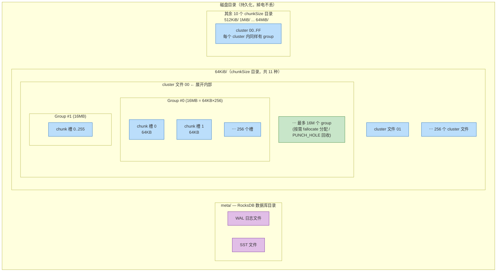
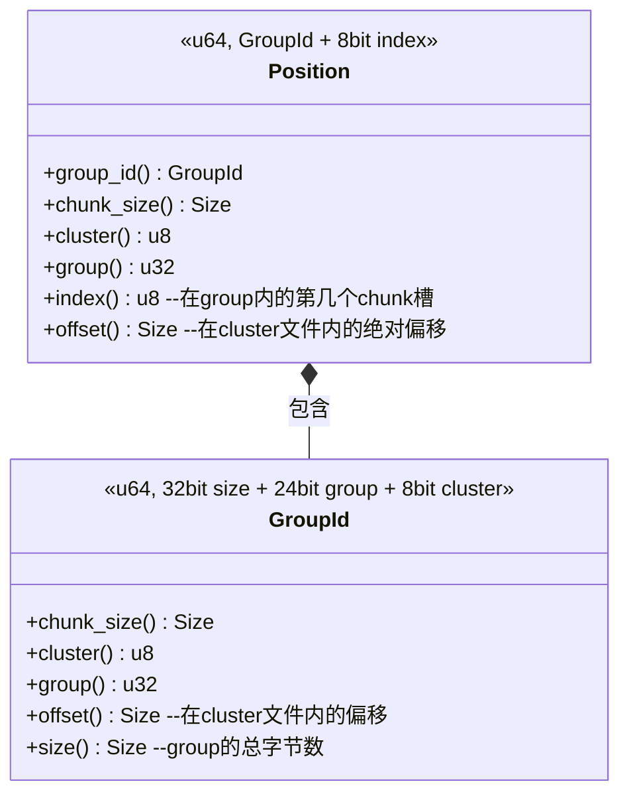
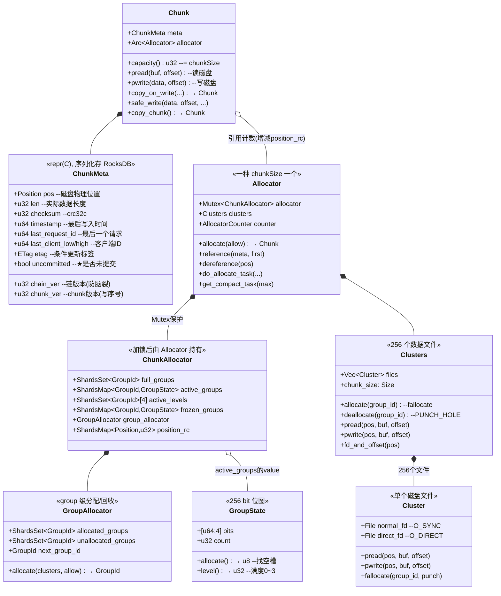
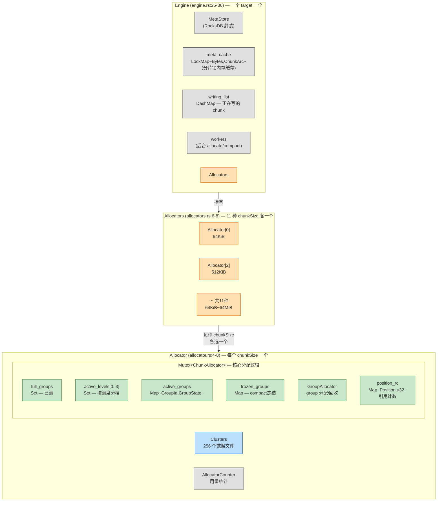
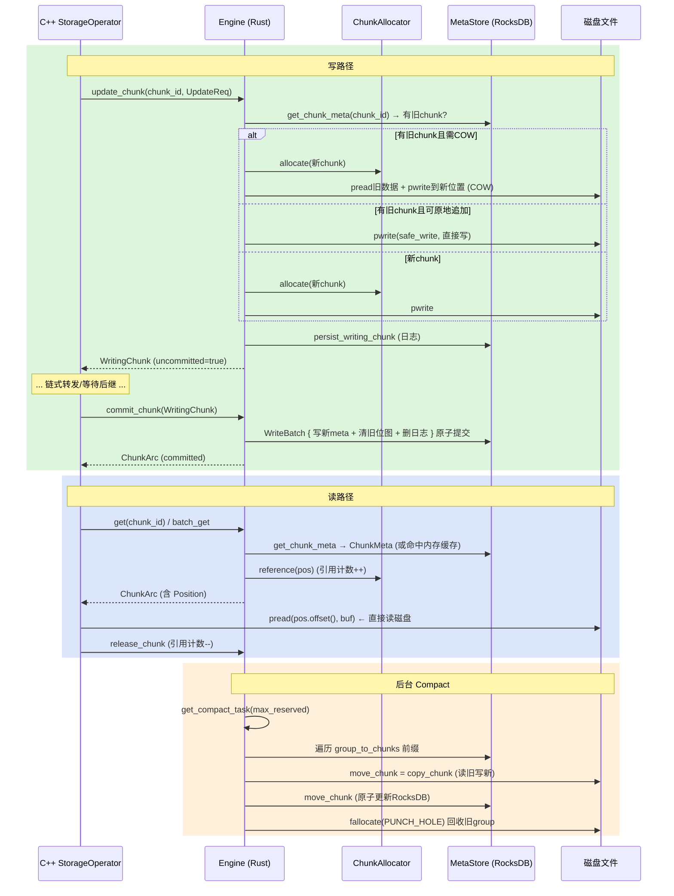

# Chunk Engine (Rust) 模块详细分析

> 阅读路线：第 1 章明白它在整个存储栈中的位置 → 第 2 章建立空间感（磁盘布局与核心数据结构）→ 第 3 章按写/读/Compact 的真实执行顺序走一遍生命周期 → 第 4 章回看机制总结 → 第 5 章参考。

## 目录

- [1. 模块定位与职责](#1-模块定位与职责)
- [2. 静态视图：磁盘布局与核心数据结构](#2-静态视图磁盘布局与核心数据结构)
  - [2.1 磁盘布局总览](#21-磁盘布局总览)
  - [2.2 Position 与 GroupId：一个 u64 定位一切](#22-position-与-groupid一个-u64-定位一切)
  - [2.3 GroupState：256 格的位图](#23-groupstate256-格的位图)
  - [2.4 Chunk 与 ChunkMeta](#24-chunk-与-chunkmeta)
  - [2.5 Allocator 层次结构](#25-allocator-层次结构)
  - [2.6 MetaStore 与 RocksDB Key 设计](#26-metastore-与-rocksdb-key-设计)
- [3. 动态视图：核心操作](#3-动态视图核心操作)
  - [3.0 全景时序图](#30-全景时序图)
  - [3.1 chunk 分配：从写请求的 size 到磁盘槽位](#31-chunk-分配从写请求的-size-到磁盘槽位)
  - [3.2 写路径：update_chunk → COW 或 safe_write → commit](#32-写路径update_chunk--cow-或-safe_write--commit)
  - [3.3 COW vs safe_write 的选择逻辑](#33-cow-vs-safe_write-的选择逻辑)
  - [3.4 读路径](#34-读路径)
  - [3.5 Compact：搬走存活 chunk、回收空洞 group](#35-compact搬走存活-chunk回收空洞-group)
  - [3.6 崩溃恢复](#36-崩溃恢复)
- [4. 核心机制速查](#4-核心机制速查)
- [5. 参考](#5-参考)
  - [5.1 FFI 接口（CXX 桥）](#51-ffi-接口cxx-桥)
  - [5.2 源码索引](#52-源码索引)

---

## 1. 模块定位与职责

Chunk Engine 是 3FS storage 服务的**本地持久化引擎**，用 Rust 实现并编译为静态库（通过 CXX 桥给 C++ 调用）。它是 storage.md 7.3 节中"新引擎"，替代了传统的 ChunkStore。

**它管理的是什么**：

```
每个 storage target 的磁盘目录下:
  <target_path>/
  ├── meta/                          ← RocksDB (chunk 元数据)
  └── 64KiB/                         ← 11 种 chunk 大小,每种一组文件
      ├── 00, 01, ..., FF            ← 256 个数据文件 (cluster)
  ├── 512KiB/
  │   ├── 00, ..., FF
  ├── 4MiB/
  └── 64MiB/
      └── ...
```

**在整条写路径中的位置**：

```
fuse/UsrbIo → StorageOperator(handleUpdate) → ChunkEngineUpdateJob
  → Chunk Engine (Rust)
      ├── update_chunk:  写数据到磁盘文件 + 写元数据到 RocksDB
      └── commit_chunk:  原子提交 RocksDB 事务
```

**与 C++ 侧的分工**：C++ 侧的 `StorageOperator` 负责 chunk 级锁、链式转发、版本校验等**协议层**逻辑；Chunk Engine 负责**数据落盘和元数据持久化**这一层。

---

## 2. 静态视图：磁盘布局与核心数据结构

### 2.1 磁盘布局总览

Chunk Engine 的东西分布在**两个世界**——磁盘上的持久化文件 + 进程内存中的运行时数据结构。这张图只画**磁盘上的**；内存中的 Allocator/缓存等在 2.5 节展开。

Group **不是磁盘上的独立文件**——它是 cluster 文件内部通过 `fallocate`/`PUNCH_HOLE` 管理的一段**逻辑空间**（一个 group = chunkSize × 256 字节），但为了展示完整的层次关系，图中展开了一个 cluster 文件的内部结构：



**磁盘层级从大到小**：

| 层级 | 例子 | 大小 | 数量 | 代码 |
|---|---|---|---|---|
| chunkSize 目录 | `64KiB/` | — | 11 种 | `constants.rs:3-8` |
| cluster 文件 | `64KiB/03` | chunkSize × 256 × 最大group数 | 每目录 256 个 | `clusters.rs:18` |
| **group**（逻辑分区） | group #42 | chunkSize × 256 = 16MB | 动态分配 | `group_id.rs:15` |
| **chunk 槽位** | 槽 #17 | chunkSize | 每 group 256 个 | `group_state.rs` |

**磁盘上实际存储的两类文件**：

| 文件 | 内容 | 谁写 |
|---|---|---|
| **chunk 数据文件**（每 chunkSize 目录 256 个） | chunk 的实际数据字节（由 Position 算出偏移直接 pwrite/pread） | `file/cluster.rs` |
| **RocksDB 文件**（meta/ 目录下的 WAL + SST） | 5 类 key-value（chunk 元数据、分配器位图、反向索引等，见 2.6 节） | `meta/rocksdb.rs` |

**注意**：group 是 cluster 文件内的一段逻辑空间，不是独立文件——分配用 `fallocate`（预留物理空间），回收用 `fallocate(PUNCH_HOLE)`（归还给文件系统），`cluster.rs:43-61`。Chunk Engine 自身的内存数据结构（Allocator/缓存/writing_list）**不在这张图里**，在 2.5 节。

### 2.2 Position 与 GroupId：一个 u64 定位一切

Chunk Engine 最巧妙的设计是：**chunk 在磁盘上的物理位置完全由一个 64 位整数表达**，不需要任何指针或文件路径。



**位编码与磁盘结构的对应关系**（`position.rs:12-16`）——每个位域直接映射到磁盘目录层级：

```
GroupId (u64) — 定位到一个 group (第三层):
┌──────────────┬──────────────┬───────────┐
│ 32bit        │ 24bit        │ 8bit      │
│ chunkSize    │ group 序号    │ cluster号 │
│ = 哪个目录   │ = 哪个 group  │ = 哪个文件 │
└──────┬───────┴──────┬───────┴─────┬─────┘
       │              │             │
       ▼              ▼             ▼
  64KiB/ 目录    group #42    cluster 文	件 03

Position (u64) — 定位到一个 chunk 槽位 (第四层):
┌──────────────┬──────────────┬───────────┬──────┐
│ 24bit        │ 8bit         │ 24bit     │ 8bit │
│ chunkSize(高)│ cluster      │ group     │ index│
│ = 哪个目录   │ = 哪个文件    │ = 哪个group│ =第几个│
└──────┬───────┴──────┬───────┴─────┬─────┴──┬───┘
       │              │             │        │
       ▼              ▼             ▼        ▼
  512KiB/ 目录   cluster 07    group #233   槽 #17
```

**换算关系**：

```
一个 group = chunkSize × 256 个 chunk 槽位    (GroupId::COUNT = 256)
chunk 在 cluster 文件内的偏移 = chunkSize × (group × 256 + index)
```

**设计价值**：Position 可以序列化为一个 u64 存进 ChunkMeta（8 字节）、可以做 RocksDB 的 key 前缀（pos_to_chunk 索引）、可以直接算出 `pread/pwrite` 的文件偏移——**零解析成本**。

### 2.3 GroupState：256 格的位图

每个 group 用一个 **256 bit 位图**（4 × u64，`group_state.rs:5`）记录哪些 chunk 槽位已占用：

```
GroupState:
  bits  = [u64 × 4]      // 256 bit 位图, 每 bit 对应一个 chunk 槽位
  count = u32             // 已占用的槽位数
```

**关键操作**：

| 方法 | 干什么 | 行号 |
|---|---|---|
| `allocate()` | 遍历 4 个 u64，找第一个 0 bit 置 1，返回槽位号 | `:56-67` |
| `level()` | `count / (TOTAL_BITS / LEVELS)` → 0~3 四个活跃度等级 | `:74-76` |
| `is_full()` / `is_empty()` | count 达到 256 / 0 | `:48-53` |

**level 的用途**：Allocator 从**最高 level**（最满的 group）优先分配——把chunk往已有数据的 group 里塞，减少空间碎片：

```
(chunk_allocator.rs:99-117)
FOR level = 3 DOWNTO 0:                        // 从最满的 level 开始
    IF active_levels[level] 非空:
        group_id = 取出第一个 group
        index = group_id 的位图找空槽 → allocate()
        RETURN Position(group_id, index)
```

### 2.4 Chunk 与 ChunkMeta



**各层职责**：

| 类 | 职责 | 代码 |
|---|---|---|
| `Chunk` | 运行时对象：持 meta + 分配器引用，提供 pread/pwrite/COW/safe_write | `chunk.rs:9-12` |
| `ChunkMeta` | 持久化元数据（RocksDB），`#[repr(C)]` 保证 C++ 透传 | `chunk_meta.rs:7-19` |
| `Allocator` | 一种 chunkSize 的分配器外壳（Mutex + Cluster 文件组 + 计数器） | `allocator.rs:4-8` |
| `ChunkAllocator` | 核心分配逻辑：group 位图管理 + level 优先 + 引用计数 | `chunk_allocator.rs:7-15` |
| `GroupAllocator` | group 级分配/回收（决定开新 group 还是回收旧 group） | `group_allocator.rs` |
| `Clusters` | 256 个 cluster 文件的管理者 | `clusters.rs:11-15` |
| `Cluster` | 单个磁盘文件（O_SYNC + O_DIRECT 双 fd） | `cluster.rs:11-14` |
| `GroupState` | 256 bit 位图，追踪一个 group 内的槽位占用 | `group_state.rs:8-11` |

`Chunk` 是 Rust 侧的运行时对象（Arc 共享），`ChunkMeta` 是**持久化到 RocksDB 的元数据**（`#[repr(C)]` 保证 C++ 侧可以透传）。`uncommitted` 标记是崩溃恢复的关键。

### 2.5 Engine 内存数据结构与 Allocator 层次

2.1 画了磁盘上的文件；本节画**进程内存中的运行时结构**（Rust 侧）。类图已在 2.4 展开，这里用布局图展示整体关系——Engine 持有五个组件，其中 Allocators 展开为 11 种 chunkSize 的分配器，每个分配器再展开内部：



**颜色语义**：灰=配置/缓存、橙=热路径入口、绿=分配器状态、蓝=磁盘 IO


### 2.6 MetaStore 与 RocksDB Key 设计

RocksDB 里存 5 类 key（`meta_key.rs:7-15`）：

| 前缀字节 | Key 格式 | Value | 用途 |
|---|---|---|---|
| `1` | `1 + !chunk_id[]` (取反) | ChunkMeta 序列化 | **主索引**：chunk → 元数据 |
| `2` | `2 + GroupId(u64 BE)` | GroupState 位图 (32B) | 分配器状态 |
| `3` | `3 + Position(u64 BE)` | chunk_id | **反向索引**：物理位置 → chunk |
| `4` | `4` | used_size | 已用空间 |
| `6` | `6 + timestamp + prefix + chunk_id` | chunk_id | 按时间查询（GC 用） |
| `9` | `9 + prefix + chunk_id` | ChunkMeta | **writing chunk 日志**（崩溃恢复） |

**为什么 chunk_id 取反**（`:28-34`）：RocksDB 默认字节序升序排列 key。chunk_id 取反后，**原始 chunk_id 越小 → 取反后越大 → 在 RocksDB 里排越后**。这样按 chunk_id 正序遍历时正好是 RocksDB 的逆序。

**add_chunk 一次写入的事务**（`meta_store.rs:143-191`）：

```
一个 WriteBatch 原子写入 6 条:
① 写 chunk_meta_key → ChunkMeta          // 主索引: chunk_id → 元数据
② 写 pos_to_chunk_key → chunk_id          // 反向索引: Position → chunk_id
③ merge group_bits_key (MergeState)       // 位图标记此槽位被占用
④ used_size += chunk_size                 // 更新用量
⑤ 写 timestamp_key → chunk_id             // 时间索引
⑥ 删 writing_chunk_key                    // 清除未提交日志 ★
```

---

## 3. 动态视图：核心操作

### 3.0 全景时序图



### 3.1 chunk 分配：从写请求的 size 到磁盘槽位

所有写操作的第一步都是**分配一个 chunk**——从 `select_by_size` 的位运算到 `GroupState` 位图找空槽，三层查找全是内存操作，只有开新 group 时才碰磁盘：

**第一层：选哪个 Allocator**（`select_by_size`，`allocators.rs:57-66`，纯位运算 O(1)）：

```
select_by_size(size):                      // allocators.rs:57-66, O(1) 位运算
  IF size ≤ 64KiB:
      RETURN vec[0]                        // 一律用最小的
  ELSE:
      n = size 向上取整到 2^n               // next_power_of_two()
      RETURN vec[n - 16]                   // 16 = CHUNK_SIZE_SHIFT (64KiB = 2^16)
```

| 你要写的量 | next_power_of_two | trailing_zeros | 数组下标 | 选中的 Allocator |
| --- | --- | --- | --- | --- |
| 1 byte | ≤64KiB | — | 0 | vec[0] = 64KiB |
| 300KB | 512KB = 2^19 | 19 | 3 | vec[3] = 512KiB |
| 1MB | 1MB = 2^20 | 20 | 4 | vec[4] = 1MiB |
| 5MB | 8MB = 2^23 | 23 | 7 | vec[7] = 8MiB |
| 64MB | 64MB = 2^26 | 26 | 10 | vec[10] = 64MiB |

**第二层：在 Allocator 内找 group**（`chunk_allocator.rs:97-120`，内存操作）：

```
ChunkAllocator 的内存状态:
  active_levels[3]: { group#7, group#42 }    ← 3/4 满
  active_levels[2]: { group#3 }
  active_levels[1]: { group#15 }
  active_levels[0]: { group#88 }              ← 几乎空

① for level in (0..4).rev()                  ← 从 3 开始倒序
     level=3 非空 → 取 group#7
② GroupState.allocate()                       ← group_state.rs:56
     位图 [u64×4] 遍历找第一个 0 bit → index=185
     置 1, count++
③ 如果 group#7 这下满了 → 移入 full_groups
   如果 count 跨越 level 边界 → 从 levels[3] 移出
④ Position::new(group#7, 185)
⑤ position_rc[Position]++ (引用计数)
```

**第三层：没有可用 active group 时的兜底**（`group_allocator.rs`）：

```
所有 active_levels 都空 →
  ① unallocated_groups 里有吗？ → 有 → fallocate 分配这个 group
  ② 没有 → next_group_id++ 分配新号 → fallocate → 写 RocksDB 登记
  ③ 在新 group 的 slot 0 放这个 chunk
```

**完整链路一图**（以 size=300KB 为例）：

```
size=300KB
  │ select_by_size(300KB)                     allocators.rs:57
  │ 300KB → next_power_of_two → 512KB → vec[3]
  ▼
Allocator[3] (512KiB 分配器)
  │ allocator.lock() → ChunkAllocator          allocator.rs:26
  ▼
  ├─ 有 active group?
  │    active_levels[3] 倒序找                 chunk_allocator.rs:99
  │    → group#7
  │    GroupState.allocate() 位图找空bit       group_state.rs:56
  │    → index=185
  │    Position::new(group#7, 185)             position.rs:13
  │    position_rc[Position]++
  │    → 返回 Chunk ✓
  │
  └─ 没有 active group?
       GroupAllocator.allocate()              group_allocator.rs
       → 新 group 或复用 unallocated
       clusters.allocate(group_id)            clusters.rs:41
       → fallocate(fd, offset, 512KB × 256)   ← 唯一碰磁盘的步骤
       → 新 group 的 slot 0 放这个 chunk
```

### 3.2 写路径：update_chunk → COW 或 safe_write → commit

`update_chunk`（`engine.rs:295-479`）是所有写操作的入口（write/remove/truncate 都走这里）。以下是简化后的核心流程：

```
update_chunk(chunk_id, req):                    // 返回 WritingChunk 或 Error

  ① 校验 checksum
     local = crc32c(data)
     IF local != req.checksum:
         RETURN Error(ChecksumMismatch)

  ② 查旧 chunk
     old_chunk = get(chunk_id) FROM meta_cache 或 RocksDB
     // old_chunk = 有值(旧chunk的Arc) 或 无值(null)

  ③ 版本校验                                    // engine.rs:351-383
     IF req.chain_ver < old.chunk_ver:  RETURN Error(ChainVersionMismatch)
     IF req.update_ver <= old.chunk_ver: RETURN Error(ChunkCommittedUpdate)
     IF req.update_ver > old.chunk_ver+1: RETURN Error(ChunkMissingUpdate)
     IF req.etag != old.etag:            RETURN Error(ChunkETagMismatch)
     // 防乱序 / 防过期 / 防脑裂

  ④ 三路分支写数据
     IF old_chunk 不存在:                       // 新 chunk
         new_chunk = allocators.allocate(offset + length)
         new_chunk.safe_write(data, offset)
     ELSE IF req.is_remove:                     // 删除
         new_chunk = old_chunk (直接引用, 不写数据)
     ELSE IF req.is_syncing                     // 同步
          OR offset < old.len                   // 覆盖写
          OR offset + len > old.capacity:       // 超出容量
         new_chunk = old_chunk.copy_on_write(data, offset)   // 分配新chunk
     ELSE:                                      // 纯追加写
         old_chunk.safe_write(data, offset)     // 原地写, 不换chunk
         new_chunk = old_chunk

  ⑤ 登记 writing_list + 写 RocksDB 日志
     writing_list[prefix][chunk_id] = { new_chunk, abort: false }
     meta_store.persist_writing_chunk(chunk_id, meta)   // RocksDB 写日志

  RETURN WritingChunk { new_chunk, commit_succ: false }   // uncommitted=true
```

**两阶段写**（与 storage.md 的 CRAQ 协议对齐）：

- `update_chunk` = 第一阶段（写数据 + 写日志，`uncommitted=true`）
- `commit_chunk`（`engine.rs:481-518`）= 第二阶段（原子提交 RocksDB 事务，`uncommitted=false`）

### 3.3 COW vs safe_write 的选择逻辑

#### 设计动机：读写无锁

Chunk Engine 的读路径**不加任何锁**——读者直接 `pread` 磁盘，不持有 chunk 锁。无锁读的安全性不靠锁保护，靠一条空间不变量：

> **读写操作永远不会碰同一个磁盘字节。**

这条不变量由三路分支保障：追加写走 safe_write（新旧数据物理不重叠），覆盖写走 COW（写到全新位置，旧位置不动）。选择哪条路的判断，本质是判断"这次写入会不会与可能正在进行的读发生空间重叠"。

#### 三路分支（`engine.rs:386-434`）

| 条件 | 走哪条路 | 空间重叠分析 |
|---|---|---|
| `is_remove` | 直接 clone | 不写数据，无重叠 |
| `is_syncing` | **COW** | 同步数据来自源端，可能覆盖任意 offset；且源端给的是完整数据，不需要与本地旧数据合并（`skip_read=true`） |
| `offset < old.len`（覆盖写） | **COW** | ★**新旧数据在物理上重叠**——如果原地写，正在读旧数据的读者会读到混合体 |
| `offset + len > capacity` | **COW** | 当前 chunk 容量不够，必须分配更大的 |
| 其余（追加写） | **safe_write** | ★**新数据写在旧数据之后，物理上不重叠**——读者读 [0, old.len)，写者写 [old.len, new_len)，天然无竞争 |

#### COW 的"覆盖"是引用切换，不是物理覆盖

```
COW:                                safe_write:
旧 chunk → 物理位置A [旧数据]        旧 chunk → 物理位置P [旧数据+追加]
新 chunk → 物理位置B [合并后数据]              ↑ pwrite 追加在这里
                                              与旧数据不重叠 ✓
commit 前:
  RocksDB: chunk_id → 位置A (不动)   写的那一刻旧数据完好
  正在读位置A的读者 → 安全 ✓
commit 后:
  RocksDB: chunk_id → 位置B (切指针)
  新读者读B, 已持有A引用的旧读者继续读A
  引用计数归零后才真正释放位置A
```

#### COW 内部（`chunk.rs:89-174`）

```
① allocate 新 chunk (大小 = max(旧len, offset+len) 的 next_power_of_two)
② IF NOT (is_syncing OR 从头覆盖):
     pread 旧 chunk 全部数据到线程本地 buffer        ← 需要合并旧数据
   ELSE:
     skip_read = true (源端给了完整数据, 不需要读旧的)
③ 把新数据 memcpy 进 buffer 的对应位置
④ pwrite 整个 buffer 到新 chunk 的物理位置
⑤ IF skip_read:
     直接用传入的 checksum                            ← 源端校验和
   ELSE:
     重算 crc32c(buffer 全量)                        ← 联合校验和
```

#### safe_write 内部（`chunk.rs:176-270`）— 按对齐情况分三种

```
情况A: 全对齐 (len/offset/buf 都是4KB对齐) — 最快路径
  IF offset > old.len:                            (中间有空洞)
     pwrite(ZERO 填充, old.len → offset)
  pwrite(data, offset)                             直接写磁盘
  checksum = crc32c_combine(old_checksum, data)    拼接校验和, 不重算

情况B: 部分不对齐
  copy 到线程本地 buffer → 对齐化 → 一次 pwrite     避免多次小IO
  checksum 重算
```

#### 性能对比

| | safe_write | COW |
|---|---|---|
| 磁盘 IO | 1 次 pwrite（只写新数据） | 1 次 pread（读旧数据）+ 1 次 pwrite（写整个chunk） |
| 内存分配 | 不分配新 chunk | 分配新 chunk（位图操作 + 引用计数） |
| checksum | crc32c_combine 拼接（O(新增数据)） | 全量重算（O(整个chunk)）或源端直接给 |
| chunk 元数据 | pos 不变，只更新 len/checksum | pos 换新，旧 chunk 等待回收 |
| 适用场景 | 顺序追加（fuse writeBuf 聚合后的 flush） | 随机覆盖 / 同步 / 超容量扩展 |

**追加写的性能优势是 fuse 侧聚合的下游收益**：fuse 把多次小写攒成一次大 flush 后，到 Chunk Engine 的写入几乎总是纯追加（offset = old.len），走 safe_write 的最快路径（情况A：对齐 + 直接 pwrite + 拼接 checksum）。

### 3.4 读路径

读路径非常轻量（`engine.rs:184-209`）——Rust 侧**不做读 IO**，只负责查元数据和引用计数：

```
get(chunk_id)
  ① 查 meta_cache (内存缓存, 分片 LockMap) → 命中直接返回
  ② 未命中 → RocksDB get → ChunkMeta → allocator.reference(pos) → 入缓存
  → 返回 ChunkArc (含 Position)

C++ 侧拿到 ChunkArc 后，有两种读法:

  读法A: 通过 Rust 侧封装 → Chunk.pread(buf, offset)
         Rust 内部调 pread 系统调用, 数据读到调用方给的 buf

  读法B: 通过 FdAndOffset → clusters.fd_and_offset(pos)
         Rust 只返回 { fd: O_DIRECT 的文件描述符, offset: 磁盘偏移 }
         C++ 自己调 pread(fd, offset, 目标buffer)
```

**两种读法的实际使用场景**：

| 场景 | 走哪种 | 目标 buffer 是什么 | 数据路径 |
|---|---|---|---|
| **客户端读（UsrbIo）** | **读法B** (FdAndOffset) | 客户端 RPC 带来的 RDMARemoteBuf（应用共享内存的 RDMA 远端地址） | 磁盘 → DMA → 应用共享内存 ★零拷贝 |
| **客户端读（FUSE）** | **读法B** (FdAndOffset) | fuse 进程 RDMA 池缓冲的远端地址 | 磁盘 → DMA → fuse RDMA 池缓冲 → fuse_reply_buf → 内核 |
| **ResyncWorker 同步** | **读法A** (Chunk.pread) | 本地临时 buffer | 磁盘 → 本地 buffer → 发给后继 |
| **checksum 校验 / COW 搬旧数据** | **读法A** (Chunk.pread) | 线程本地 AlignedBuffer | 磁盘 → 本地 buffer |

**读法B（FdAndOffset 零拷贝）的数据流**——以 UsrbIo 读为例：

```
应用: prep_io(读文件 [0, 1MB) 到共享内存)
  → fuse worker → BatchReadReq { chunk_id, remote_buf = RDMABuf }
  → storage 收到 → C++ doRead:
      ① Rust: get(chunk_id) → ChunkArc
      ② Rust: fd_and_offset(pos) → { fd, offset }
      ③ C++: pread(fd, offset, remote_buf_ptr)
         磁盘 → DMA → 应用共享内存  ← 唯一一次 IO, 无中间拷贝
      ④ RDMA 完成通知 → 写 CQE → 应用收割
```

**注意**：3FS 集群内部所有通信都走 RDMA（InfiniBand/RoCE），没有 TCP 回退——零拷贝设计完全依赖 RDMA 硬件（无 RDMA 环境最低可用 Soft-RoCE 跑通功能）。

### 3.5 Compact：搬走存活 chunk、回收空洞 group

#### 为什么要 Compact——碎片的产生过程

碎片来自 **COW 和 chunk 删除**：

```
初始: group#7 有 256 个 chunk 槽位全部占用 (16MB, 假设 chunkSize=64KB)
      ┌─────────────────────────────────────────┐
      │ ■■■■■■■■■■■■■■■■■■■■■■■■■■■■■■■■■■■■■■ │  256/256 (full)
      └─────────────────────────────────────────┘

用户覆盖写了其中 100 个 chunk → 每次都走 COW:
  COW: 旧 chunk 的引用计数降为 0 → 位图置 0 → 槽位"空闲"
       新 chunk 被分配到别的 group

结果: group#7 只剩 156 个存活 chunk, 100 个空槽
      ┌─────────────────────────────────────────┐
      │ ■■■□□□■■■□□■■□□□■■■■□□□□■■■□□□■■■■□□ │  156/256 (level 2)
      └─────────────────────────────────────────┘
       但磁盘上这 16MB 空间仍然被 fallocate 预留!
       空槽 100 个 × 64KB = 6.4MB 被浪费 ← 碎片
```

**单个 group 无法自我回收**：group 是 `fallocate` 预留的一段连续空间，只要还有 1 个存活 chunk，整段 16MB 就不能 `PUNCH_HOLE`。只有把存活 chunk 全部搬走才能归还。

#### 什么时候 Compact——谁来触发、什么条件下触发

**Compact 不是 Rust 侧自动跑的后台线程**——它是一个被动方法（`pub fn compact_groups`），由 **C++ storage 服务的后台任务**通过 FFI 主动调用：

```
C++ storage 服务启动
  → 启动后台 worker (storage.md 第 10 章的后台任务)
     → 周期性调用 Rust FFI: compact_groups(max_reserved)
        → Rust: get_compact_task()         ← 判断碎片是否够多
        → Rust: 遍历 + move_chunk          ← 搬数据
        → Rust: finish_compact_task()      ← 解冻或确认回收
```

**触发条件**（`chunk_allocator.rs:207-223`）：

```
get_compact_task(max_reserved):
  reserved = counter.reserved_chunks()        // 全局统计: 所有 group 的空槽总数
  IF reserved <= max_reserved:
      RETURN None                             // 碎片不够多, 不 compact
      // max_reserved 是阈值, 由 C++ 侧配置传入

  FOR level IN active_levels[0..3]:           // 从最空的 level 开始找
      IF active_levels[level] 非空:
          group_id = 取出第一个
          从 active_groups 移到 frozen_groups  ★冻结!
          RETURN group_id                     // 这就是要 compact 的 group
```

两步判断：① 全局空槽数超过阈值才启动；② 从最空的 level（碎片最多的 group）开始搬。

**冻结的机制与意义**：

```
冻结前:
  active_levels[2]: { group#3, group#7 }     ← allocate() 从这里找
  active_groups:   { group#3: 位图, group#7: 位图 }

冻结 group#7 后 (chunk_allocator.rs:216-217):
  active_levels[2]: { group#3 }              ← group#7 被移除了
  active_groups:   { group#3: 位图 }
  frozen_groups:   { group#7: 位图 }          ← 移到这里, 位图数据还在!

效果:
  allocate() → 遍历 active_levels → 找不到 group#7 → 不会再往这个 group 分配新 chunk ✓
  reference(pos) / dereference(pos) → 在 frozen_groups 里也能查到 → 已有 chunk 照常读写 ✓

为什么要冻结:
  compact 正在把 group#7 的 chunk 一个一个搬到别的 group
  如果不冻结, 搬到一半又有新的 allocate() 往 group#7 分配了新 chunk
  → compact 结束后 group#7 又不空了 → 白搬了
```

**compact 完成后解冻**（`finish_compact_task`，`chunk_allocator.rs:225-233`）：

```
finish_compact_task(group#7):
  IF group#7 还在 frozen_groups 里:
      // 说明还有存活 chunk 没搬走 (compact 失败或部分完成)
      → 放回 active_levels + active_groups    ← 解冻, 恢复正常分配

  IF group#7 不在 frozen_groups 里:
      // 说明全部搬走了, group 已被回收
      // (位图清空 → group_allocator.deallocate → PUNCH_HOLE)
      → 什么都不做 (group 已经不存在了)
```

#### 具体怎么 Compact（`engine.rs:117-138`）

```
compact_groups(max_reserved):

  ① 领取任务
     group_id = get_compact_task(max_reserved)
     // 如果 reserved <= max_reserved → 返回空, 不 compact

  ② 遍历该 group 里的所有存活 chunk
     // RocksDB 按 pos_to_chunk 前缀扫描 (3 + Position 前缀)
     // 可以精确找到"物理位置在这个 group 内"的所有 chunk_id
     FOR each chunk_id IN group:
         move_chunk(chunk_id)                 // engine.rs:226-248

  ③ 完成任务
     finish_compact_task(group_id)           // chunk_allocator.rs:225-233
     // 如果 frozen_groups 里还有这个 group → 放回 active (compact 失败, 有 chunk 没搬走)
     // 如果 frozen_groups 里没有 → 说明全部搬走了, group 已被回收
```

**move_chunk 的内部**（`engine.rs:226-248`）——搬一个 chunk 的完整过程：

```
move_chunk(chunk_id):
  ① old_chunk = get(chunk_id)                 // 从缓存/RocksDB 拿到旧chunk
     // 这一步会把 old_chunk 的引用计数 +1 (读 hold)

  ② new_chunk = old_chunk.copy_chunk()         // chunk.rs:65-87
     ├─ allocate 一个新 chunk (在别的 group 分配新槽位)
     ├─ pread 旧 chunk 的全部数据到线程本地 buffer
     ├─ pwrite buffer 到新 chunk 的物理位置
     └─ 复制 meta (保留 len/checksum/版本号, 只换 pos)

  ③ 原子切换 RocksDB:
     在 meta_cache 的锁保护下:
     IF entry.get() 还是 old_chunk (没被其他人更新):
         meta_store.move_chunk(chunk_id, old.meta, new.meta)  // 原子事务
         entry.insert(new_chunk)        // 缓存切到新 chunk
     ELSE:
         RETURN None                   // 被其他人更新了, 不搬

  ④ 旧 chunk 的引用计数 -1 (① 中 hold 的释放)
     如果降为 0 → 位图置 0 → 槽位空闲

  当 group 里所有 chunk 都搬走后:
     group 的位图全空 → group_allocator.deallocate(group_id) → 放回空闲池
     clusters.deallocate(group_id) → fallocate(PUNCH_HOLE)  ← 磁盘空间归还
```

**move_chunk 在 RocksDB 里的事务**（`meta_store.rs:205-260`）：

```
一个 WriteBatch 原子写入:
  ① 写 chunk_meta_key → 新的 ChunkMeta (pos 换新)
  ② 写 pos_to_chunk_key(新pos) → chunk_id (新反向索引)
  ③ 删 pos_to_chunk_key(旧pos) (旧反向索引)
  ④ merge group_bits_key(新group) (新 group 位图 +1)
  ⑤ merge group_bits_key(旧group) (旧 group 位图 -1)
  ⑥ 更新 used_size
```

#### Compact 与正常读写的关系

```
compact 期间, 被冻结的 group 里的 chunk 仍然可以正常读写:
  frozen_groups 里有这个 group 的位图 → reference/dereference 正常工作
  pread/pwrite 直接操作磁盘文件, 不受 compact 影响

move_chunk 是原子的:
  要么成功 (RocksDB 切换到新 Position)
  要么失败 (chunk 被其他人更新了, 放弃搬家)
  不会出现"数据在新旧两个位置各有一半"的状态
```

### 3.6 崩溃恢复

#### 问题：崩溃时留了什么脏数据

写路径是两阶段的（3.2 节）——`update_chunk` 先写数据和日志（`uncommitted=true`），`commit_chunk` 再原子提交。如果进程在两阶段之间崩溃：

```
崩溃前某个 chunk 的状态:
  磁盘数据文件: [新数据已写入]               ← pwrite 已经落盘了
  RocksDB:
    chunk_meta_key → ChunkMeta { uncommitted: true }   ← 有主索引, 但标记为未提交
    writing_chunk_key → ChunkMeta { uncommitted: true } ← ★有崩溃日志

如果不做恢复的后果:
  - 磁盘上有数据, RocksDB 里也有元数据 → chunk "看起来存在"
  - 但它是未提交的 → 可能只有部分数据 (COW 搬了一半)
  - 后续读 → 可能读到不完整数据 ✗
  - 后续写 → update_chunk 检查 writing_list
    发现"正在写" → 报错 "chunk is in writing" ✗ 永远写不进去!
```

#### `Engine::open`（`engine.rs:31-75`）的恢复流程

```
open():
  ① MetaStore::open                          -- 打开 RocksDB
  ② occupy_uncommitted_positions()             -- 扫描 writing_chunk_key 前缀
     → 找到所有 uncommitted=true 的 chunk
  ③ Allocators::new                           -- 从 RocksDB 加载分配器状态
  ④ 对每个未提交 chunk (engine.rs:58-68):
     FOR (chunk_id, meta, _) IN uncommitted_chunks:
         old_chunk = get(chunk_id)            -- 查是否有旧版本
         allocator = select_by_pos(meta.pos)  -- 找到对应的分配器
         chunk = allocator.reference(meta.pos) -- 引用计数 +1 (锁住位置)
         writing_list[prefix][chunk_id] = { chunk, abort: true }
                                              -- ★放入 writing_list 并标记 abort
  ⑤ vacate_uncommitted_positions()             -- 清除 RocksDB 里的崩溃日志
  ⑥ upgrade_version()                          -- 版本迁移
```

#### `abort: true` 如何解除写入死锁

关键在 `update_chunk` 的 writing_list 三路检查（`engine.rs:443-465`）：

```
update_chunk 尝试写某个 chunk_id 时:

  情况A: writing_list 里没有
    → 正常情况, 插入并继续写入

  情况B: 有, 且 abort = false
    → 另一个协程正在写 (互斥保护)
    → 返回 Error("chunk is in writing") ✗ 拒绝

  情况C: 有, 且 abort = true            ★崩溃恢复后的状态
    → 没有真人在写, 只是之前没 commit 的残留
    → 允许覆盖! 替换为新的 WritingHolder
    → 写入正常继续 ✓
```

#### Drop（RAII）与崩溃恢复的关系——互补，各管一种故障

**Drop 处理进程存活时的异常退出；崩溃恢复处理进程死亡后的磁盘残留。**

| | Drop (RAII) | 崩溃恢复 (Engine::open) |
|---|---|---|
| **解决的故障** | 函数出错 / 协程 cancel（进程还活着） | 进程死亡（SIGKILL / 段错误 / 断电） |
| **触发时机** | WritingChunk 离开作用域的那一刻 | 下次启动时 |
| **处理什么** | 内存中的 writing_list | RocksDB 磁盘上的 uncommitted 日志 |
| **Drop 会执行吗** | ✅ 会——Rust 保证不管正常还是异常退出都执行 | ❌ 不会——内存已消失 |
| **结果** | abort=true 或移除条目 | 重建 writing_list + abort=true |
| **需要重启吗** | 不需要 | 需要重启 |

**正常运行时 Drop 的三种触发点**（`writing_chunk.rs:35-50`）：

```
update_chunk() 创建 WritingChunk → writing_list 插入条目

  触发点1: commit_chunk() 正常完成
    → commit_succ = true → 函数结束 → ★ Drop → 移除 writing_list 条目
    → 业务含义: 写入完成, 解锁

  触发点2: update/commit 内部出错 → return Err
    → commit_succ = false (默认值) → 函数提前结束 → ★ Drop → abort=true
    → 业务含义: 允许后续覆盖

  触发点3: 协程被 cancel
    → 同上 → ★ Drop → abort=true
    → 业务含义: 允许后续覆盖

Drop 由 Rust 编译器自动插入调用, 不需要手动调
C++ 侧不需要知道 Drop 的存在——它只调 FFI 函数 (commit/release),
FFI 函数内部 Rust 拿回所有权后, 函数结束时 Drop 自动执行
```

**崩溃时 Drop 不会执行**——内存全部消失，writing_list 不存在了。但 RocksDB 磁盘上还有 `writing_chunk_key` 日志，所以需要 `Engine::open` 的崩溃恢复流程（上文的 ② ~ ⑤ 步）来补做：**重建 writing_list 并标记 abort=true，达到与 Drop 相同的效果**。

一句话总结：**Drop 是“实时保险”（进程存活时异常退出不泄漏），崩溃恢复是“事后补救”（重启时补建 abort 标记）——两者最终导向同一个状态：writing_list 里有 abort=true 的条目，后续写入不会被 "chunk is in writing" 卡住。**

#### 恢复后的三种结局

```
崩溃残留的 chunk (abort=true) 后续:

  结局1: 有人再次写这个 chunk_id
    → abort=true → 允许覆盖 → 正常 commit → 旧槽位回收

  结局2: 有人读这个 chunk_id
    → get() 正常返回 ChunkMeta (数据在磁盘上)
    → C++ 侧版本校验发现 chunk_ver 不匹配 → 上层处理

  结局3: 一直没人碰
    → 磁盘空间被占用 (引用计数为 1)
    → 等 GC / 上层删除 → 引用归零 → 槽位回收
```

#### 为什么恢复后立即清 RocksDB 日志

如果不清，下次重启会重复扫描、重复恢复。清掉后 RocksDB 干净了，但 `writing_list`（**内存级**）里的 `abort=true` 仍然有效——进程退出就消失，不影响下次启动。

---

## 4. 核心机制速查

| 机制 | 一句话 | 代码位置 |
|---|---|---|
| **Position 一个 u64 定位一切** | chunkSize(24b)+cluster(8b)+group(24b)+index(8b)；零解析成本直接算磁盘偏移 | `position.rs:7-43` |
| **11 种 chunk 大小** | 64KiB 到 64MiB（2^n），每种独立的分配器和 cluster 文件 | `constants.rs:3-8` |
| **Group = 256 chunk 槽** | 一个 group 256 个等大 chunk 槽位，位图管理 | `group_state.rs:5-11` |
| **level 优先分配** | 从最满的 level 开始分配（往已有数据的 group 里塞），减少碎片 | `chunk_allocator.rs:99` |
| **COW vs safe_write** | 覆盖写/超容量走 COW（新 chunk）；追加写走 safe_write（原地） | `engine.rs:386-434` |
| **两阶段写** | update_chunk（写数据+日志，uncommitted）→ commit_chunk（原子 RocksDB 事务） | `engine.rs:295/:481` |
| **writing_list 追踪** | DashMap 按 prefix 分片，记录正在写的 chunk；abort=true 允许覆盖崩溃残留 | `writing_chunk.rs:10` |
| **meta_cache** | LockMap 分片锁缓存，get 优先查缓存，未命中走 RocksDB | `engine.rs:32/:184` |
| **Compact = move_chunk** | 把存活 chunk 搬到新 group → PUNCH_HOLE 回收旧 group 空间 | `engine.rs:117-138` |
| **崩溃恢复** | 扫 writing chunk 日志 → 恢复引用 → 标记 abort=true 等待覆盖 | `engine.rs:42-77` |
| **chunk_id 取反做 key** | 使 RocksDB 字节序 = chunk_id 降序 | `meta_key.rs:28-34` |
| **PUNCH_HOLE 回收** | fallocate(FALLOC_FL_PUNCH_HOLE) 归还物理空间给文件系统 | `cluster.rs:9/:43-61` |
| **引用计数** | position_rc: ShardsMap<Position, u32>；read hold +1, release -1; 归零可回收 | `chunk_allocator.rs:13` |

---

## 5. 参考

### 5.1 FFI 接口（CXX 桥）

`cxx.rs`（604 行）通过 [CXX](https://cxx.rs/) 框架暴露给 C++ 侧调用：

| Rust 函数 | C++ 侧对应 | 说明 |
|---|---|---|
| `create(path, ...)` | `createEngine()` | 打开 Engine |
| `get_raw_chunk(id)` | `getChunk()` | 查单个 chunk |
| `get_raw_chunks(reqs)` | `batchGetChunks()` | 批量查 |
| `update_raw_chunk(id, req)` | `updateChunk()` | 第一阶段写 |
| `commit_raw_chunk(chunk, sync)` | `commitChunk()` | 第二阶段提交 |
| `query_raw_chunks(begin, end)` | `queryChunks()` | 范围查询 |
| `release_raw_chunk(ptr)` | `releaseChunk()` | 释放 Arc 引用 |
| `compact_groups()` | — | 后台 Compact |

**错误码映射**（`cxx.rs:153-166`）：Rust 的 Error enum 映射到 C++ 侧的 StorageCode（如 `ChainVersionMismatch → 4081`）。

### 5.2 源码索引

| 文件 | 行数 | 职责 |
|---|---|---|
| `core/engine.rs` | 1705 | Engine 主入口：get/update/commit/compact/崩溃恢复 |
| `meta/meta_store.rs` | 878 | MetaStore：RocksDB 封装、WriteBatch 事务 |
| `cxx.rs` | 604 | CXX FFI 桥 |
| `meta/rocksdb.rs` | 314 | RocksDB 原始封装 |
| `alloc/chunk.rs` | 312 | Chunk 运行时对象：COW/safe_write/pread/pwrite |
| `alloc/chunk_allocator.rs` | 304 | 位图分配器：GroupState 管理 + level 优先 |
| `alloc/allocator.rs` | 258 | Allocator 外壳（Mutex + Cluster + Counter） |
| `meta/meta_key.rs` | 217 | RocksDB key 编码 |
| `alloc/allocators.rs` | 200 | 11 种 chunk 大小的分配器数组 |
| `alloc/group_allocator.rs` | 190 | group 级分配/回收（fallocate/PUNCH_HOLE） |
| `file/cluster.rs` | 176 | 单个数据文件：O_SYNC/O_DIRECT 双 fd、pread/pwrite |
| `file/clusters.rs` | 118 | 256 个 cluster 文件管理 |
| `types/group_state.rs` | 163 | 256 bit 位图 |
| `types/position.rs` | 117 | Position（u64 编码） |
| `types/group_id.rs` | 114 | GroupId（u64 编码） |
| `types/chunk_meta.rs` | 85 | ChunkMeta（序列化结构） |
| `alloc/writing_chunk.rs` | 124 | WritingChunk + Drop 的 abort 机制 |
