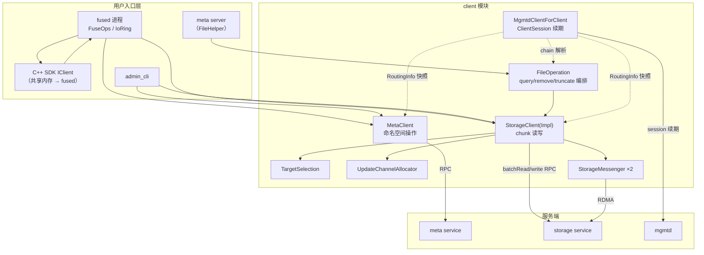
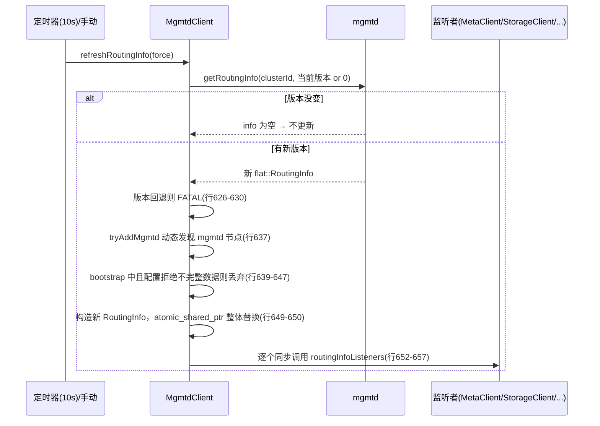
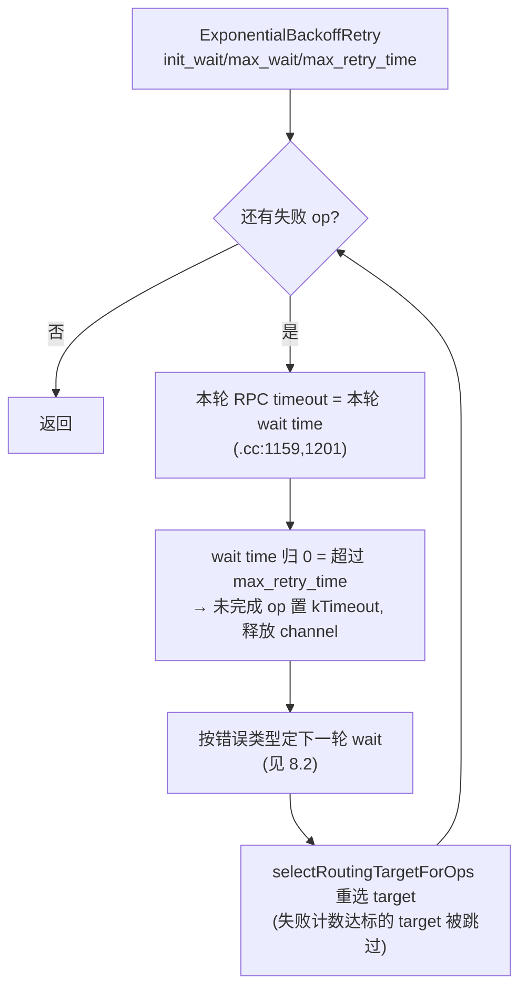

# Client 模块设计与实现全景

> 对应代码：`src/client/`。本文所有结论附文件路径和行号，基于 feature/learning 分支。
> 前置阅读：`docs/overview.md`（全局架构）、`docs/mgmtd.md`（服务端）、`docs/meta.md`（服务端）、`docs/storage.md`（服务端）。

## 目录

- [0. 开篇：client 模块是什么](#0-开篇client-模块是什么)
- [1. 总体架构：三个子客户端 + 用户入口层](#1-总体架构三个子客户端--用户入口层)
- [2. MgmtdClient：集群视图的唯一入口](#2-mgmtdclient集群视图的唯一入口)
- [3. MetaClient 概览](#3-metaclient-概览)
- [4. StorageClient：接口与核心概念](#4-storageclient接口与核心概念)
- [5. 读流程端到端](#5-读流程端到端)
- [6. 写流程端到端](#6-写流程端到端)
- [7. TargetSelection：选哪个 target](#7-targetselection选哪个-target)
- [8. 重试与容错](#8-重试与容错)
- [9. 并发控制与流量整形](#9-并发控制与流量整形)
- [10. FileOperation：chunk 管理的编排器](#10-fileoperationchunk-管理的编排器)
- [11. StorageClientInMem：内存模拟实现](#11-storageclientinmem内存模拟实现)
- [12. admin CLI 与周边工具](#12-admin-cli-与周边工具)
- [13. 配置参考](#13-配置参考)
- [14. 附录：源码索引](#14-附录源码索引)

---

## 0. 开篇：client 模块是什么

### 0.1 在 3FS 中的位置

3FS 有三类服务进程：mgmtd（集群管理）、meta（元数据）、storage（数据）。**client 模块是这些服务的客户端 SDK**，被两类使用者共享：

1. **fused 进程**（FUSE 文件系统 + UsrbIo 服务）：挂载文件系统的用户态进程，同时使用 MgmtdClientForClient、MetaClient、StorageClient；
2. **服务进程自己**：meta server 用 `MgmtdClientForServer` 发心跳、用 StorageClient 查文件长度/删 chunk；storage server 用它互相转发更新（`StorageMessenger`，见 `docs/storage.md`）。

所以 client 模块的代码质量直接影响所有进程，它是"数据面绕开 meta"这个核心设计的执行者——客户端拿到 Layout 后**直连 Storage 读写**，mgmtd/meta 都不在数据路径上。

### 0.2 目录结构

| 子目录 | 内容 | 规模 |
| --- | --- | --- |
| `src/client/mgmtd/` | MgmtdClient + RoutingInfo + 三种角色接口 | ~1600 行 |
| `src/client/meta/` | MetaClient + ServerSelectionStrategy | ~1700 行（已在 `docs/meta.md` 第 10 章分析） |
| `src/client/storage/` | StorageClient 及实现（**本模块核心**） | ~4400 行 |
| `src/client/core/` | CoreClient：admin_cli 访问 fused 进程 CoreService 的桥接器（`CoreClient.h:16-32`），与 MgmtdClient 无关 | 1 个头文件 |
| `src/client/cli/`、`bin/` | admin_cli 命令实现与入口 | 略（12 章） |
| `src/client/trash_cleaner/` | Rust 独立工具：周期清理 trash 目录中到期的文件 | 略 |

另有 chunk 编排器 `FileOperation`——注意它在 `src/fbs/meta/FileOperation.h/.cc`，不在 `src/lib/`（10 章）。

### 0.3 核心设计三句话

1. **RoutingInfo 拉模式**：集群视图（节点/链/链表/target）由 MgmtdClient 定期拉取、版本比对、写时复制整体替换；所有子客户端共享这一份快照。
2. **读写路径不对称**：读默认 LoadBalance 随机选 target 批量并行发；写固定发 chain **head**，CRAQ 链式复制对客户端完全透明（客户端的 updateVer 恒为 0）。
3. **两级重试**：传输层不重发（sendRetryTimes=1），重试全部在 StorageClientImpl 的外环完成——指数退避、失败计数、下一轮重选 target（failover）。

---

## 1. 总体架构：三个子客户端 + 用户入口层

### 1.1 组件关系图



三个子客户端都依赖同一个 MgmtdClient 的 RoutingInfo 快照（`ICommonMgmtdClient.h:10-39` 的 `getRoutingInfo`/`addRoutingInfoListener`），这是它们对集群认知的唯一来源。

这样分层的好处：集群视图只需拉取和维护一份；三类服务（元数据/数据/集群管理）的客户端互相独立、故障不传染——StorageClient 的连接问题不会影响心跳，meta 全挂时数据面已有的 IO 依然能完成。

| 子客户端 | 依赖的 RoutingInfo 内容 | 服务发现方式 | 备注 |
| --- | --- | --- | --- |
| MetaClient | 活跃 meta 节点列表 | `ServerSelectionStrategy`（默认 RandomFollow）任选一个，服务端负责转发 | `docs/meta.md` 第 10 章 |
| StorageClient | chains/targets/nodes | 按 Layout 算出 chain，选 target 后按 NodeId 直连 | 数据面，本文主体 |
| MgmtdClientForClient | 自身 | 种子地址 + 动态发现 primary | 2 章 |

---

## 2. MgmtdClient：集群视图的唯一入口

实现集中在 `MgmtdClient.cc` 的 `MgmtdClient::Impl`（`MgmtdClient.cc:116`），对外方法都是薄转发（`MgmtdClient.cc:797-997`）。

### 2.1 三种角色：不同进程对 mgmtd 的需求不同

先想一个问题：meta server、fused 进程、admin_cli 都要连 mgmtd，但它们想要的东西完全不同——

- **meta/storage 这类服务进程**需要持续宣告"我活着"（心跳），集群才能把流量路由给它；它还需要接收配置热更新；
- **fused 这类文件系统客户端**不需要心跳（它不是被路由的目标），但需要续期 ClientSession，为自己的写会话保命（2.4 节）；
- **admin_cli 这类管理工具**两条周期任务都不需要——它是人操作的，不存在"失联"一说——但它需要全部管理写操作（改 chain、下线 target、改配置……）。

3FS 没有为三种使用者写三个客户端，而是**一个 `MgmtdClient` 实现 + 三个薄包装**，包装的全部工作就是预设不同的默认开关（`MgmtdClient.h:14-26` 的配置项）：

| 包装 | 预设行为 | 接口位置 |
| --- | --- | --- |
| `MgmtdClientForServer` | RoutingInfo 刷新 ✅ + 心跳 ✅ | `MgmtdClientForServer.h:9-33` |
| `MgmtdClientForClient` | RoutingInfo 刷新 ✅ + session 续期 ✅ | `MgmtdClientForClient.h:9-29` |
| `MgmtdClientForAdmin` | 周期任务全部关闭，暴露全部管理操作 | `MgmtdClientForAdmin.h:9-16`、`IMgmtdClientForAdmin.h:10-56` |

这个设计的好处：心跳/续期/刷新的公共实现只有一份（都在 Impl 里），角色只是"出厂设置"；进程类型选错包装，行为立刻不对（比如 meta 错用了 ForClient，就不会发心跳，mgmtd 会认为它下线）。

所有角色的公共能力（拉取 RoutingInfo、注册监听、查配置等）定义在 `ICommonMgmtdClient.h:10-39`，三个周期任务的开关和间隔都是可热更新配置（默认均 10s）。

### 2.2 寻址与 primary 发现

配置的 `mgmtd_server_addresses` **只是种子**：初始化时全部映射为 nodeId 0（UNKNOWN，`MgmtdClient.cc:459-476`），之后：

1. `probePrimary` 用 DFS 逐个调 `getPrimaryMgmtd` 探测，递归深度上限 3（`MgmtdClient.cc:480-537`）；
2. 过程中遇到的新 mgmtd 节点通过 `tryAddMgmtd` 动态加入本地列表（`MgmtdClient.cc:593-599`）——客户端能自动感知 mgmtd 集群扩容；
3. 请求打到非 primary 节点时返回 `kNotPrimary`，错误消息里携带真正的 primary nodeId，客户端解析后重新探测（`MgmtdClient.cc:145-155`）；网络错误则 `switchAddr` 换同节点的另一个地址（`MgmtdClient.cc:104-107`）。`withRetry` 的重试只做一次（`retried` 标志，`MgmtdClient.cc:170-189`）。

### 2.3 actor 串行模型：所有 mgmtd 操作排队执行

MgmtdClient 被很多地方调用：用户代码发管理 RPC、定时器每 10s 刷一次 RoutingInfo、再每 10s 发一次心跳或续期。

但不管调用来自谁，**所有到 mgmtd 的请求都进同一条队列，由唯一一个后台协程逐个执行**。这个协程就是 actor（`MgmtdClient.cc:378-420`）：

- 在 `start()` 时被调度到后台执行器（`.cc:216-222`）；
- 之后永远循环做一件事：取一个工作项 → 执行 → 把结果交还 → 取下一个。

```text
调用方 A ─┐                        ┌─> 结果交还 A
调用方 B ─┼─> [ 工作项队列 ] ─> actor 协程（唯一）
定时器   ─┘    （容量 100）        └─> 结果交还 B、定时器...
```

#### 先跟着一次调用走一遍

假设用户代码调了 `getConfig()`，接下来发生的事：

1. **请求被包装，不是直接发出去。** getConfig 内部把"要执行的操作"打包成一个工作项（CallableWorkItem——一个带方法名的 lambda，`MgmtdClient.cc:59-66`），同时创建一对 promise/future 当作回执（`.cc:38-43`）。
2. **工作项入队，调用方拿回执走人。** 入队成功后，调用方协程在回执上挂起（`co_await future`，`.cc:213`）。注意：挂起不占任何资源，也不挡着别人——其他调用方此刻照样能入队自己的请求。
3. **actor 取件、执行。** actor 循环里 `dequeue` 取到这个工作项，执行里面的 lambda：真正去找 primary、发 RPC、失败时重试（`withRetry`，`.cc:170-189`），拿到结果。
4. **结果写回回执，调用方被唤醒。** actor 调 `promise.setValue(...)`（`.cc:408-410`），挂起的调用方协程恢复，拿到 getConfig 的返回值。actor 不休息，立刻处理下一个。

队列里排的不只是用户 RPC。定时器触发的 RoutingInfo 刷新和心跳也走同一条路（分别是 RefreshWorkItem / HeartbeatWorkItem，`.cc:48-57`；后台任务的注册见 `.cc:240-261`），所以"串行"的范围是**所有**到 mgmtd 的操作——这保证了心跳和你的管理请求永远不会同时执行。

#### 为什么要这样设计

MgmtdClient 内部维护着一组需要协调变化的状态：谁是 primary（`primaryMgmtdId_`）、已知的 mgmtd 节点地址表、RoutingInfo 快照、心跳和续期的版本号。如果让请求并发执行，至少有两类麻烦：

- **重新探测互相踩踏**：两个请求同时失败，各自触发"重新找 primary"（`.cc:123-136`），会同时修改 primary 记录和地址选择，互相覆盖；
- **版本协商错乱**：心跳收到"版本过期"时要按服务端的值 +1 立即重试（`.cc:716-727`），两次心跳并发执行时本地版本号会被改乱。

常规解法是加锁，但这组状态相互关联，锁多了容易死锁也难维护。排队串行是一劳永逸的替代：**全部状态只有 actor 一个写者，永远无竞争**，多步操作（探测、协商）中间也不会被别的操作插进来改状态。

#### 边界与代价

- **队列有界**：容量 `work_queue_size` 默认 100，满了之后新请求**立即**收到 `kWorkQueueFull` 错误，不会阻塞等待（`.cc:442-451`）；
- **吞吐封顶于串行**：mgmtd 是低频控制面（心跳/刷新各 10s 一次，管理命令偶发），串行足够；只有 admin 批量操作（如 admin_cli 一次提交大量管理 RPC）才可能感到排队；
- **别误解"串行"的对象**：串行的是"到 mgmtd 的操作"，不是调用方——任意多个调用方可以同时调用 MgmtdClient，各自挂起等各自的回执，互不阻塞，只是请求在队列里依次执行。

### 2.4 心跳与 ClientSession：客户端如何"活在"mgmtd 的视野里

#### mgmtd 为什么需要知道谁在线

mgmtd 发布的 RoutingInfo 是整个集群做路由决策的依据。要让它发布的信息可信，它必须回答两个问题，而答案只能靠客户端周期性上报：

1. **每个服务进程（meta/storage）还活着吗？** ——服务进程用**心跳**回答。mgmtd 看不到谁的 heartbeat 就在 RoutingInfo 里把它的状态降级，其他组件看到降级状态就不会把流量路由过去；
2. **每个文件系统客户端（fused/SDK 进程）还在线吗？** ——客户端用 **ClientSession 续期**回答。这个问题看似只关系到一个"会话记录"，实际是 meta 判定孤儿 FileSession 的依据（后述）。

所以两种角色的 MgmtdClient 各带一个周期任务（ForServer 发心跳、ForClient 续期 session，默认都是 10s 一次，`MgmtdClient.cc:240-261`），它们的结构几乎相同：**周期性上报 + 版本号对齐 + 响应捎带配置**。

#### 心跳：一条通道干三件事

心跳请求不只是"我还活着"一个比特，它被设计成三合一的通道（`heartbeatImpl`，`MgmtdClient.cc:688-743`）：

1. **存活证明**：周期到达本身就是证明，超时即视为失联；
2. **状态上报**：服务进程把"我是谁"（进程信息）和"我的最新状态"（如 storage 的磁盘水位、target 状态——由各服务通过回调注入 payload）放在心跳里带上去。mgmtd 不需要为每类状态单独做一条 RPC 通道，一条心跳全解决；
3. **配置回传**：mgmtd 把最新的集群配置**放在心跳的响应**里捎回来。客户端应用配置成功后才确认版本——这样配置下发不需要服务端记住"哪些节点还没同步"，客户端下一次心跳自然会把还没确认的配置再带一次。这是全集群配置热更新的传输层。

#### 版本号在防什么

心跳和续期都带一个本地版本号（hbVersion / clientSessionVersion），收到"版本过期"错误时按服务端告知的值校准后立即重发（心跳 `MgmtdClient.cc:716-727`，续期 `.cc:351-358`）。

这个设计防的是一个具体场景：**mgmtd 是主备切换的**。新 primary 对"这个客户端上次心跳到第几版"的记忆可能比客户端新（继承了别的路径写入的记录）。此时：

- 没有版本号：一个迟到的旧心跳可能把新 primary 眼中的状态覆盖回过去；
- 有了版本号：服务端直接拒绝过期心跳并告知正确值，双方一步对齐。

#### 断连的因果链

客户端断连后自己并不退出——只是每个周期重试失败、记日志。真正的后果发生在**服务端和其他组件**，形成一条链：

```text
fused 停止续期（网络分区或进程假死）
  → mgmtd 过期该 ClientSession（心跳断的服务节点同理被降级为 HEARTBEAT_CONNECTING）
  → meta 的 SessionManager 周期扫描，发现该 clientId 已不在 mgmtd 活跃列表
  → 判定为孤儿会话，清理它名下的全部 FileSession（docs/meta.md 12.5 节）
  → 该客户端的写文件不再有会话保护，进入可被 GC 回收的状态
```

这条链是刻意设计的**故障收敛机制**：客户端不需要显式"注销"，失联本身就是信号，最终由 meta 收拾残局。反过来它也定义了ClientSession 续期的真正意义——**不是"登录"，而是持续为自己的写会话续命**。

### 2.5 RoutingInfo：数据结构与更新链路

#### 设计选择：快照 + 版本号，而不是推送或增量

RoutingInfo 要回答的问题是"**集群现在长什么样**"——哪些节点活着、每个 chain 由哪些 target 按什么顺序组成、文件按哪版 ChainTable 布局。所有子客户端的每一次选路都依赖它，所以更新机制有两个硬约束：

1. **读到的一定是完整一致的视图**。不能出现"chain 列表是新的、target 状态还是旧的"这种半新半旧的组合，否则选路会自相矛盾；
2. **读路径必须廉价**。选路发生在每个 IO 上，不能为了读个 chain 信息去加锁或发请求。

3FS 的解法是**不可变快照 + 整体替换**：

- `RoutingInfo` 对象构造后永不修改（`src/client/mgmtd/RoutingInfo.h:10-63`）；
- 更新时构造一个全新的完整快照，用原子指针替换旧的（`MgmtdClient.cc:649-650`）——读者无锁地拿到某一刻的完整视图，旧快照随最后一个引用消失。

这天然满足上面两条约束。代价是每次更新传输完整数据，所以配了一个**版本号协商**：刷新请求带上当前版本，没变时服务端返回空（`MgmtdClient.cc:606-616`），大多数周期是零负载的。

快照里有什么（`flat::RoutingInfo`，`src/fbs/mgmtd/RoutingInfo.h:11-48`）：

| 内容 | 服务于谁 |
| --- | --- |
| 全部节点信息（状态、各服务地址） | 服务发现：MetaClient/StorageClient 从这里找服务端 RDMA 地址 |
| chains（ChainId → 有序 target 列表） | StorageClient 选 target、FileOperation 解析 Layout |
| **同一 ChainTable 的多个版本并存** | Layout 里锁了老版本的文件继续用老版本路由（`docs/meta.md` 9.8 节），所以不能只留最新版 |
| 全局版本号、bootstrap 标志 | 更新协商 + bootstrap 期间的防御（后述） |

消费 API 是一组只读查询（`getChain/getTarget/getNode/getNodeBy/getServiceBy`，`RoutingInfo.h:19-58`），其中 `getServiceBy` 把"节点 → 服务地址"的翻译标准化，是各客户端发现服务端地址的统一入口。

#### 更新链路（拉模式）

**mgmtd 不主动推送**——推送需要维护每个接收方的状态（谁收到了哪版），拉模式把这份簿记简化成一个版本号。链路（`MgmtdClient.cc:601-658`）：



要点：

- 带当前版本请求，**版本没变时服务端返回空 info，客户端什么都不做**（`MgmtdClient.cc:606-616`）——省带宽；
- 更新是**写时复制 + 原子指针替换**（行 649-650），读者无锁，永远看到一份完整快照；
- StorageClient 在 start 时注册 listener（`StorageClientImpl.cc:1452-1454`），收到新快照只做原子替换和日志告警（`setCurrentRoutingInfo`，`StorageClientImpl.cc:1494-1559`），**不主动失效任何在途请求**——版本校验推迟到发送时（5 章）；
- `accept_incomplete_routing_info_during_mgmtd_bootstrapping`（默认 true）= false 时，bootstrap 期间带 HEARTBEAT_CONNECTING 节点的快照会被丢弃（行 639-647），避免拿到残缺视图。

---

## 3. MetaClient 概览

MetaClient（`src/client/meta/MetaClient.h/.cc`）的完整分析在 `docs/meta.md` 第 10 章，这里只列与本文相关的要点：

- **节点选择不做按 InodeId 的精确路由**：用 `ServerSelectionStrategy`（`ServerSelectionStrategy.h:27-50`）从活跃 meta 列表选一个节点（默认 RandomFollow 模式，`MetaClient.h:83`），服务端用 rendezvous 哈希判断 owner、不是就 Forward 一跳；
- **重试配置**（`MetaClient.h:60-68`）：`rpc_timeout` 5s、`retry_total_time` 1min、`max_failures_before_failover` 1（连续失败一次就换节点）；
- **后台任务**：close 失败进后台队列重试 + 定期批量发 pruneSession（`MetaClient.h:70-80`）；
- **truncate 编排**：MetaClient::truncateImpl 组合 stat → removeChunks → truncateChunk → sync（`MetaClient.cc:863-933`），其中 chunk 操作委托给 FileOperation（10 章）。

---

## 4. StorageClient：接口与核心概念

`StorageClient`（`src/client/storage/StorageClient.h`）是抽象基类，两个实现：`StorageClientImpl`（RPC，4-9 章）和 `StorageClientInMem`（内存模拟，11 章）。`create()` 工厂按 `implementation_type` 选择（`StorageClient.cc:17-46`）。

### 4.1 两段式接口：先 create 再执行

StorageClient 的所有操作都分两步（`StorageClient.h:453-552`）：

1. **create**（`createReadIO/createWriteIO/...`）：往调用方的数组里塞一个"要读/写哪个 chunk 的哪一段"的描述对象——纯内存操作，不发任何网络。写类操作在这一步分配全局递增的 requestId（`StorageClient.cc:66,83,93`）；
2. **执行**（`read/write/batchRead/batchWrite/...`）：协程，把整个数组交给客户端统一选路、发送、重试。read/write 就是单元素的 batch（`StorageClientImpl.cc:1748-1753`）。

真实调用形态（fused 的 `PioV`，用户态批量 IO 入口）：

```cpp
rios_.emplace_back(storageClient_.createReadIO(chain, chunk, off, len, buf, ...));  // PioV.cc:42，攒
// ... 攒 N 个，N 由上层决定
co_await storageClient_.batchRead(rios_, userInfo, options);                        // PioV.cc:139，提交
```

**为什么不设计成 `read(chunkId, buf)` 一步到位？** 因为这个客户端的核心价值在批处理，而批的前提是知道"哪些 IO 是一批的"。单段式下客户端每次调用只看到一个孤零零的 IO，它不知道这 32 个 IO 是同一次用户请求，只能：

- 没法把发往同一节点的 IO 合成一个 RPC；
- 没法用一轮重试统一处理；
- 只能靠内部攒批器猜批的边界（凑时间窗口），猜不准。

而"这 32 个 IO 属于同一次用户读"这个事实，**上层天然知道**。两段式把批边界的决定权交还上层：

- **create 负责攒**：攒多少、何时攒完由上层说了算；
- **batch 负责优化**：看到全量后做只有看到全量才能做的事——按节点分组、统一限流、统一重试。

顺带的一个接口细节：IO 对象**既是请求描述也是结果容器**——batch 完成后每个对象自己的 `result` 字段就是自己的结果（如 `RemoveChunksOp.result.numChunksRemoved`，`StorageClient.h:289-299`），接口不需要返回 `vector<Result>` 让调用方按下标对齐。

#### 上层怎么攒批：两条路径的批大小天差地别

批处理的收益和批的大小成正比（一个 RPC 携带更多 IO、一轮重试覆盖更多请求），所以值得追问：**上层攒出来的批到底能有多大？** fused 有两条数据路径，答案截然不同。

**FUSE 路径（普通 read()/write()，经过内核）——批很小。**

- 应用每次系统调用，内核发现文件是 FUSE 挂载的，就写一张请求单（FUSE_READ/FUSE_WRITE，**每张最多 1MB**，`FuseOps.cc:343-345` 协商的 max_read/max_write）交给 fused；
- fused 每收到**一张**单子就新建一个 PioV、提交一个 batchRead（`FuseOps.cc:1525`）——**一张单子一个批**；
- chunk 大小默认 1MB 时，一张 1MB 的单子只覆盖 1 个 chunk，**批里典型只有 1 个 IO**；
- 内核唯一的帮忙是预读（顺序读时提前多丢几张单子，使它们并发在途），但它**永远不会把多张单子钉成一大张**——这是内核 FUSE 机制的本性（writeback cache 默认也是关闭的，`FuseConfig.h:38`）。

**UsrbIo 路径（应用绕过内核，直连 fused）——批可以很大。**

- 应用和 fused 共享一块内存环（IoRing），应用把"我要读的 N 段数据"的描述一次性写进环里再通知 fused；
- fused 醒来后把环上**所有就绪的请求一口气取出**，逐段换算成 chunk IO、全部塞进**同一个** PioV——循环外只构造一个 PioV（`IoRing.cc:119`），循环里攒本轮全部任务（`:125-`）；
- 最后一次 `batchRead/batchWrite` 提交（`PioV.cc:139,182`）。

**批的大小 = 应用一次愿意提交多少段 × 每段覆盖的 chunk 数**，轻松上百个 IO。

```text
FUSE 路径:   read()×N → 内核 → N 张独立请求单(各≤1MB) → 每张各自成批（批≈1 个 IO）
UsrbIo 路径: submit(N 段) → 共享内存环 → fused 一轮全取出 → 同一个批（N×每段 chunk 数）
```

这就是 3FS 专门做 UsrbIo 的根本理由：**应用比内核更懂自己的 IO 模式**——训练程序知道一轮要读哪些数据、checkpoint 一次写多大，可以让批真正吃满 StorageClient 的批处理能力；而 FUSE 路径的批被内核钉死在 1MB/张，只能靠并发小批弥补。普通场景（`cat`、`ls`）用 FUSE 兼容文件语义即可。

### 4.2 IOBuffer：数据怎么到服务端

一次读写的**数据**有两条路可走，控制信息（RPC 请求）始终走消息：

- **RDMA 单边读写**（大 IO）：用户内存通过 `registerIOBuffer()` 注册为 RDMA buffer（`StorageClient.cc:97-110`），RPC 里只放这块内存的远程描述（`RDMARemoteBuf`），服务端网卡直接对这块内存做单边读/写，不经过服务端 CPU 拷贝。IOBuffer 就是注册生命周期的载体（析构即注销）；
- **inline**（小 IO）：`max_inline_read/write_bytes`（默认 0，关闭）大于 0 时，小于阈值的数据直接内嵌在 RPC 消息里（`StorageClientImpl.cc:706-708, 1898-1901`），省掉一次 RDMA 操作的延迟，对小 IO 更快。

### 4.3 ReadIO / WriteIO：一次 IO 的描述

一次 IO 用一个对象描述：写哪个 chain 的哪个 chunk、什么偏移多长、数据放在哪个 buffer 的什么位置（`StorageClient.h:101-157`）。两点值得注意：

- WriteIO 在**发送前就算好 checksum** 随请求带上（`StorageClientImpl.cc:1878-1883`）——完整性校验的输入是用户原始数据，服务端存什么就校验什么，不依赖传输层；
- ReadIO 可以携带 `splittedIOs`：一次超大读被拆成多个子 IO 分开执行、结果合并（`StorageClient.h:129`，拆分逻辑 5 章）。

### 4.4 RoutingTarget 与 UpdateChannel：执行期绑定 + 写去重

先分清两个层次：一条 chain 是**多个存储副本组成的链**（如 chain #7 = [T1(节点A), T2(节点B), T3(节点C)]，chunk 在三个 target 上各有一份）。所以 IO 对象描述的 `{chain, chunk}` 只是说"要什么"，**没有说发给哪个节点**——把它解析成具体的 target，就是"绑定"：

- **create 时**：只记录"chain 7 的 chunk X"，不选目标；
- **执行时**：查当前 RoutingInfo，按策略选出一个 target（读 LoadBalance 挑、写固定 head），绑定结果（chain 版本、target 信息、channel）写进 IO 对象的 `routingTarget` 字段（`StorageClient.h:21-42`）。

绑定为什么推迟到执行？类比 DNS：chunk 地址里写的是"域名"（chain），每次请求才解析成"IP"（target）。关键是**重试**——一轮失败到下一轮之间集群可能变化，每轮重新绑定才能换 target：

```text
第 1 轮: 查当前视图 → chain 7 = [T1✓, T2✓, T3✓] → 选中 T2 → 超时失败
第 2 轮: 重新查视图 → T2 失败计数达标被跳过 → 选 T1 → 成功
（期间 T3 被下线也无妨——每轮都看当前视图，候选里自然没有它）
```

如果 create 时就定死 target，重试只会往已知故障的节点上撞到超时为止。每轮重新绑定是第 8 章 failover 的前提。

**UpdateChannel 解决的问题是"写请求重试不能写两遍"**。它是一对逻辑标识 `{channelId, seqnum}`（`src/fbs/storage/Common.h:270-273`），和物理连接无关：

- 服务端用 `(clientId, requestId, channel)` + seqnum 识别"这个更新我已经应用过了"。分配/释放全部由 StorageClientImpl 自动完成（`allocateChannelsForOps`，`.cc:293-327`），上层无感知：
  - **write**：首轮执行前分配（空闲栈弹出 id + 取一段全局单调递增的 seqnum）；重试轮直接跳过分配——(id, seqnum) 原样不动，服务端看到相同标识就跳过，同一段数据不会落两次；每个 IO 发送成功后立即归还 id（`.cc:1969`）；
  - **remove/truncate**：每轮重试都重新走 allocate——id 复用、seqnum 推进新段（`UpdateChannelAllocator.cc:40-44` 的复用分支），服务端看到新 seqnum 就重新执行（6.3 节解释为什么它们不能去重）；
- channel 是有限资源（一个在途更新流占一个）。分配器 `UpdateChannelAllocator` 用空闲栈管理：allocate 弹出、release 归还，已持有 channel 的 op 再分配只递增 seqnum（`UpdateChannelAllocator.cc:39-79`）。总量由 traffic_control 的更新类并发上限决定（`StorageClient.h:404-408`）——所以"在途更新数"同时被 channel 数和信号量两层约束；
- RoutingTarget 析构时若 channel 未释放会 DFATAL（`StorageClient.h:26-32`）。channel 泄漏不是内存泄漏，而是永久减少可用的并发更新槽位，值得直接崩溃暴露。

### 4.5 两套 messenger：读不被写拖住

`StorageClientImpl` 可以配两个 `StorageMessenger`（`StorageClientImpl.h:224-237`）：

- 读/查询走 `messenger_`；
- write/remove/truncate 走 `messengerForUpdates_`（`create_net_client_for_updates` 开启，默认关）。

分开的意图是**隔离故障域**：更新类操作可能长时间重试（等 target 恢复），如果和读共用连接池，一个卡磁盘的 target 会耗尽连接、拖垮毫不相关的读。

messenger 本身只是 `net::Client` 的薄封装（`StorageMessenger.h/.cc`），不含重试和路由逻辑——那些都在 StorageClientImpl。

### 4.6 请求分组的流量参数

上层一次提交的 N 个 IO 并不是直接发出去，先按目标节点分组（`groupOpsByNodeId`，`StorageClientImpl.cc:1030-1122`），每个维度都在回答一个具体问题：

| 参数 | 默认 | 回答的问题 |
| --- | --- | --- |
| max_batch_size / max_batch_bytes | 128 / 4MB | 一个 RPC 请求塞多少？——摊薄每个请求的固定开销，但不能撑爆请求大小 |
| max_concurrent_requests | 32 | 客户端自己最多同时在途多少个 batch？——保护自己不被打爆 |
| max_concurrent_requests_per_server | 8 | 单个服务节点最多同时接到多少？——**保护服务端**，一个客户端不能独占某个 storage 节点 |
| random_shuffle_requests | true | 分组前随机打散——热点 chunk 的 IO 不会天然聚在同一 batch/节点 |
| process_batches_in_parallel | true | batch 间并行（写是串行，原因见 6 章） |

read/query 用热更新版（运行时可调），write/remove/truncate 用固定版（`StorageClient.h:396-409`）——读的负载特征随业务变化需要在线调，写的并发上限和 channel 总量耦合（4.4 节），不宜运行时改。

---

## 5. 读流程端到端

入口是 `batchRead(ReadIOs, options)`（`StorageClientImpl.cc:1563-1575`）。

先澄清一个容易误解的点：**这里没有任何"时间窗口攒批"**——客户端从不等待凑单。批的边界就是上层一次调用传入的数组（上层怎么攒批见 4.1 节），调用即刻处理。合并的规则也由此确定：**只看"同一次调用 + 选 target 后发往同一节点"，不看业务相关性**——同一批里的 IO 可以属于不同文件、不同用户（UsrbIo 一轮多个无关 job 进同一个 PioV 就是这种），照样合并成一个 RPC；而两次独立的 batchRead 调用无论时间多接近、目标多相同，永不合并。流程中只有两个方向相反的重新组织：

- **分组**（每次都发生）：把一批 IO 按"发给哪个节点"归堆，同类合并成一个 RPC——多归堆；
- **拆分**（默认关闭）：`max_read_io_bytes > 0` 时才把**单个超过阈值的大 IO** 切成子 IO、各自独立选 target——1 变多，让同一份数据的读取分散到多个副本并行。

拿一个具体例子走全程：上层给了 6 个 IO（IO1-3 在 chain A、IO4-6 在 chain B），逐个选 target 后 IO1/IO3 → 节点 X2、IO2 → 节点 X、IO4-6 → 节点 Y，按节点归堆后**3 个 RPC 并行发出**。失败的单个 IO 带着错误进重试外环，下一轮重新选 target 再试——重试的单位是 IO，不是整批。

把一次读分成五个阶段看，每个阶段都在解决一个明确的问题：

**阶段一：验证输入**。校验所有 IO 的 buffer 区间合法、按 data 排序后互不重叠（`validateDataRange`，`.cc:890-951`）。重叠的读是调用方 bug，在这里拦下比在服务端产生错数据好。如果开了 `max_read_io_bytes`，超大的 IO 先按 chunk 边界拆成子 IO（`.cc:953-992`）——单个 IO 太大不利于按节点分组摊开。

**阶段二：选 target**。默认 LoadBalance 策略：对每个 IO 所在的 chain，沿 target 顺序收集 SERVING 的候选，随机挑一个（`selectRoutingTargetForOps`，`.cc:490-631`）。

这里有一条从 CRAQ 继承来的硬规则：**候选只取 chain 的前缀**——遇到第一个非 SERVING 的 target 就停止收集（`.cc:435-444`）。原因在链式复制的语义：head 提交的数据按顺序向后传播，链中间某个 target 断了，它后面的 target 即使 SERVING，也可能还没拿到最新数据。读它们不算错，但读到的可能是旧值——所以干脆不选。

**阶段三：分组与限流**。把 IO 按目标节点分组成 batch（上限见 4.6 节），每个 batch 发送前先拿 per-server 信号量再拿全局信号量（`.cc:1667-1671`）——先拿小的再拿大的，避免"占着全局名额去等单节点"的浪费。

**阶段四：发送**。拿信号量后先做一次**路由时效校验**：RoutingInfo 版本或 chain 版本比选路时新就放弃本轮（`isLatestRoutingInfo`，`.cc:633-645`），交给外环用新视图重选——这比发出去被服务端拒绝更便宜。

然后构造批量请求：每个 IO 变成 `{chain, chunkId}` 键 + buffer 的远程描述（或 inline 数据），整个 batch 一次 RPC 发给该节点（`buildBatchRequest` + `sendBatchRequest`，`.cc:670-721, 1302-1391`）。地址选择只试该节点的**第一个 RDMA 地址**（`.cc:843-882`）——同节点换地址意义不大，换 target 是外环的事。

**阶段五：收数据与校验**。数据两条路回来：inline 的直接从响应拷贝进用户 buffer（`.cc:1697-1718`），否则早已通过 RDMA 单边写进注册的 buffer。开了校验则重算 checksum 与服务端存值比对（`.cc:1720-1737`）。拆分模式下把子 IO 的结果合并回父 IO（`.cc:1607-1634`）。


三个默认值的取舍值得注意：

1. **读默认不校验 checksum**（Release 构建，`ReadOptions.enableChecksum=false`；Debug 构建强制开，`StorageClient.h:196-204`）。校验要读整段数据算一遍 CRC，大读的 CPU 开销不小；写默认校验（`WriteOptions.enableChecksum=true`）因为写坏了是持久性损坏，读到坏数据通常还能靠重试别的 target 恢复——不对称的风险对应不对称的默认值；
2. **传输层不重发**（sendRetryTimes=1，`.cc:834-836`）。重试权限全部集中在外环（第 8 章），这样退避节奏、target 切换、channel 处理都是一处逻辑，不会出现传输层静默重发和外环重试叠加的放大效应；
3. 读路径每轮都重新选 target，所以读请求不持有 channel——channel 只属于更新类操作（4.4 节）。

---

## 6. 写流程端到端

先记住读写的三个本质差异，后面所有细节都由此派生：

| | 读 | 写 |
| --- | --- | --- |
| 发给谁 | chain 里任意 SERVING 前缀 target（负载均衡） | **只发 chain head**（链式复制的入口） |
| RPC 形态 | 整个 batch 一次批量 RPC | **没有批量 RPC**，batch 内逐 IO 串行独立发送 |
| 重试的身份 | 无身份，换 target 重读即可 | 带 channel 去重身份，**同一段数据不能写两遍** |

为什么写要收窄到 head？因为 CRAQ 的协议规定写从队首进入、按序向队尾传播提交（`docs/storage.md`）。客户端只需要把数据交给 head，复制、版本传播、提交确认全部是服务端链上的事。这同时解释了"没有批量写 RPC"：每个写是独立的一次链式提交，服务的去重身份（channel）也是每个 IO 独立的。

### 6.1 write 的执行过程

`batchWrite()`（`StorageClientImpl.cc:1757-1769`）校验后（额外检查写入区间不越出 chunk 边界，`.cc:994-1015`）进入外环，每轮 `batchWriteWithoutRetry`（`.cc:1799-1858`）：

1. 选 chain 的 head target（HeadTarget 策略，`.cc:1806-1808`）；
2. 为每个 IO 获取 channel（4.4 节；耗尽说明在途更新已达上限，报 `kResourceBusy` 等外环退避，`.cc:293-327`）；
3. **逐 IO 串行发送**（`sendWriteRequestsSequentially`，`.cc:1927-1990`）：一个失败就停止本 batch 剩余 IO（`.cc:1970-1973`），成功的立即释放 channel（`.cc:1969`）。

单个写请求（`sendWriteRequest`，`.cc:1860-1925`）可以理解为**一封挂号信**：信封（tag）让服务端认出重复投递，正文（payload）描述写什么、数据在哪、怎么验证。逐字段看：

**信封——去重身份（MessageTag，`.cc:1886`）**

| 字段 | 含义 | 为什么需要 |
| --- | --- | --- |
| clientId | 哪个客户端进程 | 不同进程的 requestId 会撞号，先报家门 |
| requestId | 客户端内哪次操作 | 定位到具体操作 |
| channel | 该操作的哪个更新流（4.4 节） | **重试时 (channel, seqnum) 不变，服务端靠这三件套认出"这封信我收过了"**，不会把数据写两遍 |

**正文——内容描述（UpdateIO，`.cc:1889-1896`）**

| 字段 | 含义 | 为什么这样设计 |
| --- | --- | --- |
| offset / length / chunkSize | 写 chunk 内哪一段、多长 | 校验写入不越界，服务端按 chunkSize 组织存储 |
| key = {vChainId, chunkId} | 写哪条链（带版本）的哪个 chunk | vChainId 带 chainVer，链重排后旧请求会被服务端拒绝而不是写错地方 |
| rdmabuf | **数据在哪**——客户端注册内存的远程描述 | 默认数据不随请求走，服务端用 RDMA 单边来取（4.2 节） |
| updateVer = **0** | 版本号留空 | CRAQ 规定版本由 head 统一分配（`docs/storage.md` 5.3.2），客户端填了反而会乱 |
| UpdateType::WRITE | 操作类型 | 同一个请求结构复用给 TRUNCATE/EXTEND/REMOVE（6.3 节），类型字段区分 |
| checksum | 客户端发送前算好的校验和 | 校验的是用户原始数据，写坏在源头就能发现，不依赖传输层 |

小写有一步额外处理：`length ≤ max_inline_write_bytes`（默认 0，即关闭）时，把数据直接塞进正文随信寄出（`SEND_DATA_INLINE`，`.cc:1898-1901`），省一次 RDMA 往返——小数据附货比画地图附地址更快。

### 6.2 CRAQ 与 chunk engine：对客户端完全透明

写请求到达 head 后的链式复制（write+commit 两阶段、updateVer 传播）全部在服务端完成（`src/storage/service/StorageOperator.cc:394-518`，详见 `docs/storage.md`）。集群可以逐 target 混布两种实现——传统 CRAQ 和 chunk engine（按 target 配置决定，`TargetMap.cc:88`）——**客户端对此完全无感知**：它的 updateVer 恒为 0（`.cc:1894`），不参与任何版本协商。这是接口设计的胜利：存储引擎演进不需要动任何客户端代码。

### 6.3 removeChunks / truncateChunks / queryLastChunk：chunk 管理操作

除了写数据，还有三类"改变 chunk 生命周期"的操作：删除一个区间的 chunk、把 chunk 截断/加长到指定长度、查询 chain 上最后一个 chunk（查文件实际长度用）。它们和写一样只发 head（管理操作必须从链首进入才能全链生效），但有**一个关键的身份差异**：

**写重试要复用 channel（防止数据写两遍），而 remove/truncate 重试要换新的 seqnum**（`.cc:2202, 2333`）。原因是对称的：

- 写操作的内容由客户端决定，重试时内容不变，去重才安全；
- 删除/截断操作 作用的是服务端的**当前状态**——"删到哪儿了"只有服务端知道，客户端无法描述"重试时请删除和上次完全相同的东西"。

所以 remove 的返回值设计成 `(本次删除数, 区间还有剩余)`——`more` 就是"下一页还有没有"，调用方循环直到 false。以删 100 个 chunk（上限 32/次）为例：

```text
调用方                                  服务端
  │── removeChunks([0..100), 上限32) ──→  删 chunk0-31
  │←────── (32, more=true) ──────────────  还剩 68
  │── removeChunks([0..100), 上限32) ──→  删 chunk32-63
  │←────── (32, more=true) ──────────────  还剩 36
  │── removeChunks([0..100), 上限32) ──→  删 chunk64-99
  │←────── (4,  more=false) ─────────────  清空，循环结束
```

三个设计点：

- 一次只删一批（默认 32 个）是防止单个 RPC 过重超时，类似分页；
- 每轮发的是**同一个区间**——调用方不记进度，服务端自己删"区间里还没删的"；
- 注释警告"重试后实际删除数可能大于各次返回值之和"（`StorageClient.h:488-493`）的场景：某轮服务端删了 32 个但响应丢了，客户端超时重发、服务端接着再删 32 个——客户端只记录到后一次。**无害**：目标就是清空区间，多删的也是区间内的 chunk。这也呼应了删除重试要换 seqnum 真删、不靠 channel 去重——若被去重跳过反而漏删。

truncate 的语义有一点容易被忽略：它不只是"截短"。`truncateChunks` 这个 RPC 用一个标志区分两个方向（`StorageClient.h:501-514`）：

```text
truncateChunks（发 head）
  ├─ onlyExtendChunk=false → 截短到 chunkLen
  └─ onlyExtendChunk=true  → 加长到 chunkLen，扩出部分填零（ChunkReplica.cc:267-273）
```

EXTEND 和普通 WRITE 的分工——关键事实：**WRITE 自带创建和填零**，多数场景不需要 EXTEND：

| 场景 | 谁负责 | 依据 |
| --- | --- | --- |
| 写到新区域（chunk 还不存在） | WRITE 自动创建 chunk | `ChunkReplica.cc:248` |
| 写入位置前面有空洞 | WRITE 自动先填零 | `.cc:281-284` |
| 只想把 chunk 变大、**不写数据** | EXTEND（预创建场景，PioV 预留了"先 extend 再统一写"的机制） | `.cc:267-273`、`PioV.cc:149-152` |
| 把 chunk 截短 | TRUNCATE | `.cc:262-263` |

最后区分两层"长度"概念，别混淆：

```text
写数据 → 只改变 chunk（存储层）→ Inode.length 不动
sync(updateLength=true) → 上报 meta → Inode.length 才更新（meta 层）
```

FileOperation 层的编排见第 10 章。

---

## 7. TargetSelection：选哪个 target

选 target 的策略由操作的语义决定，而不是性能偏好：**读要分散（多个副本随便读，挑负载低的），写和管理操作要收敛（协议规定只能找 head）**。

所以默认策略就两个——读用 LoadBalance，写/删/截断/查询用 HeadTarget。其余四种（RoundRobin、Random、Tail、ManualMode，`TargetSelection.h:21-46`）主要服务于测试和运维（比如指定 targetIndex 复现某台机器的问题）。

| 策略 | 行为 | 默认使用者 |
| --- | --- | --- |
| **LoadBalance** | 随机起点 + 双层计数取最小（见下） | **读**（`StorageClientImpl.cc:1648-1650`） |
| **HeadTarget** | chain 的第一个 target | **写/remove/truncate/query**（`.cc:1806-1808` 等） |
| RoundRobin / RandomTarget / TailTarget / ManualMode | 轮询 / 纯随机 / 链尾 / 指定 index（`TargetSelection.cc:56-125`） | 测试与运维 |

两个设计点：

1. **只有"任意 target 都行"的模式才能 failover**（LoadBalance/RoundRobin/Random 的 `selectAnyTarget()` 为 true，`StorageClientImpl.cc:547` 使用）。Head 失败没法"换一个 head"——head 是 chain 结构决定的，不是客户端选的——写路径的容错只能靠重试外环等待，或 mgmtd 侧重排 chain。这就是写比读更怕 head 故障的原因；
2. **LoadBalance 用两层计数**：batch 内计数保证同批 IO 不扎堆一个节点（短周期），进程级累积计数保证长期趋向均摊（长周期）。只做前者会在 batch 间漂移，只做后者对突发不敏感（`TargetSelection.cc:14-53`）。

另一个与部署相关的开关：`trafficZone` 非空时只选同 zone 的 target（`TargetSelection.h:40-46`），用于跨机房部署时把读流量留在本机房。

---

## 8. 重试与容错

重试要回答三个问题：**等多久**（退避）、**换不换人**（failover）、**还要不要试**（错误分类）。3FS 把这三个决策全部集中在一处——`sendOpsWithRetry` 外环（`StorageClientImpl.cc:1144-1300`），传输层只发一次（sendRetryTimes=1）。

为什么集中而非分散？如果传输层也在静默重发，两层重试会相乘放大（外环重试 3 次 × 传输层重发 3 次 = 9 次实际请求）——服务端看到的去重身份不变，排队压力却真实翻倍。集中后，退避、target 切换、channel 的复用/重分配（4.4 节）在同一个循环里协同决策。

### 8.1 重试外环的运转



### 8.2 错误分类（`StorageClientImpl.cc:137-174`）

| 类别 | 错误码 | 处理 |
| --- | --- | --- |
| **永久错误** | kMemoryError/kInvalidArg/kChunkNotFound/kBadConfig/kProtocolMismatch/kRequestCanceled/kReadOnlyServer/kNoSpace/kFoundBug/kChecksumMismatch | **不重试**（除非 `retry_permanent_error=true`），channel 立即释放（`.cc:1232-1233`） |
| **暂时不可用** | kCommError/kTimeout/kRemoteIOError | 重试，且计入 `numFailures[targetOnChain]++`（`.cc:1246-1248`） |
| **快速重试** | kRoutingVersionMismatch/kChunkNotCommit | 重试，wait 压到 init_wait/2（`.cc:166-174, 1242`）——路由版本变了或 chunk 未提交，通常下一轮就好 |

### 8.3 failover 的实现方式

**没有"切换"动作**，failover = "失败计数 + 下一轮重选 target"：某 target 的失败次数达到 `max_failures_before_failover`（默认 1，`StorageClient.h:361-376`）后，`selectRoutingTargetForOps` 的 LoadBalance 等任意 target 模式会把它从候选中剔除（`.cc:547-578`）。

### 8.4 RetryOptions 的三层合并

全局默认（`StorageClient::Config.retry`，`StorageClient.h:361-376`）← `mergeWith()` 用每次调用的 `RetryOptions` 中**非零项**覆盖（`StorageClient.h:370-375`）。默认值：init_wait 10s、max_wait 30s、max_retry_time 60s。

Meta 服务端调用时传自己的 RetryOptions 覆盖（如 GC 用 init 10s/max 10s/总 30s，`src/meta/base/Config.h:50-54`）。

---

## 9. 并发控制与流量整形

客户端是共享设施（一个 fused 进程服务所有用户），它必须同时保护三方不被打爆，所以并发控制有三层，每层的"被保护者"不同：

| 层 | 保护谁 | 形式 |
| --- | --- | --- |
| 全局信号量（每操作类型一个） | **客户端自己**——在途请求总量封顶 | `OperationConcurrencyLimit`（`StorageClientImpl.h:150-196`） |
| per-server 信号量（每操作 × 每节点） | **单个 storage 节点**——一个客户端不能独占某节点，热点 chain 的拥塞不外溢 | 同上，按节点懒创建（`.cc:169-188`） |
| channel 池 | **服务端的去重状态**——在途更新流数量封顶（4.4 节） | `UpdateChannelAllocator` |

获取顺序是**先 per-server 再全局**（`.cc:1667-1671`）：拿到全局名额却等不到单节点名额，等于白占一个全局槽位挡住别人的无关请求——先小后大保证手里持有的资源都是"马上能用"的。

读/查询的限流值支持热更新（`OperationConcurrencyLimit` 的热更版），写/删/截断的固定——同 4.6 节的道理，更新类并发和 channel 总量耦合，运行时改会破坏两者的一致。

监控指标前缀 `storage_client.`（`.cc:24-63`）：并发数、在途请求、各粒度 bytes/ops/latency、按错误码打 tag 的 num_error_codes、channel 使用率等——线上判断"客户端打太狠还是服务端慢"主要靠这些。

---

## 10. FileOperation：chunk 管理的编排器

回忆一个跨层的事实：meta 只存 Layout（"这个文件的 chunk 分布在哪些 chain 上"的编码描述），storage 只认 `{chain, chunkId}`。**从 Layout 到具体 chain 的翻译**谁都需要，而且规则只有一份。

`FileOperation`（`src/fbs/meta/FileOperation.h/.cc`，注意在 fbs 目录而非 src/lib）就是这段翻译逻辑的归宿：

- 被 **MetaClient**（客户端 truncate 时）和 **meta server**（FileHelper 查长度/删 chunk 时）共用；
- 放在 fbs 目录正是为了让两侧都能依赖它而不引入循环。

它不做数据读写（那是 fused 的 IoRing/PioV 直连 StorageClient 的批量路径，4.1 节），只编排四类 chunk 管理操作，所有操作的第一步都相同：**解码 Layout**。

### 10.1 共同的第一步：把 Layout 解码成 chainId 列表

Layout 里存的是紧凑编码（起始位置 + 洗牌种子，见 `docs/meta.md` 9.2 节），FileOperation 用 `routing_.getChainId(ChainRef{tableId, tableVersion, chainIndex})` 把它逐 stripe 解开成真实的 ChainId（`FileOperation.cc:96-104`）——**这就是 Layout 编码在客户端的解码点**，meta 文档 9.4 节描述的映射关系在这里执行。解出来的 chainId + 文件长度算出的 ChunkId 区间，就是后续所有操作的寻址输入。

### 10.2 queryChunks：查文件实际长度

问题背景：客户端上报的长度只是 hint，meta 想知道**真实**长度（比如 close 时）就得问 storage——但文件横跨多个 chain，"问谁"？答案是问每条 chain 上**最后一个 chunk**（每个 chunk 的 id 里含序号，最大的就是最后一块，`.cc:45-179`）。批量 queryLastChunk 各 chain，取回各最后 chunk 的长度，组装出文件全局长度；顺带能发现 chunk 之间的空洞（`docs/meta.md` 8.5 节）。

### 10.3 removeChunks / truncateChunk：按区间删与截尾

- **removeChunks**（`.cc:181-248`）：目标长度算出要保留的 chunk 数，超出部分是一个 ChunkId 区间，对每条 chain 发一个区间删除。返回 `(删除数, 区间是否还有剩余)`——**调用方按剩余标志循环**（6.3 节解释了为什么删除不能一次保证清完）。dynStripe 文件只清理 dynStripe 实际覆盖的 stripe（`.cc:189-192`）；
- **truncateChunk**（`.cc:250-292`）：只关心边界所在的**最后一个 chunk**——定位它、解析它的 chainId、发截断（或加长）请求。

### 10.4 完整例子：MetaClient::truncate 的编排

`MetaClient.cc:863-933` 展示了所有部件怎么串起来：

```text
stat(inode)                                        # 拿 Layout 和当前长度
loop: fop.removeChunks(targetLength, batch=32)     # 按 32 个一批删整 chunk
      └─ 直到 more = false
if dynStripe 不足: extendStripe(...)               # 调整动态条带
fop.truncateChunk(targetLength)                    # 截断边界所在的最后一块
sync(updateLength=true, truncated=true)            # 通知 meta 更新长度+truncateVer
```

---

## 11. StorageClientInMem：内存模拟实现

`StorageClientInMem.h/.cc` 用 `map<ChunkId, ChunkData>` + 按 chain 的协程 Mutex 模拟存储服务，实现全部 StorageClient 接口，无网络、无重试编排。两个用途：

1. meta server 的单元测试用它替代真实 StorageClient（`tests/meta/`）；
2. 提供 `injectErrorOnChain` 注入错误（`StorageClientInMem.h:77`），用于测试 meta 对存储错误的处理（如 GC 重试）。

---

## 12. admin CLI 与周边工具

- **admin_cli**（`src/client/bin/admin_cli.cc`）：集群管理工具，组合 MgmtdClientForAdmin + CoreClient + MetaClient + StorageClient。命令实现在 `src/client/cli/admin/`（每文件一个子命令：DumpChains/CreateTarget/Bench/UserCtrl/ReadBench/ScanTree/FindOrphanedChunks 等约 40 个，注册进 `AdminEnv`）；
- **CoreClient**（`src/client/core/CoreClient.h:16-32`）：admin_cli 访问各 fused 进程 CoreService 的 RPC 桥接器，支持多地址顺序尝试；
- **trash_cleaner**（`src/client/trash_cleaner/`，Rust）：按 `--interval` 周期扫描 trash 目录、物理删除到期文件，配合 meta 的 moveToTrash 机制（`docs/meta.md` 8.7 节）。

---

## 13. 配置参考

### 13.1 StorageClient::Config（`StorageClient.h:411-425`）

| 配置项 | 默认值 | 说明 | 位置 |
| --- | --- | --- | --- |
| `net_client` | net::Client 默认 | 读/查询类 messenger | `StorageClient.h:413` |
| `net_client_for_updates` | 同上 | 更新类 messenger | `StorageClient.h:414` |
| `retry` | init 10s / max 30s / total 60s / failover 1 | 全局重试参数 | `StorageClient.h:361-376` |
| `traffic_control` | 见 4.6 节表 | 各操作批量/并发控制 | `StorageClient.h:378-409` |
| `implementation_type` | RPC | RPC 或 InMem | `StorageClient.h:417` |
| `chunk_checksum_type` | CRC32C | 写校验算法 | `StorageClient.h:418` |
| `create_net_client_for_updates` | false | 是否启用第二 messenger | `StorageClient.h:419` |
| `check_overlapping_read_buffers` | true（热更） | 校验同批读 buffer 不重叠 | `StorageClient.h:420` |
| `check_overlapping_write_buffers` | false（热更） | 同上，写 | `StorageClient.h:421` |
| `max_inline_read_bytes` | 0（热更） | 小读走 inline 数据 | `StorageClient.h:422` |
| `max_inline_write_bytes` | 0（热更） | 小写走 inline | `StorageClient.h:423` |
| `max_read_io_bytes` | 0（热更） | >0 时大读 IO 拆分 | `StorageClient.h:424` |

### 13.2 每次调用的 Options

| Options | 字段 | 默认 | 位置 |
| --- | --- | --- | --- |
| ReadOptions | enableChecksum | false（Debug 构建强制 true） | `StorageClient.h:188-205` |
| ReadOptions | allowReadUncommitted | false | `StorageClient.h:193` |
| WriteOptions | enableChecksum | true | `StorageClient.h:207-223` |
| RetryOptions（可传给任一操作） | init/max_wait/max_retry_time | 0 = 继承全局 | `StorageClient.h:181-186` |
| TargetSelectionOptions | mode / targetIndex / trafficZone | Default / 0 / "" | `TargetSelection.h:40-46` |

### 13.3 MgmtdClient（`MgmtdClient.h:14-26`）

见 2.1 节的表格。

### 13.4 DebugOptions（仅 Debug 构建生效，`StorageClient.h:161-179`）

bypass_disk_io、bypass_rdma_xmit、inject_random_server_error、inject_random_client_error、max_num_of_injection_points=100——测试注入用。

---

## 14. 附录：源码索引

### 14.1 storage 子目录

| 文件 | 关键内容 | 行号参考 |
| --- | --- | --- |
| `src/client/storage/StorageClient.h` | 抽象接口、IO/Op 结构、全部配置 | 21-42(RoutingTarget), 46-66(IOBuffer), 101-157(Read/WriteIO), 232-334(管理 Op), 361-425(配置) |
| `src/client/storage/StorageClientImpl.h` | RPC 实现声明、并发限流器 | 131-133, 150-222, 224-237 |
| `src/client/storage/StorageClientImpl.cc` | **核心实现**（读/写/删/重试/分组） | 69-131(ctx), 137-174(错误分类), 293-327(channel), 435-631(target 选择), 823-887(地址选择), 890-1015(校验/拆分), 1030-1141(分组/并行), 1144-1300(重试外环), 1302-1391(批量发送), 1494-1559(路由更新), 1563-1990(读/写), 2061-2367(query/remove/truncate) |
| `src/client/storage/TargetSelection.h/.cc` | 6 种选 target 策略 | h:21-46, cc:14-125 |
| `src/client/storage/UpdateChannelAllocator.h/.cc` | channel 分配器 | cc:39-79 |
| `src/client/storage/StorageMessenger.h/.cc` | net::Client 薄封装 | — |
| `src/client/storage/StorageClientInMem.h/.cc` | 内存模拟（测试） | h:23-109 |

### 14.2 mgmtd 子目录

| 文件 | 关键内容 | 行号参考 |
| --- | --- | --- |
| `src/client/mgmtd/MgmtdClient.h/.cc` | 核心实现（actor/寻址/心跳/续期/刷新） | h:14-26(配置), cc:38-66(工作项), 116(Impl), 170-189(withRetry), 240-318(后台任务), 320-376(session 续期), 378-420(actor), 459-599(寻址), 601-658(RoutingInfo), 688-743(心跳) |
| `src/client/mgmtd/RoutingInfo.h/.cc` | RoutingInfo 快照包装 + 消费 API | h:10-63 |
| `src/client/mgmtd/ICommonMgmtdClient.h` | 通用接口 | 10-39 |
| `src/client/mgmtd/MgmtdClientForServer.h` / `ForClient.h` / `ForAdmin.h` | 三种角色 | — |

### 14.3 相关但不在 src/client 的文件

| 文件 | 关键内容 |
| --- | --- |
| `src/fbs/meta/FileOperation.h/.cc` | chunk 管理编排器（query/remove/truncate） |
| `src/fbs/storage/Service.h` | storage RPC 定义（client 用 batchRead/write/queryLastChunk/truncateChunks/removeChunks/spaceInfo/createTarget/queryChunk/getAllChunkMetadata/offlineTarget/removeTarget） |
| `src/fbs/storage/Common.h` | UpdateChannel(270-273)、UpdateIO(326-344)、RDMARemoteBuf(313) |
| `src/fbs/mgmtd/RoutingInfo.h` | flat::RoutingInfo 数据结构 |
| `src/client/meta/MetaClient.h/.cc` | 见 `docs/meta.md` 第 10 章 |
| `src/lib/api/hf3fs.h` | C++ SDK IClient（共享内存 → fused） |
