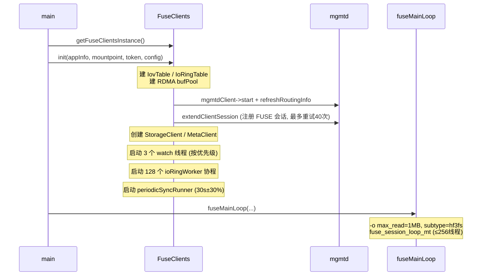
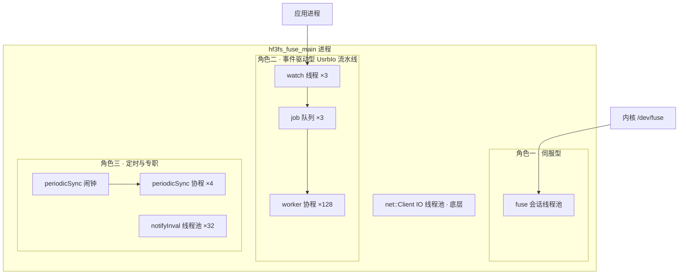
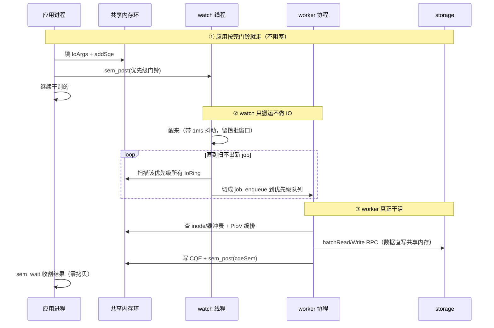
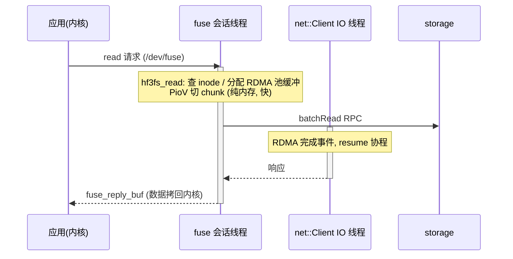
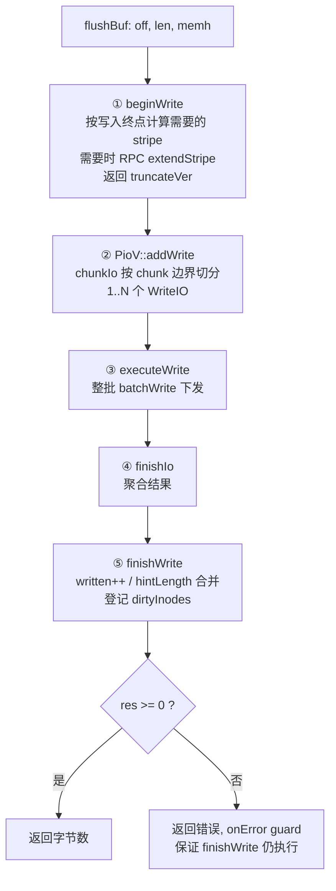
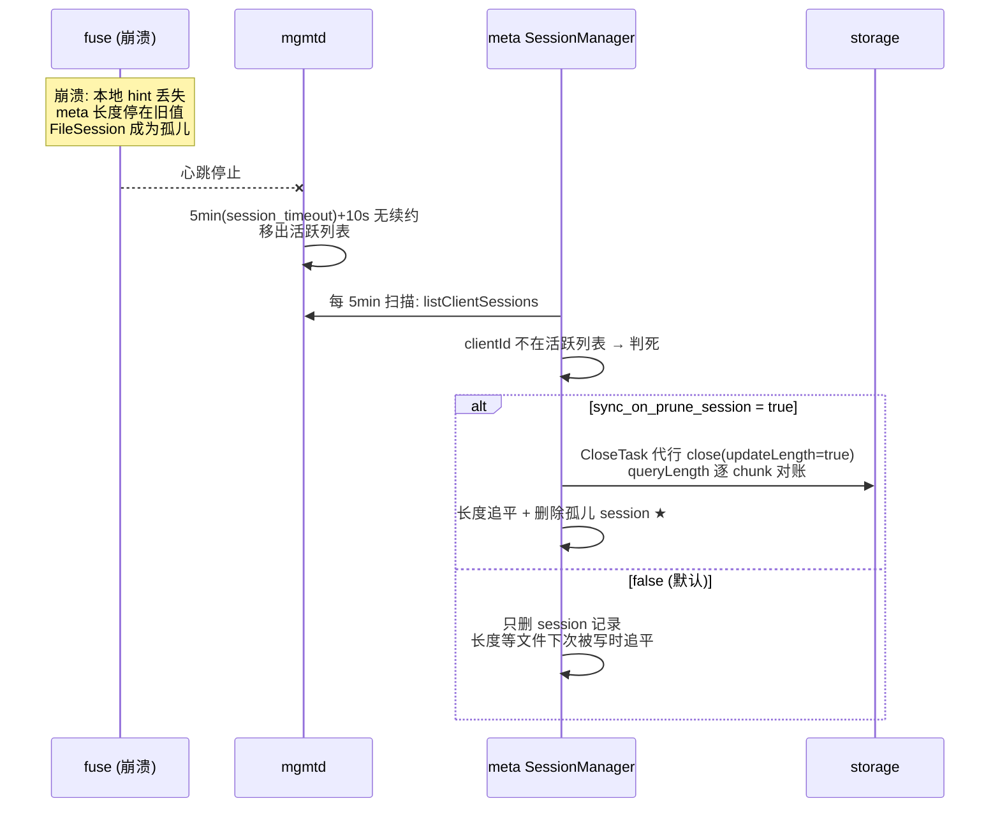
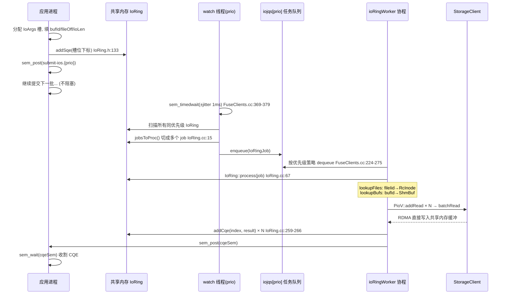

# FUSE 客户端模块详细分析

## 目录

- [1. 模块定位与职责](#1-模块定位与职责)
- [2. 进程结构与启动流程](#2-进程结构与启动流程)
  - [2.1 两条编译形态](#21-两条编译形态)
  - [2.2 启动时序](#22-启动时序)
  - [2.3 线程与协程模型](#23-线程与协程模型)
- [3. 核心数据结构](#3-核心数据结构)
  - [3.1 FuseClients - 全局组件容器](#31-fuseclients---全局组件容器)
  - [3.2 RcInode - inode 缓存与写状态跟踪](#32-rcinode---inode-缓存与写状态跟踪)
  - [3.3 Inode 编号映射与引用计数](#33-inode-编号映射与引用计数)
- [4. FUSE 读路径](#4-fuse-读路径)
  - [4.1 流程图解](#41-流程图解)
  - [4.2 关键设计](#42-关键设计)
- [5. FUSE 写路径](#5-fuse-写路径)
  - [5.1 写缓冲聚合](#51-写缓冲聚合)
  - [5.2 flushBuf 五步](#52-flushbuf-五步)
  - [5.3 长度一致性三计数器](#53-长度一致性三计数器)
  - [5.4 延迟同步机制](#54-延迟同步机制)
  - [5.5 崩溃后的长度恢复](#55-崩溃后的长度恢复)
- [6. UsrbIo 与 IoRing 零拷贝](#6-usrbio-与-ioring-零拷贝)
  - [6.1 为什么需要 IoRing](#61-为什么需要-ioring)
  - [6.2 共享内存布局](#62-共享内存布局)
  - [6.3 注册与发现](#63-注册与发现)
  - [6.4 提交流水线](#64-提交流水线)
  - [6.5 批量切分策略](#65-批量切分策略)
  - [6.6 乱序完成与队列回收](#66-乱序完成与队列回收)
  - [6.7 IovTable 与缓冲注册](#67-iovtable-与缓冲注册)
- [7. 虚拟目录](#7-虚拟目录)
- [8. ioctl 扩展接口](#8-ioctl-扩展接口)
- [9. 配置体系](#9-配置体系)
- [10. 监控指标](#10-监控指标)
- [11. 源码索引](#11-源码索引)

---

## 1. 模块定位与职责

FUSE 模块是 3FS 的 **POSIX 文件系统入口**，以用户态守护进程 `hf3fs_fuse_main` 运行，把 Linux VFS 的系统调用翻译为对 meta/storage 服务的 RPC。

它同时提供**两条性能迥异的数据通道**：

```
                 ┌─────────────────────────────────────────┐
                 │            hf3fs_fuse_main 进程           │
                 │                                         │
  普通 POSIX IO   │  FUSE 内核通道 (read/write 系统调用)      │   ┌────────┐
 ──────────────> │  hf3fs_read / hf3fs_write               │──>│  meta  │
  兼容所有程序    │    │ 1次 memcpy + PioV                    │   └────────┘
                 │    ▼                                    │   ┌────────┐
  高性能批量 IO   │  UsrbIo 通道 (C API + 共享内存)           │──>│storage │
 ═══════════════> │  IoRing 零拷贝 (无 memcpy, 深度批量)      │   └────────┘
  需改用 libhf3fs │                                         │   ┌────────┐
                 │                                         │──>│ mgmtd  │
                 │                                         │   └────────┘
                 └─────────────────────────────────────────┘
```

- **FUSE 通道**：兼容一切程序，但用户数据要过一次用户态拷贝（`FuseOps.cc:1621` 的 `memcpy`）
- **UsrbIo 通道**：应用通过共享内存直接提交 IO 描述符，数据全程零拷贝直达 RDMA（`IoRing.cc:67`）

两条通道在 `PioV` 处汇合，复用同一套 StorageClient 读写逻辑。

---

## 2. 进程结构与启动流程

### 2.1 两条编译形态

`src/fuse/hf3fs_fuse.cpp` 有两种编译模式（`#ifdef ENABLE_FUSE_APPLICATION`）：

| 模式 | 启动方式 | 配置来源 |
| --- | --- | --- |
| `FuseApplication` | 接入统一的 `TwoPhaseApplication` 框架（`hf3fs_fuse.cpp:5-9`），支持从 launcher 拉取配置、配置热推送 | 集中管理（`FuseApplication.cc:55-84`） |
| 独立 main | 自行初始化 IBManager/日志/监控后直接启动（`hf3fs_fuse.cpp:39-81`） | 本地 TOML |

两种形态最终都汇入同一个入口：`fuseMainLoop()`（`FuseApplication.cc:118`）。

### 2.2 启动时序



关键点：

- **mgmtd 会话必须先建立**。`establishClientSession` 以指数退避重试 40 次（10ms → 1s），失败则进程退出（`FuseClients.cc:31-45`）——集群不可达时 FUSE 进程没有存在意义
- **fuse 挂载参数**：`max_read` 固定为 `io_bufs.max_buf_size`（默认 1MB）、`auto_unmount`、`allow_other + default_permissions`（`FuseMainLoop.cc:25-45`）——即内核单次 read/write 请求最大 1MB
- **内核能力协商**（`hf3fs_init`，`FuseOps.cc:321-348`）：主动开启 splice read/write/move（内核↔用户态管道零拷贝传递请求），writeback cache 可选

### 2.3 线程与协程模型

hf3fs_fuse_main 里有五类执行体。区分它们只需要一个问题：**谁唤醒我，我醒来干什么**。

| 执行体 | 数量 | 唤醒源 | 醒来干什么 |
| --- | --- | --- | --- |
| fuse 会话线程 | ≤ min(256, 逻辑核/2) | 内核写 `/dev/fuse` | 执行一个 `hf3fs_*` 回调（= 一次系统调用） |
| watch 线程 | 3（每优先级一条） | 应用进程 `sem_post` 门铃 | 扫 IoRing，把积压 SQE 切成 job 入队 |
| ioRingWorker 协程 | 128 | job 队列非空 | 执行一个批量 IO job（查表→PioV→RPC→写 CQE） |
| periodicSync | 1 闹钟 + 4 协程 | 定时 30s±30% | 冲写缓冲，把文件长度 sync 给 meta |
| notifyInvalExec | 32 | 收到"作废内核缓存"任务 | 通知内核缓存失效（专职保证顺序） |

> 所有 RPC 的收发与协程恢复都发生在底层的 net::Client IO 线程池（`FuseClients.cc:92-95`），不参与上表分工。

#### 2.3.1 总览图



设计原则只有一条：**每类执行体只对一个唤醒源负责，互不抢活**。

- **伺服型**（fuse 线程）：阻塞读 `/dev/fuse`，内核来一个请求处理一个。回调是同步函数，内部用 `blockingWait` 等协程结果（`FuseOps.cc:85-89`）。一个线程 = 一个在途系统调用，大部分时间在等网络，所以数量压到核数一半（`FuseClients.cc:80-85`）
- **事件驱动型**：为 UsrbIo 通道服务的三级流水线，2.3.2 展开
- **定时/专职型**：2.3.3 展开

#### 2.3.2 UsrbIo 流水线：watch → 队列 → worker

问题的起点：应用进程和 fuse 进程是**两个进程**，不能函数调用。解法是用命名信号量当门铃、用任务队列传话，完整协作一次看全：



三步分工（对应图中三个分组）：

1. **应用按完门铃就走**：提交 SQE 后 `sem_post` 即返回，等结果时才 `sem_wait` 收割 CQE
2. **watch 只搬运**：三个优先级各一条线程、一根门铃（`submit-ios.ph/.pl`），醒来扫环切 job 入队（`FuseClients.cc:369-401`），扫完回去睡
3. **worker 真正干活**：128 个协程调度在 bgThreadPool 上（不是 128 个线程），等 RPC 时让出执行权，一个 job 覆盖"查表 → PioV → RPC → 写 CQE"全流程（`IoRing.cc:67-284`）

worker 的三级身份（`FuseClients.cc:226-227`）：

| 协程编号 | 身份 | 主认队列（容量） |
| --- | --- | --- |
| i < 8 | 高优 worker | iojqs[0]（32） |
| 8 ~ 119 | 普通 worker | iojqs[1]（1024） |
| i ≥ 120 | 低优 worker | iojqs[2]（4096） |

两条调度规则：

- **反饿死**：取任务时若更高优先级队列已满，先帮它消化一个，帮完立刻切回自己的队列（`FuseClients.cc:234-274`）
- **干完续抓**：干完一个 job 若同环还有活且高优队列未满，自己直接再抓一个，不唤醒 watch；忙不过来才 `sem_post` 请 watch 继续派活（`FuseClients.cc:343-353`）

#### 2.3.3 定时与专职组件

**periodicSync：闹钟 + 执行者**。拆成两个执行体，因为"扫描"和"执行"耗时差三个数量级：

- 闹钟（periodicSyncRunner）：每 30s×rand[0.7,1.3] 醒来，从 dirtyInodes 摘最多 1000 个 inode 投给协程池——纯内存簿记，必须快，否则会顶住写路径的登记（`FuseClients.cc:403-438`）
- 执行者（periodicSyncWorker ×4）：对每个 inode 先冲写缓冲、再 sync 长度到 meta——慢网络操作，丢进池里并行消化（`FuseOps.cc:2671-2714`）

**notifyInvalExec：给内核递"缓存作废"通知的专职邮差**。不放在回调线程里顺手做，有两个原因：

- libfuse 内部互斥：正在处理 `getattr/lookup` 时发 inode 失效，内核会认为刚返回的结果无效（`FuseOps.cc:534-536`）
- 顺序保证：`MOVE/REMOVE` 要求**先失效、后回复**，打包成一个闭包按序执行（`FuseOps.cc:2133-2137`）：
  ① `notify_inval_entry(旧路径)` → ② `notify_inval_entry(新路径)` → ③ `fuse_reply_ioctl` 最后才回复应用

#### 2.3.4 两条通道对比

普通 `read()` 走 FUSE 通道，**不经过流水线**，全在 fuse 线程上：



把它与 2.3.2 的 IoRing 流水线放在一起，对比就是分工逻辑本身：

| | FUSE 通道（上图） | IoRing 通道（2.3.2） |
| --- | --- | --- |
| 并发度决定因素 | fuse 线程数（伺服模型） | 128 个 worker 协程 |
| 提交方式 | 内核 syscall | 共享内存 + 信号量门铃 |
| 派单路径 | 无（线程自己干） | watch → iojqs → worker |
| 数据拷贝 | 1 次（用户态↔内核） | 0 次 |

---

## 3. 核心数据结构

### 3.1 FuseClients - 全局组件容器

`FuseClients` 是进程级单例（`FuseOps.cc:55` 的全局变量 `d`），持有：

| 成员 | 职责 | 位置 |
| --- | --- | --- |
| `mgmtdClient / metaClient / storageClient` | 三个后端的客户端 | `FuseClients.h:196-198` |
| `bufPool` | RDMA 缓冲池（读路径/O_DIRECT 写路径的 memcpy 落点） | `FuseClients.h:220` |
| `inodes` | InodeId → RcInode 缓存表 | `FuseClients.h:211` |
| `iovs` | IovTable：已注册共享内存缓冲 | `FuseClients.h:227` |
| `iors` | IoRingTable：已注册 IO 环 | `FuseClients.h:228` |
| `iojqs[3]` | 三级优先级 IO 任务队列（容量 32/1024/4096） | `FuseClients.h:229`，`FuseClients.cc:139-142` |
| `dirtyInodes` | 待周期同步的 inode 集合 | `FuseClients.h:235` |
| `userConfig` | 按 uid 覆盖的用户级配置 | `FuseClients.h:233` |

### 3.2 RcInode - inode 缓存与写状态跟踪

`RcInode` 是 meta 侧 `Inode` 的本地包装（`FuseClients.h:67-144`），核心是 `DynamicAttr` 里的一组**本地写状态**：

```
DynamicAttr (folly::Synchronized 保护)
├── written  : 本地成功提交写数据的次数 (每次 flushBuf 成功 +1)
├── synced   : 已通过周期 sync 同步到 meta 的 written 快照
├── fsynced  : 已通过 fsync/close 同步的 written 快照
├── writer   : 最后一个写者的 uid (periodicSync 用它构造 UserInfo)
├── truncateVer  : 已知最大的 truncate 版本号 (防写与截断错乱)
├── hintLength   : 本地长度提示 (写到了哪里, sync 时传给 meta)
├── atime/mtime  : 本地时间戳积累
└── dynStripe    : 动态条带大小 (随写位置自动扩展)
```

- `written/synced/fsynced` 三个计数值回答一个问题：**本地写的数据，meta 侧的文件长度追上了没有？**（详见 5.3 节）
- `hintLength` 是性能优化的关键：写路径只更新本地提示，不实时 RPC，让 sync 时一次性把长度推给 meta（`FuseOps.cc:2655-2669`）
- `extendStripeLock` 保证同一文件并发写时只有一个协程去 meta 扩展 stripe（`FuseOps.cc:2631-2641`）

此外每个 RcInode 还挂着一个 `writeBuf`（写聚合缓冲，见 5.1）。

### 3.3 Inode 编号映射与引用计数

FUSE 协议要求 inode 号在会话内稳定，3FS 做两层映射：

```
内核 fuse_ino_t                     3FS InodeId (uint64)
├── FUSE_ROOT_ID (1)      <──────> InodeId::root()
├── FUSE_ROOT_ID + 1      <──────> InodeId::gcRoot()          FuseOps.cc:175-193
├── 高 4 位为 1 (0xf000...) ──>   虚拟 inode (3fs-virt/iov/sem/conf)  FuseOps.cc:262
└── 其余                     ──>   原样透传
```

**引用计数模型**（与 FUSE 内核 dentry 缓存对应）：

- 每次 `lookup` 成功 → `add_entry` 使 `refcount++`（`FuseOps.cc:231-247`）
- 内核下放 `forget(ino, nlookup)` → `remove_entry` 减 n，减到 0 移除本地缓存（`FuseOps.cc:401-409`）
- 这是纯本地缓存，不影响 meta 侧真实生命周期

---

## 4. FUSE 读路径

### 4.1 流程图解

一次 `read(fd, buf, 1MB)` 的完整链路（`hf3fs_read`，`FuseOps.cc:1473-1550`）：

```
内核 VFS ──read──> FUSE ──> hf3fs_read(req, ino, size=1MB, off)
   │
   │ ① 读己之写: 若本地有未落盘的写缓冲, 先 flush
   │     lock(pi->wbMtx); wb->len != 0 → flushBuf(...)       FuseOps.cc:1482-1495
   │
   │ ② 从 RDMA 缓冲池分配目标内存
   │     memh = bufPool->allocate()                            FuseOps.cc:1511
   │     (这块内存已做 RDMA 注册, storage 可直接 RDMA 写入)
   │
   │ ③ PioV 编排: 按 chunk 边界切分
   │     ioExec.addRead(iovIdx=0, inode, off, size, memh.data())
   │       └─ chunkIo(): 逐 chunk 查 getChainId/getChunkId     PioV.cc:98-130
   │          1MB 读 + 1MB chunk → 1~2 个 ReadIO
   │
   │ ④ 提交 StorageClient
   │     ioExec.executeRead → batchRead(rios_)                 PioV.cc:139
   │       └─ LoadBalance 选副本 → BatchReadReq → RDMA
   │          storage 直接 RDMA 写入 memh 指向的内存
   │
   │ ⑤ 结果聚合
   │     ioExec.finishIo(true) → concatIoRes                   PioV.cc:268-274
   │       短读检测/hole 填零, 汇总每个 iov 的字节数
   │
   └── fuse_reply_buf(req, memh.data(), res[0])                FuseOps.cc:1548
         (唯一一次拷贝: 用户态 buf → 内核, splice 优化可部分绕过)
```

### 4.2 关键设计

**读缓冲来自 RDMA 池而非 malloc**

`bufPool` 在启动时创建（`FuseClients.cc:86`），每块 `max_buf_size`（1MB）且已完成 RDMA 内存注册。storage 服务端读出数据后通过 RDMA 直接写入这块内存，**服务端到 fuse 进程零拷贝**；代价只在最后 `fuse_reply_buf` 交内核的一次拷贝。

**读之前必须冲刷写缓冲（读己之写）**

`hf3fs_read` 拿着 `wbMtx` 检查 `writeBuf`（5.1 节）：有未下发的数据就先 `flushBuf` 再读，保证读到最新内容（`FuseOps.cc:1482-1495`）。读期间锁不释放（除无写缓冲外），同一文件的读写在本地层面串行。

**短读与 hole 的处理**

storage 承诺 chunk 内读出的数据总是从前部连续（`PioV.cc:200-203` 注释），因此 `concatIoRes` 用"短读"作为 hole 信号：

- 某个 chunk 读出长度 < 请求长度 → 标记进入 hole 状态（`PioV.cc:255-262`）
- hole 之后又读到数据 → 说明中间有洞：
  - 允许 hole（默认）→ memset 填零并把 hole 大小计入返回值（`PioV.cc:225-235`）
  - 不允许（UsrbIo 设置了 `FORBID_READ_HOLES`）→ 该 iov 返回 `kHoleInIoOutcome` 错误（`PioV.cc:237`）
- 读到 chunk 不存在（`kChunkNotFound`）→ 静默跳过，视为全零区（`PioV.cc:243-244`）

---

## 5. FUSE 写路径

### 5.1 写缓冲聚合

`hf3fs_write`（`FuseOps.cc:1552-1689`）不是来一次写发一次 RPC，而是先在 `writeBuf` 里聚合：

```
hf3fs_write(size, off)
   │
   ├─ O_DIRECT 或 write_buf_size=0 (旁路模式)
   │    memcpy 到池缓冲 → 直接 flushBuf 下发                     FuseOps.cc:1592-1630
   │
   └─ 聚合模式 (默认, write_buf_size = 1MB)
        懒初始化 writeBuf (vector + RDMA 注册)                  FuseOps.cc:1632-1645
        │
        ├─ 新写与缓冲不连续 (wb->off + wb->len != off)?
        │     是 → 先 flush 旧缓冲, 重置 wb->off = off           FuseOps.cc:1649-1657
        │
        ├─ memcpy 追加到 wb->buf
        │    写满 1MB → 立即 flushBuf 整块下发                   FuseOps.cc:1669-1678
        │
        ├─ 还有剩余数据未落盘?
        │     是 → 登记 dirtyInodes (等周期同步)                 FuseOps.cc:1681-1684
        │
        └─ fuse_reply_write(req, size)  ← 立即返回"已写"         FuseOps.cc:1688
```

要点：

- **写缓冲是 per-inode 的**（`RcInode::writeBuf`，`FuseClients.h:103-104`），按文件聚合
- **立即回复成功**：数据还在 writeBuf 里就 reply_write 了——这就是 POSIX 缓冲写语义，落盘保证延后到 fsync/close/周期同步
- **聚合的价值**：`wb->buf` 本身做过 RDMA 注册（`FuseOps.cc:1635-1640`），flush 时 storage 直接从此缓冲读数据，flushBuf 内部无需再 memcpy

### 5.2 flushBuf 五步

`flushBuf` 是写路径真正的执行者（`FuseOps.cc:424-491`）：



- **没有"补 truncate"这回事**：`PioV` 的 `trops_` 在全仓没有任何填充点（仅 `executeWrite` 有消费分支，`PioV.cc:149-152`，属预留代码）。写不满的 chunk 直接写，chunk 的实际大小由 storage 按写入内容记录；文件长度完全交给 5.3/5.4 的 sync 机制收敛
- **部分写循环**：`do { ... } while (flushAll && done < len)`，短写时推进 offset 重试（`FuseOps.cc:450-484`）
- **beginWrite 的动态条带**：stripe 随写入位置自动扩展（小文件少占 chain、大文件摊开），`extendStripeLock` + 双重检查防重复 RPC（`FuseOps.cc:2617-2653`）

### 5.3 长度一致性三计数器

**问题**：POSIX 缓冲写让数据先留在 fuse 本地（甚至只在 writeBuf），而文件长度是 meta 侧维护的——另一个节点 `stat` 到的长度可能落后。

**机制**：用 `written / synced / fsynced` 三个递增计数器描述"追进度"（`FuseClients.h:69-71`）：

```
written:  ──┬─────┬─────┬─────┬──→  每次成功写数据 +1
            │     │     │     │
synced:   ──┴──┬──┴─────┴─────┼──→  周期 sync / stat 触发, 携带 hintLength
             │  │             │
fsynced:  ───┼──┴──┬──────────┼──→  fsync/close/truncate 触发 (强语义)
             │     │          │
             ▼     ▼          ▼
        meta 侧文件长度逐步追上本地

判断: synced >= written → 数据长度已全同步, 无事可做   FuseOps.cc:525-528
```

- **周期同步（弱保证）**：`periodicSyncScan` 每 `interval(30s)×rand[0.7,1.3)` 扫一遍 dirtyInodes（每轮上限 1000 个，超出部分轮转），对每个 inode 先冲 writeBuf 再 `metaClient->sync`（`FuseClients.cc:403-438`，`FuseOps.cc:2671-2714`）
- **fsync/close（强保证）**：走 `fsynced` 档，且 sync 时不带长度提示（force 全量重算），确保崩溃后 meta 长度准确（`FuseOps.cc:517-549`）
- **sync 失败** → `clearHintLength()`，下次 sync 强制 meta 重算（`FuseOps.cc:541`）
- **stat 顺手同步**：`lookup/getattr` 默认触发 `flushAndSync`（`sync_on_stat=true`），让其他端尽快看到新长度（`FuseOps.cc:777-780`）

### 5.4 延迟同步机制

```
                    写入发生
                       │
                       ▼
        ┌──────────────────────────────┐
        │ writeBuf 聚合 (per-inode)     │◄──── read/setattr 触发提前 flush
        └──────────┬───────────────────┘
                   │ 写满 1MB / 不连续 / fsync / close / read / 周期到期
                   ▼
        ┌──────────────────────────────┐
        │ flushBuf → storage (链式写)   │  数据立即持久化到 storage
        └──────────┬───────────────────┘
                   │ finishWrite 登记 dirtyInodes
                   ▼
        ┌──────────────────────────────┐
        │ periodicSync (30s±30%)        │  长度/时间戳延迟推给 meta
        │ 每轮 ≤1000 inode             │
        └──────────────────────────────┘
```

**数据与元数据分离推进**：数据一旦 flush 就已多副本持久化在 storage；meta 侧长度只是"滞后视图"。fsync 是唯一把两者强对齐的命令。这一设计把 meta RPC 从写热路径上完全摘除——写吞吐只受 storage 制约。

### 5.5 崩溃后的长度恢复

延迟同步留下一个必须回答的问题：**客户端挂了，hintLength 随内存丢失，meta 的长度谁来追平？**

#### 恢复链：FileSession 孤儿回收

fuse 以写模式 open 时在 meta 登记了 FileSession（`FuseOps.cc:1449-1459`）。客户端死亡后它成为孤儿——这是 meta 侧唯一知道"该文件长度不可信"的线索：



`queryLength` 以 storage 实际数据为准（`FileHelper.cc:88-111`）——已 flush 的数据会被算进长度，比 POSIX 对缓冲写的承诺更强。

#### 误判（假死）：客户端活着却被回收

判死是**间接推断**（心跳消失 ≠ 进程死亡），存在误判窗口：

```
fuse 活着 ──心跳──✗──> mgmtd     (fuse↔mgmtd 分区 / mgmtd 繁忙)
    │
    └──数据通道正常──> storage/meta   ← 写照常成功!
```

防误杀的三道缓冲（`SessionManager.cc`）：

| 缓冲 | 说明 | 位置 |
| --- | --- | --- |
| 超时余量 | `lastExtend + 5min + 10s` 才算死 | `:66` |
| 新建宽限 | session 创建不到 1 分钟跳过（防误伤并发创建） | `:118-123` |
| bootstrapping 放弃 | mgmtd 刚启动信息不全时宁可本轮不扫 | `:51-54` |

#### 复活后的客户端：无感知，无需恢复

误判 close 之后客户端"复活"继续工作，每个动作都不受影响——session 被设计成**纯登记簿，不在任何关键路径上做存在性校验**：

| 客户端动作 | 依赖 FileSession？ | 结果 |
| --- | --- | --- |
| 继续写数据 | 否（数据面走 storage channel） | 照常成功 |
| periodicSync 携带 hint | 否——`SyncReq` 没有 session 字段（`Service.h:378-384`） | 照常采纳，长度单调递增 |
| release 时正常 close | close 只登记待删 + KV remove，**幂等**（`BatchOperation.cc:253-255, 141-144`） | 照常成功，updateLength 照走 |
| 重新 open（写） | 创建**新的** FileSession（新 sessionId） | 完全恢复正常 |

长度也不会错乱：误判重算与客户端后续 hint 都收敛于同一事实（storage 上的数据），且 meta 有单调性保护——同 truncateVer 下新长度小于旧长度直接 FATAL（`BatchOperation.cc:160-166`）。

#### 误判真正的代价：安全网失效一次

```
t0  正常状态: FileSession 在册
t1  误判: meta 代行 close → session 删除, 长度重算追平     ← 安全网被消耗
t2  客户端复活继续写: 一切照常, 但 session 已不在册          ← 裸奔状态
t3  客户端真的崩了: 没有孤儿 session → 无人触发重算
    → 长度停在 t2 之后最后一次成功 sync 的值
    → 直到该文件下次被任何客户端写 (sync/close 触发 updateLength)
       或 fsync 才追平
```

即：**死会话检测这张安全网对同一个会话只生效一次**。被误杀过的客户端若再次崩溃，其最后一批已 flush 数据的长度恢复要等到文件下次被写——不是数据不一致（未 fsync 的数据本就不保证），而是可见性延迟。

> 服务端视角的孤儿回收机制（SessionManager 扫描、CloseTask、prune 标记）详见 meta.md 第 12 章。

---

## 6. UsrbIo 与 IoRing 零拷贝

### 6.1 为什么需要 IoRing

FUSE 通道有两个先天开销：

1. **一次额外拷贝**：写路径 `memcpy(池缓冲, buf, size)`（`FuseOps.cc:1621`），读路径 `fuse_reply_buf` 拷回内核
2. **深度太浅**：单次 syscall 最多 1MB，且 syscall 提交本身有开销——高 IOPS 场景 CPU 被 syscall 和拷贝吃光

IoRing 的解法：**应用进程把 IO 描述符直接写进与 fuse 守护进程共享的内存环里，数据缓冲也用共享内存，全程零拷贝 + 深度批量**。这就是 3FS 训练场景读数据的主力通道（配合 `libhf3fs` C API 使用）。

### 6.2 共享内存布局

一块 IoRing 共享内存（由应用进程创建、fuse 进程 mmap）的布局（`IoRing.h:88-120`）：

```
┌─────────────────────────────────────────────────────────┐
│ sqeHead (int32)  │ 提交队列游标 (应用进程 addSqe 时推进)         │
│ sqeTail (int32)  │ 提交队列游标 (fuse 进程处理完后推进)          │  4 个原子游标
│ cqeHead (int32)  │ 完成队列游标 (fuse 进程 addCqe 时推进)        │
│ cqeTail (int32)  │ 完成队列游标 (应用进程收割时推进)             │
├─────────────────────────────────────────────────────────┤
│ ringSection: IoArgs[entries]   ← 应用进程写                   │
│   { bufId(16B UUID), bufOff,                                 │
│     fileIid, fileOff, ioLen, userdata }   IoRing.h:17-27     │
├─────────────────────────────────────────────────────────┤
│ cqeSection: IoCqe[entries]     ← fuse 进程写                  │
│   { index, result, userdata }            IoRing.h:34-39      │
├─────────────────────────────────────────────────────────┤
│ sqeSection: IoSqe[entries]     ← 应用进程写 (指向 IoArgs 下标)  │
│   { index, userdata }                    IoRing.h:29-32      │
├─────────────────────────────────────────────────────────┤
│ sem_t cqeSem    ← fuse 进程 post, 应用进程 wait 收割完成        │
└─────────────────────────────────────────────────────────┘
   entries = f(共享内存大小), 另多留 1 个槽位区分空/满         IoRing.h:59-66
```

三个关键设计：

- **描述与提交分离**：`IoArgs`（IO 内容）先写入 ringSection 的空闲槽，`IoSqe`（槽位下标）才进提交队列——应用可以用任意顺序填描述，队列本身极小
- **所有游标都是 `std::atomic_ref<int32_t>`**：两个进程无锁共享（`IoRing.h:176-179`），构造函数要求 4 字节对齐（`ringMarkerSize()`，`IoRing.h:55-58`）
- **同一条环可被多个 io worker 并行处理不同段**（类注释 `IoRing.h:49-52`），但只允许一个线程"准备"IO

### 6.3 注册与发现

**注册的本质是"借用 symlink 系统调用做一次进程间 RPC"——不会创建任何真实的链接对象**（不写 DirEntry、不发生 meta RPC）。symlink 回调的两个参数各自充当函数入参：

```
symlink( target,                    link )
         │                           └─ 链接名 = 配置参数串 (被 parseKey 解码)
         └─ 目标 = 共享内存文件路径    (被 fuse 进程 mmap)

等价于: register_buf(config=链接名, shm_path=目标)
```

应用通常不手敲 `ln`，而是调 C API，库内部替它发起 symlink（`src/lib/api/UsrbIo.cc:125-159`）：

```
应用: hf3fs_iorcreate4(&ior, mount, entries, for_read=1, io_depth=64, timeout=100, ...)
  │
  │ ① 库创建真实共享内存: /dev/shm/hf3fs-iov-<uuid>      UsrbIo.cc:129-137
  │     (整个流程中唯一真实存在的文件, 数据缓冲/环的本体)
  │
  │ ② 库把 API 参数编码成"链接名":                        UsrbIo.cc:147-154
  │     <uuid> + ".r64" + ".t100" + ".pl"
  │
  │ ③ 库调用普通 symlink 系统调用:                         UsrbIo.cc:155
  │     symlink("/dev/shm/hf3fs-iov-<uuid>",
  │             "<mount>/3fs-virt/iovs/<uuid>.r64.t100.pl")
  ▼
FUSE 回调 hf3fs_symlink (parent=iovs 虚拟目录)
  └─ IovTable::addIov(key=name, shmPath=link)             FuseOps.cc:1216, IovTable.cc:124
       ├─ parseKey(name) 解码全部配置
       ├─ mmap(target) 共享内存, 包成 ShmBuf
       ├─ 普通 iov: registerForIO (整块 RDMA 注册)          IovTable.cc:222-224
       │  IoRing:  不预注册 (worker 统一经 memh() 取钥匙, 未命中才现场注册, 见 6.7)
       ├─ 是 IoRing? → IoRingTable::addIoRing              FuseOps.cc:1227-1235
       │    解析布局, 分配 table 槽位, 记录优先级
       └─ 注册的全部持久化痕迹 = fuse 进程内存表里的一个条目
```

链接名（key）的编码语法（`parseKey`，`IovTable.cc:28-111`）：

| 字段 | 含义 |
| --- | --- |
| `<uuid>` | 共享内存唯一 ID（16 字节） |
| `.b<N>` | 块大小（普通 iov：RDMA 按 block 注册） |
| `.r<N>` / `.w<N>` | 这是 IoRing，读/写方向，ioDepth = N |
| `.t<N>` | 凑批超时（毫秒） |
| `.f<bin>` | 执行 flags（如 FORBID_READ_HOLES） |
| `.ph/.pn/.pl` | 优先级 高/中/低 |

**注册成功后链接目标随即消失**：IoRing 场景下库会 `maybeUnlinkShm()` 把 `/dev/shm` 文件从文件系统删掉（`UsrbIo.cc:160-162`，mmap 依然有效）——这反证了"链接"从来不是链接，target 只是一次性的资源交接路径，fuse 拿到 mmap 后就没用了。

`ls` / `stat` 看到的目录内容也是现查现造的：遍历 IovTable 表拼出目录项，`stat` 时伪造一个 target 指回 `/dev/shm` 的 symlink inode（`IovTable.cc:283-286`）。

辅助"文件"：每个优先级一个命名信号量（`submit-ios.ph / submit-ios / submit-ios.pl`，`/dev/shm/sem.*` 下真实存在）同样以伪造 symlink 的形式出现在 iovs 目录（`IoRing.h:262-277`）——**应用进程提交后 sem_post 对应优先级的信号量来"踢"fuse 进程开始干活**。

卸载与清理（同样不是真的删链接，而是注销表条目）：

- `unlink` iovs 下的条目 → `rmIov` + `rmIoRing`（`FuseOps.cc:1061-1069`）
- **死进程清理**：`releasedir` 关闭 iovs 目录时，扫描该 pid 注册的所有 iov 并移除（`FuseOps.cc:1816-1830`）——应用崩溃也不会泄漏共享内存注册

### 6.4 提交流水线

一次 UsrbIo 提交的完整流水（读方向为例）：



**watch 线程的防惊群与抖动**：

- sem 等待带 `submit_wait_jitter`（默认 1ms）抖动（`FuseClients.cc:376-379`）——给应用留出攒批的时间窗
- 拿到信号后循环扫描直到无新 job 才回到等待（`FuseClients.cc:383-399`）
- worker 干完一个 job 后：若本优先级还有积压且高优队列未满，**自己直接再抢一个**而不唤醒 watch；否则 sem_post 通知 watch（`FuseClients.cc:343-353`）

**三级优先级的反饿死调度**（`ioRingWorker`，`FuseClients.cc:218-275`）：

```
128 个协程 (batch_io_coros) 分工:
  前 8 个 (io_worker_coros.hi)  → 专职高优队列
  后 8 个 (io_worker_coros.lo)  → 专职低优队列
  其余 112 个                    → 普通队列

反饿死规则: worker 取任务时
  1. 若"允许向上看"(checkHigher): 更高优先级队列满 → 先帮它消化
     (帮完一次后 checkHigher=false, 下次优先取自己队列的)   FuseClients.cc:235-252
  2. 从高到低逐个队列 co_dequeue, 每个 1ms 超时轮转         FuseClients.cc:255-273
     取到自己队列的任务 → 恢复 checkHigher=true
```

### 6.5 批量切分策略

`jobsToProc`（`IoRing.cc:15-65`）把一条环里的积压 SQE 切成若干 job，切法由注册时的 `ioDepth` 决定：

| ioDepth | 语义 | 切分行为 |
| --- | --- | --- |
| `> 0` | 固定批量 | 每 job 恰好 ioDepth 个；凑不齐或 CQE 空位不足就先不切（`:25-29`） |
| `< 0` | 攒批模式 | 目标批量 = \|ioDepth\|；凑不满就等 `timeout` 到期再发（`:32-47`）——训练数据加载的典型用法 |
| `= 0` | 尽量多 | 一次吃掉 min(积压数, CQE 空位)（`:30-31`） |

约束条件：

- **CQE 背压**：`cqeAvail = entries - 1 - processing - cqeCount()`——完成队列快满时不再领取新 job，防止覆盖应用还没收割的结果（`IoRing.cc:22`）
- **并发上限**：一条环同时可有多个 job 在不同 worker 协程上并行（`IoRing.h:49-52`），`processing_` 计数跟踪在途量

### 6.6 乱序完成与队列回收

多个 job 并行处理时，完成顺序必然乱序，但 **SQE 队列的 tail 推进必须有序**（应用按序感知消费进度）。`IoRing` 用两个辅助结构解决（`IoRing.h:211-214`）：

```
领取时 (jobsToProc):   按序登记每个 job 的结束位置
  sqeProcTails_: deque = [job1 结束位, job2 结束位, ...]   领取顺序
  processing_ += toProc

完成时 (process 收尾, IoRing.cc:230-257):
  若自己不是队首 job:
      sqeDoneTails_.insert(自己的结束位)      ← 先记账, 不推进
  若自己是队首:
      sqeTail = 我的结束位; 弹出队首
      循环: 下一个队首若也在 done 集合里 → 连锁推进
      (中间有洞就停, 等那个 job 完成)

效果: sqeTail 只会按领取顺序单调推进, 完成乱序无害
```

### 6.7 IovTable 与缓冲注册

**两类共享内存缓冲，注册策略不同**：

| | 普通 iov（数据缓冲） | IoRing 的 shm（环本身） |
| --- | --- | --- |
| 用途 | 纯数据落点（配合 UsrbIo `bufId` 引用） | 提交环本身 |
| RDMA 注册 | addIov 时整块 `registerForIO`（`IovTable.cc:222-224`） | 不预注册（`:222` 的 `if (!is_io_ring)` 跳过） |
| IO 时取句柄 | 同一入口 `memh()`——预注册过，**直接命中** | 同一入口 `memh()`——未注册则**现场注册**（兜底分支） |
| 越界检查 | addIov 时查 `size < bufOff + ioLen`（`IovTable.cc:322-325`） | 同左（lookupBufs） |

**取钥匙的统一入口是 `memh()`，"懒注册"只是它的未命中分支**（`Shm.cc:140-147`：查 `memhs_[off/blockSize]`，有则返回，无则现场注册并填入）。worker 对**任何**缓冲取句柄都只走这一个入口（`IoRing.cc:151`）——对预注册过的普通 iov 是零开销命中；对未预注册的缓冲（环的 shm）现场补注册，保证接口对两类缓冲统一。

**主流用法是"环 + 独立预注册的普通 iov"**，代码闭环：`hf3fs_iorcreate4` 建的环 shm 恰好是标准环大小（`UsrbIo.cc:491` 用 `hf3fs_ior_size` = `bytesRequired`，`IoRing.h:67-71`），没有数据区；且 `hf3fs_iorwrap` 不在 `hf3fs_usrbio.h` 的导出列表里——公开 API 上不存在"环 + 数据区一体"的入口，数据落点总是单独建的 iov。

**块对齐约束**：`ShmBuf` 按 `blockSize` 分块，每块一个独立的 `IOBuffer`（RDMA 句柄，`Shm.h:73`）。`ShmBufForIO::memh(len)` 要求 `[off, off+len)` **不跨块**（`Shm.h:90-92`）——所以应用注册时必须让单个 IO 落在一个 block 内（`b65536` = 64KB 块是常见配置）。

**lookupBufs 的查表**（`FuseClients.cc:296-333`）：按 `bufId` 查 `shmsById` 表拿 ShmBuf，连续相同 bufId 的 IO 复用上一次结果（省锁开销）；越界/未注册的 IO 直接以错误码进 CQE，不影响同批其他 IO。

---

## 7. 虚拟目录

挂载点根下有一个虚拟目录 `/3fs-virt`（`FuseOps.cc:356-379`），用文件系统语义暴露**进程管理接口**——它不存在于 meta，内容由 fuse 进程的常量和内存表凭空呈现，对它的文件操作被翻译成对 fuse 进程内部功能的调用（类比 Linux 的 `/proc`、`/sys`）：

| 子目录 | 用途 | 用法 |
| --- | --- | --- |
| `iovs/` | 注册共享内存缓冲 / IoRing / 提交信号量 | `ln -s /dev/shm/xxx iovs/<key>`（借用调用做注册 RPC，不产生真实链接，见 6.3）；`ls` 列出全部 |
| `rm-rf/` | 服务端原子递归删除 | `ln -s /mnt/3fs/path/to/dir rm-rf/x` |
| `get-conf/` `set-conf/` | 查看 / 修改运行配置 | `cat get-conf/usr.readonly`；`ln -s false set-conf/usr.readonly` |

**递归删除的安全防护**：

- `check_rmrf` 打开时，校验发起 `ln` 的进程命令行，要求目标必须是本挂载点下的**绝对路径**（`FuseOps.cc:104-173`）——防止 shell 软链接误指到其他文件系统
- 删除走 meta 的 recursive remove（`FuseOps.cc:1200`），服务端一次性完成，避免客户端逐条 unlink 的高开销与不一致窗口
- 删除成功后异步发内核缓存失效通知（`notify_inval_exec`，`FuseOps.cc:1210-1212`）

**隐藏的 rename 语法**：普通目录下创建内容为 `mv:/mnt/3fs/old/path` 的 symlink 即执行 rename（`FuseOps.cc:1274-1307`）——供 `hf3fs mv` CLI 生成内核缓存失效的正确顺序。

**目录枚举**（`hf3fs_readdirplus`，`FuseOps.cc:2173-2374`）：

- 首次 `opendir` 后逐页拉取 meta `list`（每页 256 条）缓存到 `readdirplusResults[dirId]`（`:2241-2275`）
- `readdirplus` 翻页时对未带 inode 的条目发一次 `batchStat`（`:2306-2323`），一次 RPC 拿全部属性
- `releasedir` 时清理缓存（`:1808-1814`）

---

## 8. ioctl 扩展接口

`hf3fs_ioctl`（`FuseOps.cc:1908-2171`）在标准 ioctl 之上提供 3FS 私有命令，供 CLI/库使用：

| 命令 | 作用 | 实现 |
| --- | --- | --- |
| `HF3FS_IOC_GET_MOUNT_NAME` | 返回挂载名（集群 ID） | `:1979-1988` |
| `HF3FS_IOC_GET_PATH_OFFSET` | 挂载点路径长度（路径压缩） | `:1990-1998` |
| `HF3FS_IOC_GET_MAGIC_NUM` | 返回 `HF3FS_SUPER_MAGIC` | `:2000-2008` |
| `HF3FS_IOC_GET_IOCTL_VERSION` | ioctl 版本探测 | `:2010-2019` |
| `HF3FS_IOC_RECURSIVE_RM` | 按 inode 递归删除 | `:2021-2040` |
| `HF3FS_IOC_FSYNC` | 强制 fsync 并失效内核缓存 | `:2041-2049` |
| `HF3FS_IOC_HARDLINK` | 建 hardlink | `:2051-2061` |
| `HF3FS_IOC_PUNCH_HOLE` | 按 chunk 对齐批量打洞（发 RemoveChunks） | `:2063-2106` |
| `HF3FS_IOC_MOVE` | rename + 双端缓存失效 | `:2108-2138` |
| `HF3FS_IOC_REMOVE` | remove + 缓存失效 | `:2140-2166` |
| `FS_IOC_GETFLAGS/SETFLAGS` 等 | 标准文件标志（immutable 等） | `:1932-1977` |

设计要点：

- **缓存失效与回复的顺序**：`MOVE/REMOVE` 把 `fuse_reply_ioctl` 放进 `notifyInvalExec` 线程池，先发失效通知再回复（`:2133-2137`）——防止内核用旧 dentry 缓存立刻发起下一个操作
- `PUNCH_HOLE` 要求区间严格 chunk 对齐，直接构造 `RemoveChunksOp` 发 storage（`:2071-2075`），不走 meta

**xattr 的唯一用途**：`hf3fs.lock` —— 目录分布式锁（try/preempt/unlock/clear），给跨节点互斥的应用逻辑用（`FuseOps.cc:2412-2437`）。

---

## 9. 配置体系

### 9.1 FuseConfig 主要配置项

定义于 `src/fuse/FuseConfig.h:11-91`，按功能分组：

**内核协商与缓存**

| 配置 | 默认 | 说明 |
| --- | --- | --- |
| `io_bufs.max_buf_size` | 1MB | 单次 FUSE 请求上限（max_read/max_write/readahead） |
| `io_bufs.write_buf_size` | 1MB | per-inode 写聚合缓冲；设 0 关闭聚合 |
| `enable_writeback_cache` | false | FUSE 内核写回缓存 |
| `attr/entry/negative/symlink_timeout` | 30/30/5/5s | 内核属性缓存时长 |

**UsrbIo 执行引擎**

| 配置 | 默认 | 说明 |
| --- | --- | --- |
| `batch_io_coros` | 128 | ioRingWorker 协程数 |
| `io_worker_coros.hi/lo` | 8/8 | 高/低优专职协程数 |
| `io_jobq_sizes.hi/lo` | 32/4096 | 高/低优队列容量（普通 1024） |
| `max_jobs_per_ioring` | 32 | 单环单轮最多切出的 job 数 |
| `submit_wait_jitter` | 1ms | watch 唤醒抖动窗口 |
| `io_job_deq_timeout` | 1ms | worker 空队列轮转超时 |
| `iov_limit` | 1MB | Iov/IoRing 总数上限 |

**周期同步**

| 配置 | 默认 | 说明 |
| --- | --- | --- |
| `periodic_sync.enable/interval/limit` | true / 30s / 1000 | 扫描周期（乘 0.7~1.3 随机）与每轮上限 |
| `periodic_sync.flush_write_buf` | true | 同步前先冲写缓冲 |

### 9.2 UserConfig - 按 uid 的配置覆盖

`UserConfig` 把配置做成虚拟文件，支持**全局(sys) 与按用户(usr) 两级**（`UserConfig.cc`）：

```
cat    /mnt/3fs/3fs-virt/get-conf/usr.readonly          # 查看该 uid 的生效值
ln -s  true /mnt/3fs/3fs-virt/set-conf/usr.readonly     # 为当前 uid 覆盖

可覆盖的 user keys (UserConfig.h:31-39):
  enable_read_cache, readonly, dryrun_bench_mode,
  flush_on_stat, sync_on_stat,
  attr/entry/negative/symlink_timeout

可覆盖的 sys keys (UserConfig.h:23-30):
  rdma max_concurrent_transmission (上限=2×系统值, UserConfig.cc:58-68),
  periodic_sync.*, io_worker_coros.*, max_jobs_per_ioring, io_job_deq_timeout
```

实现机制：

- 首次为某 uid 设置时，从全局配置克隆一份 `LocalConfig` 存入按 uid 索引的表（`UserConfig.cc:86-93`）
- **全局配置热更新时**，对所有已覆盖用户重放它们的覆盖项（`UserConfig.cc:12-28`）——用户覆盖始终叠在最新全局值之上
- **readonly 全局开启后用户无法自行关闭**（`UserConfig.cc:75-78`）——运维熔断不被绕过

---

## 10. 监控指标

| 前缀 | 内容 | 位置 |
| --- | --- | --- |
| `fuse.op` | 各 FUSE 操作计数（按 op/uid） | `FuseOps.cc:56-59` |
| `fuse.write.latency / fuse.write.size` | FUSE 写延迟与尺寸分布 | `FuseOps.cc:1553-1555` |
| `fuse.piov.*` | FUSE 通道 PioV 四阶段：prepare/submit/complete/overall | `FuseOps.cc:432-439` |
| `usrbio.piov.*` | IoRing 通道同四阶段 + io_depth/total_bytes/distinct_files/bufs | `IoRing.cc:75-87` |
| `fuse.iov.*` | 共享内存 map 字数/字节、RDMA 注册延迟/字节 | `IovTable.cc:130-136` |
| `fuse.dirty_inodes` | 待周期同步 inode 数（水位表） | `FuseClients.cc:29` |

四阶段延迟拆分（prepare→submit→complete）可直接定位瓶颈在编排、网络还是收尾。

---

## 11. 源码索引

| 文件 | 行数 | 职责 |
| --- | --- | --- |
| `src/fuse/hf3fs_fuse.cpp` | 83 | 进程入口（两种编译形态） |
| `src/fuse/FuseApplication.cc/.h` | 125+55 | TwoPhaseApplication 适配层 |
| `src/fuse/FuseMainLoop.cc/.h` | 107 | FUSE 会话创建与挂载参数 |
| `src/fuse/FuseOps.cc/.h` | 2716 | 全部 FUSE 系统调用实现 + ioctl + fuse_lowlevel_ops 表（`:2580-2613`） |
| `src/fuse/FuseClients.cc/.h` | 440+243 | 组件容器、ioRingWorker、watch、periodicSync、RcInode/FileHandle |
| `src/fuse/PioV.cc/.h` | 275+59 | chunk 切分编排、hole 处理（FUSE 与 IoRing 共用） |
| `src/fuse/IoRing.cc/.h` | 285+279 | 共享内存 IO 环布局、job 切分、process 主流程 |
| `src/fuse/IovTable.cc/.h` | 337+39 | 共享内存缓冲注册表、key 解析 |
| `src/fuse/UserConfig.cc/.h` | 174+64 | 按 uid 配置覆盖 |
| `src/fuse/FuseConfig.h` | 92 | 配置定义 |
| `src/fuse/FuseConfigFetcher.cc` | 19 | 配置拉取占位 |
| `src/fuse/FuseAppConfig.h` / `FuseLauncherConfig.h` | 16/24 | 启动器配置 |
| `src/lib/common/Shm.h`（依赖） | - | ShmBuf/ShmBufForIO：共享内存抽象与按块 RDMA 注册 |

**与其它模块的衔接**：

- 向下：`StorageClient`（批量读/写/删 chunk）、`MetaClient`（stat/sync/open/close/truncate/list）、`MgmtdClientForClient`（路由与会话）
- `PioV` 是两条通道的汇合点，与 `src/fbs/meta/FileOperation.cc` 的 chunk 编排逻辑同源
- IoRing 的用户侧库在 `src/lib/api/`（hf3fs_usrbio.h），Rust 绑定为 `src/lib/rs/hf3fs-usrbio-sys`

