# 客户端 API (lib) 模块详细分析

> 阅读路线：第 1 章明白它是什么 → 第 2 章建立空间感（名词 + 两块内存长什么样）→ 第 3 章按应用使用的真实顺序走一遍生命周期 → 第 4 章回看机制总结。走读代码时第 6 章的阅读地图可作索引入口。

## 目录

- [1. 模块定位与职责](#1-模块定位与职责)
- [2. 静态视图：名词、内存与底层](#2-静态视图名词内存与底层)
  - [2.1 名词与系统位置地图](#21-名词与系统位置地图)
  - [2.2 环内存布局](#22-环内存布局)
  - [2.3 IoRing 对象解剖：一个类，四类成员](#23-ioring-对象解剖一个类四类成员)
  - [2.4 数据缓冲布局与两块内存的协作](#24-数据缓冲布局与两块内存的协作)
  - [2.5 API 句柄：iov 与 ior](#25-api-句柄iov-与-ior)
  - [2.6 Shm 底层：ShmBuf](#26-shm-底层shmbuf)
- [3. 动态视图：完整生命周期](#3-动态视图完整生命周期)
  - [3.0 全景：六个阶段](#30-全景六个阶段)
  - [3.1 阶段 1·认门：环境探测](#31-阶段-1认门环境探测)
  - [3.2 阶段 2·备料：创建链](#32-阶段-2备料创建链)
  - [3.3 创建的变体：iovcreate / iovopen / iovwrap](#33-创建的变体iovcreate--iovopen--iovwrap)
  - [3.4 阶段 3·报关：fd 注册](#34-阶段-3报关fd-注册)
  - [3.5 阶段 4·热路径（每批重复）：prep 填单入环、submit 按门铃](#35-阶段-4热路径每批重复prep-填单入环submit-按门铃)
  - [3.6 阶段 4·热路径（每批重复）：wait 收割完成回执、归还槽位](#36-阶段-4热路径每批重复wait-收割完成回执归还槽位)
  - [3.7 阶段 5/6·销毁与兜底](#37-阶段-56销毁与兜底)
- [4. 核心机制速查](#4-核心机制速查)
- [5. 周边接口](#5-周边接口)
  - [5.1 ioctl 便捷封装](#51-ioctl-便捷封装)
  - [5.2 Python 与 Rust 绑定](#52-python-与-rust-绑定)
  - [5.3 IClient C++ API](#53-iclient-c-api)
- [6. 参考手册](#6-参考手册)
  - [6.1 C API 总览](#61-c-api-总览)
  - [6.2 源码索引与阅读地图](#62-源码索引与阅读地图)

---

## 1. 模块定位与职责

lib 模块是 3FS 的**应用侧接入层**——fuse.md 第 6 章从 fuse 进程视角讲了 IoRing 的服务端，本模块就是**客户端的另一半**。应用访问 3FS 共有三条路，lib 承担后两条：

```
┌────────────┐  ① POSIX 系统调用        fuse.md 已覆盖 (内核通道)
│            │ ───────────────────────► hf3fs_fuse (FUSE 通道)
│  应用进程   │
│            │  ② UsrbIo C API          本文档主线 (共享内存零拷贝通道)
│            │ ───────────────────────► hf3fs_fuse (IoRing 通道)
│            │     libhf3fs_api.so
│            │  ③ IClient C++ API       本文档 5.3 (直连 meta/storage,
│            │ ───────────────────────► 绕过 fuse 进程)
└────────────┘
```

目录结构（`src/lib/`，共 ~5300 行）：

| 子目录 | 内容 |
| --- | --- |
| `api/` | C API（`hf3fs_usrbio.h` + `UsrbIo.cc`）、IClient 接口（`hf3fs.h`）、ioctl 定义（`fuse.h`）、官方文档（`UsrbIo.md`） |
| `common/` | `Shm.h/.cc`：共享内存抽象（ShmBuf）；`PerProcTable.h`：跨进程表 |
| `py/` | Python 绑定（pybind11） |
| `rs/hf3fs-usrbio-sys` | Rust 绑定（bindgen 生成 + 安全封装） |

**全文档最重要的一个事实**：应用库与 fuse 进程**复用同一个 `IoRing` C++ 类**（`src/fuse/IoRing.h`）。两个进程各自构造一个对象指向同一块共享内存，靠构造函数最后一个参数 `owner` 区分身份——应用侧传 `false`（`UsrbIo.cc:398`），因此**跳过** `sem_init`（`IoRing.h:116-118` 的 `if (owner)`）；fuse 侧传 `true` 负责初始化信号量。学习时需要两头对照的 fuse 侧代码位置在文中以 `[fuse侧]` 标注。

---

## 2. 静态视图：名词、内存与底层

### 2.1 名词与系统位置地图

UsrbIo 涉及的名词（环 / IoRing / ior / IoRingTable / IovTable / iov / ShmBuf / 两种信号量）分布在**一台机器的四个区域**。这张图是全文档的**全局导览**：**每个有内部组成的结构都画成嵌套的框**——外框 = 结构名与身份，内部小格 = 逐个字段/组成部分（和环的五段、数据缓冲的分块同一画法）。图的读法：**实线 = 持有/指向关系**（静态结构）；**带圈数字 = 一次读 IO 的时序**（① 应用填单 → ② 按提交门铃 → ③ watch 唤醒切 job → ④ worker 读单查表发 RPC → ⑤ storage RDMA 直写数据 → ⑥ worker 写回执按完成铃 → ⑦ 应用收割还槽）；圆 = 执行体、旗形 = 信号量、圆柱 = 外部存储。

```mermaid
flowchart TB
    %% ══ 颜色语义(全图统一): 绿=应用的/应用写 橙=fuse的/fuse写 灰=双方共同/内核 蓝=数据 ══
    subgraph APP["① 应用进程"]
        subgraph IOR["hf3fs_ior — API 工作证"]
            direction LR
            IOR1["iov 内嵌"]:::app
            IOR2["iorh → 遥控器"]:::app
            IOR3["for_read<br/>mount_point"]:::app
            IOR4["io_depth 等4参数<br/><i>注销拼链接名</i>"]:::app
            IOR1 --- IOR2 --- IOR3 --- IOR4
        end
        subgraph IOV["hf3fs_iov — 缓冲工作证"]
            direction LR
            IOV1["base<br/>起始地址"]:::app
            IOV2["id 16B<br/>UUID"]:::app
            IOV3["iovh → ShmBuf"]:::app
            IOV4["size<br/>block_size"]:::app
            IOV1 --- IOV2 --- IOV3 --- IOV4
        end
        subgraph HND["Hf3fsIorHandle"]
            direction LR
            HND1["→ IoRing 对象"]:::app
            HND2["→ submitSem 铃"]:::app
            HND1 --- HND2
        end
        subgraph AR["IoRing 对象 · 应用侧 (owner_=false)"]
            direction LR
            AR1["指针组<br/>游标×4·三段·铃"]:::app
            AR2["slots<br/>槽位分配器"]:::app
            AR1 --- AR2
        end
        subgraph AS["ShmBuf · 应用侧 (owner_=true 创建者)"]
            direction LR
            AS1["bufStart<br/>blockSize"]:::app
            AS2["memhs_[] 钥匙"]:::app
            AS3["★有权 shm_unlink"]:::app
            AS1 --- AS2 --- AS3
        end
        subgraph REG["regfds — fd 档案表"]
            direction LR
            REG1["fd · dupfd"]:::app
            REG2["inode · 打开模式"]:::app
            REG1 --- REG2
        end
    end

    subgraph SHM["② 共享内存 (tmpfs，双方各 mmap 一次)"]
        subgraph RING["环 — 一块连续 shm (16B+96B×(N+1)+32B+余量)"]
            direction LR
            RC["<b>游标区</b> 16B<br/>sqeHead←应用 sqeTail←fuse<br/>cqeHead←fuse cqeTail←应用"]:::mix
            RA["<b>IoArgs[]</b> 申请单 56B/张<br/>bufId·bufOff·fileIid<br/>·fileOff·ioLen·userdata<br/>✏应用写"]:::app
            RCQ["<b>IoCqe[]</b> 回执 24B<br/>index·result·userdata<br/>✏fuse写"]:::fuse
            RS["<b>IoSqe[]</b> 号牌 16B<br/>index·userdata<br/>✏应用写"]:::app
            RSEM["<b>cqeSem</b> ≈32B<br/>fuse init/post 应用wait"]:::fuse
            RC --- RA --- RCQ --- RS --- RSEM
        end
        subgraph DATA["数据缓冲 — 另一块 shm (如 2GB)"]
            direction LR
            D0["<b>块0</b> 64KB"]:::blk
            D1["<b>块1</b>"]:::blk
            DD["⋯ N=⌈size/块⌉"]:::blk
            DN["<b>块N-1</b>"]:::blk
            D0 --- D1 --- DD --- DN
        end
    end

    subgraph FUSE["③ fuse 进程"]
        subgraph IVT["IovTable — 登记簿(所有shm)"]
            direction LR
            IVT1["shmsById<br/>uuid→iovd"]:::fuse
            IVT2["table<br/>iovd→ShmBuf"]:::fuse
            IVT1 --- IVT2
        end
        subgraph IRT["IoRingTable — 机架(只管环)"]
            direction LR
            IRT1["table<br/>idx→IoRing"]:::fuse
        end
        subgraph FR["IoRing 对象 · fuse侧 (owner_=true)"]
            direction LR
            FR1["指针组+<br/>sem_init 责任"]:::fuse
            FR2["乱序回收簿<br/>Proc/DoneTails_"]:::fuse
            FR1 --- FR2
        end
        subgraph FS["ShmBuf · fuse侧 (owner_=false)"]
            direction LR
            FS1["bufStart"]:::fuse
            FS2["memhs_[] 钥匙<br/>★只有这侧真填"]:::fuse
            FS3["iorIndex"]:::fuse
            FS1 --- FS2 --- FS3
        end
        WT(("watch ×3<br/>睡在提交铃上")):::mix
        WK(("worker ×128<br/>查表→PioV→RPC")):::mix
    end

    subgraph KER["④ 内核 / /dev/shm"]
        SEM>"submit-ios ×3<br/>提交铃·每优先级一根"]:::mix
        F["/dev/shm/hf3fs-iov-uuid<br/>tmpfs·环注册后即删"]:::mix
    end

    STG[("storage<br/>RDMA READ/WRITE")]:::mix

    %% ── 静态持有(实线) ──
    IOR -->|iorh| HND
    HND --> AR
    IOR -->|内嵌| IOV
    IOV -->|iovh| AS
    IOV -.->|base| DATA
    AS -->|mmap| DATA
    AR -->|读写| RING
    FR -->|读写同一块| RING
    FS -->|mmap| RING
    IVT -->|uuid 查| FS
    IRT -->|idx| FR
    FS -.->|iorIndex| IRT

    %% ── 一次读 IO(虚线带圈号) ──
    REG -.->|①填申请单| RING
    AR -.->|②sem_post| SEM
    WT -.->|③唤醒扫环切job| SEM
    WK -->|④读号牌与申请单| RING
    WK -.->|④'按bufId查| IVT
    STG ==>|⑤RDMA直写| DATA
    WK -->|⑥写回执·按完成铃| RING
    AR -->|⑦收割·还槽| RING

    classDef app fill:#c8e6c9,stroke:#2e7d32
    classDef fuse fill:#ffe0b2,stroke:#ef6c00
    classDef mix fill:#e0e0e0,stroke:#616161
    classDef blk fill:#bbdefb,stroke:#1565c0
```

名词严格对照表：

| 名词 | 本体（类型） | 住在哪 | 谁创建 | 一句话身份 |
| --- | --- | --- | --- | --- |
| "环" | 共享内存本身 | /dev/shm 的 tmpfs 页 | 应用（3.2 节 ShmBuf 建的） | 公告板本体——存放队列结构的连续内存 |
| `IoRing`（对象） | C++ 类 | **两个进程各 new 一个**（应用 `UsrbIo.cc:387`，fuse `IoRing.h:245`） | 各自 | 盖在公告板上的解读器——知道哪段是 IoArgs 哪段是 CQE，各推各的游标 |
| `hf3fs_ior` | C 结构体 | 应用进程（栈/成员） | `iorcreate4` 填好 | 应用的工作证：环内存在哪（内嵌 iov）+ 遥控器（iorh） |
| `Hf3fsIorHandle` | C++ 小结构体 | 应用堆（3.2 节） | iorwrap | `{IoRing对象指针, submitSem指针}`——iorh 指向的东西 |
| `IoRingTable` | 容器 | **仅 fuse 进程**（`FuseClients.iors`） | fuse 启动 | fuse 的机架：它服务的所有环按 idx 编号存放 |
| `IovTable` | 容器 | **仅 fuse 进程**（`FuseClients.iovs`） | fuse 启动 | fuse 的登记簿：uuid → ShmBuf，**所有共享内存的注册记录**（环和数据缓冲都记） |
| `hf3fs_iov` | C 结构体 | 应用进程 | iovcreate/iovopen 填好 | 数据缓冲的工作证：base + id + 块大小 |
| `ShmBuf`（对象） | C++ 类 | **两侧各一个**（应用 `iov->iovh`；fuse 表里） | 应用创建（7 参数构造，`owner_=true`）；fuse 挂接（5 参数构造，`owner_=false`） | 一块共享内存的包装：映射 + 按 block 切的 RDMA 句柄数组 |
| `IoArgs`/`IoSqe`/`IoCqe` | C 结构体 | **环内存里的三种格子** | 应用写前两种，fuse 写第三种 | 一张 IO 描述单 / 挂单索引 / 完成回执 |
| `submitSem` | **内核命名信号量** | `/dev/shm/sem.*` | **fuse 启动时**（每优先级一根） | 提交门铃：应用 post 叫醒 fuse 的 watch |
| `cqeSem` | **进程间信号量**（sem_t 实体） | **埋在环内存末尾** | fuse 侧 IoRing 构造时 `sem_init`（owner=true 才做） | 完成门铃：fuse post 叫醒等待中的应用 |
| `regfds` | 全局表（大小=RLIMIT_NOFILE） | **仅应用进程**（`UsrbIo.cc:555`） | 库加载时 | fd 注册表：fd 号直接当数组下标，O(1) 查达 |
| `Hf3fsRegisteredFd` | C++ 结构体 | 应用堆（regfds 槽里） | `hf3fs_reg_fd` | fd 的档案：`{fd, dupfd, inode号, 打开模式}` |

每块共享内存 ↔ 两侧各一对对象：

| 共享内存 | 应用侧 | fuse 侧 |
| --- | --- | --- |
| 环 | IoRing 对象（owner=false） | IoRing 对象（owner=true）+ 两张表各一条 |
| 数据缓冲 | ShmBuf（`iov->iovh` 指向） | ShmBuf（IovTable 里的条目） |

最易混的三对：

| 混淆对 | 辨析 |
| --- | --- |
| 环 vs IoRing 对象 vs hf3fs_ior | 三层：**环**是内存本体；**IoRing 对象**是解读它的遥控器（每进程一个）；**hf3fs_ior** 是 API 句柄，经内嵌字段最终够到遥控器 |
| IovTable vs IoRingTable | IovTable 管**所有共享内存**（uuid→ShmBuf）；IoRingTable 只管**环**（idx→IoRing对象）。注册时先入 IovTable，是环再入 IoRingTable |
| submitSem vs cqeSem | submitSem 在**内核**（fuse 启动建，管提交方向叫醒）；cqeSem 埋在**环内存末尾**（fuse 的 IoRing 对象 init，管完成方向叫醒）。`UsrbIo.cc:332` 那个叫 `cqeSem` 的函数找的其实是 submitSem——历史命名事故 |

#### 归属关系与 idx 到底编的是什么

> **一个挂载点 = 一个 fuse 进程 = 一套完全独立的表/门铃/watch；`idx` 是该 fuse 进程给自己名下所有环发的本地挂号号间互不相干。**

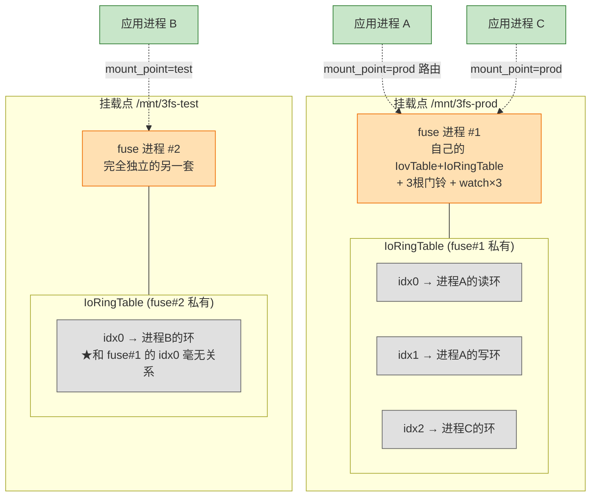

完整归属链：

```
应用进程   想建几条环自便 (读写方向必须分开建; 多线程建议各建各的 —— prep 非线程安全;
           唯一总额约束 = fuse 侧 iov_limit 配置)
  └── 环#N   一块独立 shm + hf3fs_ior
        │ 注册时按 mount_point 参数路由 (symlink 写在哪个挂载点下, 内核就送给哪个 fuse)
        ▼
某个 fuse 进程 (= 一个挂载点, 表/门铃/watch 全私有)
  └── IoRingTable[idx] → 它对环#N 的解读器(owner=true)
```

另有一对编号**极易混淆**，务必分清——`IoRingTable` 的 idx 编的是"**整机（该挂载点内）第几条环**"，与单条环内部的格子号是两套系统：

| | IoRingTable 的 **idx** | 环内 IoArgs 的 **index** |
| --- | --- | --- |
| 编号对象 | **哪一条环**（该 fuse 进程的第几号客人） | **一条环内的哪个格子**（申请单槽位） |
| 谁分配 | fuse 注册时 `ioRings->alloc()`（`IoRing.h:238`） | 应用 prep 时 `ring.slots.alloc()`（`UsrbIo.cc:644`） |
| 容量语义 | `iov_limit`（该挂载点环总数上限，注册报错即满） | `entries`（**单条环**的深度，建环时按 shm 大小算死，2.2 节公式） |
| idx 的设计动机 | watch 高频**遍历**要无锁（数组+原子 load，`FuseClients.cc:387-397`）；int 句柄小而稳定可存进 `ShmBuf.iorIndex` 供注销（`FuseOps.cc:1240/1065`）——即"内核 fd 的设计哲学用在进程内" | 环内存布局的一部分（2.2 节），收割后凭它归还格子 |

记忆锚点：**环 = 两办公室之间墙上的公告板**（钉 IO 申请单和回执）；**IoRing 对象 = 各办公室的使用手册 + 手电筒**（知道哪格是什么、挪自己那两个刻度）；**hf3fs_ior / hf3fs_iov = 员工工作证**；**两张 Table = fuse 总务的台账**；**submitSem/cqeSem = 两根拉绳门铃**——你拉 submit 铃 fuse 来取单，fuse 拉 cqe 铃你来取回执。

### 2.2 环内存布局

一整块连续 shm，内部分五段。绿色 = 应用写、fuse 只读；橙色 = fuse 写、应用只读；灰色 = 双方各推各自名下的游标：

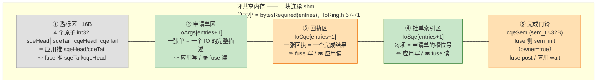

#### 环的大小是怎么确定的：从需求到字节的因果链

**第 1 步·需求**：应用在 `hf3fs_iorcreate4(…, entries=N, …)` 里表达的是**深度**——这条环最多同时挂多少个在途 IO（第 N+1 个 prep 会 EAGAIN）。

**第 2 步·正向算大小**（`hf3fs_ior_size` → `IoRing::bytesRequired`，`IoRing.h:67-71`，`UsrbIo.cc:491` 调用）：

```
需要的 shm 大小 = 游标区 16B
               + 完成门铃 sizeof(sem_t) ≈ 32B
               + 每格 96B × (N + 1) 格        ← 三个数组各 N+1 格, +1 的原因见第 4 步
               + 4096B 页对齐余量
```

**第 3 步·建内存，再反解**：按这个 size 建 shm 后，IoRing 构造函数的入参只有 `buf` 和 `size`（`IoRing.h:77-87`）——**深度信息丢了**，于是用 `ioRingEntries(size)` 从大小反解回来（`:60-66`）：

```
可用深度 N = (shm大小 - 4096 - 16 - 32) ÷ 96  -  1
```

正反两个函数互为逆运算。构造函数把**物理格数**记为 `entries = N+1`（`:89`），把**槽位分配器上限**记为 `N`（`:104`）——两个数字从此各司其职。

**第 4 步·为什么多开一格**：环形队列若把格子全部装满，head 会转一圈追上 tail——**和空队列的样子完全相同**，无法区分：

```
4 格装满 4 个: head 转一圈回到起点 → head == tail ┐
4 格全空:      head == tail                        ├ 同一个状态, 两种含义 ✗
                                                   ┘
解法: 开 N+1 格、只许装 N 个 —— 永远留一个空格,
     head 永远追不上 tail, 空与满的判定条件从此不同:
       空: head == tail
       满: (head + 1) mod (N+1) == tail     ← addSqe 的判满 (IoRing.h:135)
```

用一格内存（96B）的代价，换掉一个需要生产者/消费者共同维护的共享计数器——保住"每块牌子只有一个主人"的无锁规则。

| 队列状态 | 游标关系 |
| --- | --- |
| 空 | `head == tail` |
| 有 n 项 | `(head - tail) mod (N+1) == n`，有效区 `[tail, head)` |
| 满 | `(head + 1) mod (N+1) == tail` |

#### 逐区放大：字节级设计

三个住在这块内存里的结构体（类图；字节偏移见下表）：

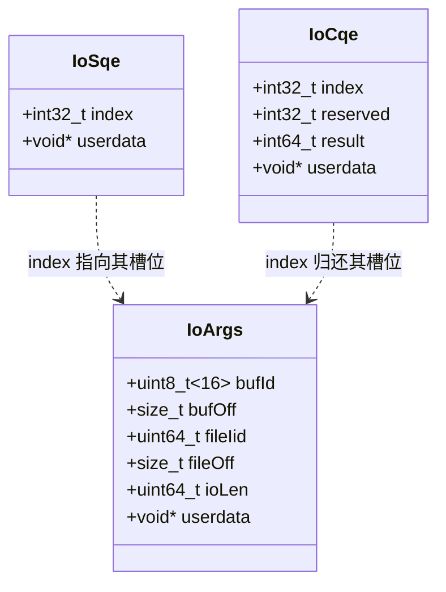

构造函数（`IoRing.h:93-103`）按下面这张**偏移表**把 buf 切开（x86-64；`ringMarkerSize()` = `atomic_ref<int32_t>` 的对齐要求 = 4）：

| 区 | 起始偏移 | 长度 | 内部 |
| --- | --- | --- | --- |
| 游标区 | `0` | `4 × 4B = 16B` | 4 个连续的原子 int32 |
| ringSection | `+16` | `entries+1` × 56B | IoArgs 数组 |
| cqeSection | `+16 + 56×(entries+1)` | `entries+1` × 24B | IoCqe 数组 |
| sqeSection | 紧随其后 | `entries+1` × 16B | IoSqe 数组 |
| cqeSem | 紧随其后 | `sizeof(sem_t)` ≈ 32B | 无名信号量 |
| （预留） | 末尾 | 补足 4096 余量 | — |

**① 游标区（16B）**——4 个 int32，靠 `std::atomic_ref<int32_t>` 把**裸内存当原子变量**用（两个进程各自的 atomic_ref 指向同一个物理 int32）：

```
偏移:    0          4          8          12
      ┌─────────┬─────────┬─────────┬─────────┐
      │ sqeHead │ sqeTail │ cqeHead │ cqeTail │  存的是环形下标 [0, entries)
      └─────────┴─────────┴─────────┴─────────┘  不是指针/计数——比较都要 mod entries
        应用推     fuse推     fuse推     应用推
```

**② ringSection：IoArgs 每张单 56 字节**（`IoRing.h:17-27`）：

```
偏移:  0        16       24       32       40       48      56
     ┌─────────┬────────┬────────┬────────┬────────┬────────┐
     │ bufId   │ bufOff │fileIid │fileOff │ ioLen  │userdata│
     │ [16]UUID│  8B    │  8B    │  8B    │  8B    │  8B    │
     └─────────┴────────┴────────┴────────┴────────┴────────┘
       数据在哪     ↑──────────── 读哪 ────────────↑    透传票据
```

**③ cqeSection：IoCqe 每张回执 24 字节**（`:34-39`）：

```
偏移:  0        4         8         16      24
     ┌────────┬─────────┬─────────┬────────┐
     │ index  │reserved │ result  │userdata│   index = 申请单槽位号
     │  4B    │  4B填充 │  8B     │  8B    │   (收割后凭它归还槽)
     └────────┴─────────┴─────────┴────────┘   result = 字节数 / 负 errno
```

**④ sqeSection：IoSqe 每项 16 字节**（`:29-32`，int32 后有 4B 对齐填充）：

```
偏移:  0        4        8                 16
     ┌────────┬────────┬──────────────────┐
     │ index  │ (填充)  │ userdata         │   index = 指向 ringSection
     │  4B    │  4B    │  8B              │   的槽位号
     └────────┴────────┴──────────────────┘
```

**⑤ 槽位分配器 AvailSlots 不在共享内存里**——它是 IoRing **对象**的成员（`IoRing.h:186`），且**只有应用侧使用**：

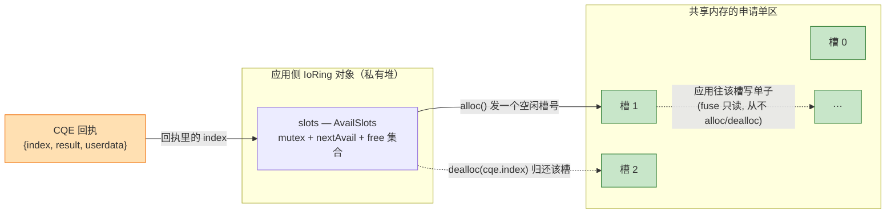

深意：**IoArgs 槽位的分与收完全归应用单侧**，所以分配器用带 mutex 的普通结构即可（`AtomicSharedPtrTable.h:10-49`），无需跨进程共享。

**尺寸速算**（每槽合计 56+24+16=96B）：2MB shm ≈ 2.1 万槽；1024 槽仅 ~100KB——环内存很小，大头永远是数据缓冲。

**三个设计要点**：

- **描述与提交分离**（IoArgs vs IoSqe）：单子内容可乱序填（槽位由 slots 分配），提交顺序只由 SQE 队列记载；fuse 消费 SQE 拿 index 再回 ringSection 取内容——SQE 每项仅 16B，队列转一圈极快
- **index 串起一次 IO 的一生**：`slots.alloc → IoArgs[index] → IoSqe{index} → IoCqe{index} → slots.dealloc(index)`——三个数组靠同一个槽位号首尾相接
- **reserved 是纯对齐填充**；`userdata` 在 SQE/CQE 两处都有，完成时原样回传（`IoRing.cc:262`）

申请单（IoArgs）逐字段——谁填、下游谁用：

| 字段 | 含义 | 谁填（值从哪来） | 下游谁用 |
| --- | --- | --- | --- |
| `bufId[16]` | 数据缓冲身份 UUID | prep_io 从 `iov->id` 抄（`:650`） | fuse 的 lookupBufs 查 IovTable |
| `bufOff` | 缓冲内偏移 | prep_io 算 `ptr - iov->base`（`:651`） | fuse 定位数据落点 |
| `fileIid` | 目标文件 inode 号 | prep_io 从 regfds 档案抄（`:652`） | fuse 的 lookupFiles 查 RcInode 表 |
| `fileOff` / `ioLen` | 文件内偏移 / 长度 | 应用直接传（`:653-654`） | fuse 侧 PioV 按 chunkSize 切分 |
| `userdata` | 透传票据 | 应用任意 | 原样进 CQE，收割时对账 |

回执（IoCqe）只有三个字段：`{index（归还申请单槽位用）, result（字节数或负 errno）, userdata}`。

#### 游标推进：全场景推演（含回绕、满、乱序、并发收割）

四个游标两两配对，每对内部"生产者推 head、消费者推 tail"：

```
提交队列:  sqeHead(应用推·挂SQE时) ──── sqeTail(fuse推·消费完后)
完成队列:  cqeHead(fuse推·写回执时) ──── cqeTail(应用推·收割走时)
```

设 entries=5（4 可用 + 1 牺牲格），用数字走一遍全部场景：

**正常推进**：

```
prep ×3 → sqeHead: 0→1→2→3   (应用每挂一个号牌推一次)
fuse 完成 → sqeTail: 0→3     (消费完3个SQE后推到3)
fuse 写回执 ×3 → cqeHead: 0→3
应用收割 ×3 → cqeTail: 0→3   (每抄走一个回执推一次)
```

**回绕（head 到尾部再推）**：

```
sqeHead=4, sqeTail=0 时再 prep:
  addSqe: h=4, (4+1)%5=0, 0≠tail(0) → 不满
         写 sqeSection[4] → head=(4+1)%5=0   ★从4跳回0
格子编号在 [0,5) 循环取模, head 永远"追着" tail 转圈
```

**SQE 满（不能再挂）**：

```
sqeHead=4, sqeTail=0 (4个待处理, 占满了4个可用格)
  addSqe: (4+1)%5=0 == tail(0) → ★满!
         return false → prep_io 返回 -EAGAIN
应用必须先 wait 收割 → fuse 消费 SQE → sqeTail 前进 → 才有空位
```

**CQE 满 + 背压（fuse 写不进去）**：

```
cqeHead=4, cqeTail=0 (4个回执待收割, 完成队列满)
  addCqe: (4+1)%5=0 == cqeTail(0) → ★满! return false  (IoRing.h:192)

fuse 的 jobsToProc 切新 job 前也会检查:                    (IoRing.cc:22)
  cqeAvail = entries - 1 - processing - cqeCount()
           = 5 - 1 - 0 - 4 = 0 → 不切新job → worker没活干
  ★背压: 完成队列快满时 fuse 不领新活, 防覆盖未收割的回执

解除: 应用 wait 收割 → sem_post 反压通知 (:736)
      → fuse 重算 cqeAvail > 0 → 恢复切 job
```

**fuse 乱序完成 → sqeTail 连锁推进**：

```
watch 切 3 个 job: job1[0,2), job2[2,3), job3[3,4)
  sqeProcTails_ = [2, 3, 4]     ← 领取时按序登记结束位

workerB 先完成(结束位=3): 队首=2≠3 → 不是队首
  → sqeDoneTails_.insert(3)    ← 记账, tail 不动
workerC 完成(结束位=4): 同上 → insert(4)
workerA 最后完成(结束位=2): 队首=2==2 → 是队首!
  → sqeTail=2, 弹出
  → 循环: 下一个队首=3 在 done{3,4}里? 是 → sqeTail=3
  → 下一个队首=4 在 done{3,4}里? 是 → sqeTail=4
  ★一次连锁推从 0 到 4
```

**应用多线程并发收割（CAS 竞争）**：

```
cqeHead=3, cqeTail=0, 线程A和B同时调 wait:

线程A: t=0 → 抄 cqeSection[0] → CAS(0→1) 成功! ✓
线程B: t=0 → 也抄 cqeSection[0] → CAS(0→1) ★失败! (已被A改)
       → break, 丢弃本地拷贝, 下轮 t=1 重试

★CAS 输家丢弃拷贝重来, 保证每个 CQE 恰好归一个线程
```

**单 IO 完整时间线（一格的生命周期）**：

```
slots.alloc(发0号) → IoArgs[0]填内容 → IoSqe[0]挂号 → sqeHead+1
→ fuse读单执行 → IoCqe[0]写回执 → cqeHead+1
→ 应用抄走 → cqeTail+1 → slots.dealloc(还0号) → 槽0回到空闲池
```

**为什么不需要跨进程锁**：

| 规则 | 保证 |
| --- | --- |
| 每个游标**只有一个进程**有资格 store | 单写者，不需要互斥 |
| 读别人的游标用 atomic_ref.load | 读到最新值，无撕裂 |
| **先写内容，后推游标** | 读到 head 前进 → 内容一定已就绪 |
| 永远留 1 格空位 | 空满判定不歧义（head==tail 空 / head+1==tail 满） |
| cqeTail 用 CAS 而非 store | 应用多线程并发收割时每个 CQE 归一人 |

### 2.3 IoRing 对象解剖：一个类，四类成员

2.2 讲了**环内存**长什么样；本节讲**解读它的那个 C++ 对象**（`IoRing.h:53-215`）——两侧各 new 一个、指向同一块 shm（2.1），本章回答"这个类本身装了什么"。核心结构一句话：

> **public 部分 ≈ 共享内存的视图（两侧一致，复用同一个类的根基）；private 部分按侧分家**——源码里 `private: // for fuse` 注释（`:205`）就是分界线。

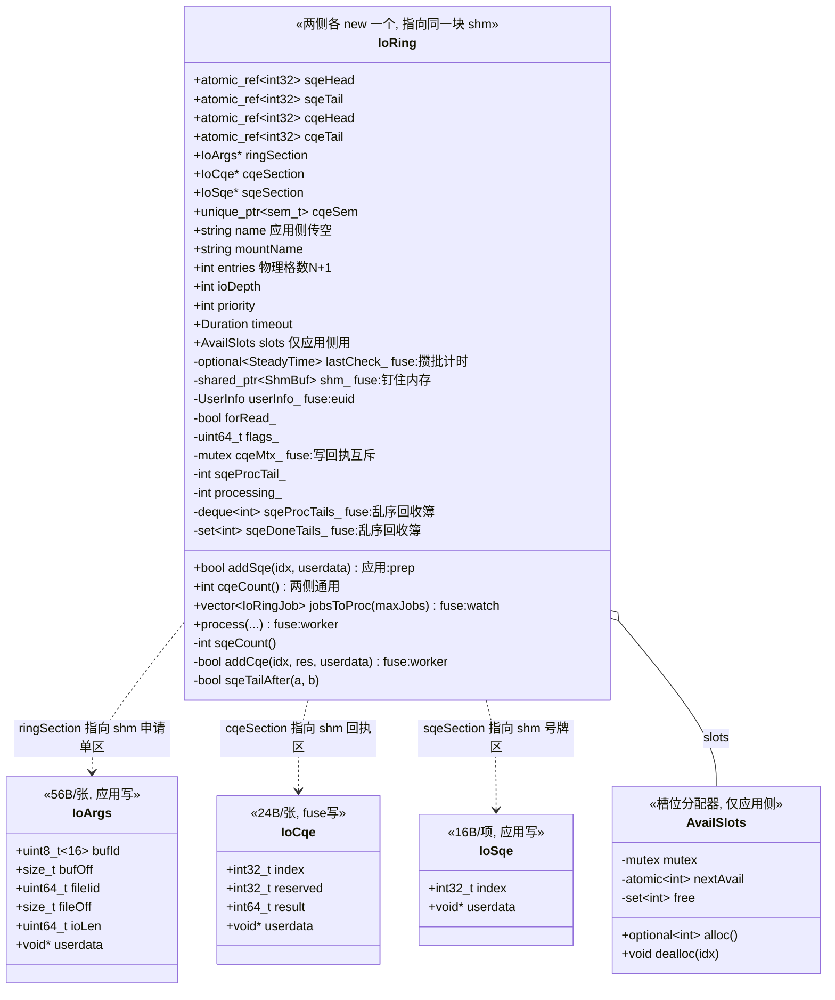

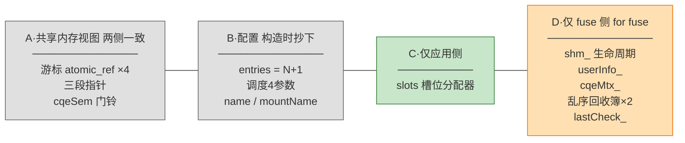

成员明细（四类逐行，行号 + 说明）：

| 类别 | 成员 | 行号 | 说明 |
| --- | --- | --- | --- |
| **A·共享内存视图**(两侧值完全相同：同一构造函数、同一块 shm、同一套公式) | `sqeHead/sqeTail/cqeHead/cqeTail` | `:176-179` | `std::atomic_ref<int32_t>`——**指进 shm 游标区的原子引用**（"游标住在共享内存、原子性由 atomic_ref 授予"的代码落点；两个进程的引用指向同一个物理 int32） |
| | `ringSection / cqeSection / sqeSection` | `:180-182` | 三段（申请单/回执/号牌）的起始地址 |
| | `cqeSem` | `:183` | 指向环末尾的完成门铃；deleter 含 `sem_destroy`——**两侧析构都会执行它**（应用侧 iordestroy 也走这个 deleter，而此刻 fuse 侧可能还在用这根铃；未见 owner 分叉保护，类设计上的存疑点） |
| **B·配置** | `entries` | `:163` | 物理格数 N+1（判满用） |
| | `ioDepth/priority/timeout/flags` | `:164-166` | 调度参数 |
| | `name / mountName` | `:161-162` | 应用侧 name 传空、fuse 侧是注册链接名 |
| **C·仅应用侧** | `slots`（AvailSlots） | `:186` | IoArgs 槽位分配器——2.2 节⑤讲过它的生命周期（prep 时 alloc、收割时凭 CQE 的 index dealloc） |
| **D·仅 fuse 侧**(private: for fuse) | `shm_`（shared_ptr） | `:206` | **持住 ShmBuf，钉住环内存生命周期**——应用侧构造传空（由 `iov->iovh` 持有），两侧各有一个"不会提前死"的保人 |
| | `userInfo_` | `:207` | euid 身份，process 时做 readonly 检查与按用户配置查询（`IoRing.cc:91-97`） |
| | `cqeMtx_` | `:210` | 多个 worker 协程**并发写回执**（addCqe）时的互斥 |
| | `sqeProcTails_` / `sqeDoneTails_` | `:213-214` | **乱序回收簿**——多 job 并行、完成乱序时保证 sqeTail 按领取序推进（机制见 fuse.md 6.6，状态住在这两个容器里） |
| | `lastCheck_` | `:173` | ioDepth<0 攒批模式的超时计时起点（`IoRing.cc:36-46`） |

**方法归属**（谁能调，同样按侧分家）：

| 方法 | 谁调 | 行号 | 说明 |
| --- | --- | --- | --- |
| `addSqe` | 应用（prep 内部） | `:133-146` | 判满 `(h+1)%entries==tail` → 写号牌 → 推 sqeHead |
| `cqeCount` | 两侧（wait / watch） | `:122` | `(cqeHead+entries-cqeTail)%entries` |
| `jobsToProc` | fuse（watch） | `:121` | 把积压 SQE 切成 job（2.2 节空满规则在此使用） |
| `process` | fuse（worker） | `:123` | 一个 job 的完整执行（查表→PioV→RPC→写回执） |
| `addCqe` | fuse（worker，**private**） | `:190-203` | 写回执 + 推 cqeHead，与 `cqeMtx_` 配合 |
| `sqeTailAfter` | fuse | `:147-158` | 环形序号比较（处理回绕） |

**为什么用一个类而不是写成两个类**：布局公式、判满逻辑、环形下标运算这些"环的数学"只写一份（两侧必须严格一致，写两份迟早漂移）；而 owner 参数实际只分叉一处——`sem_init`（`:116-118`）。**公共接口只是"环的指针集合 + 少量通用方法"，各自的私有状态（应用的槽位分配器 / fuse 的乱序回收簿与并发锁）互不干扰**——这就是"两个进程复用同一个类"能成立的全部结构性原因。

### 2.4 数据缓冲布局与两块内存的协作

数据缓冲（普通 iov）是**另一块 shm**，与环分开建：环是控制面（几十 KB~几 MB，放描述单），缓冲是数据面（GB 级，放数据），大小差三个数量级、线程约束不同（环单线程 prep，缓冲可多线程各用各的区间）、RDMA 注册策略不同。

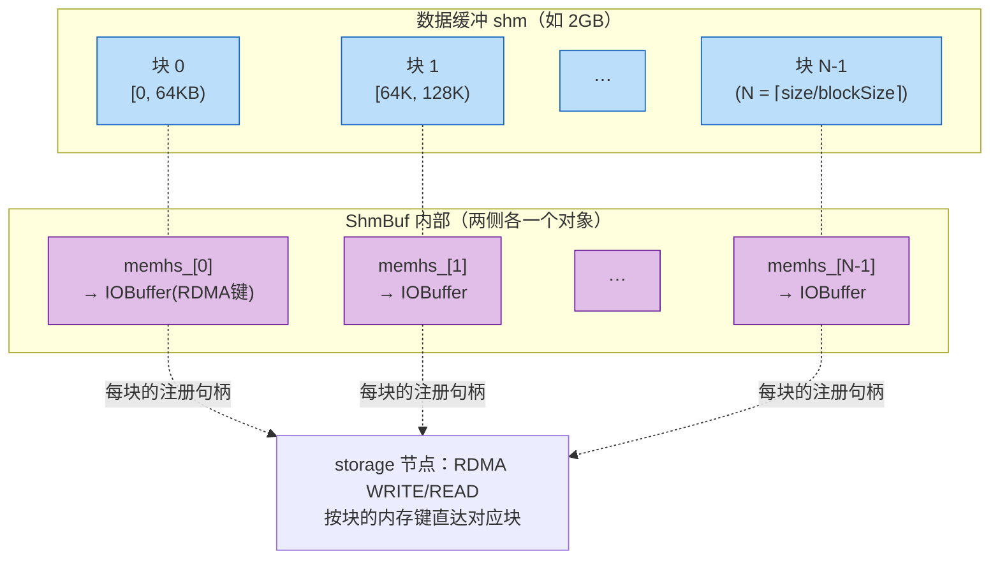

- 普通 iov：注册时**全量逐块**注册（`Shm.cc:101-117`）——数据落点的主流形态（数据块几乎全会被用到，一次付清，热路径零注册延迟）
- 环的 shm：注册时**不预注册**（`IovTable.cc:222` 的 `if (!is_io_ring)` 跳过）——环 shm 恰好是标准环大小（`UsrbIo.cc:491`），主体是控制结构，预注册纯浪费
- 硬约束（`Shm.h:90-92`）：单个 IO 的 `[bufOff, bufOff+ioLen)` **不得跨块**——RDMA 凭证按块发放

一次读 IO 中两块内存的协作——**描述走环、数据走缓冲**：

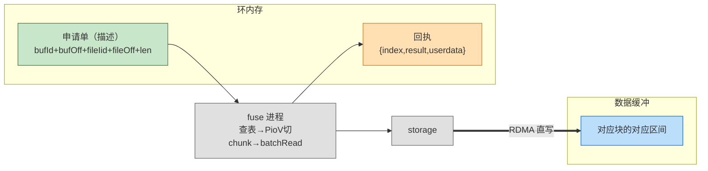

数据全程不过 fuse 进程的手——fuse 只是"描述的翻译者 + 注册代办"。

#### 两块内存的生命周期与所有权（谁建、谁初始化、谁释放）

把"创建 / 初始化 / 使用 / 释放"四个阶段拆开看——**两块内存都是应用创建、应用发起释放**；fuse 在环上做的唯一"构建"动作只是装门铃：

| 阶段 | 环的 shm | 数据缓冲的 shm |
| --- | --- | --- |
| **谁创建**（开文件+映射） | **应用**（`UsrbIo.cc:133`：shm_open+ftruncate+mmap） | **应用**（同一函数，iovcreate 路径） |
| **谁初始化内容** | 游标**天然为零**（新页零填充 = 空队列）；门铃 `sem_init` 由 **fuse**（注册时，`IoRing.h:116`）；双方各建自己的解读器对象 | 无需初始化（纯数据区）；fuse 代做 RDMA 注册 |
| **谁使用** | 双方（应用写单 / fuse 写回执） | 双方（storage RDMA 写、应用读） |
| **谁释放** | **应用发起**（`iordestroy`），fuse 被动配合 | **应用发起**（`iovdestroy`），fuse 被动配合 |

释放时实际发生的事（以环为例，`hf3fs_iordestroy` 展开）：

```
应用调 hf3fs_iordestroy
 ├─ ① 拼回链接名 → unlink
 │     → [fuse侧] rmIov + rmIoRing:
 │          表槽清空 → fuse 侧 ShmBuf 析构 (munmap, 无权删文件)
 │          fuse 的 IoRing 对象析构 → sem_destroy 拆门铃 (owner=true 才做, IoRing.h:183)
 └─ ② delete 应用侧的 ShmBuf 和 IoRing 对象:
        应用侧 IoRing 析构 (owner=false, 不碰门铃)
        应用侧 ShmBuf 析构 → deregisterForIO + munmap
                          → 应用侧(创建者)才 shm_unlink ★删文件 (Shm.cc:128-138)
 → 双方 mmap 都没了 → tmpfs 引用归零 → 物理页释放
```

**两个 owner 各管一件一次性动作，不改变"资源归应用"的大格局**：

| | `ShmBuf.owner`（true 在**应用侧**） | `IoRing.owner`（true 在**fuse侧**） |
| --- | --- | --- |
| owner 独占的动作 | 建文件 / ftruncate / **shm_unlink 删除资格** | **sem_init** 完成门铃（只能初始化一次） |
| 分派逻辑 | 谁建这块 shm、谁负责生杀 | 注册时序决定 fuse 的对象必然先诞生——"先到先装修"，消灭"环已挂表但门铃未装"的窗口（`IoRing.h:238-248`：构造+init 完才挂表，**表里的环永远装修完毕**） |
| 修辞 | 谁建谁有权删 | 谁先到谁装修 |

**崩溃时的兜底与边界差异**（应用没调 destroy 就死了 → 保活 fd 关闭 → fuse releasedir 按 pid 清理，3.7 节）：

- **环**：注册后文件已被 `maybeUnlinkShm` 删过，物理页只由双方 mmap 持有——两侧映射一撤就彻底释放，**无泄漏**
- **普通 iov**：文件路径特意留给 iovopen 第三方，进程暴死时没人有权删它——物理页随映射释放，但 `/dev/shm` 下的**文件名**可能残留，依赖运维层 tmpfs 清理兜底——这是"保留路径给第三方"设计付出的代价

**`/dev/shm` 本体是什么——tmpfs，不在任何盘上**：

- 它是**独立挂载的内存文件系统**（`mount` 可见 `tmpfs on /dev/shm`），写进去的字节全活在 RAM 里，与根盘互不相干；重启即整体清空
- 容量默认 = 物理内存的一半（挂载选项 `size=` 可调），**写满报 ENOSPC**——这正是 `ShmBuf` 构造三个炸点之一（`shm_open` 失败，`Shm.cc:151-159`）的现实来源
- 唯一与磁盘的可能交集：机器配了 swap 时，长期不碰的 tmpfs 页可能被换出到 swap
- 3FS 选它的三个理由：**内存速度**（SQE/CQE 是热路径）、**两进程可 mmap 同一文件**（共享的载体）、**文件语义**（名字/open/unlink——"注册即删"与"mmap 保活"的前提）
- 崩溃兜底的最终闭环：普通 iov 的文件名残留问题，在**重启时 tmpfs 清空**自然消失

### 2.5 API 句柄：iov 与 ior

两个结构体（`hf3fs_usrbio.h:18-49`）与它们指向的对象（类图，含持有链）：

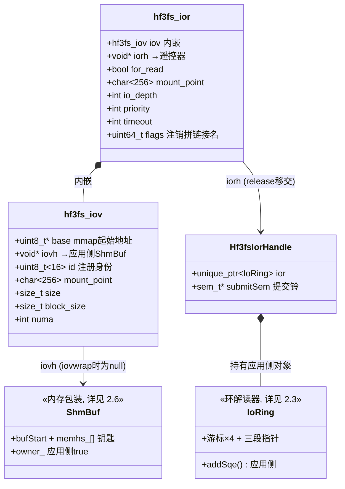

职责严格分离：

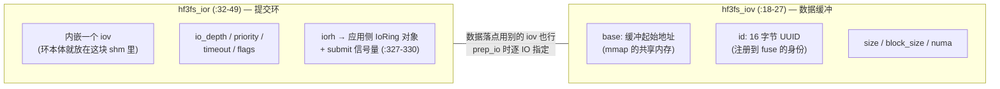

- **iov 只管数据放哪**：一块共享内存 + 身份 UUID
- **ior 只管怎么提交**：环布局 + 调度参数。创建 ior 时内部自动创建一个恰好够环大小的 iov，但 `prep_io` 提交时可以指定**任何**已注册的 iov（`:616-623` 参数中 iov 独立于 ior）
- `hf3fs_cqe`（`:51-56`）与 fuse 侧 `IoCqe`（`IoRing.h:34-39`）**二进制布局一致**——同一块内存两个进程各自用自己的结构体类型解读

### 2.6 Shm 底层：ShmBuf

`ShmBuf`（`src/lib/common/Shm.h:19-76`）两侧共用，**应用侧和 fuse 侧各 new 一个对象指向同一块 shm**。类图（成员与方法，含单次 IO 视图类）：

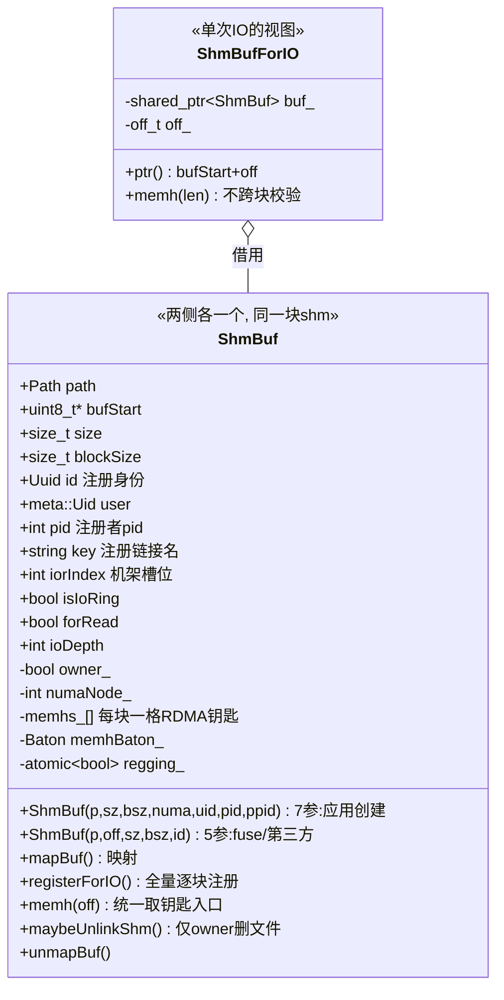

类里有个 bool 成员 `owner_`（`Shm.h:68`）：**应用侧的对象 owner_=true（它是创建这块内存的一方），fuse 侧 owner_=false**。两个构造函数（同名重载，按参数个数区分）各自服务一种身份：

**7 参数构造——应用侧创建时走（`Shm.cc:10-31`，`UsrbIo.cc:133` 调用）**：

```cpp
ShmBuf::ShmBuf(const Path &p, size_t sz, size_t bsz, int numa, meta::Uid u, int pr, int pp)
    : ...,
      blockSize(bsz ? bsz : sz),          // 不指定块大小 → 整块即一块
      id(Uuid::random()),                 // 身份(uuid)在此生成
      owner_(true),                       // ★应用侧对象 = 创建者
      memhs_((size + blockSize - 1) / blockSize) {  // ★每块一个 RDMA 句柄槽 :21
  mapBuf();                               // :26 映射(见下)
  if (numaNode_ >= 0) numa_tonode_memory(bufStart, size, numaNode_);  // :28-30 NUMA绑定
}
```

**5 参数构造——fuse 侧（`IovTable.cc:174`）和 iovopen 的第三方走（`Shm.cc:33-52`）**：uuid 用传入的（应用创建时生成的那枚）、`owner_(false)`、不做 ftruncate/NUMA，同样调 `mapBuf()`。

**`mapBuf`（`Shm.cc:149-175`）——两个构造函数最后都调它，把 shm 文件映射进本进程**（差异全靠 `owner_` 开关）：

```cpp
// :150 应用侧(owner_=true)带 O_CREAT|O_EXCL 创建文件; fuse侧不带, 纯打开已存在的
auto fd = shm_open(path.c_str(), O_RDWR | (owner_ ? O_CREAT | O_EXCL : 0), 0666);
// :163-168 应用侧负责 ftruncate 定长 (新文件创建时长度为0)
if (owner_) { ftruncate(fd, size); }
// :169 MAP_SHARED —— 跨进程共享的关键 (写入对其他映射者可见)
bufStart = (uint8_t *)mmap(nullptr, size, PROT_READ | PROT_WRITE, MAP_SHARED, fd, off);
```

**RDMA 注册两形态**：

- `registerForIO`（`Shm.cc:87-126`）：普通 iov 用（fuse 侧 addIov 时调，`IovTable.cc:222-224`）。`:101-117` 把**所有块**逐块 `sc.registerIOBuffer(...)`，注册丢到 executor 异步做，`memhBaton_.post()` 通知完成（`:119`）
- `memh(off)`（`Shm.cc:140-147`）：**worker 取钥匙的统一入口**（唯一调用点 `IoRing.cc:151`）。`idx = off/blockSize`，查 `memhs_[idx]`：已注册（普通 iov 预注册过）直接命中返回；未注册则现场注册并填入，注册进行中则 `co_await memhBaton_` 等待。"懒注册"是这个接口的**未命中分支**——保证任何未预注册的缓冲（如环的 shm）也能工作，对调用方完全透明

**`ShmBufForIO`（`Shm.h:78-99`）——单次 IO 的视图**：

```cpp
CoTryTask<IOBuffer *> memh(size_t len) const {
  // :90-92 ★块对齐约束: [off, off+len) 不许跨块
  if (len && off_ / buf_->blockSize != (off_ + len - 1) / buf_->blockSize)
    co_return makeError(StatusCode::kInvalidArg);
  co_return (co_await buf_->memh(off_)).get();
}
```

**析构链**（`Shm.cc:54-65`）：`deregisterForIO`（清空全部句柄，`:67-85`）→ `unmapBuf`（munmap；**应用侧的对象**才补 `shm_unlink` 删文件，`:128-138`——fuse 侧的对象无权删）。

**`maybeUnlinkShm`（`Shm.h:33-39`）**：判断 `owner_`，即**只有应用侧的 ShmBuf 有资格删文件**——"注册即删"（3.2 节）和销毁兜底都靠它。

---

## 3. 动态视图：完整生命周期

### 3.0 全景：六个阶段

一个训练进程从启动到退出，与 3FS 的完整交互只有 6 个阶段。每阶段的存在都由一个具体问题驱动——前一阶段的产出恰好是后一阶段的输入：

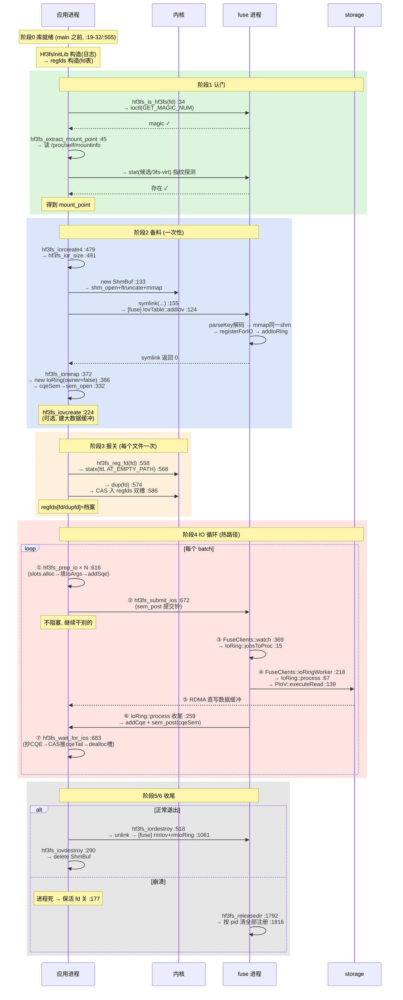

### 3.1 阶段 1·认门：环境探测（**可选——知道挂载点就跳过整个阶段**）

本阶段两个函数都是**探测型便利工具**：知道答案就跳过，不知道才用它们去问。全仓所有 C/C++/Rust 示例和 benchmark 都**不调**这两个函数——它们在配置里显式写了挂载点路径。唯一调用方是 **Python 绑定**（`usrbio_binding.cc:43-46`），替脚本自动翻译。

| 函数 | 什么时候需要调 | 什么时候跳过 |
| --- | --- | --- |
| `hf3fs_is_hf3fs(fd)` | 想确认 fd 是否在 3FS 上 | `reg_fd` 内部会自动调它守门（`:561`），应用通常不用主动调 |
| `hf3fs_extract_mount_point` | 应用手里只有文件路径、不知道挂载点 | 已知挂载点字符串（写死/配置传入）→ 直接传给 iorcreate |

**`hf3fs_is_hf3fs(fd)`（`UsrbIo.cc:34-43`）**——与 fuse 的第一次握手：

```cpp
ioctl(fd, HF3FS_IOC_GET_MAGIC_NUM, &magic);   // :37 私有 ioctl 问 magic
return magic == HF3FS_SUPER_MAGIC;            // 0x8f3f5fff (hf3fs_usrbio.h:11)
```

一次同步往返：内核→FUSE→fuse 的 `hf3fs_ioctl`（`FuseOps.cc:2000-2008`）原样回 magic。任何一环不通都返回 false。它是后面 `reg_fd` 的守门员（`:561`）。

**`hf3fs_extract_mount_point(buf, size, path)`（`:45-107`）**——把"任意文件路径"翻译成"它属于哪个 3FS 挂载点"（后续所有 API 的第一个参数）：

```
第1步 :57-92   扫 /proc/self/mountinfo, 收集所有 fuse.hf3fs 挂载进候选集 mps
              └ 指纹探测淘汰 bind 子树: exists(mp/"3fs-virt") —— 3fs-virt
                只存在于 fs 根(fuse 的内存常量, FuseOps.cc:654-658 凭空应答),
                子树 bind 后父目录≠根inode, 探测必失败 → 天然不可伪造
第2步 :94      canonical(path) 规范化 —— 消解软链接/../相对路径
              (要求路径存在, 无 catch → 不存在时异常逃出 C 边界, 已知缺陷)
第3步 :95-104  倒序(最长前缀优先)逐分量 std::mismatch 匹配
              └ 最长匹配=最深的门=内核路径解析最后穿过的挂载点=文件真实归属
```

返回值三态：`-1` 不是 3FS 路径；`≤size` 成功已写入；`>size` 缓冲区不够（返回所需大小，开大重调）。

### 3.2 阶段 2·备料：创建链

`hf3fs_iorcreate4`（`:479-516`）是三层套娃——本质是三幕剧：**造内存 → 让 fuse 来注册 → 收尾**：

```
hf3fs_iorcreate4 (:479)
  ├─ hf3fs_ior_size(entries)                    :491   算环需要多大 shm
  ├─ hf3fs_iovcreate_general(..., 环参数)        :492-502   第一幕+第二幕
  └─ hf3fs_iorwrap(ior, iov.base, ...)          :508   领手册+拿门铃
```

**第一幕·造内存（`hf3fs_iovcreate_general`，`:109-183`）**：

```cpp
// :129-137 向内核要三样东西 (Shm.cc:149-175)
auto p = fmt::format("/hf3fs-iov-{}", Uuid::random());   // tmpfs 文件名
shm = new ShmBuf(p, size, block_size, numa, uid, pid, ppid);
//     └ shm_open(O_CREAT|O_EXCL) + ftruncate + mmap(MAP_SHARED)
```

**第二幕·注册（`:146-159`）**——全函数的灵魂。两个子问题（怎么叫到 fuse、参数怎么传）的答案都藏进一次 `symlink`：

```cpp
// :147-154 链接名 = 参数串(七段编码), 目标 = 资源路径
auto link = fmt::format("{}/3fs-virt/iovs/{}{}{}{}{}{}",
                        hf3fs_mount_point, shm->id.toHexString(),
                        /* .b块 / .r|w深度 / .p优先级 / .t超时 / .f标志 按需拼接 */);
// :155-159 一次普通 symlink = 一次同步注册 RPC (三个世界一个来回)
auto lres = symlink(target.c_str(), link.c_str());
//   [fuse侧] hf3fs_symlink (FuseOps.cc:1215-1246) → IovTable::addIov (IovTable.cc:124):
//             parseKey 解码 → mmap 同一块 shm → registerForIO → 是环再 addIoRing
```

编码对照（本侧 `:150-154` ↔ `[fuse侧]` 解码 `IovTable.cc:28-111`）：

| 编码 | fuse 侧解码 | 字段 |
| --- | --- | --- |
| `<uuid hex>` | `:34-36` | 缓冲身份 |
| `.b64K` | `:41-48` | 块大小 |
| `.r64` / `.w64` | `:50-57` | IoRing + 方向 + ioDepth |
| `.ph/.pl` | `:84-101` | 优先级（h=0/默认=1/l=2） |
| `.t100` | `:59-69` | 凑批超时 ms |
| `.f10` | `:71-81` | flags（二进制） |

`symlink` 失败的 `-errno` 有两个来源：内核侧拒绝（ENOENT=挂载点错、EACCES）；fuse 对端拒绝（EROFS=readonly 配置、EINVAL=parseKey/stat 检查失败、表满=iov_limit，见 `FuseOps.cc:1181` / `IovTable.cc:144-158`）。

**第三幕·收尾（`:160-180`）**三件杂务：

```cpp
if (is_io_ring) shm->maybeUnlinkShm();      // ① 注册即删: mmap 保活, 路径消失防误碰
                                            //    (普通 iov 不删 —— 留给 iovopen 第三方)
iov->base/iovh/id/... = ...;                // ② 收据交给应用(所有权移交 iovdestroy)
succ = true;                                //    SCOPE_EXIT(失败自动 delete shm)关闸
{ lock(alive.mtx);                          // ③ 保活: 首次 open iovs 目录并永久持有
  mountFds[mp] = open("<mp>/3fs-virt/iovs", O_DIRECTORY); }
```

保活 fd 的意义：进程死 → fd 关 → `[fuse侧]` releasedir（`FuseOps.cc:1792-1835`）→ 按 pid 清理全部注册（`:1816-1830`）。**内核 fd 生命周期充当免费死亡通知**。

**`hf3fs_iorwrap`（`:372-420`）——领手册、拿门铃**：

```cpp
// :386-399 在应用进程里构造 IoRing 对象 —— 复用 fuse/IoRing.h 的同一个类!
auto iorh = std::make_unique<Hf3fsIorHandle>(
    Hf3fsIorHandle{std::make_unique<hf3fs::fuse::IoRing>(
                       std::shared_ptr<ShmBuf>{},       // 不持有 shm(由 ior->iov 管)
                       "",
                       UserInfo{Uid{geteuid()}, Gid{getegid()}, ""},  // 身份带 euid
                       for_read, (uint8_t *)buf, size,  // 指向共享内存
                       io_depth, priority, timeout, flags,
                       false /* ★owner: 门铃 fuse 已装过, 此处绝不 sem_init */),
                   nullptr});

// :405-408 找到提交门铃的把手
auto res = cqeSem(iorh->submitSem, hf3fs_mount_point, priority);
```

`cqeSem`（`:332-370`，★名字叫 cqeSem 实际找的是 submit 门铃）三步：

```cpp
// ① readlink 伪链接 ([fuse侧] lookupSem 伪造, IoRing.h:267-277)      :340-350
auto link = fmt::format("{}/3fs-virt/iovs/submit-ios{}", mount,
                        prio==0 ? "" : prio<0 ? ".ph" : ".pl");       // 优先级三态
// ② 严格校验: 必须恰好 /dev/shm/sem.<name> 两级 (防伪造)              :352-361
// ③ sem_open("/<name>", 0) —— 只打开不创建, 铃必须 fuse 建的           :363-367
```

交货（`:410-418`）：`ior->iorh = iorh.release()`——unique_ptr 管构造期异常安全（6 个失败出口自动回收），`release()` 是向 C ABI 的所有权交接点，此后归 `hf3fs_iordestroy` 管；随后把 for_read/io_depth 等参数填进 `hf3fs_ior`（它们是将来注销时拼链接名的凭据）。

上层兜底（`:508-513`）：iorwrap 失败 → `hf3fs_iovdestroy` 回滚第二/一幕——两站拼出"要么全成、要么干干净净失败"的原子效果。

### 3.3 创建的变体：iovcreate / iovopen / iovwrap

先钉死**谁在哪个进程里调用**——三个函数都在**应用侧进程**执行（C API 的调用方永远是应用/第三方，fuse 进程从不调这些 C 函数；fuse 侧的动作都发生在它自己的 symlink 回调里）：

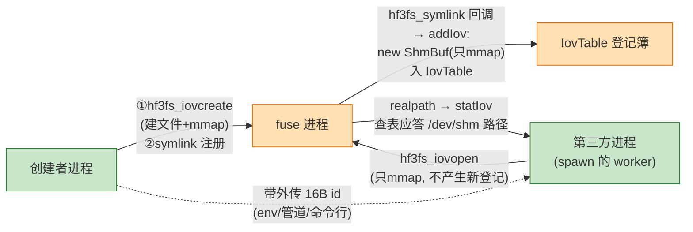

**`hf3fs_iovcreate`（`:224`）——调用方：应用进程（缓冲的创建者）**，数据面专用入口：只要缓冲、不要环。典型用法是"两条腿"：

```c
// 都在应用进程内执行:
hf3fs_iorcreate4(&ior, mp, entries, ...);        // 腿1: 提交环(小, 控制面)
hf3fs_iovcreate(&iov, mp, 2GB, 64KB, numa);      // 腿2: 数据缓冲(大, 数据面)
hf3fs_prep_io(&ior, &iov, true, iov.base+off, fd, file_off, len, ud);
//          ↑从这环提交      ↑数据落在这缓冲
```

内部走 `iovcreate_general(is_io_ring=false)`（`:109-183`，与 3.2 节同一流程）：应用侧 `new ShmBuf`（7 参数，`owner_=true`，建文件+mmap）→ `symlink` → **fuse 侧被动**在回调 `addIov` 里再 new 一个 ShmBuf（只 mmap）入登记簿。

**`hf3fs_iovopen`（`:228-283`）——调用方：第三方应用进程（不是创建者！）**——拿着 16 字节 id 打开**别人建的**缓冲：

- 创建者**不需要**它（手里有 `iov.base` 直接用）；fuse 进程也**不调**它——fuse 的"打开"发生在注册回调 `addIov` 里（`IovTable.cc:174`），与 iovopen 是两段互不相识的代码，只是殊途同归（都用 5 参数构造、只 mmap）
- 第三方进程内的执行链：

```
:237-240  拼 "<mount>/3fs-virt/iovs/<id>.b<block>"
:241-247  realpath() ──穿到──► [fuse侧] statIov 查登记簿, 伪链接应答 /dev/shm 真实路径
:256-262  new ShmBuf(path, 0, ..., uuid)  ← 在第三方进程堆上, 只 mmap, 不创建不注册
```

- fuse 的虚拟目录在这里充当**跨进程名字服务**。典型场景：大缓冲池集中管理（管理进程建 64GB、按块对齐划区、把 id+区间发给 worker）、生产者-消费者零拷贝交接、长寿命缓冲与短命计算进程解耦。**分区协议是应用自己的带外逻辑**（静态等分/动态申请/自描述头部），3FS 只提供"同一块内存"。

**典型第三方就是"spawn 的 worker"**——spawn 与 fork 的区别恰好决定了要不要 iovopen：

| 对比项 | fork | spawn |
| --- | --- | --- |
| 机制 | **复制**当前进程，子进程**原样继承 mmap** | 启动**全新进程**，从程序入口重跑，**什么都不继承** |
| 子进程对共享缓冲 | 映射已继承，base 直接有效——**不需要 iovopen**（不算第三方） | 全新地址空间，一无所知——**必须 iovopen 找回** |
| 典型来源 | 传统 Unix 风格、PyTorch DataLoader 在 Linux 的默认 | `posix_spawn`/exec、Python multiprocessing 的 spawn 模式（macOS/Windows 默认）、vLLM/Ray 等 GPU 框架主动选它（fork 后碰 CUDA 会死） |

spawn worker 的完整生命周期：

```c
// 主进程
hf3fs_iovcreate(&pool, mp, 2GB, 64KB, numa);    // 建缓冲池, 拿到 pool.id
spawn ×8, 各传 (id, 区间号);                     // 带外: 命令行/env/管道

// worker 进程 (全新地址空间)
hf3fs_iovopen(&iov, id, mp, 2GB, 64KB, numa);   // 找回缓冲: mmap 同一块
hf3fs_iorcreate4(&ior, mp, entries, ...);       // 环各建各的(私有)
// 循环: prep_io(落点 = iov.base + 我的区间) → submit → wait → 喂 GPU
```

**`hf3fs_iovwrap`（`:294-325`）——调用方：应用进程（自带 shm 的高级用法）**——包装应用自建的 shm（Rust 绑定走此路，`lib.rs:37-67`）：不建新 shm、`iovh=nullptr`（因此不能 iovdestroy，`:196-201`）、生命周期归应用。

### 3.4 阶段 3·报关：fd 注册

**问题**：申请单的 `fileIid` 栏要填 inode 号（全局身份证），应用手里只有 fd（进程私有的票根，号码会复用）。`hf3fs_reg_fd`（`:558-596`）= 翻译 + 钉住 + 登记：

```cpp
auto is3fs = hf3fs_is_hf3fs(fd);          // :561 守门(复用3.1)
if (!is3fs || fd >= regfds.size()) return EBADF;   // :562-563
if (regfds[fd].load()) return EINVAL;              // :564-565 已注册

statx(fd, "", AT_EMPTY_PATH|AT_STATX_DONT_SYNC, STATX_INO, &stx);  // :568
//       └ 别找路径, 直接问这个已打开的文件; 只要 inode 字段

auto dupfd = dup(fd);                     // :574 ★钉住: 应用 close 原fd后
//                                        //   inode 仍被 dup 引用, prep 不会写错对象

int status = fcntl(fd, F_GETFL);          // :582 顺手抄打开模式(读/写)
auto regfd = make_shared<Hf3fsRegisteredFd>(fd, dupfd, InodeId{stx.stx_ino}, status);
regfds[fd].compare_exchange_strong(empty, regfd);       // :586 双槽登记:
regfds[dupfd].compare_exchange_strong(empty, regfd);    // :589 两个号都能查到同一档案
return -dupfd;                            // :595
```

档案结构体与登记表（类图）：

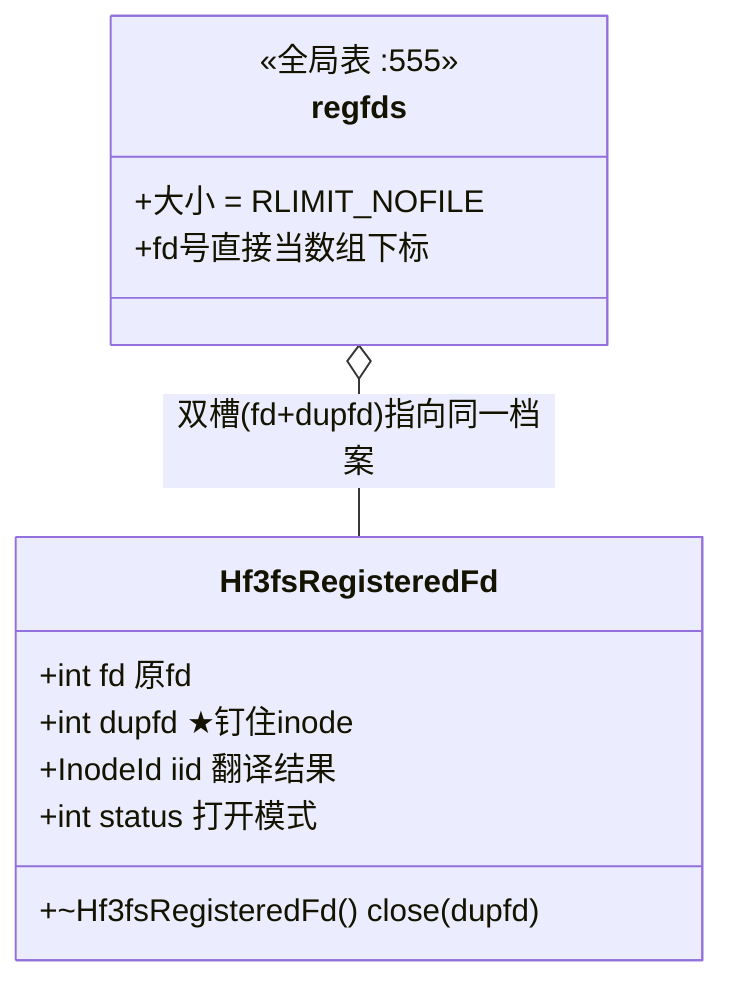

三个要点：

- **双槽**：prep_io 将来查表用调用方传的 fd（`:625` 的 `abs(fd)`），可能是原 fd 也可能是 dupfd——两个槽指向同一档案就都不会查空
- **CAS 而非锁**：多线程注册不同 fd 各占各的槽互不阻塞
- **★返回值约定反直觉**：成功返回**负数**（-dupfd）、失败返回**正 errno**——与全库"0=成功/负=失败"相反，Python 绑定按 `res > 0` 抛错（`usrbio_binding.cc:64-68`），写应用时最易踩反

**`dup(fd)` 内核里具体发生的三步**（只加号、不新开文件）：

```
① 在本进程 fd 表找最小空位 → 新号 dupfd
② fd 表[dupfd] 指向 fd 表[fd] 的【同一个 struct file】  ★不新建对象
③ 该 struct file 引用计数 f_count: 1 → 2

  fd表: [fd]───┐
               ├──► struct file {模式, offset, f_count:2} ──► inode
       [dupfd]─┘
```

| 两个号之间 | 内容 |
| --- | --- |
| **共享** | 同一 struct file → 同一 inode、同一打开模式、同一 offset（lseek 一个另一个跟着变） |
| **独立** | fd 号本身；`close(fd)` 只是 f_count 2→1，inode 仍被 dupfd 钉着——档案里的 inode 号**永不过期** |

dup 的"共享 offset"副作用在 3FS 无关紧要——每次 IO 的偏移由申请单的 `fileOff` 显式给出，不用内核 offset。**3FS 要的只是那 +1 的引用计数**：把 inode 的生命周期从"应用会不会 close fd"解耦出来，交给库保管的 dupfd 决定（dereg 时档案析构才 `close(dupfd)`，`:537`）。

`hf3fs_dereg_fd`（`:598-612`）：双槽 CAS 清空；档案引用归零时析构自动 `close(dupfd)`；未注册的 fd 注销静默成功（幂等）。头文件 `:136-141` 的配套约束：注册过的 fd 不应 close（即便 close，dup 副本仍钉着 inode）；close 后同号 fd 再注册 → EINVAL（防张冠李戴）。

### 3.5 阶段 4·热路径（每批重复）：prep 填单入环、submit 按门铃

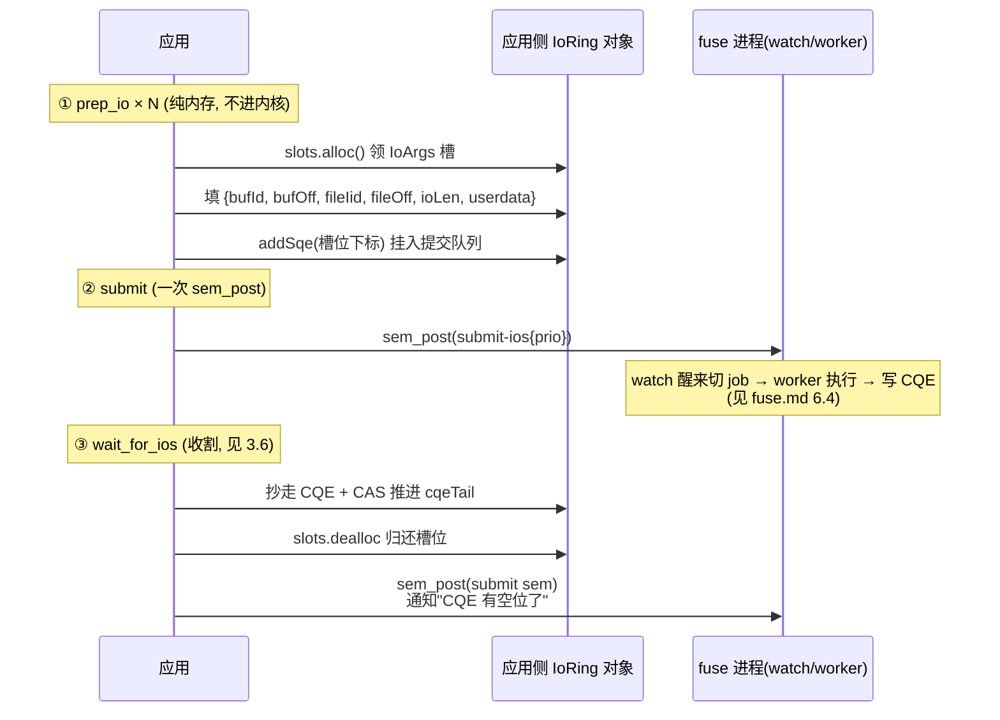

**`hf3fs_prep_io`（`:616-670`）**——五道闸门 + 两次写入，错误在源头拦截：

```cpp
// 闸门: 方向/缓冲范围 EINVAL(:626-629) → 未注册 EBADF(:631-634) → 权限 EACCES(:636-639)
// 写入1: slots.alloc() 领 IoArgs 槽 (:644-647, 满则 EAGAIN)
//        填 bufId/bufOff/fileIid/fileOff/ioLen/userdata (:649-655, 值来源见 2.2 的字段表)
// 写入2: addSqe(idx) 挂提交队列 (:657-664, 失败归还槽)
```

两侧共用代码的对应关系：

| 应用侧调用 | 实现 | 说明 |
| --- | --- | --- |
| `ring.slots.alloc/dealloc` | `AtomicSharedPtrTable.h:10-49`（AvailSlots） | alloc 优先复用 free 集合最小值；dealloc 尾部收缩优化（`:36-39`） |
| `ring.addSqe` | `IoRing.h:133-146` | 判满 `(h+1)%entries==tail` → 写 sqeSection → 推进 sqeHead |

**`hf3fs_submit_ios`（`:672-681`）**——全文一句 `sem_post(iorh.submitSem)`。语义：submit 只是**加速提示**（头文件 `:41-43`）——fuse 的 watch 带 1ms 抖动轮询 + worker 干完续扫（`FuseClients.cc:343-353`），不 submit 的 IO 最终也会被执行。

**线程约束**（头文件 `:148-151` 三个感叹号）：`prep_io` **不是线程安全的**——fuse 侧 `jobsToProc`（`IoRing.cc:15-65`）按 SQE 填入顺序切段成批，多线程混写会打乱批次边界。wait 可以多线程。多线程应用各建各的环。

### 3.6 阶段 4·热路径（每批重复）：wait 收割完成回执、归还槽位

`hf3fs_wait_for_ios`（`:683-770`）主循环拆解：

```cpp
// :696-700 自旋粒度可调 (HF3FS_USRBIO_WAIT_JITTER_MS, 默认1ms)
do {
  auto done = ring.cqeCount();               // :707  [共用] IoRing.h:122
  if (done) {
    for (auto i = 0; i < done; ++i) {
      auto t = ring.cqeTail.load();
      const auto &cqe = ring.cqeSection[t];

      // ★先抄内容...                                    :718-720
      cqes[filled] = {cqe.index, cqe.result, cqe.userdata};

      // ★...再 CAS 推进 tail                            :723-727
      if (!ring.cqeTail.compare_exchange_strong(t, (t + 1) % ring.entries))
        break;   // 别的线程抢走了这个 CQE → 丢弃本地拷贝, 不计 filled

      ++filled;
      ring.slots.dealloc(cqe.index);          // :732 归还 IoArgs 槽
    }

    hf3fs_submit_ios(ior);                    // :736 ★反压解除通知
    continue;
  }

  if (filled >= min_results) return filled;   // :740-742 够了就走
  // :744-762 处理 abs_timeout (已到期则带现有返回)
  sem_timedwait(ring.cqeSem.get(), &ts);      // :766 睡最多 jitter, 醒来再查
} while (filled < cqec);
```

两个精巧点：

- **"先抄后 CAS"**（`:717-731`，三行注释逐步解释）：多线程并发收割时，CAS 失败的一方说明 CQE 已被对方取走，丢弃本地拷贝——保证每个 CQE 恰好归一个消费者。若先推进再抄，内容可能已被复写
- **收割后 `sem_post` 提交门铃**（`:736`）：不是提交新 IO，而是叫醒 fuse 的 watch 重新计算 `cqeAvail`（`[fuse侧]` `IoRing.cc:22` 的 CQE 背压约束），空出的完成槽位才能被新 IO 使用

返回值语义（头文件 `:162`）：可能少于 min_results（超时），"call again to make sure"。

### 3.7 阶段 5/6·销毁与兜底

**主动销毁**：

```cpp
// hf3fs_iordestroy (:518-529) 两步:
hf3fs_iovdestroy_general(&ior->iov, true, ior->for_read, ...);
//   实现 :185-222: 按创建参数重新拼链接名(:206-213) → unlink(:214)
//                 → [fuse侧] rmIov+rmIoRing (FuseOps.cc:1061-1069) → delete ShmBuf(:220)
if (ior->iorh) { delete (Hf3fsIorHandle *)ior->iorh; }   // 析构关 sem
```

注销时拼链接名用的正是创建时填进 `hf3fs_ior` 的那些参数（io_depth/priority/timeout/flags）——它们是凭据不是摆设。

**进程崩溃兜底**：忘了 destroy 也没关系——进程退出 → 保活 fd 关闭 → `[fuse侧]` releasedir 按 pid 清理（`FuseOps.cc:1816-1830`）。多进程各 open 各的 iovs 目录 fd、计数独立，一个进程死只清它自己 pid 的注册；fork 继承的 fd 共享计数，全家死光才触发。

#### 全景：各种销毁场景下每类资源的命运

一张表覆盖四种场景 × 六类资源（✅ 释放 / ⚠️ 残留但无害 / ❌ 残留需处理）：

| 资源 | 应用正常 destroy | 应用崩溃 fuse 活 | fuse 崩溃应用活 | 双崩 |
| --- | --- | --- | --- | --- |
| 环 shm 物理页 | ✅ 释放 | ✅ 释放（保活 fd → fuse releasedir 清映射 → 双方映射撤 → 页释放） | ⚠️ 应用 mmap 还在，暂不释放（应用 destroy/退出后释放） | ✅ 释放 |
| 环 /dev/shm 文件名 | ✅ 不存在 | ✅ 不存在（注册后早已删，`maybeUnlinkShm`） | ✅ 不存在 | ✅ 不存在 |
| 普通 iov /dev/shm 文件名 | ✅ shm_unlink 删掉 | ⚠️ **残留 tmpfs**（fuse 只清表不删文件，owner 是应用侧） | ⚠️ 残留 | ⚠️ 残留（重启机器 tmpfs 清空兜底） |
| 提交门铃 /dev/shm/sem.\* | ✅ fuse 存活不受影响 | ✅ 同左 | ❌ **孤儿残留**（SIGKILL 时 `IoRing.h:222-224` 的 sem_unlink 不执行；新 fuse 建新的 uuid 不同） | ❌ 残留（同左） |
| 完成门铃 cqeSem | ✅ 随环映射释放 | ✅ 同左 | ⚠️ 随应用侧映射暂存 | ✅ 释放 |
| FUSE 挂载点 | ✅ 正常 | ✅ 正常 | ❌ **残留在内核**（SIGKILL 时 auto_unmount 不执行；新 fuse 挂载前需先手动 `umount`） | ❌ 残留（同左） |

**fuse 崩溃时应用侧的假象**：`prep/submit` 照常成功（纯写内存+sem_post，不碰 fuse）；`wait_for_ios` 永远超时（cqeCount=0，没人写 CQE）。**恢复 = fuse 重启 + 应用重建全部资源**（无热重连）：重新 iorcreate → iovcreate → reg_fd → 检查长度一致性。

---

## 4. 核心机制速查

数据结构"是什么"见 2.1，内存"长什么样"见 2.2/2.4，解读环的对象见 2.3，本表收集的是走读中确认过的**机制性知识**（每个"为什么"一行，供回看）：

| 机制 | 一句话 | 代码位置 |
| --- | --- | --- |
| **注册即借用** | `symlink` 不创建任何链接：链接名=参数串（七段编码）、目标=资源路径，fuse 截获后 mmap shm + 入表——一次文件系统调用充当注册 RPC | `UsrbIo.cc:155` / `FuseOps.cc:1215-1246` |
| **三个世界同步往返** | `symlink/readlink/exists` 都穿 应用→内核→FUSE→fuse 一个来回，返回即对端已完成（内核把调用线程睡眠到 fuse 答复） | 见 fuse.md 6.3 |
| **owner 分叉** | 环末尾的 cqeSem 只能 `sem_init` 一次：fuse(owner=true) 装门铃，应用(owner=false) 只记住位置——"谁建谁装修" | `IoRing.h:115-118` |
| **双门铃分工** | submitSem=内核命名信号量、全局每优先级一根（fuse 启动建，所有环共用）；cqeSem=无名信号量、埋在环内存里（每环一个）。私有资源跟本体走，公共资源靠名字找 | `IoRing.h:217-228` vs `:115` |
| **游标所有权** | 无锁协作的全部规则：生产者推 head、消费者推 tail。sqeHead 应用推 / sqeTail fuse 推 / cqeHead fuse 推 / cqeTail 应用推——每块牌子只有一个主人写 | `IoRing.h:133-146` / `IoRing.cc:241` / `UsrbIo.cc:723` |
| **两段生命周期** | 构造期用 unique_ptr（6 个失败出口自动回收、零手写 delete）；到 C API 边界 `release()` 成裸指针，配显式 destroy——RAII 到边界为止，Rust 绑定再用 Drop 恢复自动 | `UsrbIo.cc:386→410`、`lib.rs:191-197` |
| **注册即删** | IoRing 场景 symlink 成功后立即 `maybeUnlinkShm`（mmap 保活，路径消失防误碰）；普通 iov 保留路径——留给 iovopen 的第三方按 id 找回 | `UsrbIo.cc:160-162` / `:228-283` |
| **保活 fd** | 库首次注册时 open iovs 目录并永久持有：进程死→fd 关→fuse `releasedir`→按 pid 清理该进程全部注册——内核 fd 生命周期充当免费死亡通知 | `UsrbIo.cc:175-180` / `FuseOps.cc:1816-1830` |
| **fd→inode 翻译与钉住** | `statx(fd, AT_EMPTY_PATH)` 从 fd 直接问 inode 号（不走路径）；`dup` 复制一份钉住 inode（应用 close 原 fd 也不怕号被复用）；fd 和 dupfd **双槽**指向同一档案 | `UsrbIo.cc:568-593` |
| **返回值约定（注意例外）** | 全库统一：0=成功、负 errno=失败。**唯一例外 `hf3fs_reg_fd`**：负数（-dupfd）=成功、正 errno=失败——Python 绑定按 `res > 0` 抛错 | `hf3fs_usrbio.h:136-141` / `usrbio_binding.cc:64-68` |
| **prep 非线程安全** | 同一环只许单线程 prep：fuse 侧 jobsToProc 按 SQE 填入顺序切段成批，多线程混写会打乱批次边界；wait 可以多线程 | `hf3fs_usrbio.h:148-151` |
| **submit 只是提示** | 不 submit 的 IO 最终也会被执行（watch 带 1ms 抖动轮询 + worker 干完续扫）；submit 只是加速唤醒 | `hf3fs_usrbio.h:41-43` / `FuseClients.cc:343-353` |
| **先抄后 CAS 收割** | wait_for_ios 多线程并发收割：先抄 CQE 内容、再 CAS 推进 cqeTail——CAS 输家丢弃本地拷贝，保证每个 CQE 恰好归一个消费者 | `UsrbIo.cc:718-731` |
| **反压通知** | 收割后 `sem_post` 提交门铃**不是提交新 IO**，而是叫醒 fuse 重算 cqeAvail——腾出的完成槽位才能被新 IO 使用 | `UsrbIo.cc:736` / `IoRing.cc:22` |
| **块对齐约束** | 单个 IO 的数据落点 `[off, off+len)` 不得跨 blockSize 块——RDMA 按块注册的强制点，注册大 iov 时区间划分要按块取整 | `Shm.h:90-92` |
| **RDMA 注册两策略一入口** | 普通 iov 注册时全量逐块注册（`Shm.cc:101-117`，热路径零延迟）；环的 shm 不预注册（`IovTable.cc:222`）；worker 取钥匙统一走 `memh()`——"懒注册"只是它的未命中分支。主流用法 = 环 + 独立预注册 iov（`hf3fs_iorwrap` 未导出、`iorcreate4` 建标准环大小，公开 API 无"一体布局"入口） | `Shm.cc:140-147` / `IoRing.cc:151` / `UsrbIo.cc:491` |

---

## 5. 周边接口

### 5.1 ioctl 便捷封装

`hf3fs_hardlink`（`UsrbIo.cc:772-792`）：open target → stat 父目录拿 inode → ioctl `HF3FS_IOC_HARDLINK`（参数 `{ino, name}`，`fuse.h:18-21`）——**纯元数据操作**，不建任何缓冲、不碰 RDMA（与注册 iov 的 symlink 是完全不同的东西）。
`hf3fs_punchhole`（`:794-807`）：一次最多 1000 段 `[start,end]`（`fuse.h:12`），ioctl `HF3FS_IOC_PUNCH_HOLE`。
`[fuse侧]` 处理见 fuse.md 第 8 章的 ioctl 表（`FuseOps.cc:1908-2171`）。

### 5.2 Python 与 Rust 绑定

**Python（`src/lib/py/`）**

| 模块 | 绑定内容 | 位置 |
| --- | --- | --- |
| `hf3fs_py_usrbio` | UsrbIo 全套：`extract_mount_point`（`usrbio_binding.cc:42-61`）、`register_fd/deregister_fd`（`:62-88`）、iov/ior 生命周期与 prep/submit/wait | `usrbio_binding.cc`（470 行） |
| 同名模块另一部分 | IClient 封装 | `binding.cc`（496 行） |

错误统一翻译成 Python `OSError`（`usrbio_binding.cc:33-40`）；注意 `register_fd` 按 `res > 0` 判错（`:64-68`，对应 3.4 节的反约定）。

**Rust（`src/lib/rs/hf3fs-usrbio-sys`）**

- `build.rs` + `lib.rs:5`：bindgen 从 C 头生成 FFI；链接 CMake 软链进来的 `libhf3fs_api_shared.so`
- 安全封装（`lib.rs`）：`Iov::wrap`（`:37-67`，包装 shared_memory crate 的 shm）、`Ior::create`（`:77-116`）、`prepare/submit/poll`
- 三个巧思：**userdata 装 Rust 泛型**（`Box::into_raw` 塞进、`Box::from_raw` 从 CQE 还原，`:125-141/:183`）、**RAII 全覆盖**（`Ior::drop → iordestroy`、`RegisteredFd::drop → dereg_fd`）、文件尾 `test_io`（`:249-278`）是完整用法示例

### 5.3 IClient C++ API

`hf3fs.h`（174 行）定义 `IClient`——**绕过 fuse 进程、直连 meta/storage 的完整客户端**接口：

- 获取：`newClient(mountName, token)`（`:51-52`）
- 元数据全套：`stat/opendir/mkdir/rename/...`（`:56-140`），带 `ignoreCache`（库自建缓存）
- 零拷贝 IO：`iovalloc`（`:143`）+ `preadv/pwritev`（`:147-148`）；非零拷贝 `read/write`（`:151-152`）
- 特色：`sharedFileHandles`（`:168-170`）——fd 序列化分发给**其他机器**的客户端直接打开，免 meta 往返

**注意**：接口头文件在仓库，但实现（`lib/api/Client.h`，`py/binding.cc:6` 引用）**未随本仓库开源**——CMake 链接的 `client-lib-common` 在发布件中，分析以接口契约为准。

---

## 6. 参考手册

### 6.1 C API 总览

`hf3fs_usrbio.h`（173 行）纯 C 接口，按功能四组，附实现位置：

**环境探测**

| 函数 | 声明 | 实现 | 作用 |
| --- | --- | --- | --- |
| `hf3fs_is_hf3fs(fd)` | `:59` | `UsrbIo.cc:34-43` | ioctl 问 magic |
| `hf3fs_extract_mount_point(path)` | `:65` | `UsrbIo.cc:45-107` | 路径 → 挂载点 |

**缓冲管理（iov）**

| 函数 | 声明 | 实现 |
| --- | --- | --- |
| `hf3fs_iovcreate` | `:71` | `UsrbIo.cc:224-226` → `iovcreate_general:109-183` |
| `hf3fs_iovopen`（跨进程打开） | `:72` | `:228-283` |
| `hf3fs_iovunlink` | `:78` | `:285-288` |
| `hf3fs_iovdestroy` | `:80` | `:290` → `iovdestroy_general:185-222` |
| `hf3fs_iovwrap`（包装自建 shm） | `:87` | `:294-325` |

**IO 环（ior）**

| 函数 | 声明 | 实现 |
| --- | --- | --- |
| `hf3fs_ior_size(entries)` | `:97` | `:292`（= `IoRing::bytesRequired`） |
| `hf3fs_iorcreate` ~ `iorcreate4` | `:100-124` | `:422-516`（四版本=参数演进，二进制兼容） |
| `hf3fs_io_entries` | `:145` | `:614` |
| `hf3fs_prep_io` | `:152` | `:616-670` |
| `hf3fs_submit_ios` | `:161` | `:672-681` |
| `hf3fs_wait_for_ios` | `:163` | `:683-770` |
| `hf3fs_iordestroy` | `:134` | `:518-529` |

**fd 注册与杂项**

| 函数 | 声明 | 实现 |
| --- | --- | --- |
| `hf3fs_reg_fd` / `hf3fs_dereg_fd` | `:141-142` | `:558-596` / `:598-612` |
| `hf3fs_hardlink` / `hf3fs_punchhole` | `:169-170` | `:772-792` / `:794-807` |

### 6.2 源码索引与阅读地图

| 文件 | 行数 | 职责 |
| --- | --- | --- |
| `src/lib/api/hf3fs_usrbio.h` | 173 | C API 声明 |
| `src/lib/api/UsrbIo.cc` | 807 | C API 实现（本文档主对象） |
| `src/lib/api/UsrbIo.md` | 275 | 官方 API 参考 |
| `src/lib/api/hf3fs.h` | 174 | IClient 接口（实现未开源） |
| `src/lib/api/fuse.h` | 58 | ioctl 命令号（`:44-56`） |
| `src/lib/api/hf3fs_expected.h` | 2031 | 单头 expected（IClient 的 Result） |
| `src/lib/common/Shm.h/.cc` | 102+176 | ShmBuf 共享内存抽象 |
| `src/lib/common/PerProcTable.h` | 225 | AllProcMap 跨进程表（带 fork 继承语义，供 IClient 用） |
| `src/lib/py/usrbio_binding.cc` / `binding.cc` | 470/496 | Python 绑定 |
| `src/lib/rs/hf3fs-usrbio-sys/src/lib.rs` | 279 | Rust 封装 |

**建议阅读顺序**（一次完整的代码走读，fuse 侧标 `[fuse侧]`）：

```
 1. hf3fs_usrbio.h 通读           结构体 + 函数注释本身就是文档
 2. UsrbIo.cc:19-32, 545-556      库加载: 静态初始化与全局状态 (阶段0)
 3. UsrbIo.cc:34-107              环境探测 (阶段1)
 4. UsrbIo.cc:479-516             iorcreate4 入口
 5. UsrbIo.cc:109-183             iovcreate_general: 造内存+注册+保活 (阶段2 前两幕)
 6. Shm.cc:10-31, 149-175         ShmBuf 创建与 mmap
 7. UsrbIo.cc:327-420             iorwrap: 领手册+拿门铃 (阶段2 第三幕)
 8. IoRing.h:53-120 [fuse侧]      对照构造函数, 看 owner 分叉
 9. UsrbIo.cc:531-612             reg_fd/dereg_fd (阶段3)
10. UsrbIo.cc:616-681             prep_io 填单入环 + submit_ios 按门铃 (阶段4 热路径)
11. AtomicSharedPtrTable.h:10-49  AvailSlots 槽位分配
12. IoRing.h:133-146 [fuse侧]     addSqe (提交队列)
13. UsrbIo.cc:683-770             wait_for_ios 收割: 先抄后 CAS (阶段4 热路径)
14. IoRing.cc:15-65 [fuse侧]      jobsToProc (对端怎么消费你的 SQE)
15. UsrbIo.cc:185-222, 518-529    destroy 链 (阶段5)
```

**与其它模块的衔接**：

- 上游：`fuse/IoRing.h` 的类被两侧复用；fuse 虚拟目录 `iovs/` 是注册名字服务（fuse.md 6.3/第 7 章）
- 下游：`ShmBuf` 依赖 `StorageClient` 的 `registerIOBuffer`（RDMA 注册）
- fuse.md 6.2-6.7 讲服务端视角，本文档讲客户端视角，两篇互为镜像
