# Meta 模块设计与实现全景

这份文档面向第一次接触 3FS Meta 模块的读者。它会从"这个模块在整个系统里干什么"讲起，再用"一次完整读写"把所有组件串一遍，之后逐层展开每个子系统的设计与实现。每个论点都附源码位置（`文件:行号`），便于对照学习。

> 阅读建议：第 1 章"一次完整读写的旅程"是全文的地图，建议先读完它建立全局画面，再按需深入后续章节。

## 目录

- [0. 开篇：背景与名词约定](#0-开篇背景与名词约定)
- [1. 一次完整读写的旅程](#1-一次完整读写的旅程)
- [2. Meta 进程的启动与停止](#2-meta-进程的启动与停止)
- [3. 元数据模型：四类持久状态](#3-元数据模型四类持久状态)
- [4. 路径解析：字符串怎么变成对象引用](#4-路径解析字符串怎么变成对象引用)
- [5. 请求执行框架：一个 RPC 是怎么跑完的](#5-请求执行框架一个-rpc-是怎么跑完的)
- [6. 路由与批处理：热点优化的关键](#6-路由与批处理热点优化的关键)
- [7. 幂等：客户端不知道上次是否成功怎么办](#7-幂等客户端不知道上次是否成功怎么办)
- [8. 主要文件操作详解](#8-主要文件操作详解)
- [9. Layout、Chain 与 ChunkId：Meta 和 Storage 的契约](#9-layoutchain-与-chunkidmeta-和-storage-的契约)
- [10. 客户端 MetaClient](#10-客户端-metaclient)
- [11. 垃圾回收](#11-垃圾回收)
- [12. FileSession 与 SessionManager](#12-filesession-与-sessionmanager)
- [13. 多 Meta 协作](#13-多-meta-协作)
- [14. 后台任务与事件系统](#14-后台任务与事件系统)
- [15. 故障恢复与一致性保证](#15-故障恢复与一致性保证)
- [16. RPC 接口参考](#16-rpc-接口参考)
- [17. 配置参考](#17-配置参考)
- [18. 附录：源码索引](#18-附录源码索引)

---

## 0. 开篇：背景与名词约定

### 0.1 3FS 是什么、Meta 在里面干什么

3FS（Fire-Flyer File System）是一个分布式文件系统。它把"管理文件名和属性"与"保存文件字节"这两件事拆开，分别由两类服务承担：

- **Meta 服务**：管目录树、inode、权限、Layout、Session、GC。不保存文件字节。
- **Storage 服务**：按 `ChunkId` 实际保存文件内容，不做路径解析，也不判权限。

为什么必须拆开？如果让一个服务同时承担元数据和数据，它会同时受"小而频繁的元数据操作"（open、stat、rename）和"大流量的数据读写"两种负载冲击，很容易互相拖垮。把数据面独立出来，Meta 就能保持短小事务、低延迟；数据面则可以专注于吞吐。

3FS 还有一类**控制面**服务叫 **mgmtd**，它负责发布集群视图：服务成员列表、ChainTable/target 路由、客户端活跃 session、动态配置。Meta、Storage、Client 都从 mgmtd 拿这些信息来决策。

### 0.2 你需要先记住的几个名词

后文会反复出现，先约定含义：

| 名词 | 含义 |
| --- | --- |
| **Meta** | 管理命名空间、Inode、Layout、Session、GC 的服务。一次 KV 事务可原子更新多个 Inode/DirEntry/Session |
| **Storage** | 按 `ChunkId` 保存文件字节。每个文件被切成多个 chunk |
| **FDB / KV** | Meta 底层的事务型键值存储（FoundationDB）。**只服务于 Meta**，不是 Storage chunk 的数据库 |
| **mgmtd** | 集群控制面，发布路由信息、动态配置、活跃 session |
| **客户端** | 调用 MetaClient/FUSE 的进程或挂载实例。既请求元数据，也拿 Layout 直连 Storage |
| **chunk** | 文件按固定大小切分后的存储单元，由 Storage 读写 |
| **chain** | Storage 的逻辑放置单元，最终解析到一个或多个 target |
| **stripe** | 同一文件一次轮转使用的 chain 数（决定并行度） |
| **短事务** | 只含快速 KV 读、检查、写；**不**在事务中等待 Storage 删除或递归遍历 |

后文出现"原子"默认指 **Meta KV 内原子**；出现"最终收敛"则意味着操作跨了 Storage 或后台任务。这个区分极其重要——它是理解全文所有故障恢复逻辑的前提。

### 0.3 Meta 的核心设计三句话

读全文时请把这三句话放在脑子里：

1. **用 Inode 存对象属性、用 DirEntry 组织命名空间、用 KV 事务维护二者一致性。**
2. **把需要按 inode 串行合并的请求路由到同一 Meta 节点。**
3. **短事务优先：路径先 snapshot 解析，写前再补必要的冲突保护；慢操作（Storage 删除、递归遍历）转后台任务。**

---

## 1. 一次完整读写的旅程

本章是全文地图。我们先不讲任何实现细节，只跟着一次"创建并写入文件"的完整链路走一遍，把客户端、Meta、mgmtd、Storage 都串起来。后面所有章节都是对这条链路某一段的展开。

### 1.1 创建并写入一个文件

假设客户端要执行：`fd = open("/data/log.txt", O_CREAT|O_WRONLY, 0644); write(fd, buf, 4096);`。

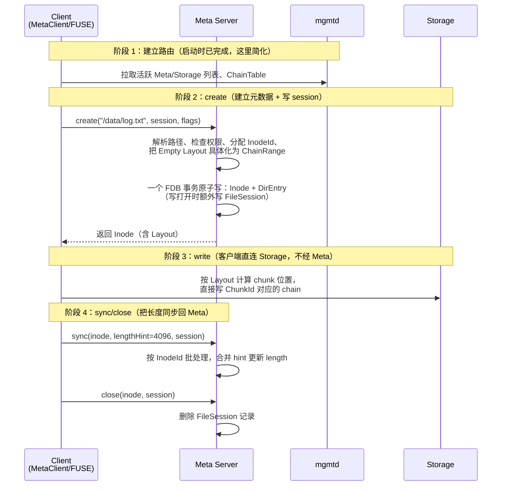

这条链路里有几个关键点：

- **阶段 2（create）只动 Meta KV，不碰 Storage**。Meta 把名字、Inode、Layout、FileSession 在一个 FDB 事务里写完。
- **阶段 3（write）完全不经过 Meta**。客户端拿 create 返回的 Layout，自己算"这段字节落到哪个 chain"，直接发到 Storage。这是 3FS 的核心设计——**数据面绕开 Meta**，否则 Meta 会成为吞吐瓶颈。
- **阶段 4（sync/close）回 Meta 更新长度并清 session**。为什么必须回 Meta？因为客户端写完之后，Storage 的 chunk 已经存在，但 Meta 还不知道文件实际长度是多少。客户端把长度作为 `lengthHint` 传给 sync；Meta 用 [VersionedLength](#82-sync-与-close长度合并) 机制合并多个 writer 的 hint。

### 1.2 读一个文件

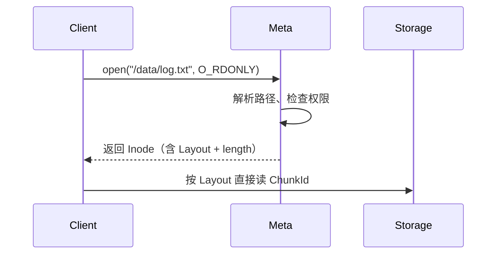

读路径比写路径简单很多：open 拿到 Layout 之后，客户端就完全自主地按 Layout 计算 chunk 位置直连 Storage 读取。Meta 不参与数据读取。

注意 open 是**只读打开**，不会创建 FileSession——FileSession 只为写打开存在（见 [12.1](#121-为什么需要-filesession)）。

### 1.3 删除一个文件

这是初学者最容易误解的地方。**删除一个文件，不是当场把数据删掉**，而是分两步：


为什么不能在前台直接删 Storage chunk？因为删 chunk 是个慢操作（要按 Layout 覆盖的所有 target 发 RPC），放进 FDB 短事务会拖垮整个系统。所以前台只完成"命名空间摘除 + 挂入 GC"，把慢活儿留给后台。

GC 条目本质上是挂在 GC 根目录下的一条 `DENT` 记录（即 DirEntry 的 KV 编码，[3.6 KV 前缀](#36-kv-key-编码与前缀) 里看不到单独的 GC 前缀）。它是一张**续办单**：即使 Meta 进程崩溃，重启后的 scanner 仍能从这条 KV 记录继续完成 Storage 删除。

这个两步走描述的是**文件**。空目录和 symlink 没有 chunk 也不需要等写会话，在前台事务里直接删除 DirEntry + Inode，不进 GC（特例详见 [8.6](#86-remove不是真删而是搬家)）。

但这里有个问题：**如果文件还在被某个客户端写打开怎么办？** 删了 DirEntry，但客户端还在往 Storage 写 chunk。这就引出了 FileSession。

### 1.4 关闭一个文件 + FileSession 的角色

FileSession 是写打开的**存活证据**。它的核心作用：

> **只要某个文件的 FileSession 还在 KV 里，GC 就不能删它的 Storage chunk。**

所以删除链路其实是：

```text
unlink 时：
  - 删 DirEntry
  - nlink--（如果还有其他硬链接，nlink > 0，文件仍然存在）
  - 如果 nlink == 0：
      挂入 GC 目录
      但 GC worker 扫到这条任务时，会先检查 FileSession
      如果还有 session（写客户端还活着）→ 暂时不删，返回 kBusy，延后再试
      直到 session 被正常 close 删除，或客户端崩溃后被 SessionManager 清理
```

这就解释了为什么客户端崩溃也需要被处理：客户端崩溃后它的 FileSession 可能残留在 KV 里。SessionManager（[第 12 章](#12-filesession-与异常客户端清理)）负责在 mgmtd 报告该客户端不活跃后清理这些孤儿 session。

### 1.5 概念地图：所有组件在链路中的位置

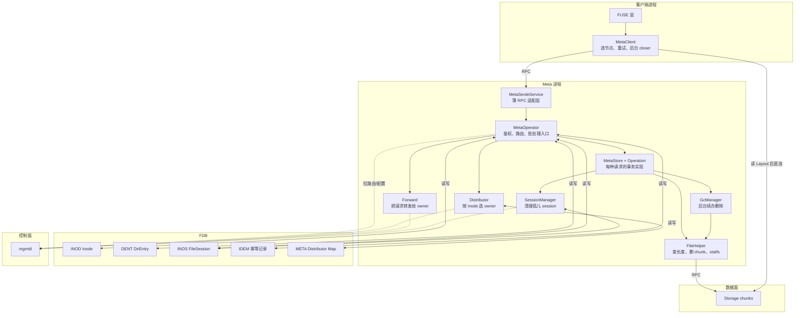

后面每一章都是对这张图里某一块的展开。读到任何细节时，都先回到这张图定位它在链路中的位置。

---

## 2. Meta 进程的启动与停止

第 1 章给出了完整链路。本章回答：**Meta 进程是怎么把这些组件按正确顺序拉起来的**。理解启动顺序很重要，因为它决定了"哪些组件依赖哪些组件"，也解释了故障时的行为边界。

### 2.1 入口

进程入口在 `src/meta/meta.cpp:7`：

```cpp
return TwoPhaseApplication<meta::server::MetaServer>().run(argc, argv);
```

`TwoPhaseApplication` 是项目的应用框架，分两阶段：先 `beforeStart()`（初始化），成功后开始对外服务，停机时调 `beforeStop()` 和 `afterStop()`。

`MetaServer` 继承 `net::Server`（`src/meta/service/MetaServer.h:22`），默认暴露两个服务组（`src/meta/service/MetaServer.h:49-56`）：

| 服务组 | 默认端口 | 服务 | 线程池 |
| --- | ---: | --- | --- |
| group 0 | 8000 | `MetaSerde`（业务 RPC） | 默认共享线程池 |
| group 1 | 9000 | `Core`（管理接口） | 独立线程池 |

`MetaSerdeService` 是薄适配层，通过宏把 RPC 委托给 `MetaOperator`。共暴露 22 个方法（完整列表见 [第 16 章](#16-完整-rpc-语义速查)）；其中 `truncate` RPC 仍在接口中，但 `MetaOperator::truncate()` 直接返回 `kNotImplemented`（`src/meta/service/MetaOperator.cc:314-317`），提示客户端走新的端到端流程（见 [8.11](#811-truncate-的真实端到端流程)）。

### 2.2 beforeStart 的 9 步

启动顺序非常讲究"先建立依赖，再启动依赖者"（`src/meta/service/MetaServer.cc:25-80`）：

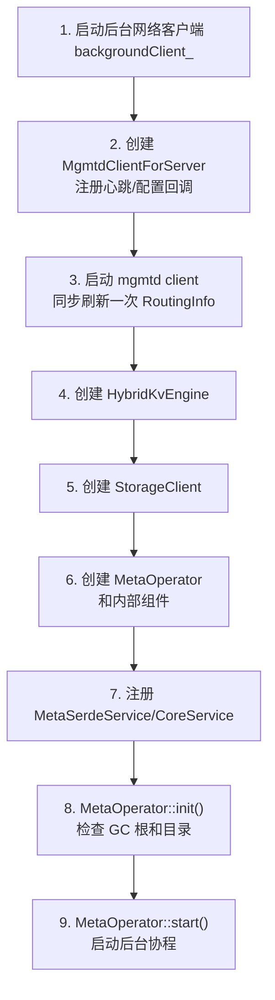

每一步的依赖关系：

| 步 | 做什么 | 为什么必须在此时 |
| --- | --- | --- |
| 1 | 启动 `backgroundClient_` | 后续所有对外 RPC（Forward、Storage 访问）都需要网络客户端 |
| 2 | 创建 mgmtd client | 没有路由信息，后续组件无法工作 |
| 3 | 同步刷一次 RoutingInfo | 必须先知道集群里有哪些 Storage/Meta 才能创建 StorageClient |
| 4 | 创建 KV Engine | MetaOperator 要用它做事务 |
| 5 | 创建 StorageClient | FileHelper 依赖它 |
| 6 | 创建 MetaOperator | 此时 mgmtd client、KV、Storage 都就绪 |
| 7 | 注册 Service | 服务能在 RPC 上被调用 |
| 8 | `init()` 检查 GC 根 | 必须在开始接受请求前确认文件系统没坏 |
| 9 | `start()` 启动后台 | 此时如果后台开始写 KV，已有正确的 GC 目录可用。注意 `Distributor::start()` 会先**同步**刷一次 server map（`Distributor.cc:60-62`，失败仅记 ERR 不阻断启动），保证启动后立即可正确路由 |

`init()` 这步有个关键检查：只在已废弃的 `use_memkv` 路径下，`beforeStart()` 才传 root Layout 并调 `initFs`（`src/meta/service/MetaServer.h:46`）。非 memkv 路径不调 `initFs`；`MetaOperator::init()` 先打开事件追踪日志（`metaEventTraceLog_.open()` 失败则启动以 `kIOError` 失败，`MetaOperator.cc:180-183`），随后 `GcManager::checkFs()` 必须读到 InodeId 0 和 1 两个 root，否则启动以 `kBadFileSystem` 失败（`src/meta/components/GcManager.cc:696-697`，配合 `src/meta/store/MetaStore.cc:41-42`）。换句话说，**KV 必须事先已经有正确的根目录**，Meta 不会替你初始化。

### 2.3 MetaOperator 的角色

`MetaOperator` 是 RPC 编排层，持有所有内部组件（声明在 `src/meta/service/MetaOperator.h:196-205`）：

| 组件 | 职责 |
| --- | --- |
| `MetaStore` | 为每种请求构造 Operation |
| `Distributor` | 路由决策：用活跃节点 Map + inode rendezvous hash 算出唯一 batch owner；不发 RPC |
| `Forward` | 网络投递：把 Distributor 选定 owner 的四类请求发到目标 `MetaSerde`；不决定 owner，也不合批 |
| `InodeIdAllocator` | 批量分配普通 InodeId |
| `ChainAllocator` | 把 Empty Layout 实例化为 ChainRange |
| `FileHelper` | 查长度、删 chunk、缓存 statfs |
| `GcManager` | 延迟删除和递归回收 |
| `SessionManager` | 清理死客户端或显式 prune 的 FileSession |
| `UserStoreEx` | 开启认证时校验用户凭据 |

调用顺序固定（`src/meta/components/Distributor.cc:88-91`）：`Distributor::getServer(inodeId)` 先回答"由 node X 处理"；若 X 是当前节点，MetaOperator 把请求放进本地 Batch；若 X 是远端，才调 `Forward::forward(X, req)`。具体 Operation 在 `src/meta/store/ops/`。

可把 `MetaOperator` 理解为"鉴权 + 路由 + 事务入口"，把 Operation 理解为"单次元数据语义"。

### 2.4 组件依赖关系图

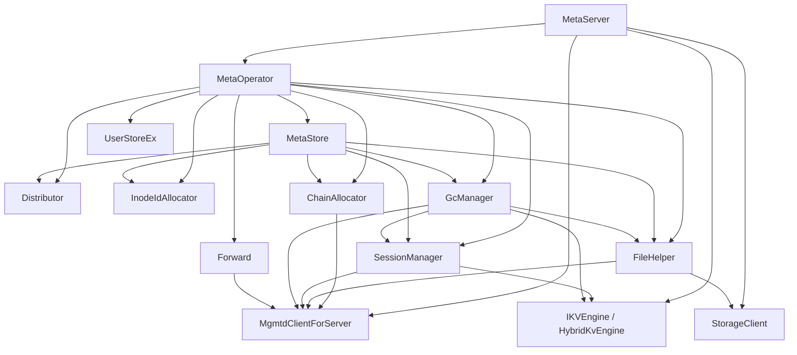

两类依赖：

- **请求期依赖**：Operation 通过 MetaStore 使用分配器、路径解析、Session、GC、Storage helper。
- **后台调度模型**：这些组件不各占一个 OS 线程，协程都调度到 MetaServer 传入的共享 `CPUExecutorGroup`。
  - `BackgroundRunner::start()`（`src/common/utils/BackgroundRunner.h:21`、`src/common/utils/BackgroundRunner.cc:17`）启动 1 个按间隔循环的协程。
  - `CoroutinesPool` / `PriorityCoroutinePool`（`src/common/utils/CoroutinesPool.h:32`）启动固定数目的常驻消费协程。

默认配置下的直接启动数量：Distributor 1 个、FileHelper 1 个、MetaOperator idempotent 1 个、SessionManager 1+8+32、GcManager 1+16+8（有旧式 index-0 GC 目录时为 1+20+8）。完整任务清单见 [14.1](#141-全部后台协程一览表)。

SessionManager 的 close 回调在 MetaOperator 构造完后通过 lambda 注入，避免它直接拥有 MetaOperator。GC 显式持有 FileHelper、SessionManager、UserStore、InodeIdAllocator 和事件追踪日志（`MetaOperator.cc:152-160`）：前三个用于文件回收、会话保护和递归删除身份恢复，InodeIdAllocator 用于把权限不足的子项搬进 `trash/gc-orphans` 孤儿区时创建目录（11.6 节）。

### 2.5 停机顺序

`beforeStop()`（`src/meta/service/MetaServer.cc:83-89`）先置 `stop_`，再停 Distributor；Distributor 会尝试事务性地把本节点从 Server Map 移除（配合 `src/meta/components/Distributor.cc:74-86`，`stopAndJoin`）。随后停 mgmtd client，避免继续对外宣告活跃。

`afterStop()`（`src/meta/service/MetaServer.cc:91-97`）依次停：

1. MetaOperator 的幂等清理 runner；
2. GC scanner 和 worker；
3. Session scan/close worker；
4. FileHelper statfs runner；
5. 事件 trace log；
6. MetaServer 的后台网络 client。

意图是：先停接收/路由新工作，再排空后台组件，最后关它们依赖的网络资源。

---

## 3. 元数据模型：四类持久状态

第 1、2 章讲了完整链路和组件依赖。本章深入到 Meta 到底在 KV 里存了什么。理解数据模型是后续所有章节的基础——你不知道有什么字段，就看不懂任何 Operation 在改什么。

### 3.1 为什么需要拆成四类

Meta 的持久状态分成四类，每类回答不同的问题：

| 类别 | 回答什么 | 为什么不合并 |
| --- | --- | --- |
| **Inode** | 这个对象是什么（属性） | 属性独立存放，rename 时不用搬数据，hard link 才可能 |
| **DirEntry** | 这个名字指向谁 | 命名空间是图结构；属性不能跟名字一一对应（hard link 一个 Inode 多个名字） |
| **FileSession** | 是否还有写客户端可能继续用它 | 客户端崩溃后需要持久证据保护数据不被 GC |
| **GC entry** | 何时、由谁继续完成物理删除 | 删除是慢操作，必须能崩溃恢复 |

如果把这些都塞进一个大记录，rename 时要搬整个对象、hard link 就不可能、客户端崩溃也没法保护数据。**拆开才能让 rename、hard link、客户端异常、Storage 慢操作各自独立演进。**

它们都是独立的 KV 记录，互相通过 key 引用。下文逐一展开。

### 3.2 Inode：对象的属性

`meta::Inode` 继承 `InodeData` 并增加 `id`（`src/fbs/meta/Schema.h:361-375`）；服务端的 `meta::server::Inode` 再增加 KV 加载、写入和冲突控制方法（`src/meta/store/Inode.h:27-84`）。

**核心思想：Inode 是对象属性的唯一事实来源。** 长度、Layout、权限、链接数都跟 InodeId 走，不复制到每个名字；多个 DirEntry 指向同一 File Inode 即形成 hard link。改名通常只改 DirEntry；Directory 为了支持反向寻路，额外冗余 `parent/name`。

公共字段（`src/fbs/meta/Schema.h:316-324`）：

| 字段 | 说明 |
| --- | --- |
| `type` | `variant<File, Directory, Symlink>` |
| `acl` | uid、gid、permission、inode flags |
| `nlink` | 链接计数，默认 1 |
| `atime/ctime/mtime` | 访问、元数据变更、内容修改时间 |
| `id` | 全局 InodeId（`src/fbs/meta/Schema.h:362`） |

三种类型的附加数据：

| 类型 | 字段 | 含义 | 位置 |
| --- | --- | --- | --- |
| File | `length`, `truncateVer` | Meta 看到的长度及截断世代 | `src/fbs/meta/Schema.h:245-276` |
| File | `layout` | chunk/stripe/chain 映射 | 同上 |
| File | `flags` | 当前定义并读取的状态位是 `kHasHole` | 同上 |
| File | `dynStripe` | 0 表示未启用动态条带 | `src/fbs/meta/Schema.h:255` |
| Directory | `parent`, `name` | 目录自身缓存的父 ID 和名字 | `src/fbs/meta/Schema.h:286-288` |
| Directory | `layout` | 新建子文件/目录默认继承的 Layout 模板 | 同上 |
| Directory | `chainAllocCounter` | 启用独立 chain 分配时的轮转计数器，`uint32_t(-1)` 表示未初始化 | 同上 |
| Directory | `lock` | 可选的目录锁持有者 | `src/fbs/meta/Schema.h:279-284` |
| Symlink | `target` | 符号链接目标路径 | `src/fbs/meta/Schema.h:304-314` |

**关于 Directory 的 `parent/name`**：它和 DirEntry 里的信息冗余，存在的原因是支持反向寻路（getRealPath、目录 rename 时找到原位置）。rename 目录时必须同步更新这个字段（见 [8.4 rename](#84-rename)）。

#### InodeId

`InodeId` 底层是 `uint64_t`（`src/fbs/meta/Common.h:167-168`、`:197`）。

**InodeId 是对象身份，不是路径。** 文件 rename 后、File 被建 hard link 后，用户可见名字会变或变多，InodeId 不变；Storage 的 ChunkId 也从它派生。因此 Meta 可以只改 DirEntry，不搬数据、不重写属性。

| 项 | 值或行为 | 位置 |
| --- | --- | --- |
| `root()` | `0` | `src/fbs/meta/Common.h:139` |
| `gcRoot()` | `1` | `src/fbs/meta/Common.h:140` |
| 普通分配区间 | 分配器要求小于 `1 << 56` | `src/meta/components/InodeIdAllocator.h:56-60`（常量）、`:90-94`（达到上限报 `kInodeIdAllocFailed`） |
| 新 Chunk Engine 标志 | bit 56，即 `0x0100000000000000` | `src/fbs/meta/Common.h:144-145` |
| `normalMax()` | `0x01ffffffffffffff` | `src/fbs/meta/Common.h:146-147` |
| `packKey()` | 8 字节小端序 | `src/fbs/meta/Common.h:175-178` |

`InodeIdAllocator` 每次从通用 `IdAllocator` 取一个值，左移 12 位，再在本地生成低 12 位，所以一次数据库分配可供应 4096 个 InodeId（`src/meta/components/InodeIdAllocator.h:56-60`、`src/meta/components/InodeIdAllocator.cc:56`、`:63-65`）。队列低于半批时异步补充。生成的普通 ID 从 `0x1000` 起；分配结果达到 bit 56 时会报错（`InodeIdAllocator.h:90-94`：`result->u64() >= InodeId::kNewChunkEngineMask` 返回 `kInodeIdAllocFailed`），bit 56 只由文件创建逻辑按需设置。

InodeId 作为 KV key 时用小端序，目的是让连续分配的 ID 在 key 空间更分散，降低热点；这也意味着 key 字节序不等于 InodeId 数值顺序。

### 3.3 DirEntry：命名空间的边

`DirEntry` 的逻辑主键是 `(parent, name)`（`src/fbs/meta/Schema.h:410-424`）。

**核心思想：DirEntry 把"名字空间"与"对象属性"分离。** 它让一个目录可以按名字做范围扫描，rename 可以在一个 KV 事务中移动名字，hard link 只需新增一个指向既有 Inode 的条目。

| 字段 | 说明 | 位置 |
| --- | --- | --- |
| `id` | 目标 InodeId | `src/fbs/meta/Schema.h:410-424` |
| `type` | File / Directory / Symlink | 同上 |
| `dirAcl` | 仅目录条目必须存在，用于路径权限检查 | `src/fbs/meta/Schema.h:403-404`（`DirEntryData::valid`） |
| `uuid` | create/mkdirs/symlink/hardLink/rename 等操作的提交未知结果去重线索 | 同上 |
| `gcInfo` | GC 目录条目可携带删除用户和原始路径 | 同上 |

**为什么 DirEntry 还要缓存 `dirAcl`？** 路径解析时要逐级检查 EXEC（搜索）权限（见 [4.4](#44-权限检查)）。如果不缓存，每一级目录都要再读一次 Inode，路径越长放大越严重。DirEntry 自带 ACL 后，正常向下遍历不必为每一级目录额外读 Inode。

**POSIX 的 `.`、`..` 和根目录不在 Dentry 表里。** 传统文件系统会在每个目录的磁盘数据里真正写入 `.`（指向自己）和 `..`（指向父目录）两条记录，3FS 没有这么做——Dentry 表只存"有实际名字的边"，这三类特殊条目全部由路径解析器在内存里临时构造：

| 条目 | 构造位置 | 指向 |
| --- | --- | --- |
| 根目录起点 | `src/meta/store/DirEntry.h:66-68` `DirEntry::root()` | `name="."`，指向 `InodeId::root()` |
| 路径中的 `.` | `src/meta/store/PathResolve.cc:310-312` | 当前目录自身 |
| 路径中的 `..` | `src/meta/store/PathResolve.cc:313-326` | 父 Inode 里记录的 `asDirectory().parent` |

解析器遇到普通名字才去 KV 表 `snapshotLoad`（`PathResolve.cc:328`），遇到 `.` / `..` 则直接走上面分支，不查表。作为防御，`DirEntry::store()` 写入前会调 `checkName`（`src/meta/store/DirEntry.cc:37-39`）拒绝名字为空、`.`、`..` 或含 `/` 的条目，返回 `kFoundBug`。这样省掉了在 KV 表里维护自指/父指边，也避免了 rename/remove 时还要同步维护 `.` 和 `..` 的额外负担。

### 3.4 FileSession：写打开的存活证据

第 [1.4](#14-关闭一个文件--filesession-的角色) 节已经讲了它存在的动机。这里给出字段定义（`src/meta/store/FileSession.h:25-43`）：

| 字段 | 说明 |
| --- | --- |
| `inodeId` | 被打开的文件 |
| `clientId` | 客户端 UUID 和 hostname；保存在 value，供死客户端判断和观测 |
| `sessionId` | 本次打开会话 UUID |
| `timestamp` | 该记录最后一次 create/open/sync 写入的时间；SessionManager 用它避开刚创建、可能仍在并发中的 session |
| `payload` | 兼容/占位字段，反序列化后清空 |

**FileSession 不是**：文件锁、写者互斥器、长度日志。多个写会话可并存；同 inode 的 sync/close 顺序由 BatchedOp 处理；实际 chunk 数据只在 Storage。

#### SessionInfo：客户端发来的会话身份

SessionInfo 由客户端生成并随 RPC 发送（`src/fbs/meta/Common.h:43-46`）。Meta 服务端不分配 session UUID。

| 字段 | 来源与作用 |
| --- | --- |
| `client` | `ClientId`：客户端实例的 UUID 和 hostname。`MetaClient` 构造时补 hostname/pod 信息（`src/meta/service/MetaServer.cc:50`，`ClientId::random(appInfo().hostname)`）；SessionManager 用其中的 UUID 与 mgmtd 报告的活跃客户端比对。 |
| `session` | 本次可写打开的随机 UUID。3FS FUSE 在每次 `O_WRONLY`/`O_RDWR` 的 `open`，以及每次 `create` 时调 `SessionId::random()` 生成新值（`src/fuse/FuseOps.cc:1451`、`:1882`）；同一文件描述符后续的 sync/close 复用它。 |

SessionInfo **不含** inode、文件长度、打开 flags、用户权限或时间戳：inode 在 create/open/sync/close 请求的其他字段中，长度属于 sync 的 `lengthHint`，`timestamp` 由服务端写 FileSession 时取当前时间。

#### 创建/刷新和删除时机

- **create 或 open**：请求带 `SessionInfo` 且访问模式非 READ 时写入；纯只读 open 不创建（`src/meta/store/ops/BatchOperation.cc:516-519`、`:602`）。
- **sync**：请求携带 `SessionInfo` 时也重新写该 `(inodeId, sessionId)` 记录，用当前时间刷新 `timestamp`。
- **close**：请求携带 session 时删精确的 `(inodeId, sessionId)` key；重复 clear 仍成功（`src/meta/store/ops/Close.cc`，`FileSession::remove`）。
- **异常路径**：客户端发 prune marker，或 SessionManager 发现所属客户端不活跃后清除；细节见 [第 12 章](#12-filesession-与异常客户端清理)。

### 3.5 GC entry：续办单

GC entry 没有单独前缀；它本质上是挂在 GC 目录下的普通 `DENT` 记录。前台 remove/rename 把要删除的对象以 DirEntry 形式写入 GC 目录（`src/meta/components/GcManager.cc:800-805`），后台 scanner 扫到后继续完成 Storage 删除。

GC DirEntry **不增加** `nlink`（`src/meta/components/GcManager.cc:201-223`，`addFile/addDirectory` 只创建 DirEntry，不修改 Inode）。它是内部任务记录，不是用户可见硬链接。

GC entry 还可携带 `gcInfo`（删除用户、原始路径），用于 orphan 恢复时建立反向链接（见 [11.7](#117-orphan-目录删不掉的子项)）。

### 3.6 KV key 编码与前缀

前缀定义在 `src/common/kv/KeyPrefix-def.h:6-24`：

| 前缀/键 | 记录 | key 形态 | value 内容 |
| --- | --- | --- | --- |
| `INOD` | Inode | `INOD + inodeId.packKey()` | `serde::serialize(InodeData)` |
| `DENT` | DirEntry | `DENT + parent.packKey() + rawName` | `serde::serialize(DirEntryData)` |
| `INOS` | FileSession | `INOS + inodeId.packKey() + sessionUuid` | `serde::serialize(FileSession)` |
| `IDEM` | 幂等记录 | `IDEM + requestId + clientId.uuid` | `serde::serialize(Idempotent::Record<Result<T>>)` |
| `META` | Distributor 全局 map | `META` | `serde::serialize(ServerMap)` |
| `META-{nodeId}` | Distributor 心跳 | `META-{nodeId}` | 原始 10 字节 `Versionstamp`（`src/meta/components/Distributor.cc:45-47`） |

**前缀的设计意图：既区分记录类型，也决定可高效执行的访问模式。**

- `INOD` 支持按稳定身份直读（`InodeId.packKey()`）；
- `DENT + parent` 把一个目录的名字连续放在同一 range——这让 [目录分页](#38-目录分页为什么天然成立) 和 [list](#86-list分页--fuse-readdirplus) 天然高效；
- `INOS + inode` 让 GC 用一次前缀检查就能判断"还有没有写会话"。

key 负责"这条记录是谁"，value 负责"这条记录的内容"。两者有时会重复保存少量身份字段：例如 `FileSession` 在 value 中再存 inode/session，反序列化时校验 key 和 value 一致；`Inode` 的 id、`DirEntry` 的 parent/name 则主要只在 key 中。

除 `META-{nodeId}` 这类原始 versionstamp 外，表中结构化 value 都通过项目 Serde 序列化。Distributor 更新 map 时还在同一事务更新 FDB 保留键 `\xff/metadataVersion`（`src/common/kv/ITransaction.h:26`），其 value 同样是 10 字节 versionstamp；请求用它判断本地路由 map 是否过期。

### 3.7 两棵树：用户根 + GC 根

`InodeId::trees()` 固定返回 2（`src/fbs/meta/Common.h:138`），对应两个根：

| 根 | InodeId | 用途 |
| --- | ---: | --- |
| 文件系统根 | `0`（`src/fbs/meta/Common.h:139`） | 用户可见命名空间 |
| GC 根 | `1`（`src/fbs/meta/Common.h:140`） | Meta 内部的延迟删除队列 |

两个根的 `Directory::parent` 都指向自身（`src/meta/store/MetaStore.cc:49-50`）。正常路径从文件系统根解析；GC 条目挂在 GC 根下，不属于用户路径树。

客户端高地址区间还保留给 `virt()`、`rmRf()`、`getConf()`、`setConf()`、IOV 等虚拟 InodeId；`checkSpecialInode()` 的编译期断言确保这些区间不与正常 ID 相交。

### 3.8 目录分页为什么天然成立

把"列目录"理解成数据库范围读取，而不是逐个文件调 stat。给定一个目录和上一页最后的名字 `prev`，Meta 要找字典序排在 `prev` 之后的一段成员。`DENT` 的 key 编码就是为这件事设计的（`DirEntry::packKey()`，`src/meta/store/DirEntry.cc:43-52`）。

同一目录所有 key 都共享：

```text
DENT + parent.packKey()
```

后面直接拼原始 name，所以 KV 的字节序天然就是目录名排序。列目录时：

```text
begin = DENT + parent + prev      （exclusive）
end   = prefixEnd(DENT + parent)
```

一次 range read 返回下一批 DirEntry；`hasMore` 映射为 `ListRsp.more`（`src/meta/store/DirEntry.cc:233`）。`prev` 不是页码，而是**游标**：下一页从上页最后一个名字之后继续，所以目录很大时服务端也不需要把整个目录读进内存。

只请求名字时不加载 Inode；`ListReq.status=true` 才分批并发跟随 DirEntry 读 Inode。这样普通 readdir 不必为每个文件再做一次 KV get。

### 3.9 snapshot 读 vs read conflict（前置知识）

这一节是后续 [5.3 事务提交](#53-事务提交和重试) 和 [4 路径解析](#4-路径解析字符串怎么变成对象引用) 的基础，必须先理解。

FDB 事务模型：一次 Meta 修改在某个一致的 KV **快照版本**上读取，再尝试提交写入。若别的事务在这段时间改动了"本事务据以作决定"的 key，当前事务不能继续按旧判断提交，必须重试。**这里的"冲突"不是报给用户的业务错误，而是 FDB 保护并发正确性的内部重试信号。**

同一个 key 有三种读取/保护方式（`src/meta/store/Inode.h:56-64`）：

| 调用 | 当下读到什么 | 是否自动保护这个读取结果 |
| --- | --- | --- |
| `snapshotLoad()` | 当前事务快照中的值 | 否；之后别人改这个 key，当前事务仍可能尝试提交 |
| `load()` | 当前事务快照中的值 | 是；之后别人改这个 key，当前事务提交时发生冲突并重试 |
| `addIntoReadConflict()` | 不重新读取值 | 把先前 snapshot 判断依赖的 key/range 补入保护范围 |

**为什么不能一直用 `load()`？** 举个例子：删除 `/dir/a` 时，路径解析要经过 `/`、`dir`、`a` 等多个目录和 DirEntry。若每一步都立即登记冲突，另一个客户端仅在 `dir` 下创建一个无关文件，也会让这次 remove 重试。代码因此先用 snapshot 快速完成"路径存在吗、类型是什么、我是否有权限"的大部分工作，真正准备写入时才保护影响本次决定的少量 key。

**但 snapshot 不是"可以放心按旧值写"。** 缺少保护时会出现这种错误窗口：

```text
事务 A：snapshot 读到 DENT(dir, a) -> inode X，准备 remove
事务 B：删 a，随后创建同名新文件 a -> inode Y，并提交
事务 A：若直接按旧判断清除 DENT(dir, a)，就会误伤 inode Y 的新名字
```

正确流程是：事务 A 在写入前把 `DENT(dir, a)`（以及实际依赖的父目录/Inode 或范围）加入 read-conflict set。此时 B 的提交会使 A 的提交冲突；A 从新快照重试，重新发现 `a` 已是 inode Y，再按新的业务规则处理。

这是 [3.11 不变量](#311-存储层强制维护的不变量) 之外、写操作必须自己维护的另一层正确性约束。具体在路径解析里的应用见 [4.6](#46-snapshot-解析为何仍能安全修改)。

### 3.10 BatchContext：批量读去重（预留机制）

BatchContext 解决的问题是：同一次 RPC 内部多个并发子任务解析多条路径时，对公共前缀的 DirEntry/Inode 重复发起 KV read。典型场景是查 `/a/x`、`/a/y`、`/a/z`，三者都要读 `/a` 的 DirEntry 和 Inode，若各自独立解析就会发三次相同的 read。

机制本身绑到 folly RequestContext（一次 RPC 生命周期携带的上下文，`src/meta/store/BatchContext.h:63-73`），分别维护：

- `InodeId -> SharedFuture<optional<Inode>>`（行 30-61）；
- `(parent,name) -> SharedFuture<optional<DirEntry>>`。

第一个遇到某 key 的协程真正发起 snapshot load；`SharedFuture` 表示"这次读取正在进行或已完成的共享结果"，其他协程等待同一个完成信号（Baton）并复用结果（行 96-106）。它只合并当前批内的读取：RPC 结束后对象即丢弃，因此不是跨请求缓存，也不改变 snapshot/冲突语义。

消费端是两个被动钩子：`Inode::snapshotLoad`（`src/meta/store/Inode.cc:87-95`）和 `DirEntry::snapshotLoad`（`src/meta/store/DirEntry.cc:126-134`），都先 `BatchContext::get()` 检查上下文里有没有 BatchContext，有才走去重分支。所有 RPC 中只有 `batchStatByPath` 在 `src/meta/store/ops/Stat.cc:84-90` 主动创建它：

```cpp
auto createBatchContext() {
  if constexpr (std::is_same_v<Req, BatchStatReq>) {
    return folly::Unit{};          // 按 inode ID 批量查，不创建
  } else {
    return BatchContext::create(); // 按路径批量查，才创建
  }
}
```

**当前版本没有任何用户级操作能触发它。** 完整调用链：

| 操作 | FUSE 入口 | 走的 RPC | 是否触发 BatchContext |
| --- | --- | --- | --- |
| `ls` / `ls -l` / `find`（FUSE `readdirplus`） | `src/fuse/FuseOps.cc:2173` | `batchStat`（按 inode ID） | 否 |
| `stat(file)` | FUSE `getattr` | `stat`（单条） | 否 |
| 批量按路径 stat | 无 | `batchStatByPath` | 仅测试调用 |

`batchStatByPath` 在整个 `src/` 树里除了 `MetaClient::batchStatByPath`（`src/client/meta/MetaClient.cc:539-545`）的实现本身和 `tests/client/TestMetaClient.cc:1228` 的测试用例外，没有任何业务代码调用：FUSE 层零匹配，admin CLI 也零匹配。原因是 FUSE 的 `readdirplus`（`FuseOps.cc:2173-2312`）已经先 list 拿到一组 DirEntry（含 inode ID），后续属性补全自然走 `batchStat` 按 inode ID 查，不需要再走路径解析。

所以这套机制目前是**为未来批量路径查询场景预留的**（例如 SDK 一次性预热一组训练样本文件的 inode）。一旦将来有调用方接入 `batchStatByPath`，钩子已就位，去重自动生效，不需要再改 `Inode::snapshotLoad` / `DirEntry::snapshotLoad`。

### 3.11 存储层强制维护的不变量

这些检查是持久化边界的最后一道防线。Operation 的逻辑检查可能遗漏或将来被新调用方绕开；`store()` 在真正写 KV 前拒绝会破坏路径可达性、类型一致性或 Storage 映射的状态。

`Inode::store()` 并非无条件序列化，它在写 KV 前保护以下约束（`src/meta/store/Inode.cc:105-141`）：

- 两个 tree root 必须是 Directory，名字只能是空或 `/`（行 108-118）；
- root 的 uid/gid/permission 必须保持预定义值，只允许保留/修改 iflags（同上）；
- 普通目录的缓存名字不能是 `.`、`..`，也不能含 `/`（行 119-124）；
- File 的 Layout 必须非 Empty 且通过 `Layout::valid(false)`（行 125-130）；
- `Inode::remove()` 禁止删除 tree root 和 immutable inode（`src/meta/store/Inode.cc:143-155`）。

`DirEntry::store()` 对应保护（`src/meta/store/DirEntry.cc:144-166`）：

- name 非空，不能是 `.`、`..` 或含 `/`，长度不超过 `NAME_MAX`（行 146-149）；
- 不能让普通 DirEntry 指向 root/gcRoot（行 153-156）；
- Directory 类型必须有 `dirAcl`，非 Directory 必须没有（`src/fbs/meta/Schema.h:403-404`，`DirEntryData::valid`）；
- key 中的 `(parent,name)` 与 value 中的 `DirEntryData` 分开编码，反序列化时重新组合。

加载 DirEntry 后再加载 Inode 时还会检查：目标 Inode 是否存在，以及 InodeType 是否与 DirEntry.type 一致。不一致不是普通 not found，而是 `kInconsistent`，代表持久化元数据已经破坏。

---

## 4. 路径解析：字符串怎么变成对象引用

第 3 章介绍了 Inode 和 DirEntry 是什么。本章回答：**客户端传一个字符串 `/a/b/c`，Meta 怎么把它变成可安全提交的对象引用**。路径解析不只是查表；它同时决定 symlink 语义、每一级目录的搜索权限，以及随后修改操作必须保护哪些读取结果不被并发 rename/remove 推翻。

### 4.1 PathAt：两种入口

普通文件系统调用常传字符串 `/a/b`；但客户端可能已经知道某个目录的 InodeId（比如刚 list 过），不想再从根目录走一遍。`PathAt` 就是这两种入口的统一表达（`src/fbs/meta/Common.h:235-250`）：

- **有 `path`**：从 parent（绝对路径会改从 root）逐级解析；
- **无 `path`**：很多 API 把 parent 直接当目标 InodeId。

几种常见调用形式：

| 形式 | 解释 | 典型调用 |
| --- | --- | --- |
| `{parent=root, path="/a/b"}` | 绝对路径会忽略传入起点并从 root 开始 | 普通路径 API |
| `{parent=dirId, path="a/b"}` | 从指定目录相对解析 | client 大多数方法 |
| `{parent=inodeId, path=nullopt}` | 直接按 InodeId 操作 | stat、open、setAttr |
| `{parent=inodeId, path=""}` + `AT_EMPTY_PATH` | 把 parent 当目标（`PathResolve.cc:96`：`path.path->empty() && flags.contains(AT_EMPTY_PATH)` 时直接加载 parent 的 Inode） | 支持该 flag 的 inode 解析 |

注意空 path 且**不带** `AT_EMPTY_PATH` 时，`pathRange` 首组件为空会走 `begin == end` 分支返回 `kNotFound`（`PathResolve.cc:226-227`）。

### 4.2 解析流程

路径解析全部使用 snapshot 读（`src/meta/store/PathResolve.h:23-26` 注释、`src/meta/store/PathResolve.cc:75-85` 权限检查），原因见 [3.9](#39-snapshot-读-vs-read-conflict前置知识)：

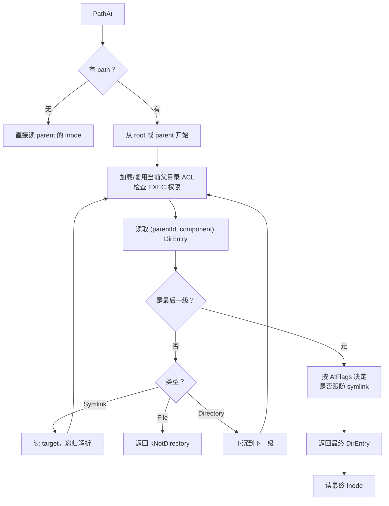

**symlink 跟随限制（防 symlink 炸弹）。** symlink 可以指向另一个 symlink，用户随手两条命令就能造出循环链（`l1 -> l2`、`l2 -> l1`）或超长链，让解析器无限递归或做百万次跟随。所以 `PathResolveOp::symlink()`（`src/meta/store/PathResolve.cc:340-362`）用两个计数器保护——`symlink()` 会调 `path()`，`path()` 中间组件遇到 symlink 又调 `symlink()`，两者相互递归：

| 限制 | 默认 | 计数器行为 | 防的场景 |
| --- | --- | --- | --- |
| `max_symlink_depth` | 4 | 进入 `symlink()` 加 1，退出减 1（`depth_`，`PathResolve.cc:341-344`） | **嵌套深**：跟随目标路径的中途又遇到 symlink，一层套一层，调用链越叠越深 |
| `max_symlink_count` | 10 | 只增不减（`symlinkCnt_`，`PathResolve.cc:347-349`） | **总量多**：平铺展开的长链 `l1 -> l2 -> ... -> l100`，不嵌套但跟随次数多 |

两个缺一不可：平铺链的 depth 始终为 1，只有 count 拦得住；嵌套 runaway 递归则由 depth 更早掐断。超过任一限制返回 `kTooManySymlinks`，客户端转成 `ELOOP`，与 Linux 语义一致（内核同类限制默认 40 层）。正常业务几乎碰不到这两个上限，能触发的基本都是循环链或恶意构造。配置定义在 `src/meta/base/Config.h:68-69`。

**解析流程中的几个特例和防御**（读代码时容易疑惑的地方）：

- **路径就是 `/`**：首组件为 `/` 且后面没有其他组件时，直接构造 `ResolveResult(DirEntry::root(), DirEntry::root())` 返回，不查任何 KV（`PathResolve.cc:229-238`）。
- **加载父目录 ACL 的 root 分支**：父目录是 `InodeId::root()` 时直接用 `DirEntry::root()`（内含 `Acl::root()`），既不走 AclCache 也不读 KV（`PathResolve.cc:52-53`）。从 root 起步的解析每一级第一跳都会经过这里。
- **nlink == 0 防御**：`inode()` 带 `checkRefCnt=true` 时，Inode 虽存在但 `nlink == 0` 会返回 `kNotFound`（"inode is removed"，`PathResolve.cc:106-109`）。这是"DirEntry 已删但 Inode 残留（GC 未完成）"窗口下路径解析仍返回不存在的关键检查；`allow_stat_deleted_inodes` 配置（`Config.h:75`，默认 true）允许 stat 类操作跳过它看到残留 Inode。
- **服务端的 depth/count 默认值来源**：`PathResolveOp` 直接构造时默认 `maxSymlinkCount=4, maxSymlinkDepth=8`（`PathResolve.h:61`），与服务端实际相反——服务端所有 Operation 经 `Operation::resolve()`（`src/meta/store/Operation.h:84-92`）传入 config 值（count=10, depth=4）。以服务端 config 为准。

### 4.3 解析结果 ResolveResult：定位到"某个目录里的一条"

先用一个具体例子建立直觉。解析 `/home/alice/report.txt` 成功后，`ResolveResult`（`src/meta/store/PathResolve.h:30-51`）里的内容是：

```
parent   = /home/alice   这个目录（解析停在"最后一级的父目录"）
dirEntry = "report.txt"  该目录里名为 report.txt 的那条目录项
```

也就是说，解析结果不是"目标文件的 Inode"，而是一个**位置**：哪个目录（parent）里的哪个条目（dirEntry）。就像一个指进目录内部的游标。

#### 为什么返回"位置"而不是"Inode"

因为调用方拿这个结果要干的事不同：

| 调用方 | 需要什么 | 从 ResolveResult 里怎么取 |
| --- | --- | --- |
| open / stat 已存在的文件 | 目标 Inode | `dirEntry->snapshotLoadInode()`（按需读一次） |
| create（文件还不存在） | 在哪个目录下建、叫什么名 | `parent` + `dirEntry == nullopt`（此时根本没有目标 Inode 可返回！） |
| 各类写操作 | 父目录 InodeId（做路由/批处理 key） | `getParentId()` |

关键在第二行：**create 的前提是目标不存在**，如果返回值设计成"目标 Inode"，create 场景就没法表达。返回"位置"才能统一覆盖"存在"和"不存在"两种结果。

#### dirEntry 为什么是 optional

`optional<DirEntry>`（`PathResolve.h:33`）：

- **有值** = 最后一级存在，就是那条目录项；
- **无值** = 最后一级不存在。`OpenOp<CreateReq>::run()`（`ops/Open.cc:58-66`）正是检测到 `dirEntry == nullopt`，才把请求改写为 `(parent, filename)` 并返回 kNotFound，让上层转去走创建分支（见 [8.2](#82-create-与-open同一份-openop-代码)）。

#### parent 为什么是 variant 三态

`parent` 的类型是 `variant<pair<InodeId, Acl>, Inode, DirEntry>`（`PathResolve.h:32`）。它回答的问题是：**对父目录，我们手头已经掌握了多少信息？**

解析逐级下沉时，每一级都要用父目录的 ACL 做 EXEC 权限检查（[4.4](#44-权限检查)），但"做权限检查"只需要 ACL 这几个字段，不需要父目录的完整 Inode（文件长度、layout 等都用不上）。所以解析器按"手头有什么就用什么"的原则填充 parent，尽量不额外读 KV：

| 手头已有的信息 | parent 填成 | 何时出现 |
| --- | --- | --- |
| 上一步刚解析出这个目录的 DirEntry（目录条目自带 ACL 副本） | `DirEntry` | 逐级下沉的中间步骤（`PathResolve.cc:45-50`） |
| AclCache 命中，有 ID 和 ACL，但没有完整 Inode | `pair<InodeId, Acl>` | 缓存命中（`PathResolve.cc:55-57`） |
| 缓存未命中，不得不读了完整 Inode | `Inode` | 缓存 miss 后（`PathResolve.cc:59-64`） |

决策逻辑在 `loadParentAcl()`（`PathResolve.cc:37-73`）：先看能不能复用 DirEntry，再看缓存，都不行才读 KV——并且读到的目录 ACL 顺手写回缓存。

统一取用接口抹平了三种形态的差异：只要 ACL 就调 `getParentAcl()`（`PathResolve.h:40`），三种形态都直接给，不触发读；确实要完整 Inode 才调 `getParentInode()`（`PathResolve.h:41-50`），此时 `pair` 和 `DirEntry` 形态会补一次读，`Inode` 形态直接返回。

#### ResolveRangeResult：附带"缺了哪一段"

派生类 `ResolveRangeResult`（`PathResolve.h:53-58`）多一个 `Path missing`。`pathRange()`（`PathResolve.cc:190-200`）逐级解析时遇到不存在的组件就停下，剩余的路径段累加成 `missing` 返回。

服务对象是 `mkdirs("/a/b/c/d")`：假设 `/a/b` 存在、`c` 和 `d` 都不存在，解析停在 `/a/b`，返回 `missing = "c/d"`，调用方据此知道要新建哪些层级。普通 `path()` 内部就是调 `pathRange()` 后丢弃 missing（`PathResolve.cc:163`）。

### 4.4 权限检查

`Acl::checkPermission()`（`src/fbs/meta/Schema.cc:25-46`）按 owner、group、other 选权限位。uid 0 把所需位设为 0，因此通过普通 READ/WRITE/EXEC 检查。

**几个关键点**：

- 路径解析时检查的是 **EXEC（搜索）权限**，不是 READ。stat 只要求对路径经过的目录有 EXEC，不要求对最终文件有 READ。
- 按 InodeId 且不带 path 的调用**没有目录遍历权限检查**——因为你已经持有 InodeId，不经过任何目录。
- 递归删除另有 `checkRecursiveRmPerm()`（`src/fbs/meta/Schema.cc:48-60`）：immutable 一律拒绝；配置要求 owner 或目录有 sticky bit 时，非 root 必须是 owner；还必须拥有 READ | WRITE | EXEC。
- 删除和 rename 还会单独执行父目录写权限、目录锁、sticky bit、目标 immutable 等检查，不能只看一次 `Acl::checkPermission()`。

### 4.5 ACL cache

`AclCache`（`src/meta/components/AclCache.h:16-77`）：

- **key**：目录 InodeId；
- **value**：该目录的 Acl（不是用户信息，也不访问 UserStore）；
- **结构**：32 个分片（`src/meta/components/AclCache.h:63`），MetaStore 默认总容量约 2M 条（`src/meta/store/MetaStore.h:90`）；
- **TTL**：来自 `acl_cache_time`，实际过期点乘以 0.8～1.0 的随机因子以分散失效峰值（`src/meta/components/AclCache.h:46`）。

**ACL cache 是每个 Meta 进程的本地缓存**，不跨节点共享。执行 setAttr 的节点在成功后立即使对应目录 InodeId 的缓存失效（`src/meta/components/AclCache.h:60`，`invalid` 函数）；其他 Meta 节点已缓存的旧 ACL 会一直用到其随机 TTL 到期为止。因此跨 Meta 的 chmod/chown 可见性延迟上界是该节点的缓存 TTL（`acl_cache_time × [0.8,1.0]`）。

### 4.6 snapshot 解析为何仍能安全修改

[3.9](#39-snapshot-读-vs-read-conflict前置知识) 解释了 snapshot 和 read conflict 的事务语义；这里落到路径操作。路径解析刻意全部用 snapshot read，避免长路径上每个目录和 DirEntry 都进入 FDB read-conflict set，否则无关的兄弟目录变化也会放大事务冲突。但 snapshot 结果本身不保护写入判断，修改类 Operation 必须在真正写入前补冲突读或写冲突：

```text
snapshot 解析路径
  -> 权限/类型/存在性检查
  -> 对将依赖的父 Inode、源/目标 DirEntry 补普通读
  -> 写 Inode/DirEntry
  -> commit 时由 FDB 检测并发变化
```

这就是 `PathResolveOp` 注释明确要求"调用者自行加入 read conflict"的原因（`src/meta/store/PathResolve.h:23-26`）。若新增 Operation 只根据 snapshot 判断后写别的 key，就会留下 TOCTOU 窗口：并发 rename/remove 已改变路径，而该事务没有因读取过旧结果而冲突。

### 4.7 symlink 的解析与 trace：getRealPath 的实现基础

这一节回答三个递进的问题：symlink 的 target 相对谁解析？trace 记录的是什么？getRealPath 为什么有两种模式？

#### target 相对谁解析

symlink 创建时 target 字符串**原样存储**，不做任何正规化（`ops/Symlink.cc` 直接存进 Inode）。真正决定"相对谁"的是解析时 `symlink()` 的这一行（`PathResolve.cc:355`）：

```cpp
auto resolveResult = co_await this->path(entry.parent, *symlinkTarget);
```

起点是 **`entry.parent`——symlink 自己所在的目录**，然后由 target 的首字符决定走向（`pathRange()` 的分支，`PathResolve.cc:229-231`）：

| target 形式 | 起点 | 例子 |
| --- | --- | --- |
| 绝对（`/` 开头） | 切回主树 root | `/data/real.txt` 从 root 走 |
| 相对 | symlink 所在目录 | `../docs/x.txt` 从 symlink 的父目录走 |

设 `/home/alice/link` 是 symlink，target 为 `../docs/x.txt`。解析 `/home/alice/link` 时：起点 `/home/alice`，`..` 通过读该目录 Inode 的 `Directory.parent` 找到 `/home`（`PathResolve.cc:313-326`），再依次下沉 `docs`、`x.txt`，最终定位到 `/home/docs/x.txt`。`.` 在循环里被直接跳过（`PathResolve.cc:243-249`）。

连续 symlink（target 又是 symlink）由 `symlink()` 内的 while 循环顺次处理（`PathResolve.cc:346-361`），两层保护见 [4.2](#42-解析流程) 末尾的 depth/count 限制。

#### trace：解析器走过的实际路径

调用方构造 `PathResolveOp` 时可以传入一个 `Path *trace`（`PathResolve.h:60`）。解析器每走一级就往里追加当前组件名（`PathResolve.cc:298-303`），相当于记录"我实际经过的目录序列"。

特殊处理在跟随 symlink 时（`PathResolve.cc:352-353`）：

```cpp
trace_->remove_filename();   // 先删掉刚追加的 symlink 自己的名字
// 随后递归解析 target，走的每一步又追加进 trace
```

即 trace 里**永远不出现 symlink 的名字，只有它展开后的真实路径**。走一遍例子，`/home/alice/link -> /data/real.txt`：

```
追加 home          trace = /home
追加 alice         trace = /home/alice
追加 link          trace = /home/alice/link
发现是 symlink：
  remove_filename  trace = /home/alice
  从 root 走 target：
    （回到 root 时重置）trace = /
    追加 data        trace = /data
    追加 real.txt    trace = /data/real.txt
```

注意 trace 里可能残留 `..`（相对 target 场景下 `..` 也被原样追加，`PathResolve.cc:303`），所以消费方需要自己化简。

#### getRealPath 的两种模式（`ops/GetRealPath.cc`）

**模式一：`absolute=false`，直接用 trace。** 传 trace 解析请求路径，跟随完所有 symlink 后 `simplifyPath(trace)` 化简掉 `.`/`..` 返回（`GetRealPath.cc:61-65`；化简逻辑在 `GetRealPath.cc:16-43`，一个标准的栈式消解）。返回的是"**这次解析实际走过的路径**"。

**模式二：`absolute=true` 或按 InodeId 查询，从目标向上回溯。** 拿到最终 DirEntry 后，利用目录 Inode 缓存的 `(parent, name)` 反向字段（[4.8](#48-两类目录反查)）逐级向上爬到 tree root，把名字拼起来（`GetRealPath.cc:82-93`）。返回的是命名空间里的**规范绝对路径**，和请求路径里用了哪个 symlink 进来无关。

| | absolute=false | 带 path + absolute=true | 按 InodeId 查询 |
| --- | --- | --- | --- |
| 路径来源 | 解析过程记录（trace） | 从目标逐级向上回溯 | 从目标逐级向上回溯 |
| 结果含义 | 实际走过的路径 | 命名空间中的规范位置 | 命名空间中的规范位置 |
| 支持 File 吗 | 支持 | 支持（解析出的 DirEntry 直接进回溯，`GetRealPath.cc:60-67`；回溯只加载父目录链，不检查目标类型） | **仅目录**（`GetRealPath.cc:71-72` 返回 kNotDirectory） |

按 InodeId 请求时只支持目录的原因：文件可以有多个硬链接名字，没有"唯一"的路径可返回；而且只有 Directory 的 Inode 维护了 `(parent, name)` 反向字段，File Inode 没有。带 path 的请求没有这个限制——路径本身就指定了"哪个名字"。

### 4.8 反向寻路：只有 InodeId 时怎么找回路径

#### 问题从哪来

命名空间的正向查找很自然：给路径，逐级查 DirEntry（key 是 `parent + name`），最后拿到 Inode。但有些场景拿到的只有 **InodeId**，却需要知道"这个目录叫什么名字、在哪个目录下面"。从用户级操作往下追，完整触发链是：

| 用户级操作 | 中间路径 | 服务端落点 |
| --- | --- | --- |
| FUSE 挂载点上 `chmod`/`chown` 一个**目录** | 内核 VFS setattr 只给 inode 号 → `FuseOps.cc:808` → `setPermission(ino, path=nullopt)`（`FuseOps.cc:846`）→ setAttr RPC 无路径 → `runInBatch`（`MetaOperator.cc:407-410`） | `BatchOperation.cc:324` |
| CLI 按 path 对目录 setAttr | setAttr RPC 带路径 → `runOp` 直通 | `ops/SetAttr.cc:61` |
| 应用调 `ioctl(HF3FS_IOC_RECURSIVE_RM)` 递归删目录（如训练框架清 checkpoint） | `FuseOps.cc:2021` → `getRealPath(ino, nullopt, absolute=true)`（`FuseOps.cc:2027`）→ getRealPath RPC：第一次反查拿自己的 DirEntry | `GetRealPath.cc:77` |
| 同上（向上回溯部分） | 循环逐级向上，每级只有父目录的 InodeId | `GetRealPath.cc:86` |
| CLI `realpath` / `cd`（穿过 symlink 或按 InodeId 进入） | `admin/GetRealPath.cc:25`、`admin/Chdir.cc:60` → MetaClient::getRealPath | 同上两条 |

注意 chmod 那行：**改目录 ACL 必须反查**，因为 DirEntry 缓存了 dirAcl 副本、AclCache 也可能有，不找到 `(parent, name)` 就无法更新副本/失效缓存（见 [4.5](#45-acl-cache)）；而 chmod **文件**不需要——文件型 DirEntry 不带 dirAcl。

另外 `Remove.cc:74 → byDirectoryInodeId`（`PathResolve.cc:141`）这条"remove 只带目录 InodeId、不带路径"的反查分支，在 `src/` 里没有业务调用方（FUSE 的 unlink/rmdir 都带名字，`FuseOps.cc:1077,1102`），属于给 SDK 保留的入口。

而 DirEntry 的 KV key 是 `(parent, name)`——**不知道名字就查不到**。这就是反向寻路问题。

#### 解法：目录 Inode 冗余存储自己的位置

`Directory` 结构（`src/fbs/meta/Schema.h:286-288`）在 Inode 里缓存了自己的 `(parent, name)`：

```cpp
struct Directory {
  InodeId parent;        // 我在哪个目录下
  Layout layout;
  std::string name;      // 我叫什么名字
  ...
};
```

注意这两个字段和 Dentry 表里的 DirEntry 信息是**冗余的**——命名空间的事实来源是 Dentry 表（`(parent, name) -> inode` 这条边），Inode 里的副本纯粹为了让目录能反向定位自己。代价是目录 rename 时必须同步更新这个字段（见 [8.4 rename](#84-rename)）。

`Inode::snapshotLoadDirEntry()`（`src/meta/store/Inode.cc:157-189`）用它做反查：

```
读 Inode 的 (parent, name)
  → name 非空：DirEntry::snapshotLoad(parent, name)   一次点查，O(1)
  → 查到的 DirEntry.id != inode.id 时返回 kNotFound（Inode.cc:188-191，"maybe deleted"）
```

最后这层身份校验是判别"冗余字段过期 vs 对象已被删"的关键：目录刚被 rename/remove 时，`Directory.parent/name` 副本可能还指向旧位置，校验 `(parent, name)` 处的 DirEntry 是否仍指向本 Inode，不一致就视为不存在，避免把 rename 前的旧名字当成当前路径返回。

#### 兼容旧数据的慢路径

如果 `name` 为空（`Inode.cc:169-183`，旧版本数据没写这个字段），退化成分页扫描：把 parent 目录下的 DirEntry 全部列出来，逐条比对 `item.id == inode.id`，找到指向自己的那条。目录条目多时这是 O(N) 的扫描，所以新数据永远走快路径。

这条慢路径的存在也说明了架构关系：`Directory.parent/name` 是**为反向定位保留的冗余缓存**，Dentry 表才是唯一事实来源——即使冗余字段丢失，仍能靠扫描重建。

#### 为什么只有目录需要，文件不需要

文件不做反向寻路。`snapshotLoadDirEntry` 开头就检查 `isDirectory()`，文件直接返回 kNotDirectory（`Inode.cc:158-160`）。原因有二：

1. 上面表格里的场景（getRealPath 回溯、ioctl 删除）只需要目录参与；
2. 文件可能有**多个硬链接**，指向同一 Inode 的 DirEntry 不止一条，"我的名字是什么"没有唯一答案，缓存哪个都不对。目录在 3FS 中不允许硬链接（`ops/HardLink.cc` 拒绝目录），`(parent, name)` 唯一。

### 4.9 inode flags 的项目语义

项目复用了 Linux flag 位，但只支持四类（`src/fbs/meta/Common.h:27-30`）：

| flag | 作用 | 是否向子目录继承 |
| --- | --- | --- |
| `FS_IMMUTABLE_FL` | 禁止普通写入、删除和递归回收 | 否 |
| `FS_CHAIN_ALLOCATION_FL` | 目录使用自己的持久 `chainAllocCounter` 分配 chain | 是 |
| `FS_NEW_CHUNK_ENGINE` | 目录下新文件的 InodeId 设置 bit 56 | 是 |
| `FS_HUGE_FILE_FL` | 大文件相关标记，owner 可修改 | 否 |

`FS_CHAIN_ALLOCATION_FL` 和 `FS_NEW_CHUNK_ENGINE` 分别复用 Linux 的 INDEX/SECRM 位。能否从 0 设置前两种功能 flag 还受 `iflags_chain_allocation`（默认 false）与 `iflags_chunk_engine`（默认 true）门控（`src/meta/base/Config.h:107-108`）。root 和 GC root 初始都带 immutable（`src/fbs/meta/Schema.h:60-61`）；root ACL 的 uid/gid/permission 被存储层固定，但 iflags 允许经授权路径调整。

---

## 5. 请求执行框架：一个 RPC 是怎么跑完的

第 4 章讲了路径解析。本章回答：**一个 RPC 从客户端到达 Meta 后，经过哪些环节才真正修改 KV**。这个框架对所有请求都通用，理解了它再看具体 Operation 就轻松很多。

### 5.1 RPC 公共信封

所有请求继承 `ReqBase`（`src/fbs/meta/Service.h:38-42`）：

| 字段 | 含义 |
| --- | --- |
| `user` | uid/gid/groups 以及认证信息 |
| `client` | 客户端 UUID + hostname；目录锁把整个 `ClientId` 与锁持有者比较，FileSession 把 ClientId 存到 value，但其 KV key 只含 inodeId + sessionId |
| `forward` | 0 表示客户端直达；非 0 表示已被某个 Meta 转发 |
| `uuid` | 请求 UUID；需要提交未知结果去重的操作使用 |

所有响应继承只有占位字段的 `RspBase`（`src/fbs/meta/Service.h:65-67`），具体响应再增加 Inode、列表或容量信息。服务协议版本宏是 1（`src/fbs/meta/Service.h:24`），Serde service 接口版本参数是 4（`src/fbs/meta/Service.h:709`）；每个 RPC 有固定 method ID，`testRpc` 特意使用 50（`src/fbs/meta/Service.h:741`），与业务接口编号区分。

### 5.2 三层校验：参数 → 认证 → 业务

容易混淆三类不同的"校验"。它们发生在不同阶段：

| 判断 | 发生位置 | 例子 |
| --- | --- | --- |
| 参数校验（`req.valid()`） | 进入 Operation 前 | 路径是否适合创建、写打开是否携带 session、标志位是否冲突 |
| 认证 | `AUTHENTICATE(req.user)` | token 是否有效、uid/gid 是否与 token 对应；开启 `authenticate` 才执行 |
| 业务检查 | Operation 的事务代码 | 父目录是否存在、目标是否已存在、权限是否允许、inode 是否匹配 |

`req.valid()` 只做第一类工作。它不读 FDB，不解析路径，不检查权限；例如 `StatReq::valid()` 只检查 `AtFlags`（当前 `AtFlags::valid()` 本身总是成功），真正的路径解析在 `StatOp` 的事务中完成。MetaOperator 的 `runOp()` 或 `runInBatch()` 调用 `req.valid()`（`src/meta/service/MetaOperator.cc:78`、`:117`）。

**认证过程**不是简单判断 `uid` 是否非零（`src/meta/service/MetaOperator.cc:60-65`，AUTHENTICATE 宏；`src/core/user/UserStoreEx.cc:30-55`）：从 token 解出 uid，读对应的 UserAttr，检查 token 是当前 token 或仍在有效期内的旧 token，再检查请求中的 uid/gid 是否与 token 对应。root token 可以代表其他 uid；认证成功后，服务端用用户记录中的 groups 覆盖请求里的 groups，避免客户端伪造附加组。认证失败返回 `kAuthenticationFail`。

**sync/close 明确跳过认证**（`src/meta/service/MetaOperator.cc:319-328`、`:330-339`）；pruneSession、dropUserCache 的入口也不走 `AUTHENTICATE` 宏（`src/meta/service/MetaOperator.cc:421-423`、`:425-432`）。但"跳过认证"不等于"跳过参数校验"：sync/close 仍会经过 `runInBatch()` 的 `req.valid()`。

各请求 `valid()` 实现的具体检查项见 [16.2](#162-请求构造时的强校验)。

### 5.3 事务提交和重试

对于不需要合批的请求（例如 stat、rename、remove），服务端不会直接在 RPC 回调里读写 KV，而是把请求包装成一个 `Operation`，再交给 `OperationDriver`（`src/meta/store/Operation.h:46-132` 为 Operation，`:148-263` 为 OperationDriver）。这样事务创建、提交、错误分类、重试和事件输出只实现一次；具体 Operation 只关心"在给定事务中检查什么、读写哪些 Inode/DirEntry"。

一个经 `runOp()` 执行的普通请求经过：

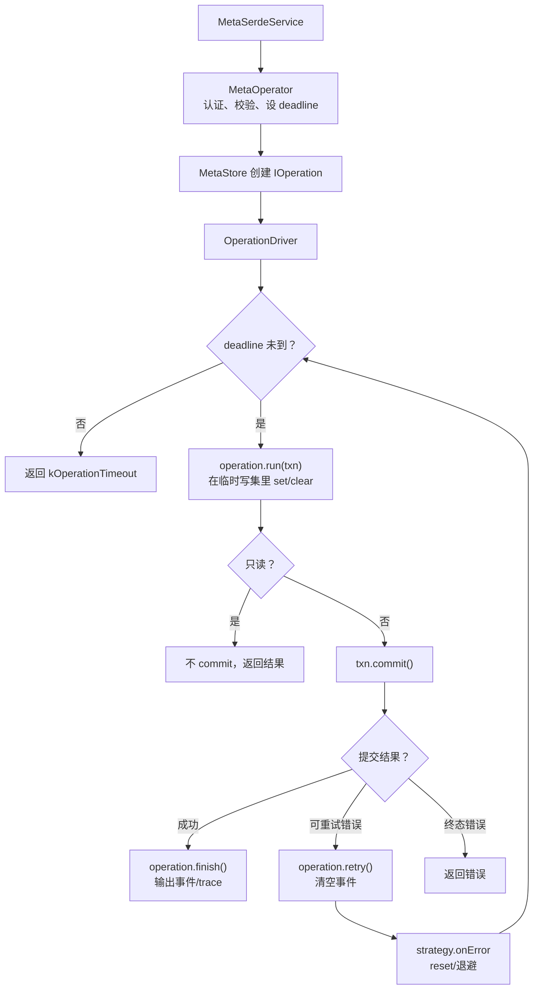

**"写操作 commit"具体是 `IReadWriteTransaction::commit()`**（调用点 `src/meta/store/Operation.h:244-246`）：Operation 在 `operation.run(txn)` 中对 Inode、DirEntry、FileSession、IDEM 等 KV key 执行的 `set()`、`clear()`，先只保存在当前 FDB transaction 的临时写集里；`commit()` 才请求 FDB 原子地检查本事务的读写冲突，并把整批 KV 修改作为一个版本应用到数据库。提交成功后，其他事务在之后的快照中才能看到这些修改；提交失败则本批修改不会对外可见，driver 根据错误决定是否重置事务并重新执行 Operation。

**这一步只提交 Meta 元数据**，不是把文件内容或 chunk 写入 Storage。文件数据由数据面单独写入，Meta 的 commit 只让"文件名指向哪个 inode、inode 属性是什么、有哪些 session"等元数据状态一次性生效。只读 Operation 没有写集，因此直接返回结果，不调 `commit()`。

从调用方角度看，只有在 driver 最终 commit 成功后，名字/属性修改才对其他客户端可见；中间某一轮因冲突重试所产生的临时读取和 event 都不算完成。`OperationDriver` 的几个关键行为：

- `readonly=true` 时拒绝非只读 Operation（`src/meta/store/Operation.h:166-168`）。
- 当 `operation.isReadOnly()==true`、`grv_cache=true` 且底层对象是 `FDBTransaction` 时，driver 设置 FDB 的 GRV cache option（`src/meta/store/Operation.h:170-174`）。GRV（Get Read Version）是事务获得一致读取快照的版本号，缓存它可减少只读请求取得版本的开销，但只适用于这条只读 FDB 路径；其他情况不设置。
- `operation_timeout` 是整个重试过程的 deadline，在每次循环开始前检查（`src/meta/store/Operation.h:179-183`，配置在 `src/meta/base/Config.h:121`），不是强行中断正在执行的 RPC。
- `retryMaybeCommitted()` 是 Operation 提供的策略开关（`src/meta/store/Operation.h:160`），决定 commit unknown 时是否重做。具体见 [5.4](#54-fdbretrystrategy-如何参与)。
- 事件和 trace 只在最终成功后输出，重试时清空事件（`src/meta/store/Operation.h:55` 清空、`:206` finish 输出）。

Operation 本身分两类：`ReadOnlyOperation` 把 `IReadWriteTransaction` 视为 `IReadOnlyTransaction` 使用，成功后不 commit；普通 `Operation` 可以写，成功后由 driver commit。即使是只读 Operation，`runOp()` 也先创建 read-write transaction，再由 `ReadOnlyOperation` 接口保证不 commit。`GcManager::runReadOnly()`、SessionManager 的扫描和 MetaScan 则显式创建 readonly transaction。

### 5.4 FDBRetryStrategy 如何参与

"重试"有两种完全不同的原因：

- **事务冲突/too old**：本轮快照不能再安全提交。必然重做。
- **commit unknown**：服务端已把 commit 发给 FDB，但网络或进程状态让它暂时无法得知 FDB 是否接受。重做前必须依赖 Operation 自身的幂等语义或 IDEM record（见 [第 7 章](#7-幂等客户端不知道上次是否成功怎么办)），不能当成普通失败。

重试行为由 `FDBRetryStrategy::Config` 的三个字段控制（`src/fdb/FDBRetryStrategy.h:27-31`）：

| 字段 | 默认值 | 含义 |
| --- | --- | --- |
| `maxBackoff` | 1 秒 | 重试间隔的指数退避上限。从 10ms 起步，每次失败翻倍，封顶后不再增长（`FDBRetryStrategy.h:25,73`） |
| `maxRetryCount` | 10 | 最大重试次数，超过后放弃并把错误返回给调用方（`FDBRetryStrategy.h:61-64`） |
| `retryMaybeCommitted` | true | 遇到 commit unknown 时是否自动重做（见下文） |

MetaOperator 的 `createRetryConfig()`（`src/meta/service/MetaOperator.cc:260-264`）组装这三项：前两项从配置 `retry_transaction.max_backoff` / `max_retry_count` 读（定义在 `src/common/kv/TransactionRetry.h:9-10`，默认值即 1 秒 / 10 次）；第三项硬编码为 `true`，即默认对 commit unknown 自动重试。

`retryMaybeCommitted()` 策略开关的含义：

- `true`：把 FDB 的 `commit_unknown_result`（项目中转换为 `kMaybeCommitted`）当作可重试事务错误，调 `strategy.onError()` 后重新执行本轮 Operation；
- `false`：只接受"确定没有提交"的可重试错误，不对 commit unknown 自动重做，而是把错误返回给上层。

提供这个开关的原因是：commit unknown 含义是"提交请求的结果未知"，重做可能把业务执行两次；允许重做的 Operation 必须依靠自身幂等逻辑或 IDEM 记录消除重复效果。当前 `IOperation` 默认返回 `true`（`src/meta/store/MetaStore.h:54`），Meta 的具体 Operation 没有覆盖这个默认值。

业务错误是否重试不由 Operation 自己硬编码，而由统一 ErrorHandling/strategy 判定。事务冲突、too old、commit unknown 等进入重试；权限、参数、not found 等终态错误直接结束。`operation_timeout=0` 可关闭 deadline。

### 5.5 readonly 模式的边界

`meta.readonly`（`src/meta/base/Config.h:58`）是 Meta 业务层对普通请求的写保护。MetaOperator 把它传给 OperationDriver（`src/meta/service/MetaOperator.cc:86`）；driver 在调 `operation.run()` 之前检查：如果配置为 true 且 `operation.isReadOnly()==false`，直接返回 `kReadOnlyMode`（`src/meta/store/Operation.h:166-168`），本次 Operation 不执行，也不提交。

| 请求类型 | `meta.readonly=true` 时 |
| --- | --- |
| `stat`、`list`、按只读方式 `open` | 允许执行；它们被识别为只读 Operation |
| `create`、`mkdirs`、`remove`、`rename`、`setAttr` | 在 Operation 开始前拒绝 |
| 可更新长度/时间的 `sync`、`close` | 作为写 Operation 拒绝 |

**几个常见误区**：

- 它保护的是"哪些 Meta RPC 可以修改元数据"，**不是**"所有 RPC 都不能读取"。
- 它不会把普通 `runOp()` 创建的 FDB transaction 自动改成只读：即使是只读 Operation，`runOp()` 当前也先创建 `IReadWriteTransaction`，只是 `ReadOnlyOperation` 不调 `commit()`。底层另有一个名字相似但层次不同的 `kv_engine.fdb.readonly` 配置；它让 FDB transaction 本身拒绝 `commit()`，不能与 `meta.readonly` 混为一谈。
- 它只约束经过 OperationDriver 的请求，**不会自动停止** GC、Distributor heartbeat、Session 清理等后台路径（`src/meta/service/MetaOperator.cc:190-196` 的 `start()` 调各组件 start，各组件 start 无 readonly 检查）。它们可能继续创建写事务。

**实际效果**：如果只有部分 Meta 节点设置了 `meta.readonly`，请求转发到其他仍可写的 owner 节点后仍可能成功；只有所有相关 owner 都进入该模式，才能达到整个命名空间不可写的效果。

`meta.readonly` 默认值是 `false`。它通常不是给普通用户长期使用的权限开关，而是运维期间的临时保护措施（一致性检查、备份、迁移、升级期间冻结用户元数据修改；发现疑似元数据损坏时先阻止写操作保留 stat/list 供排查；把某组 Meta 节点切成只读服务节点）。真正的维护窗口还需要根据目标处理 GC、SessionManager、Distributor 等后台组件。若只是希望某个挂载点或某个用户不能写，应使用客户端/FUSE 的 `readonly` 配置。

---

## 6. 路由与批处理：热点优化的关键

第 5 章讲了单个 Operation 怎么执行。本章回答：**对于高频操作（sync/close/create），怎么把多个针对同一文件的请求合并到一次事务里执行**。这是 3FS 承受高频写入的关键设计。

### 6.1 为什么要按 inode 合批

考虑一个热门日志文件被多个 writer 同时写。每个 writer 完成一段数据后会发 sync RPC 回 Meta 更新长度。如果每次 sync 都独立开一个事务"读 Inode → 更新长度 → 写回"，FDB 会承受大量小事务，而且这些事务还会因为同时改同一 Inode 而互相冲突。

解决思路：**把同一文件的多个 sync 在 owner Meta 节点合并成一个 Batch**，一次读 Inode、合并所有 hint、一次提交。这样既减少事务数，也避免同一文件的元数据更新在多个 Meta 上竞争。

但合批不适用于所有请求——rename/remove 涉及多个 key 的复杂依赖，塞进共享批次会让语义失控。所以项目只对天然围绕同一逻辑对象的操作合批。

### 6.2 哪些请求会路由和批处理

只有下面四类请求进入 Distributor/Forward/BatchedOp（入口见 `src/meta/service/MetaOperator.cc:319-328` sync、`:330-339` close、`:361-369` create、`:401-414` setAttr）：

| 请求 | 批处理 key | 条件 |
| --- | --- | --- |
| `sync` | 文件 InodeId | 总是 |
| `close` | 文件 InodeId | 总是 |
| `create` | 已解析的直接父目录 InodeId | 路径已规范化为单个文件名时 |
| `setAttr` | 目标 InodeId（存放在 `PathAt.parent`） | `PathAt.path` 为空，即按 inode 操作时 |

**几个容易误读的细节**：

- `setAttr` 按路径调用时直接走普通 Operation；只有按 InodeId 调用时批处理。
- `sync/close` 不做 `AUTHENTICATE`，但仍校验请求结构和 session 信息。
- `create` 的多级路径需要先预处理，见 [6.3](#63-create-的多级路径预处理tryopen)。

### 6.3 create 的多级路径预处理（tryOpen）

#### 问题：批处理 key 是父目录 InodeId，但有的 create 请求只有字符串路径

6.1 节说过，create 的批处理 key 是**直接父目录的 InodeId**——同一目录下并发创建的文件可以合并成一个事务。但不是所有客户端都能直接给出这个 InodeId：

| 调用方 | 传给 MetaClient::create 的形式 | 例子 |
| --- | --- | --- |
| FUSE 挂载（`FuseOps.cc:997/1885`） | `(父目录 InodeId, 单级文件名)` | 内核 VFS 已通过 lookup 解析过父目录，`name` 只是一级名字 |
| CLI 工具（`src/client/cli/admin/Create.cc:41`、`src/tools/commands/CreateWithLayout.cc:19`） | `(起始目录 InodeId, 多级路径)` | `hf3fs create /dir/a.txt`，path 是 `"dir/a.txt"` |
| 测试（`tests/client/TestMetaClient.cc:182`） | 多级路径 | `Path("a/b/c/d")` |

对于后两类请求，`req.path.path->has_parent_path()` 为真——Meta 拿到的是 `"dir/a.txt"` 这样的字符串，**既不知道父目录 `/dir` 的 InodeId（没法路由、没法合批），也不知道这个文件是否已经存在（create 碰到已存在文件要走 open 语义）**。

#### 解法：进批处理之前，先用 tryOpen 把路径"消化"一遍

`MetaOperator::create`（`src/meta/service/MetaOperator.cc:341-369`）：

```cpp
if (req.path.path->has_parent_path()) {            // 只有路径是多级时才需要
    auto result = co_await runOp(&MetaStore::tryOpen, req);  // 注意 req 按引用传，可能被改写
    if (result.hasValue() || req.path.path->has_parent_path()) {
        co_return result;                          // 文件已存在 / 父目录缺失 → 到此为止
    }
    // 走到这里说明 req 已被改写成单级形式，继续往下
}
auto node = distributor_->getServer(req.path.parent);   // 现在能按父 InodeId 路由了
if (node == distributor_->nodeId()) {
    co_return co_await runInBatch<CreateReq, CreateRsp>(parentId, std::move(req));  // 合批
} else {
    co_return co_await forward_->forward<CreateReq, CreateRsp>(node, std::move(req));
}
```

`tryOpen` 不是新操作，就是 `OpenOp<CreateReq>`（`src/meta/store/ops/Open.cc:304-306`）——**"试着打开"**。它对整条路径做一次完整解析（含权限检查），根据解析结果分三种情况处理：

```cpp
// src/meta/store/ops/Open.cc:58-66
auto resolveResult = co_await this->resolve(txn, req_.user).path(req_.path, ...);
auto &entry = resolveResult->dirEntry;
if (!entry.has_value()) {                          // 路径走完了，最后一级不存在
    if constexpr (std::is_same_v<Req, CreateReq>) {
        req_.path = PathAt(resolveResult->getParentId(), req_.path.path->filename());
        // ↑ 关键改写：{parent=dir的InodeId, path="a.txt"}
    }
    co_return makeError(MetaCode::kNotFound);
}
// 最后一级存在 → 走 openExists，按 open 语义返回（O_EXCL 则报 kExists，见 Open.cc:85-87）
```

#### 三种结果对应的后续行为

以 `create("/dir/a.txt")` 为例：

| 情况 | tryOpen 结果 | req 是否被改写 | 外层判断 | 最终行为 |
| --- | --- | --- | --- | --- |
| `/dir/a.txt` **全存在** | 成功返回 Inode（openExists 语义；带 O_EXCL 则返回 kExists） | 否 | `result.hasValue()==true` | **直接返回已 open 的结果**，create 退化成 open |
| `/dir` 存在、`a.txt` **不存在** | kNotFound | **改写为 `{parent=dir的InodeId, path="a.txt"}`** | 两个条件都不命中（path 已无 parent_path） | **继续往下走：按父 InodeId 路由 + 合批创建** |
| `/dir` **不存在** | resolve 中途返回 kNotFound | 否（没走到改写分支） | `req.path.path->has_parent_path()==true` | **把 kNotFound 直接还给客户端** |

改写后还有一道防线：外层检查 `req.valid()`（`MetaOperator.cc:353-357`），确认改写出来的"单级文件名"合法（不是 `.`/`..`、不含 `/` 等），不合法说明有 bug，返回 kFoundBug。

#### 流程图

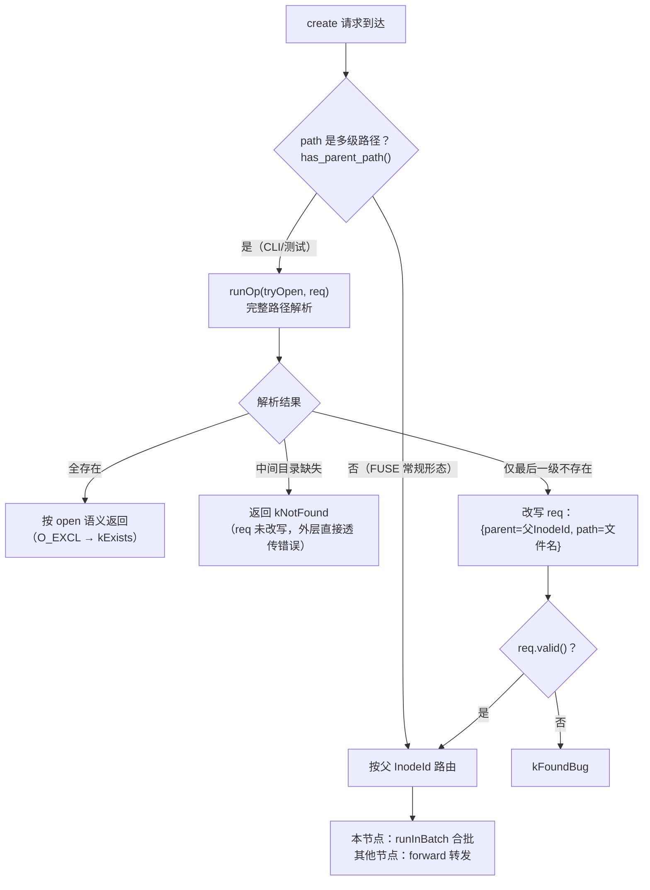

#### 设计动机总结

tryOpen 一次路径解析同时解决了两件事：

1. **把批处理 key 从"字符串路径"落实为"具体父 InodeId"**——能解析出父目录就改写 req，让后续路由和合批成为可能；解析不动就把 kNotFound 还给客户端，不浪费一次批处理调度。
2. **顺带处理"文件已存在"**——create 碰到已存在的多级路径文件时，直接复用 open 的全套逻辑（权限检查、O_EXCL 冲突、O_TRUNC 等），不需要 create 批处理路径再实现一遍。

对 FUSE 挂载这条主路径来说，内核早已把路径解析成 `(父 InodeId, 文件名)`，`has_parent_path()` 为假，**整个 tryOpen 预处理被跳过**，零开销直达路由+合批——这也是为什么该预处理放在 `MetaOperator` 层而不是 `MetaStore` 层：它服务于路由和合批的输入格式，属于"进批处理前的适配"，不是业务逻辑。

### 6.4 BatchedOp 怎么工作

#### 从一个场景开始

4 个进程同时写同一个文件（inode 记为 F）：3 个调 sync 汇报写入进度，1 个调 close。如果各跑各的事务，Meta 要开 4 个"读 F → 改 F → 写回 F"的事务——它们改的是**同一个 Inode**，在 FDB 里几乎必然互相冲突、反复重试。

批处理的思路一句话：**既然大家改的都是同一个 Inode，就凑成一个事务，读一次、改一次、写一次**。

要实现它只剩两个问题：请求怎么凑到一起（排队），凑到一起怎么改（合并）。`BatchedOp` 就是负责合并执行的那个对象。

#### 排队：先到的当领队，后到的当跟随者

每个批处理 RPC（sync/close/按 InodeId 的 setAttr/规范化后的 create）到达后，都会把"请求 + 结果槽"挂到该 inode 的排队槽位上，然后睡觉等结果。**第一个到的请求者被立刻唤醒，成为领队**——它负责执行这一批事务；后到的挂进领队的批里，睡到领队把结果放进自己的结果槽。

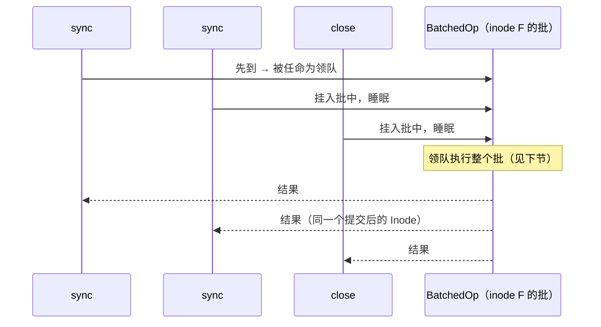

三种入队结果（`addBatchReq`，`MetaOperator.h:147-180`）：

| 情况 | 角色 |
| --- | --- |
| 该 inode 没有排队中的批 | **领队**：立刻被唤醒，负责执行这批事务 |
| 有排队中的批且未满（上限 `max_batch_operations` 默认 4096） | **跟随者**：挂入批中，睡到领队带回结果 |
| 批已满 | 立刻收到 kBusy 失败返回 |

领队跑完一批后，若期间又有新请求排队，则唤醒下一个等待者当**新领队**继续跑——批与批形成接力。所以"同一 inode 的请求天然串行"不是靠锁，而是靠**任何时刻最多只有一个领队在跑这个 inode 的事务**。

排队槽位本身按 inode 分散在 63 个分片里（`Shards<map<InodeId, Batch>, 63>`，`MetaOperator.h:207`），不同 inode 的入队互不阻塞；分片锁只在挂队/交接的一瞬间持有，不会横跨事务执行。

#### 领队执行：一个事务的三段式

领队醒来后开一个读写事务，整体是"先读、再合并改内存、最后写回"（`BatchedOp::run`，`BatchOperation.cc:57-105`）：

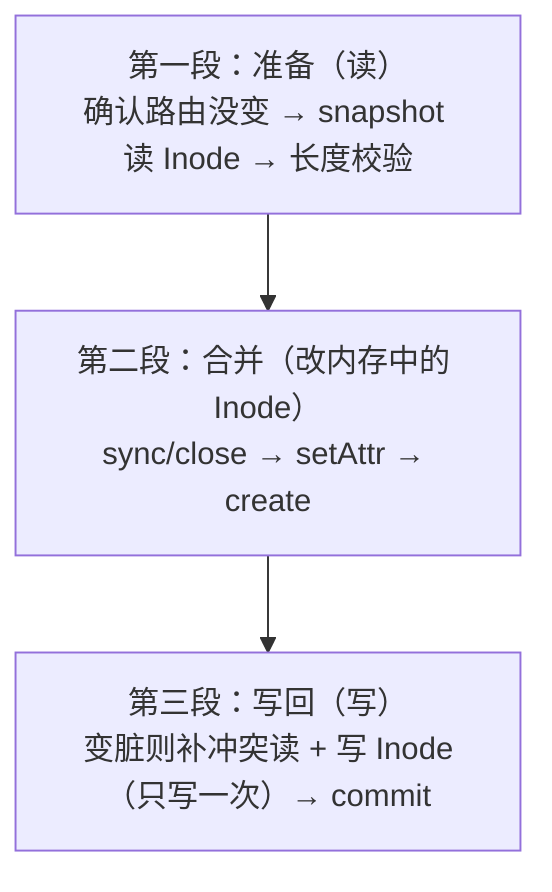

**第一段：准备**。做两件防御性检查：

1. *路由没变*：入队到执行之间集群可能扩缩容，事务内复核本节点仍是该 inode 的 owner（`Distributor::checkOnServer`）；不是则返回 kBusy，让请求者按新路由重发。
2. *长度没被批外的人改过*：`BatchedOp` 记着本批先前尝试留下的长度缓存（`currLength_` = 上次读到的现状，`nextLength_` = 上次算好待写入的新长度，用于事务重试时复用、免得反复问 Storage）。若 Server Map 版本戳变了（归属权可能中断过），作废缓存；若长度对不上缓存又不属于路由变化，说明有批外修改，宁可重试也不覆盖（`BatchOperation.cc:70-85`）。

**第二段：合并**。按固定顺序处理批内四类请求，全部改在**同一个内存 Inode 对象**上。一个贯穿的规则：**单个请求业务出错（参数非法、权限不足等）只记到它自己的结果槽，不影响整批**。

| 顺序 | 请求 | 合并什么 | 要点 |
| --- | --- | --- | --- |
| 1 | sync + close | 时间戳（超粒度才置脏）、长度 hint（归并取最大）、收集要删的 FileSession | 只要有一个 truncate 请求，作废全部 hint（截断后客户端长度提示不可信） |
| 2 | setAttr | 按到达顺序叠加到同一 Inode，等效依次执行但只写一次 | 若是目录且 ACL 变了，同步更新其 DirEntry 的 `dirAcl` 副本（见 3.3 节） |
| 3 | create | 按文件名分组：**同名一组**，组内第一个真正创建、其余按 open 语义返回；不同名组并发（每波 ≤8 组） | 天然实现"并发 create 同名文件，一个赢、其余 open"的 POSIX 行为；uuid 相同则按重放处理 |

其中最微妙的是**新长度怎么定**（`queryLength`，`BatchOperation.cc:260-303`），三级优先：

| 优先级 | 来源 | 为什么可信 / 不可信 |
| --- | --- | --- |
| 1 | 本批先前尝试算出的 `nextLength_` | 只在事务重试时命中（批与批之间不共享状态），批处理已把同 inode 修改串行化，批内算出的结果没人能推翻 |
| 2 | 客户端 hint | 免一次 Storage 往返，但客户端只知道"我写过多少"，崩溃/重试后可能不准 |
| 3 | 问 Storage（`fileHelper().queryLength`） | 最权威但最贵，hint 不可信时才付出这次代价 |

算出的新长度还要过"禁止回退"校验（长度缩水必须伴随 truncateVer+1，否则 FATAL）。

单个 create 的完整逻辑（`BatchOperation.cc:446-522`）：继承父目录 layout、S_ISGID 时继承组、分配 InodeId、把父 Inode 和新 DirEntry 加入 read conflict（防父目录被并发删除）、写打开时创建 FileSession；批内多个文件共享一个 chain 轮转计数器（`FS_CHAIN_ALLOCATION_FL`，让同目录新文件的 chain 均匀分布）。

**第三段：写回与提交**。第二段中任何一步改过 Inode，统一补 `addIntoReadConflict` + `store`——**只写一次**，无论批里多少个请求。提交由 `OperationDriver::run` 完成（重试策略见 5.3/5.4 节）：

- **提交冲突** → 整批从头重试，所有结果槽清空重来（`BatchedOp::retry`）；
- **成功** → 进入结果分发。

#### 分发：每个请求拿到自己的结果

事务成功后（`BatchedOp::finish`，`BatchOperation.cc:734-749`）：

1. 逐个调用 `Waiter::finish`：没有单独结果的（sync/close/setAttr）用提交后的 Inode 构造响应；执行中记过单独错误的（如某个 close 参数非法）保留其错误；然后唤醒各自的协程，各请求者返回各自的 RPC 客户端；
2. 领队回到排队槽位 `wakeupNext()`：有下一个等待者就唤醒它当新领队，没有就清掉该 inode 的槽位。

#### 回到开头的场景

3 个 sync + 1 个 close = **一个事务**：读一次 F、合并时间戳、长度取三级优先判定、删一个 session、写回一次；4 个请求者各自拿到同一个提交后的 Inode。若提交时 FDB 冲突，整批带着缓存的长度状态重试，直到成功。

#### 设计要点小结

- **串行不靠锁**：靠"每批一个领队 + 批间接力"，事务执行期间不持有任何排队锁；
- **错误隔离**：单请求业务错误不拖垮整批，事务错误（冲突）才整批重试；
- **长度缓存服务重试**：`currLength_/nextLength_` 只在一个批的生命周期内有效（含事务重试），让重试免于重复向 Storage 查长度，并能识别"批外有人改了长度"和"上次提交其实成功了"两种异常；Server Map 版本戳一变就作废（机制见 6.5/6.6 节）。

### 6.5 Distributor：谁负责这个 inode

到这里需要回答一个前置问题：**哪个 Meta 是这个 inode 的 owner？** 这是 `Distributor` 的工作。

注意有两份"Meta 节点列表"容易混淆：

- **mgmtd 的列表**：回答"集群里有哪些可连接 Meta"。
- **Distributor 的 Server Map**：回答"为了让同一个 key 的 batch 不在多节点并发，当前由哪一个 Meta owner 负责"。

后者由 Meta 自己写进 KV 并在事务内复核，**不直接使用 mgmtd 的 Meta 列表**。Server Map 由三类 key 维护（`src/meta/components/Distributor.h:59`、`src/meta/components/Distributor.cc:45-47`、`src/common/kv/ITransaction.h:26`）：

| key | value |
| --- | --- |
| `META` | serde 后的 `vector<NodeId> active` |
| `META-{nodeId:08d}` | FDB versionstamped heartbeat value |
| `kMetadataVersionKey` | Server Map 全局 versionstamp |

这里的 versionstamp 是 FDB 在一次成功提交时写入的提交版本标记。节点持续重写自己的 heartbeat，其他节点只要看到该值继续变化，就知道该节点仍在提交心跳；Server Map 也用同一种版本标记，让 batch owner 能在业务事务中判断自己依据的路由是否已经过期。

每个节点默认每 `1s × random(0.8, 1.2)`（`src/meta/components/Distributor.cc:71`、`:218-319` 的 `update` 函数）：

- snapshot 扫描其他节点 heartbeat；
- 观察 value versionstamp 是否变化，并在本地记录观察时间（行 272-279 超时检测）；
- 超过 30 秒未变化的 active 节点被视为 dead；
- 写自己的 versionstamped heartbeat；
- 必要时事务性更新 active Map 和全局 versionstamp。

停止时会尝试从 Map 删除自己（`src/meta/components/Distributor.cc:74-86`，`stopAndJoin`；`:295-298` 处理 exit）。

**`Weight::select()`**（`src/fbs/meta/Utils.h:251-297`）是 rendezvous/highest-random-weight 风格：为每个 `(nodeId, inodeId)` 计算 128 位 MurmurHash3（行 276），选权重最大的节点（行 280-296）。相同 Map 和 InodeId 得到稳定结果；节点变化时只重新分配一部分 key（迁移量推导见 13.2 节）。

### 6.6 路由变化时怎么处理

请求入口的 `getServer()` 只读本地 Server Map。BatchedOp 内部再读 KV 中的全局 versionstamp（`src/meta/components/Distributor.cc:98-119`）：

- KV 版本比本地新：在事务中重新加载 Server Map；
- KV 版本比本地旧：返回 `TransactionCode::kTooOld`，让事务重试；
- 最新 Map 已把该 inode 分给其他节点：BatchedOp 返回 `kBusy`。

注意，OperationDriver 的事务重试不会重新进入 `MetaOperator::getServer()`；如果当前节点已不再负责该 inode，本次调用最终需要由调用方重试，新的 RPC 才会按更新后的 Map 转发。

实际转发的工作由 `Forward` 完成。Forward 只支持 sync、close、按 inode setAttr 和规范化后的 create（`src/meta/components/Forward.h:66-83`，`ForwardMethod` 特化）。它通过 mgmtd RoutingInfo 查目标 Meta 的 `MetaSerde` 地址（`src/meta/components/Forward.h:104-124`，`getAddress`），默认要求 RDMA，超时 10 秒（行 36），发送层重试 3 次（行 132）。

Distributor 与 Forward 的分工：

```text
客户端请求先到任意 Meta
  -> Distributor.getServer(key)     # 计算 owner，纯路由决策
  -> owner == 本节点？
       是：加入本节点对应 key 的 Batch，合并后执行
       否：Forward.forward(owner, req)  # 使用网络将原 RPC 投递给 owner
  -> owner 的 Distributor.checkOnServer(txn, key)
       # 在提交事务内再次确认自己仍是 owner
```

| 问题 | Distributor | Forward |
| --- | --- | --- |
| 谁负责这个 inode/父目录？ | 计算并维护答案 | 不参与 |
| 是否把多个请求合并？ | 选择的 key 决定本地 Batch 归属 | 不参与 |
| 是否发网络 RPC？ | 否 | 是 |
| 路由 Map 变化怎么办？ | `checkOnServer()` 用 KV version 再确认，必要时返回 `kBusy` | 禁止二次转发，返回 `kForwardFailed` 让客户端重试 |

**Forward 发送的是原始 RPC，而不是"一个已经组装好的 Batch"**（`src/meta/components/Forward.h:130-149`，`forwardImpl`，行 141 直接调 RPC）。真正的合批只发生在 owner 节点收到请求后，`runInBatch()` 将同 key 的 waiter 放入本地队列时。

请求设置 `req.forward = 当前 nodeId`（`src/meta/components/Forward.h:91-96`，`check` 函数）。目标节点若想再次转发会返回 `kForwardFailed`（行 91-94），因此转发最多一跳；这也是路由 Map 快速变化时让客户端重试而不是形成转发环的保护。

---

## 7. 幂等：客户端不知道上次是否成功怎么办

第 5 章提到 commit unknown——服务端把 commit 发给 FDB 后，可能因为网络或进程状态不知道 FDB 是否接受。如果客户端超时重试，服务端怎么避免把业务执行两次？本章回答这个问题。

### 7.1 commit unknown 是什么

FDB 事务提交有三种结果：

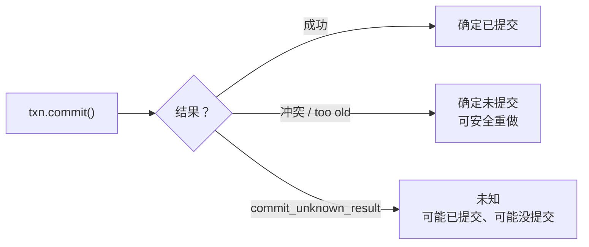

第三种是麻烦所在。客户端不知道上次是否已经成功，按原请求 UUID 重试——但服务端可能已经执行过一次了。如果服务端简单重新执行 Operation，面对的可能是变化后的名字空间（比如上次 remove 已经成功删了 `a`，又有个新文件叫 `a` 被创建了，这次 remove 就会误删新文件）。

### 7.2 IDEM：完整结果重放

**IDEM（Idempotent）解决的问题是"客户端不知道上一次修改是否已经提交"。** IDEM 让服务端把该逻辑请求的**完整结果**作为持久状态保存，重复请求不再重新执行 Operation，而是直接返回保存的结果。

IDEM 只在 `requestId` 和 `clientId.uuid` 都非零时可用，当前具体启用条件：

| Operation | 使用 IDEM 的条件 | 默认行为 | 位置 |
| --- | --- | --- | --- |
| `remove` | `recursive=true`，或 `idempotent_remove=true` | 后者默认 true，因此普通 remove 默认也使用 | `src/meta/store/ops/Remove.cc:52-62` |
| `rename` | `moveToTrash=true`，或 `idempotent_rename=true` | moveToTrash 始终使用；普通 rename 默认不使用 | `src/meta/store/ops/Rename.cc:63-69` |
| create/open/sync/close/setAttr 等 | 当前没有 `needIdempotent()` 实现 | 不建立 IDEM record | — |

一次启用 IDEM 的执行顺序：

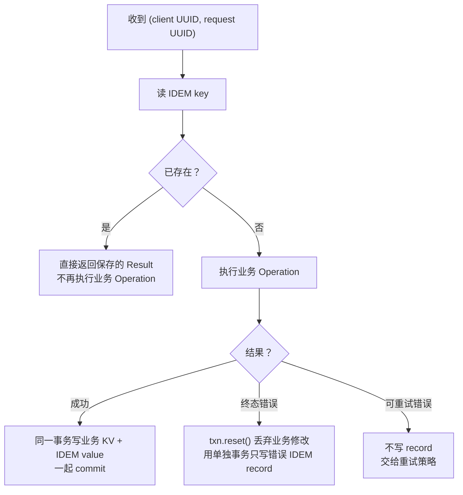

代码层面（`src/meta/store/Operation.h:233-241`）：

- **业务成功**：Operation 先在当前事务中修改业务 KV，再调 `Idempotent::store()` 写 IDEM value，最后与业务修改一起 `commit()`。只要 IDEM 记录存在，业务修改和"可重放结果"就是同一次原子提交的结果。
- **终态失败**：例如 not found、权限错误等不可重试错误。driver 先 `txn.reset()` 丢弃本轮业务修改，再用一个干净事务只写错误结果的 IDEM record 并提交。客户端重试时仍会得到同一个错误，不会重新执行业务逻辑。
- **可重试失败**：冲突、too old 等错误不写 IDEM；事务重置后重新执行。只有最终成功或最终确定失败时，才会留下可供后续请求读取的 record。

因此这里的 `Result<Rsp>` 可理解为"此前同一个逻辑请求的完整执行结果"，但不一定是成功响应：它可能包含 `Rsp`，也可能包含上一次已持久化的终态错误。典型场景是第一次 commit 已成功、但响应在网络中丢失；客户端携带相同的 client UUID + request UUID 重试，服务端读到 IDEM 后直接返回保存的结果。如果第一次执行从未成功提交、也没留下终态错误 record，那么重试时读不到 IDEM，仍会重新执行业务。

**保证范围**：IDEM 保证的是**保留期内、同一 client UUID + request UUID 的结果重放**，不是所有写操作的永久 exactly-once。IDEM record 默认保留 30 分钟；过期并被清理后，携带同一 UUID 的请求会重新执行业务逻辑（保留期与清理周期配置见 `src/meta/base/Config.h:116-117`）。

### 7.3 DirEntry UUID：目标级去重

IDEM 之外，项目还有一层"轻量级"去重：create/mkdirs/symlink/hardLink 等创建类操作把 request UUID 写入新建目标的 `DirEntry.uuid` 字段。重试时目标仍是同一条记录（UUID 匹配），就可以直接返回已有对象，不重复创建。

这层保护的局限：目录项被删除/替换后，旧 UUID 就不再保护新对象。所以它是"目标目录项级"去重，不是全局结果记录。

### 7.4 IDEM 过期后的全系统边界

项目没有永久保存的"已处理 request UUID"全局表，请求中也不携带服务端可验证的过期时间。因此 IDEM 被清理后，Meta 无法仅凭 UUID 判断"这是很久以前已完成的请求"；如果调用方重新发送原始 RPC，系统会按当前状态重新进入对应 Operation。这个场景没有统一兜底，而是按请求路径分别处理：

| 请求路径 | IDEM 之外的保护 | IDEM 过期后的实际语义 |
| --- | --- | --- |
| `remove` | `RemoveReq.inodeId` 可要求路径仍指向原 inode；递归 remove 的 MetaClient 会先取得并填入该值 | 携带 inodeId 时，目标已换 inode 返回 `NotFound`；不携带时按当前路径重新解析，系统不提供永久去重 |
| `rename` | 目标 `DirEntry.uuid` 保存 request UUID；`moveToTrash` 还携带源 inodeId | 目标 DirEntry 仍保留同一 UUID 时可识别"已完成"；目标被替换或删除后不再有这层保护。普通 rename 默认不使用 IDEM |
| `create`、`mkdirs`、`symlink`、`hardLink` | request UUID 写入新建目标的 `DirEntry.uuid`，重试时目标仍是同一条记录即可返回已有对象 | 这是"目标目录项级"去重，不是全局结果记录；目录项被删除/替换后，旧 UUID 不再保护新对象 |
| `open`（非 create）、`setAttr`、`lockDirectory` | 没有 IDEM；分别依赖 FileSession/key 覆盖、属性赋值比较、ClientId 持有者检查等局部语义 | 没有统一的永久结果重放；重复请求按当前 inode、属性或锁状态处理 |
| `sync`、`close` | 没有 IDEM；FileSession 按精确 `(inodeId, sessionId)` 写入/清除，长度用 `VersionedLength` 合并；close 的后台任务可持续重试 | 重复 sync/close 设计为收敛到相同 session/长度状态，但不会返回第一次调用保存的完整响应 |
| `truncate`、其他组合操作 | 不使用 Meta IDEM；公开 truncate 是 Storage 删 chunk 后再发 Meta sync 的组合流程 | 依赖 Storage 请求自身和长度版本语义，不能把 Meta IDEM 的保证扩展到整个组合流程 |

**正常用户请求通常不会碰到 IDEM 过期**，因为 `MetaClient::retry_default.retry_total_time` 默认只有 1 分钟，而 Meta 的 `idempotent_record_expire` 默认是 30 分钟；同一次 `MetaClient` 调用只在这 1 分钟内复用同一个请求对象和 UUID。调用失败返回后，用户再次调用 API 通常会构造新的请求 UUID，代表新的逻辑意图。这两个时间没有在代码中强制绑定，运维若把客户端重试时间调到超过 IDEM 保留期，或者直接保存旧 RPC 长时间重放，就超出了默认设计边界。

### 7.5 系统的三层保证

整个系统对"重复请求"的真实保证分为三层：

1. **FDB 保证每一次事务原子提交和冲突检测**；
2. **IDEM 在保留期内为 remove/部分 rename 重放完整结果**；
3. **各 Operation 用 DirEntry UUID、inodeId、session key、版本化长度等机制提供局部收敛或目标校验**。

**系统没有第四层"所有请求永久 exactly-once"。** 如果业务必须支持跨越 30 分钟甚至更久的旧请求重放，必须把保留期调到覆盖最大重试窗口，或新增长期的操作日志/幂等表、期望 inode/版本校验等业务协议；当前代码不会自动提供这种保证。

幂等记录由首个活跃 Meta 节点周期清理，默认保留 30 分钟、每分钟扫描一次。

---

## 8. 主要文件操作详解

第 1 章给出了全局视角的读写旅程，本章逐一拆解每个文件操作的内部实现。读者可以把它当作"字典"：先通读一遍建立全局印象，之后按需查阅。

### 8.1 操作总览

| 操作 | RPC 入口 | 实现文件 | 是否只读事务 | 是否批处理 | 是否涉及 GC |
| --- | --- | --- | --- | --- | --- |
| open | `MetaOperator.cc:309` | `ops/Open.cc` | 视 flags 而定 | 否 | 否 |
| create | `MetaOperator.cc:341` | `ops/Open.cc` + `ops/BatchOperation.cc` | 否 | 是 | 否 |
| sync | `MetaOperator.cc:319` | `ops/BatchOperation.cc` | 否 | 是 | 否 |
| close | `MetaOperator.cc:330` | `ops/BatchOperation.cc` | 否 | 是 | 否 |
| statFs | `MetaOperator.cc:284` | `ops/StatFs.cc` | 是 | 否 | 否 |
| stat | `MetaOperator.cc:289` | `ops/Stat.cc` | 是 | 否 | 否 |
| batchStat | `MetaOperator.cc:294` | `ops/Stat.cc` | 是 | 内部并发 | 否 |
| batchStatByPath | `MetaOperator.cc:299` | `ops/Stat.cc` | 是 | 内部并发 | 否 |
| getRealPath | `MetaOperator.cc:304` | `ops/GetRealPath.cc` | 是 | 否 | 否 |
| remove | `MetaOperator.cc:381` | `ops/Remove.cc` | 否 | 否 | 是 |
| rename | `MetaOperator.cc:386` | `ops/Rename.cc` | 否 | 否 | 是 |
| mkdirs | `MetaOperator.cc:371` | `ops/Mkdirs.cc` | 否 | 否 | 否 |
| symlink | `MetaOperator.cc:376` | `ops/Symlink.cc` | 否 | 否 | 否 |
| hardLink | `MetaOperator.cc:396` | `ops/HardLink.cc` | 否 | 否 | 否 |
| list | `MetaOperator.cc:391` | `ops/List.cc` | 是 | 否 | 否 |
| setAttr | `MetaOperator.cc:401` | `ops/SetAttr.cc` + `ops/BatchOperation.cc` | 否 | 是 | 否 |
| lockDirectory | `MetaOperator.cc:416` | `ops/LockDirectory.cc` | 否 | 否 | 否 |
| pruneSession | `MetaOperator.cc:421` | `ops/PruneSession.cc` | 否 | 否 | 否 |

注意 sync/close/pruneSession/testRpc/dropUserCache 这几个 RPC 不做用户认证（16.3 节）：FileSession 本身就是"客户端持有写会话"的凭证，session 精确绑定 `(inodeId, sessionId)`，伪造无收益。sync/close 还按 InodeId 走 rendezvous 路由（`MetaOperator.cc:321,332`），这是它们能进同一个批处理的前提。

"是否只读事务"决定 Operation 是否可以触发 `BEGIN_WRITE()` 宏的断言（`ops/Open.cc:18-24`）。"是否批处理"决定请求是否经过 `runInBatch` 路径合并到 BatchedOp（`MetaOperator.cc:116-132`）。

### 8.2 create 与 open：同一份 OpenOp 代码

这两个操作共享同一份核心逻辑，区别只在入口和请求类型：

- `MetaOperator::open()`（`MetaOperator.cc:309-312`）直接 `runOp(&MetaStore::open, req)`，构造 `OpenOp<OpenReq, OpenRsp>`。
- `MetaOperator::create()`（`MetaOperator.cc:341-369`）先调用 `runOp(&MetaStore::tryOpen, req)` 构造 `OpenOp<CreateReq, CreateRsp>``（`ops/Open.cc:304-306`）做路径预处理。如果 tryOpen 返回结果（不论成功还是 kNotFound），create 都会根据当前请求状态决定是直接返回还是继续批处理创建。

`OpenOp::isReadOnly()`（`ops/Open.cc:39-42`）的判定是整个设计的关键：

```cpp
bool isReadOnly() final {
  return !req_.session.has_value() && req_.flags.accessType() == AccessType::READ &&
         !req_.flags.contains(O_TRUNC) && !req_.flags.contains(O_CREAT);
}
```

四个条件全满足才用只读事务：无 session、只读、不截断、不创建。任何一个写条件出现，整个 Operation 都要走读写事务。这是因为 FDB 不允许只读事务中混入写操作。

`OpenOp::run()`（`ops/Open.cc:44-72`）按请求是否携带路径分两条路：

1. **按 InodeId 打开**（`path.path` 为空）：直接 `resolve().inode()` 获取 Inode 对象，再走 `openExists()`。客户端拿到 fd 后用 inode ID 重复 open 走这条路径。
2. **按路径打开**：`resolve().path()` 解析路径得到 `ResolveResult`，其中包含父目录信息和可选的 DirEntry。如果 DirEntry 不存在且请求是 `CreateReq`，把请求路径改写为 `(parentId, filename)`（`ops/Open.cc:62-64`），然后返回 kNotFound。这一步是 create 能继续走批处理的前提。

`OpenOp::openExistsFile()`（`ops/Open.cc:108-171`）是文件打开的主流程，按顺序做这些事：

| 步骤 | 行号 | 做什么 |
| --- | --- | --- |
| 检查 O_DIRECTORY | 117-119 | 如果带了 O_DIRECTORY 但目标是文件，返回 kNotDirectory |
| 检查 FS_IMMUTABLE_FL | 120-122 | 非读操作且文件被设为不可变，返回 kNoPermission |
| 权限检查 | 123 | `inode.acl.checkPermission(user, accessType)` |
| 检查文件 hole | 126-130 | 只读打开且文件有 hole 且配置开启检查时拒绝，避免读到空洞 |
| 处理 O_TRUNC | 132-142 | 调用 `replaceExistsFile()` 尝试替换 inode |
| 清除 SUID/SGID/SVTX | 144-150 | 非所有者写打开时清除这三个特殊权限位 |
| 创建 FileSession | 152-160 | 非只读且携带 session 时，创建写会话并处理 dynStripe 调整 |
| 存储 dirty inode | 162-166 | 有修改时加入读冲突集并写入 |

### 8.3 O_TRUNC 的 inode 替换策略

`O_TRUNC` 标志的意思是"打开时把文件截断为 0"。最直接的实现是修改 Inode 的 length 字段。但 3FS 对大文件有一个优化：当满足条件时，不修改原 Inode，而是创建一个全新的 Inode 替换旧的。

`OpenOp::replaceExistsFile()`（`ops/Open.cc:173-210`）的触发条件（行 176-177）：

1. 配置 `otrunc_replace_file` 为 true。
2. `inode.nlink == 1`（没有硬链接，保证只影响这一个名字）。
3. `inode.asFile().length >= otrunc_replace_file_threshold()`（原文件足够大，回收 chunk 有价值）。
4. 没有 FileSession 持有该文件（`FileSession::checkExists` 返回 false，行 186-190）。

全部满足时执行替换（行 194-209）：

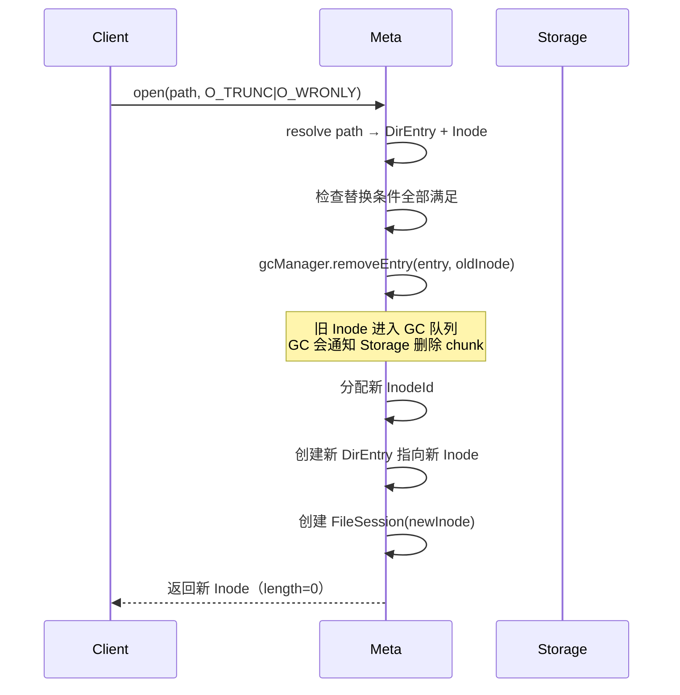

这个设计的核心收益是：大文件截断后，旧 chunk 的物理删除交给 GC 异步完成，用户不需要等待 Storage 删除完成。如果不替换 inode，就必须在 sync 时处理"截断后长度突然变小"的情况，逻辑更复杂。

### 8.4 sync 与 close：批处理中的长度合并

sync 和 close 是写流程的"提交点"。客户端写完数据后调用 sync 把最新长度告诉 Meta，调用 close 释放 FileSession。它们都走批处理路径（`MetaOperator.cc:319-339`），最终在 `BatchedOp::syncAndClose()`（`ops/BatchOperation.cc:107-187`）中统一处理。

`SyncReq`（`fbs/meta/Service.h:378-406`）和 `CloseReq`（`fbs/meta/Service.h:418-455`）的关键字段：

| 字段 | 类型 | 说明 |
| --- | --- | --- |
| `inode` | InodeId | 操作的文件 |
| `session` | optional SessionInfo | **仅 CloseReq 有**（`Service.h:420`），标识要关闭的会话 |
| `updateLength` | bool | 是否更新文件长度 |
| `lengthHint` | optional VersionedLength | 客户端认为的"至少多长" |
| `truncated` | bool (SyncReq) | 标记这是 truncate 后的 sync，使 Meta 丢弃 hint 直接查 Storage |
| `atime/mtime` | optional UtcTime | 更新访问/修改时间 |

`VersionedLength`（`fbs/meta/Schema.h:228-243`）是 `{length, truncateVer}` 二元组。合并策略 `mergeHint`（`Schema.h:233-240`）**只比较 length**（`h1->length >= h2->length ? h1 : h2`，任一 hint 缺失则结果为空）。这保证正常写场景下多个客户端并发 sync 同一个文件时取最大长度，不会丢失数据。

truncateVer 不参与 mergeHint 比较，它的一致性由 BatchedOp 保证：发生 truncate 的批会**丢弃所有 lengthHint**（`ops/BatchOperation.cc:135-139`：`if (truncate) { hintLength = std::nullopt; updateLength = true; }`），强制走 Storage 查询，由 Meta 把 truncateVer 加一（`BatchOperation.cc:300-302`）。`syncAndClose` 里的 FATAL 断言（`BatchOperation.cc:160-166`）保证 truncateVer 单调不减。

`BatchedOp::sync()`（`ops/BatchOperation.cc:189-227`）处理所有针对同一 InodeId 的 sync 请求：把多个 `lengthHint` 用 `mergeHint` 合并成一个，然后如果 `updateLength` 为 true，可能需要向 Storage 查询实际长度。

`BatchedOp::close()`（`ops/BatchOperation.cc:229-258`）收集所有要关闭的 `(inodeId, sessionId)` 对，在事务中删除对应的 FileSession 记录。

### 8.5 queryLength：Meta 向 Storage 查实际长度

当 sync 请求设置了 `updateLength` 时，Meta 不能完全信任客户端上报的 `lengthHint`（客户端可能 crash 或计算错误）。此时调用 `FileHelper::queryLength()`（`src/meta/components/FileHelper.cc:88-111`）向 Storage 发送查询请求。

`FileHelper::queryLength()` 内部调用 `FileOperation::queryChunks()`，让 Storage 报告该文件实际写入了哪些 chunk 以及最后一个 chunk 的实际长度。Meta 把这个结果和 `lengthHint` 做比较：

- 取两者中较大的作为新的 `Inode.asFile().length`。
- 如果发现 chunk 之间有"空洞"（某些 chunkIndex 不存在），会标记 `hasHole`（`FileHelper.cc:98-106`）。有 hole 的文件在后续只读 open 时会被拒绝（`ops/Open.cc:127-130`），因为读取空洞会返回错误数据。

### 8.6 remove：不是真删，而是搬家

`RemoveOp::run()`（`ops/Remove.cc:64-192`）做的事情可能和直觉不同：它不直接删除 Inode，而是把目录项从用户可见的命名空间"搬"到 GC 目录下。

核心步骤：

| 步骤 | 行号 | 做什么 |
| --- | --- | --- |
| 解析路径 | 64-80 | 获取目标 DirEntry 和 Inode |
| 权限检查 | 89-119 | 检查父目录写权限、sticky bit（`S_ISVTX`）、FS_IMMUTABLE_FL、目录锁 `checkLock`（行 93，与 8.8 的 lockDirectory 呼应：目录被锁时只有持锁客户端能删） |
| 空目录直删 | 148-162 | 删除目录时 `DirEntryList::checkEmpty()` 为空则**前台直接删除** DirEntry + Inode（行 153-156），不走 GC |
| 递归权限 | 164-183 | 递归删除时检查递归权限并保存 `origPath` 到 gcInfo |
| 移入 GC | 185 | `gcManager().removeEntry(txn, entry, inode, gcInfo)` |

`removeEntry()`（`GcManager.cc:754-807`）做的事：

1. `inode.nlink--`（行 767），如果 nlink 归零，文件才真正进入待删除队列（行 798-804）。
2. 把 DirEntry 从原父目录移到 GC 目录下（`pickGcDirectory()->add()`，行 802-803），entry 名编码了类型前缀、时间戳和 InodeId（11.2 节）。
3. Inode 本身不删除，只是 nlink 减少。

两个特例需要注意（读代码时会困惑"为什么有的删除看不到 GC"）：

- **空目录**：没有 chunk 数据也没有并发写风险，直接在前台事务删除 DirEntry + Inode（`Remove.cc:148-162`），完全不进 GC。
- **symlink**：nlink 归零时 Inode **立即删除**（`GcManager.cc:774-781`），也不进 GC——symlink 的数据就在 Inode 里，没有 chunk 可回收。

**为什么要这样设计？** 因为直接删除 Inode 后，如果有并发的 sync/close 请求还在路上，或者有客户端还持有着 fd，它们的操作就会失败。GC 机制保证在所有 FileSession 关闭后才真正通知 Storage 删除 chunk 数据。

`RemoveReq.inodeId`（`fbs/meta/Service.h:312`）是可选字段。客户端递归删除时可以预先获取目标 inode ID 并传入，让 Meta 跳过路径解析直接操作指定的 inode，避免在路径和 inode 之间的窗口期内被 rename 欺骗。

### 8.7 rename：复杂度最高的操作

`RenameOp::run()`（`ops/Rename.cc:236-361`）要处理源和目标两条路径，加上目录循环检测、权限、目标覆盖等多种情况。

关键子方法：

| 方法 | 行号 | 职责 |
| --- | --- | --- |
| `checkLoop()` | 71-139 | 检测把目录移到自己的子目录造成的循环；检查 trash 目录权限 |
| `checkPermission()` | 150-190 | 检查源父目录（写+sticky bit+目录锁 `checkLock`，行 157）和目标父目录（写）的权限 |
| `removeDst()` | 192-234 | 如果目标已存在，按目标类型走不同路径覆盖（见下表） |

`removeDst()` 覆盖已存在目标时，三种类型的处理完全不同：

| 目标类型 | 处理 | 行号 |
| --- | --- | --- |
| 文件 | 走 `gcManager().removeEntry()` 进 GC（chunk 异步回收） | `Rename.cc:200-206` |
| 空目录 | 直接删除 Inode，不走 GC | `Rename.cc:207-210` |
| symlink | **只 nlink--，不删除 Inode**（行 221-226 的注释解释：FUSE 客户端可能缓存了该 symlink，立即删除会让后续访问报 kNotFound，属临时方案） | `Rename.cc:211-232` |

**幂等防重放**：`RenameOp::run` 开头检查目标 DirEntry 的 `uuid` 是否等于本次请求的 `req_.uuid`（`Rename.cc:247-255`）——相等说明上次执行已提交（FDB 返回 commit_unknown_result 或响应丢失后客户端重试），直接加载目标 inode 返回成功，不再执行。rename 的 `needIdempotent()`（`Rename.cc:63-69`）在 moveToTrash 时启用 IDEM 记录（7.2 节），普通 rename 靠这里的 uuid 检查兜底。

`moveToTrash`（`Rename.cc:105-136`）是 rename 的一个特殊模式。当 `req_.moveToTrash == true` 或 `config().allow_directly_move_to_trash()` 时，rename 把源目录移到 trash 目录而不是目标位置，相当于"删除"，但走 GC 路径保证安全。注意 `underTrash(dstAncestors)`（行 105）检查的是**目标**是否位于 trash 下：目标是 trash 时，带 moveToTrash 的请求要做递归权限检查（行 110-124，owner + rwx）；未带 moveToTrash 的非 root 用户则要求源本来就在 trash 里（行 125-129），防止普通 rename 未经授权把文件藏进 trash。

### 8.8 其他操作要点

**mkdirs**（`ops/Mkdirs.cc:27-128`）：支持递归创建（类似 `mkdir -p`）。继承父目录的 S_ISGID 位和 group ID（行 76-82），这和 POSIX 语义一致。

**symlink**（`ops/Symlink.cc:24-84`）：创建符号链接 Inode，target 路径存在 Inode 的数据中。路径解析时遇到 symlink 会跟随（由 ATflags 控制）。

**hardLink**（`ops/HardLink.cc:30-121`）：创建新的 DirEntry 指向已有 Inode，`nlink++`。行 83-86 检查 nlink 不超过 uint16_t 上限。硬链接的文件共享同一个 Inode，所以不能有 dynStripe 调整。

**list**（`ops/List.cc:32-60`）：列出目录内容，支持分页（`limit` 参数）。只做 snapshot 读，不加入读冲突集。

**stat / batchStat**（`ops/Stat.cc`）：stat 是单个文件的 inode 查询。batchStat（`Stat.cc:97-138`）内部并发查询多个 inode，提高吞吐。

**setAttr**（`ops/SetAttr.cc:31-82`）：设置文件属性（mode、uid、gid、atime、mtime 等）。走批处理路径是因为它和 create/sync 可能竞争同一父目录。

**lockDirectory**（`ops/LockDirectory.cc:21-60`）：目录锁，有 TryLock / PreemptLock / UnLock / Clear 四种模式。锁持有者记录为 ClientId，用于防止目录在分布式训练等场景下被意外修改。

### 8.9 truncate：跨 Meta 和 Storage 的组合操作

truncate 是整个系统中唯一由客户端编排、需要 Meta 和 Storage 协同"先做物理操作再更新元数据"的流程（O_TRUNC 替换和 GC 也涉及 Meta→Storage 删 chunk，但那些由服务端/GC 异步完成，不需要客户端同步等待每一步）。**服务端没有 truncate 操作**：Meta 的 truncate RPC 直接返回 `kNotImplemented`（`MetaOperator.cc:314-317`），全部逻辑在 MetaClient 的 `truncateImpl()`。

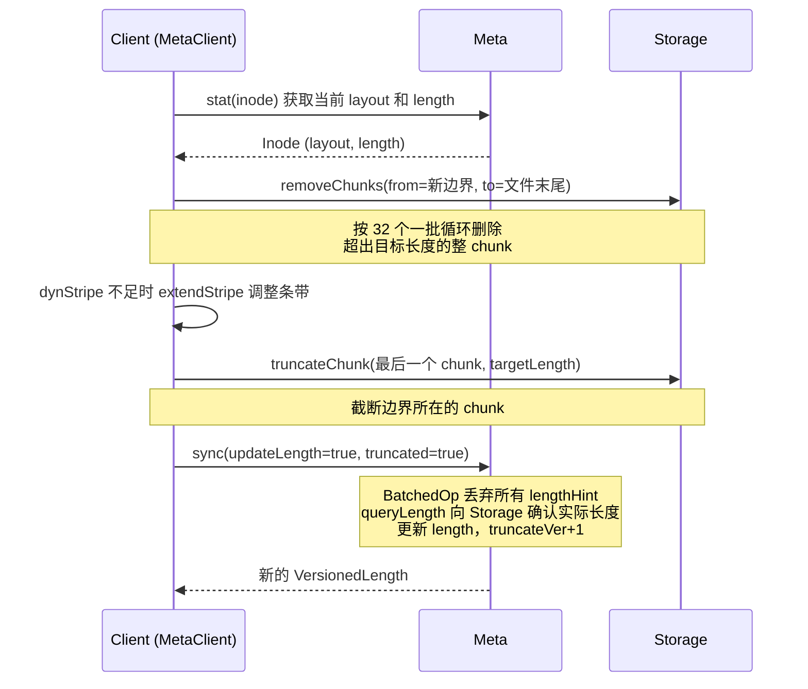

源码位置：

| 步骤 | 文件:行号 |
| --- | --- |
| 客户端入口 `MetaClient::truncate()` | `src/client/meta/MetaClient.cc:927-931` |
| 核心实现 `truncateImpl()` | `MetaClient.cc:860-925` |
| 循环删除 chunk `FileOperation::removeChunks()` | `MetaClient.cc:871-911`（按 `remove_chunks_batch_size` 分批） |
| dynStripe 调整 `extendStripe()` | `MetaClient.cc:913-917` |
| 截断最后 chunk `FileOperation::truncateChunk()` | `MetaClient.cc:920` |
| 发送 sync 请求（不带 lengthHint） | `MetaClient.cc:923-924` |
| Meta 端处理（丢弃 hint、算 truncateVer+1） | `ops/BatchOperation.cc:135-139, 156-176, 300-302` |
| 查询实际长度 | `src/meta/components/FileHelper.cc:88-111` |

注意最后一步 sync **不携带 lengthHint**（`MetaClient.cc:923`：`SyncReq(userInfo, inode.id, true, std::nullopt, std::nullopt, true /* truncated */)`），truncateVer+1 也不是客户端算的，而是 Meta 在 `queryLength` 确认实际长度后计算（`BatchOperation.cc:300-302`：发生 truncate 或长度缩小时 `truncateVer + 1`）。

`truncateVer` 的作用：每次 truncate 操作让版本号 +1，且只增不减（`BatchOperation.cc:160-166` 的 FATAL 断言保护）。后续的 sync 请求携带 `(length, truncateVer)`，Meta 通过版本号判断哪个 length 更新，避免"旧 sync 请求把已经 truncate 的文件长度又改回去"的问题。truncate 场景下 hint 被整体丢弃（不靠 mergeHint 比较版本），mergeHint（`fbs/meta/Schema.h:233-240`）只服务正常写场景的取最大长度。

### 8.10 check_file_hole 机制

`check_file_hole`（`ops/Open.cc:127`、`ops/BatchOperation.cc:580`，注意该配置已标记 deprecated，`Config.h:87-88`）是 Meta 的一个防御机制。如果配置开启，当文件有 hole 时（某些 chunkIndex 对应的 chunk 不存在），Meta 拒绝只读打开。原因是 Storage 对 hole 的读取行为不保证返回零值，可能返回旧数据或错误。

hole 的产生通常是异常情况：客户端写了一部分后 crash，或 truncate 过程中断。正常完整写入的文件不会有 hole。

---

## 9. Layout、Chain 与 ChunkId：Meta 和 Storage 的契约

本章解释 Meta 怎么描述"一个文件的数据放在哪里"，以及这套描述怎么映射到 Storage 的物理位置。这是理解 3FS 读写流程的关键。

### 9.1 为什么需要 Layout

3FS 把元数据和数据分离。Meta 只存"文件属性 + 数据放在哪些 chain 上"的描述，不存数据本身。Storage 按 ChunkId 存数据块。Layout 就是连接这两者的桥梁：它记录了一个文件的数据分布在哪些 chain 上，客户端拿到 Layout 后可以直接算出每个 offset 对应哪个 chain、哪个 chunk。

### 9.2 Layout 的三种状态

Layout（`fbs/meta/Schema.h:71-169`）内部有一个 `chains` 变体（variant），有三种可能：

| 类型 | 含义 | 何时出现 |
| --- | --- | --- |
| `Empty` | 还没分配 chain | 用户显式指定空 layout 的请求（如创建时传入） |
| `ChainRange` | 用 (baseIndex, shuffle, seed) 描述一段连续 chain | 正常文件，**create 事务内**分配（9.6 节） |
| `ChainList` | 显式列出所有 chain index | 特殊场景，如手工调整 |

大部分文件用 `ChainRange`。它不直接存储 chain ID 列表，而是存储一个起始位置 `baseIndex` 和一个洗牌参数 `(shuffle, seed)`。实际的 chain 索引序列通过 MT19937 洗牌算法在运行时计算（`ChainRange::getChainIndexList`，`fbs/meta/Schema.cc:160-181`，其中 `hf3fs_shuffle(chains, seed)` 在行 171）。

Layout 的其他字段（`Schema.h:140-144`）：

| 字段 | 类型 | 含义 |
| --- | --- | --- |
| `tableId` | ChainTableId | 引用哪张 ChainTable |
| `tableVersion` | ChainTableVersion | ChainTable 的版本，用于路由一致性 |
| `chunkSize` | ChunkSize | 每个 chunk 的大小（默认 1MB） |
| `stripeSize` | uint32_t | 一个 stripe 包含几个 chain（条带宽度） |

### 9.3 ChunkId：16 字节的地址

ChunkId（`fbs/meta/Schema.h:177-226`）是 chunk 在整个系统中的全局地址，固定 16 字节：

```
[tenant 1B] [reserved 1B] [inode 8B] [track 2B] [chunk 4B]
```

- **tenant**（1 字节）：租户 ID，目前固定为 0。
- **reserved**（1 字节）：保留位。
- **inode**（8 字节，大端）：文件 InodeId。
- **track**（2 字节，大端）：轨道 ID。普通文件只用 track 0；多轨道文件用不同 track 实现并行写入。
- **chunk**（4 字节，大端）：chunk 在文件中的序号。

用大端存储是为了保证作为字节串比较时，数值顺序和字典序一致。这在 FDB 的范围扫描中很重要。

ChunkId 由 InodeId 和 offset 计算（`fbs/meta/Schema.cc:62-68`）：

```cpp
Result<ChunkId> File::getChunkId(InodeId id, uint64_t offset) const {
  auto chunk = offset / layout.chunkSize;
  return ChunkId(id, 0, chunk);  // track 默认 0
}
```

### 9.4 chunkIndex → chain 的映射

给定一个 offset，怎么知道写到哪个 chain？计算过程（`fbs/meta/Schema.cc:78-88`，`Schema.cc:192-197`）：

```
offset → chunkIndex = offset / chunkSize
chunkIndex → stripe = chunkIndex % stripeSize
stripe → ChainRef = {tableId, tableVersion, chains[stripe]}
ChainRef → ChainId = RoutingInfo::getChainId(ChainRef)
```

举例：假设 `chunkSize=1MB`，`stripeSize=4`，chains 经洗牌后为 `[7, 2, 9, 4]`。那么：

- offset 0~1MB → chunkIndex=0 → stripe=0 → chains[0]=7 → Chain 7
- offset 1MB~2MB → chunkIndex=1 → stripe=1 → chains[1]=2 → Chain 2
- offset 4MB~5MB → chunkIndex=4 → stripe=0 → chains[0]=7 → Chain 7（循环回来）

这种 round-robin 条带化让连续写入分散到多个 chain，提高并行度。

### 9.5 多 track 文件

track 的作用是让同一文件的不同写入流走不同的 chain 序列，避免互相干扰。chunkIndex 的计算加上一个 track 偏移（`fbs/meta/Schema.cc:18-21`）：

```cpp
#define TRACK_OFFSET_FOR_CHAIN 7
```

track=0 从 chunkIndex 0 开始，track=1 偏移 `1 * 7 = 7` 个 chunkIndex。这样不同 track 写入的 chunk 落到不同的 chain 上，天然实现并发写入的隔离。普通文件只用 track 0，多 track 主要用于高级训练场景下的并行写入。

### 9.6 ChainAllocator：create 时分配 chain

创建文件时（`BatchedOp::create`，`ops/BatchOperation.cc:469-477`），如果 layout 为空（`Empty`），会在**同一个 create 事务内**调用 `chainAlloc().allocateChainsForLayout()` 把它填成 `ChainRange`。注意不是"首次写入时"才分配——文件创建返回时 Layout 就已确定。

分配逻辑（`ChainAllocator.h:82-127` 的公共实现）：

1. 从 mgmtd 获取当前 RoutingInfo，按 `tableId`/`tableVersion` 找到 ChainTable（行 92），要求 `chainCnt >= stripeSize`（行 103-112）。
2. 调 roundRobin 回调选一个起始位置 `chainBegin`（行 113），取值范围 `[1, chainCnt]`（index 0 非法，`Schema.cc` 的 valid 检查拒绝 0）。
3. 随机生成一个 `seed`，用 MT19937 洗牌算法打乱 `stripeSize` 个 chain index。`find_safe_seed()`（`src/common/utils/Shuffle.h:196-202`）尝试最多 1000 次，确保洗牌结果 valid。
4. 把 `(chainBegin, STD_SHUFFLE_MT19937, seed)` 写入 Layout 的 `ChainRange`（行 120），并把 `layout.tableVersion` 更新为 ChainTable 当前版本（行 119）。

起始位置有两种来源，决定链路的**数据局部性**：

| 变体 | 起始位置来源 | 位置 | 用途 |
| --- | --- | --- | --- |
| 全局 roundRobin | Meta 进程内按 `(tableId, stripeSize)` 记账的游标：`res = (cursor % chainCnt) + 1`，每次推进 `stripeSize`（对齐到条带块） | `ChainAllocator.h:49-65` | 目录未设置 chain 分配 flag 时（`BatchOperation.cc:474-476`） |
| 目录级 counter | 持久化在父目录 Inode 的 `chainAllocCounter` 字段（`Schema.h:289`）的游标，算法相同；批处理结束后写回目录 inode（`BatchOperation.cc:355-359, 394`） | `ChainAllocator.h:67-80` | 目录设置了 `FS_CHAIN_ALLOCATION_FL` 时（`BatchOperation.cc:472-473`）——**同一目录下连续创建的文件获得相邻的 chain 条带块**，数据局部性更好 |

分配完成后，Layout 存入 Inode，之后所有读写都基于这个固定的 Layout 计算 chain。ChainTable 本身的更新（新增 chain、下线 chain）通过版本号隔离：老 Layout 用老版本的 ChainTable，不受影响。

### 9.7 dynStripe：动态条带调整

`dynStripe`（`fbs/meta/Schema.h:255`）是 Inode 的一个字段，表示当前实际使用的条带数。它可能小于 Layout 的 `stripeSize`。

设计意图：小文件不需要全条带宽度，用较少的 chain 就够了，减少跨 chain 的协调开销。随着文件增长，dynStripe 可以动态扩大到 stripeSize。

dynStripe 生命周期（`ops/Open.cc:156-159`，`ops/BatchOperation.cc:494`）：

- 创建文件时，如果 `config.dynamic_stripe()` 为 true 且请求携带 `dynStripe`，初始值设为 `min(dynamic_stripe_initial(), stripeSize)`。
- 后续 open 时如果 `dynStripe > 0 且 < stripeSize 且 < layout.stripeSize`，会重置为 0（`ops/Open.cc:156-159`），表示恢复全条带。
- truncate 后如果目标长度需要的条带数超过当前 dynStripe，客户端会调 `extendStripe` 扩大（`MetaClient.cc:913-917`）。
- 实际的 dynStripe 扩展逻辑在客户端侧（`src/client/meta/MetaClient.h:317`），只有 FUSE 客户端支持。

### 9.8 ChainTable 版本的作用

ChainTable 有版本号，这是为了支持在线扩容/缩容。新 chain 加入时，mgmtd 发布新版本的 ChainTable。但已经在写的文件不会切换到新版本——它们锁定在创建时的 `tableVersion`。只有新创建的文件才会用最新版本的 ChainTable（分配时以 mgmtd 当前版本为准：`ChainAllocator.h:92` 按版本查表、`:119` 把 `table->chainTableVersion` 写入 layout）。

这样做避免了"写一半切换路由"的复杂性。老文件用老版本路由，新文件用新版本路由，互不影响。RoutingInfo 保留多个历史版本的 ChainTable，保证老文件的 chain 查询都能成功。

---

## 10. 客户端 MetaClient

本章介绍调用方（主要是 FUSE 客户端和 SDK）如何使用 Meta 服务。MetaClient 的实现在 `src/client/meta/MetaClient.cc` 和 `.h`。

### 10.1 MetaClient 的角色

MetaClient 是 Meta 服务的客户端封装。它的主要职责：

1. **RPC 调用**：封装 open/create/sync/close/remove/rename 等所有 Meta RPC。
2. **节点选择**：从 mgmtd 的活跃 Meta 节点列表中选一个节点发送请求（选错不要紧，服务端会转发，见 10.2）。
3. **重试与 failover**：网络错误或服务端可重试错误时自动重试（复用同一个请求 UUID，供 IDEM 识别），连续失败的节点会被剔除换下一个。
4. **组合操作**：把跨 Meta 和 Storage 的多步操作组合成一次客户端调用，典型例子是 truncate。
5. **后台 close**：close 失败的任务进入后台队列持续重试（见 10.4）。

注意 MetaClient 本身**没有** inode/目录缓存——元数据缓存在 FUSE 客户端层，服务端侧只有 AclCache（4.5 节）。

### 10.2 节点选择与服务端路由

**客户端不做按 InodeId 的精确路由**。MetaClient 用 `ServerSelectionStrategy`（`src/client/meta/ServerSelectionStrategy.h:27-50`）从活跃 Meta 列表中选一个节点，三种模式（`MetaClient.h:83` 默认 `RandomFollow`）：

| 模式 | 行为 | 位置 |
| --- | --- | --- |
| RoundRobin | 轮询所有节点 | `ServerSelectionStrategy.h:84-96` |
| UniformRandom | 均匀随机 | `ServerSelectionStrategy.h:98-115` |
| RandomFollow（默认） | 随机选一个后尽量跟随（prefer 列表粘住同一节点） | `ServerSelectionStrategy.h:117-133` |

**按 InodeId 的 rendezvous 路由（`Weight::select`）是服务端做的**：请求到达任意 Meta 后，`MetaOperator` 先调 `distributor_->getServer()`（如 `MetaOperator.cc:321,332,362`）判断本节点是否是 owner——是则本节点执行批处理，否则 Forward 转发给 owner（13.4 节）。所以客户端选错节点只多一跳转发，不影响正确性。

客户端侧的容错是 **failover**：某节点连续失败达到 `max_failures_before_failover`（默认 1）次后，把它加入 `errNodes_` 剔除、换下一个节点重试（`MetaClient.cc:437-454`）。

### 10.3 重试策略

MetaClient 的默认重试配置（`RetryConfig`，`src/client/meta/MetaClient.h:60-68`）：

| 配置项 | 默认值 | 含义 |
| --- | --- | --- |
| `rpc_timeout` | 5_s | 单次 RPC 超时 |
| `retry_send` | 1 | 发送失败重试次数 |
| `retry_fast` | 1_s | 可快速重试错误的等待上限 |
| `retry_init_wait` | 500_ms | 退避初始等待 |
| `retry_max_wait` | 5_s | 退避最大等待 |
| `retry_total_time` | 1_min | 总重试时限，超过即报错（`MetaClient.cc:460-464`） |
| `max_failures_before_failover` | 1 | 触发节点剔除的连续失败次数 |

重试时复用同一个请求 UUID（UUID 在请求构造时生成，如 `CreateReq` 构造函数 `Service.h:51-53`，重试循环复用同一 req 对象），保证 Meta 侧的 IDEM 机制能识别这是重复请求。超过 `retry_total_time` 后返回错误，用户重新调用 API 会生成新的 UUID。

### 10.4 后台 close 任务

close 调用失败（如 RPC 超时）后，任务进入 `bgRunner_` 维护的后台队列（扫描间隔 `task_scan`，默认 50_ms，`MetaClient.h:71`），由 `bgCloser_` 协程池（8 协程，`MetaClient.h:76-79`）按指数退避（`retry_first_wait` 100ms 起，上限 10s）持续重试 close。同时客户端定期把 prune session 请求批量发给服务端（`prune_session_batch_interval`，默认 10s，`MetaClient.h:72-73`），让服务端 SessionManager 主动清理本客户端的死会话（12.5 节）。这保证"close 是尽力而为、最终由后台收敛"的语义。

### 10.5 MetaClient 的组合操作

有些操作不是单个 RPC 能完成的，MetaClient 负责编排：

| 操作 | 步骤 | 源码 |
| --- | --- | --- |
| truncate | stat → removeChunks（按 `remove_chunks_batch_size` 默认 32 个 chunk 一批循环删除）→ truncateChunk → sync | `MetaClient.cc:860-925`（分批循环在 `:871-911`） |
| 文件创建后首写 | create → (客户端向 Storage 写数据) → sync | `MetaClient.cc` 中的 create + write 调用 |
| 目录递归删除 | list → 对每个子项 remove → remove 自身 | `MetaClient.cc` 中的 recursiveRemove |

这些组合操作的原子性保证有限：每一步成功后即使后续步骤失败，已完成的步骤不会回滚。例如 truncate 在删除 chunk 后 crash，Meta 的 length 不会被更新，但 chunk 已经被删了，下次 open 会检测到 hole 并拒绝只读打开。

---

## 11. 垃圾回收

本章解释 3FS 如何安全地回收已删除文件占用的存储空间。核心思路是：删除操作只把对象从命名空间移走，真正的物理回收交给后台 GC 异步完成。

### 11.1 为什么需要 GC

直接删除的问题在于并发：当你 `remove("/data/file.txt")` 时，可能有其他客户端正在对同一个文件做 sync/close。如果 Meta 立即删除 Inode 并通知 Storage 删除 chunk，这些在途的写请求会失败或写到不存在的位置。

GC 机制把删除分成两个阶段：

1. **逻辑删除**（同步）：把 DirEntry 从用户目录移到 GC 目录下，nlink 减少。对用户立即可见。
2. **物理回收**（异步）：GC 后台线程周期扫描 GC 目录，确认没有活跃 FileSession 后，通知 Storage 删除 chunk 数据，最后删除 Inode。

### 11.2 GC 目录结构

GC 使用一个独立的目录树，根是 `InodeId::gcRoot() = InodeId(1)`（`fbs/meta/Common.h:140`）。GC root 的 ACL 设为 `FS_IMMUTABLE_FL`（`fbs/meta/Schema.h:61`），防止被误删。

每个 Meta 节点在 GC root 下有**多个** GC 目录（`kNumGcDirectoryPerServer = 5`，`GcManager.cc:60`）：idx 0 为旧版本兼容保留，idx 1-4 在用，名字分别是 `GC-Node-{nodeId}`（idx 0）和 `GC-Node-{nodeId}.{i}`（idx 1-4，`GcManager.h:196-199` 的 `nameOf`）。GC 目录本身只是 gcRoot 下的一条 DirEntry，**entry 的名字就是 gc entry**，指向被回收的原 inode：

```
gcRoot(InodeId 1)
 ├─ GC-Node-1        # 节点 1 的 GC 目录（idx 0，旧版兼容）
 ├─ GC-Node-1.1 ~ .4 # 节点 1 在用的 4 个 GC 目录
 │    ├─ f-{timestamp微秒}-{inodeId}   # 中等文件
 │    ├─ S-{timestamp微秒}-{inodeId}   # 小文件（< small_file_chunks 个 chunk）
 │    ├─ L-{timestamp微秒}-{inodeId}   # 大文件（>= large_file_chunks 个 chunk）
 │    └─ d-{timestamp微秒}-{inodeId}   # 目录
 └─ GC-Node-2.1 ~ .4 # 其他节点的 GC 目录
```

gc entry 的前缀（`GcManager.h:166-179` 的 `prefixOf`）在加入时就按文件大小分好级（`GcManager.cc:201-209` 的 `addFile`：chunk 数 < 32 为 SMALL、>= 128 为 LARGE、其余 MEDIUM），对应 worker 池的三个优先级（`GcManager.h:181-194` 的 `priorityOf`：LARGE=HI_PRI 大文件优先回收、MID=MID_PRI、SMALL=LO_PRI）——大文件占用空间多，优先处理。时间戳用于 GC 扫描时判断是否过了延迟期。

新删除的对象进哪个 GC 目录由 `pickGcDirectory()`（`GcManager.h:240-253`）决定：`distributed_gc`（默认 true）开启时从**所有活跃节点的** GC 目录中随机选一个（用途见 11.7），关闭时从本节点的 idx 1-4 中随机选。

### 11.3 GcManager 工作流程

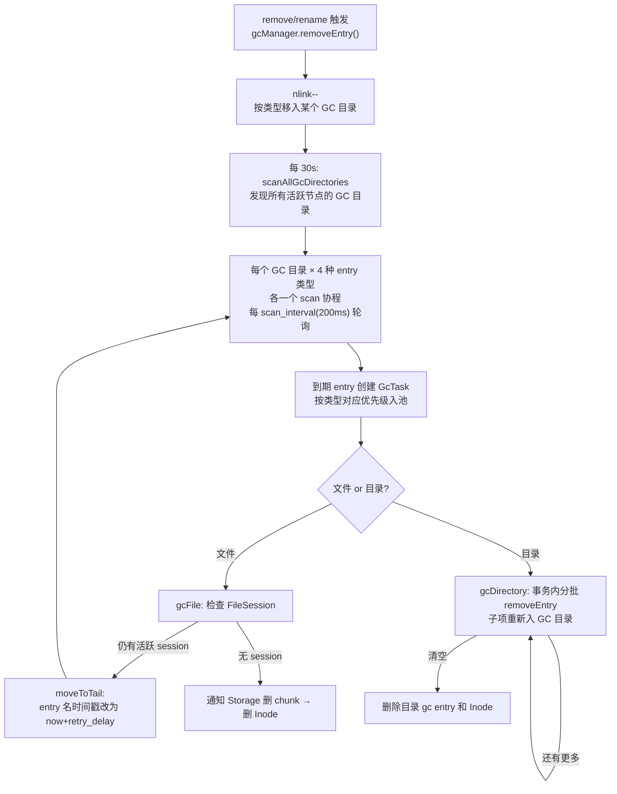

GcManager 的启动（`GcManager.cc:646-674`）创建三层执行结构：

1. **`PriorityCoroutinePool<GcTask>`** worker 池（行 651-652，8 协程 + 优先级队列，`Config.h:46-49`）；
2. **`scanAllGcDirectories`** 后台任务（行 656-667，每 **30 秒**，不是扫描 entry 的周期）：读 gcRoot 下一层所有目录项，结合 mgmtd routing info 里所有活跃 Meta 节点（`GcManager.cc:823-832`），识别出"活跃节点的 GC 目录"列表存入 `allGcDirectories_`（行 858），供 `distributed_gc` 随机选择；
3. **每个 GC 目录的 4 个 scan 协程**（`GcManager.cc:73-83`，DIRECTORY/FILE_LARGE/FILE_MEDIUM/FILE_SMALL 各一个），各自按 `scan_interval`（默认 **200ms**，`Config.h:24`）轮询该类型的 entry，为到期的创建 GcTask。

注意区分两个周期：`scan_interval`（200ms）是每个 GC 目录扫描到期 entry 的频率；30 秒是重新发现 GC 目录列表的频率。

### 11.4 GcTask 的执行

`GcTask::gcFile()`（`GcManager.cc:371-457`）处理单个文件的回收：

| 步骤 | 行号 | 做什么 |
| --- | --- | --- |
| 加载 Inode | 371-385 | 从 KV 读取待回收文件的 Inode |
| 检查 FileSession | 386-394 | `FileSession::snapshotCheckExists()` 检查是否还有活跃会话 |
| 有 session 则延迟 | 390-394 | 返回 `kBusy` |
| 通知 Storage 删 chunk | 414-421 | 调用 `FileHelper::remove()` |
| 删除 Inode | 后续 | chunk 删除成功后从 KV 删除 Inode |

kBusy（以及其他 critical 错误）的处理在 `GcTask::run`（`GcManager.cc:278-286`）：调 `moveToTail`（`GcManager.cc:225-238`）把 GC entry 的名字改写为 `now + retry_delay`（默认 10 分钟，`Config.h:33`）的时间戳并删除旧 entry——**靠时间戳自然延后**，等下一轮扫描到期再重试，没有内存中的"队列尾"。

**低磁盘空间时禁用延迟**：`enableGcDelay()`（`GcManager.cc:863-879`）发现 free 空间比例低于 `gc_delay_free_space_threshold`（默认 5%）时返回 false，扫描时把所有 delay 当 0 处理，空间紧张时立即回收。

### 11.5 FileHelper::remove：通知 Storage 删 chunk

`FileHelper::remove()`（`src/meta/components/FileHelper.cc:113-137`）调用 `FileOperation::removeChunks()` 向 Storage 发送删除请求。它每次删除 `remove_chunks_batch_size` 个 chunk（行 127），循环直到 `more=false`（行 131-135）。

对于大文件（chunk 数量超过 `large_file_chunks` 阈值），GC 任务会拆分成多次 Storage 调用，避免单次请求过大。如果 Storage 暂时不可用，`retry_remove_chunks`（`Config.h:50-54`）是一个 `RetryOptions` 配置对象（init/max wait 10s、总重试时限 30s），控制对 Storage 的重试节奏。

### 11.6 目录的 GC

目录的 GC（`GcTask` 中 type=Directory，`gcDirectory`，`GcManager.cc:294-369`）**不创建子 GcTask**，而是循环执行"一个事务处理一批"：

1. 每轮事务先做健全性检查（inode 存在、nlink==0、非 immutable，行 313-334），可选设置 FDB batch 优先级（`txn_low_priority`，行 310-312，降低对前台事务的冲突影响）；
2. 在同一事务里加载 `gc_directory_entry_batch`（默认 32）条 DirEntry（行 350），对每条调 `removeEntry`（行 353-355）——文件子项通过 `GcManager::removeEntry` → `pickGcDirectory()->add()` 重新进入 GC 目录排队（即"重新入队"），而不是等待中的子任务；
3. 还有更多（`list->more`）就提交本批、开下一轮事务（行 364-366）；没有更多则 `removeGcEntryAndInode` 删除目录自身（行 357-359）。

目录 GC 的延迟（`gc_directory_delay`，默认 **0_s**）比文件（`gc_file_delay`，默认 **5_min**）**短**：目录本体没有 chunk 需要等 Storage，递归出的文件子项各自在重新入队时获得自己的文件延迟。

**权限不足的子项不删，搬去孤儿区**：`removeEntry`（`GcManager.cc:478-502`）发现子项 immutable 或 `recursive_perm_check` 失败时（空目录除外），把它移到 `trash/gc-orphans/{user}-{date}` 目录下（`createOrphanEntry`，行 513-612，会创建 `_hf3fs_original_path` symlink 记录原路径），供管理员人工处置。

### 11.7 GC 和 Crash 恢复

GC 的状态完全持久化在 FDB 中——GC 目录结构、待回收的 Inode 都在 KV store 里。Meta 节点重启后，GC 从上次状态继续扫描。即使 GC 进行到一半节点 crash，重启后要么继续从 KV 中记录的位置扫描，要么重新发现待 GC 的目录项（因为它们还在 GC 目录下）。

比单节点重启更重要的是**多 Meta 共同消费所有 GC 目录**：`distributed_gc`（默认 true）开启时，`pickGcDirectory` 从 `allGcDirectories_`（包含**所有活跃节点**的 GC 目录，由 30 秒一次的 `scanAllGcDirectories` 维护，`GcManager.cc:809-861`）中随机选择。这意味着某个 Meta 节点永久下线后，它 GC 目录里的待回收项会被其他节点继续处理——GC 目录不与节点生死绑定，这是 crash 恢复的真正保障。

唯一的风险是 Storage chunk 删除成功但 Meta 还没来得及删除 Inode 记录时 crash。重启后 GC 会再次尝试删除 chunk，Storage 需要能正确处理"chunk 不存在"的重复删除请求（幂等删除）。

### 11.8 GC 相关的配置项

| 配置项 | 默认值 | 说明 | 位置 |
| --- | --- | --- | --- |
| `gc.enable` | true | 是否启用 GC | `Config.h:23` |
| `gc.scan_interval` | 200_ms | 每个 GC 目录扫描到期 entry 的间隔 | `Config.h:24` |
| `gc.scan_batch` | 4096 | 每次扫描的条目数上限 | `Config.h:25` |
| `gc.gc_file_delay` | 5_min | 文件回收前的等待时间 | `Config.h:27` |
| `gc.gc_file_concurrent` | 32 | 文件 GC 并发数（信号量） | `Config.h:28` |
| `gc.gc_directory_delay` | 0_s | 目录回收前的等待时间 | `Config.h:29` |
| `gc.gc_directory_concurrent` | 4 | 目录 GC 并发数（信号量） | `Config.h:30` |
| `gc.gc_directory_entry_batch` | 32 | 目录 GC 每轮事务处理的子项数 | `Config.h:31` |
| `gc.gc_directory_entry_concurrent` | 4 | 目录 GC 子项并发 | `Config.h:32` |
| `gc.retry_delay` | 10_min | kBusy 后 entry 时间戳延后的量 | `Config.h:33` |
| `gc.gc_delay_free_space_threshold` | 5（%） | 空闲空间低于此值时禁用 GC 延迟 | `Config.h:35` |
| `gc.check_session` | true | 回收前是否检查 FileSession | `Config.h:36` |
| `gc.distributed_gc` | true | 从所有节点的 GC 目录随机选择入队目标 | `Config.h:37` |
| `gc.txn_low_priority` | false | 目录 GC 事务用 FDB batch 优先级 | `Config.h:38` |
| `gc.small_file_chunks` | 32 | 小文件 chunk 数阈值（LO_PRI） | `Config.h:41` |
| `gc.large_file_chunks` | 128 | 大文件 chunk 数阈值（HI_PRI） | `Config.h:42` |
| `gc.recursive_perm_check` | true | 目录递归删除时检查子项权限 | `Config.h:44` |
| `gc.workers` | 8 协程/队列 1024 | PriorityCoroutinePool 配置 | `Config.h:46-49` |
| `gc.retry_remove_chunks` | 10s/10s/30s | Storage 删 chunk 的 RetryOptions | `Config.h:50-54` |
| `gc.remove_chunks_batch_size` | 32 | 每次调用 Storage 删除的 chunk 数 | `Config.h:26` |

---

## 12. FileSession 与 SessionManager

本章详细解释"写会话"（FileSession）的完整生命周期。FileSession 是 3FS 保证写入安全的核心机制之一。

### 12.1 FileSession 是什么

FileSession 是 Meta 记录在 KV store 中的一条"某个客户端正在以写模式打开某个文件"的记录。它的作用是让 GC 知道"这个文件还有活跃的写入者，暂时不能回收 chunk"。

定义（`src/meta/store/FileSession.h:25-30`）：

```cpp
struct FileSession {
  InodeId inodeId;       // 文件
  ClientId clientId;     // 哪个客户端
  Uuid sessionId;        // 会话 ID
  UtcTime timestamp;     // 创建时间
  std::string payload;   // 附加信息
};
```

Key 前缀是 `INOS`（`src/common/kv/KeyPrefix-def.h:15`），key 格式为 `prefix + InodeId.packKey() + sessionId`（`FileSession.cc:23`）。同一个文件的多个会话按 sessionId 排列，方便范围扫描。

### 12.2 FileSession 的创建

在 `OpenOp::createSession()`（`ops/Open.cc:235-270`）中创建。触发条件：

1. 请求携带 `session`（`req_.session.has_value()`，行 240）。
2. 请求是写模式（`accessType != READ`，隐含在 open 的调用路径中）。

创建过程（行 245-246）：
```cpp
auto session = FileSession::create(inode.id, req_.session.value());
co_await session.store(txn);
```

同时记录一条 `OpenWrite` 事件（行 248-267），包含 inode、owner、user、host、length、truncateVer、dynStripe、otrunc 等信息，用于审计和调试。

### 12.3 FileSession 的检查

两个场景需要检查 FileSession：

**GC 回收前检查**（`GcManager.cc:386-394`）：

```cpp
auto exists = co_await FileSession::snapshotCheckExists(txn, inode.id);
if (*exists) {
  // 还有活跃会话，延迟回收
  co_return makeError(MetaCode::kBusy);
}
```

**O_TRUNC 替换前检查**（`ops/Open.cc:186-190`）：

```cpp
auto checkResult = co_await FileSession::checkExists(txn, inode.id);
if (*checkResult) {
  // 有会话持有，不能替换
  co_return false;
}
```

两个版本的区别：`snapshotCheckExists` 用快照读（不影响事务冲突），`checkExists` 用普通读（加入读冲突集，保证提交时一致性）。

### 12.4 FileSession 的关闭

关闭发生在批处理的 `syncAndClose`（`ops/BatchOperation.cc:107-187`）：收集本批所有 close 请求的 session（行 126-133），在事务中调用 `FileSession::remove()`（行 141-144，本体在 `FileSession.cc:219-228`）删除对应的 KV 记录。

close 不只删记录：如果本批有请求要求 `updateLength`（close 携带长度提示时），`syncAndClose` 会向 Storage `queryLength` 查实际长度并更新 inode 的 VersionedLength（行 146-186），保证孤儿会话存在期间客户端写入的数据不丢长度。

关闭后，GC 扫描不会再看到这条会话，文件可以正常回收。

### 12.5 SessionManager：处理孤儿会话

正常流程是客户端 open → 写入 → close。但如果客户端 crash 或网络断开，close 请求可能永远不会到达，FileSession 就变成了"孤儿"——没人用但还占着 KV 空间，阻止 GC 回收。

`SessionManager`（`src/meta/components/SessionManager.h`）解决这个问题。定时器每 `scan_interval` 触发 `scanTask`（`SessionManager.cc:252-272`），有两个前置门槛：

- `enable` 配置关闭则直接返回（行 253-256）；
- **只有 isFirstMeta 的节点执行扫描**（行 257-259），避免多 Meta 重复处理。

每次扫描先 `loadPrune()`（行 262，实现在行 274-288）加载 prune 标记列表——这是**客户端主动上报**的死会话：客户端的后台任务发现自己某些 session 无法正常 close 时，通过 `pruneSession` RPC 在 `InodeId(-1)` 下创建标记（`FileSession::createPrune`，`FileSession.h:66-68`；客户端侧见 10.4 节）。

然后为 256 个 shard 各入队一个 `ScanTask`（行 267-269）。每个 ScanTask（`SessionManager.cc:78-186`）：

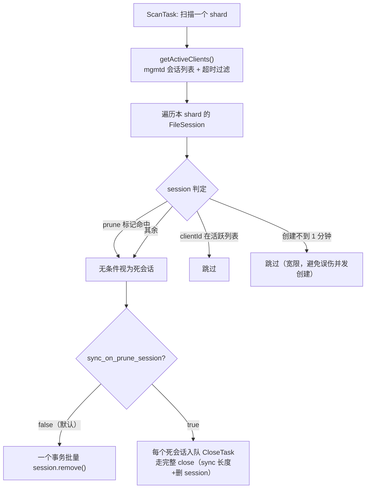

孤儿判定（`SessionManager.cc:106-127`）有四个分支：

1. sessionId 命中 prune 标记列表（行 109-112）——无条件 prune；
2. clientId 在活跃列表（行 115-117）——跳过；
3. **宽限期**：session 创建不到 1 分钟（行 118-123，`timestamp + 1_min > now`）——跳过，避免与并发创建竞态误判；
4. 其余视为死会话。

活跃列表来自 `getActiveClients()`（`SessionManager.cc:43-73`）：mgmtd 记录客户端会话心跳，但**还在列表里不等于活着**——`lastExtend + session_timeout（默认 5_min）+ 10s < now` 的客户端也被过滤掉（行 66-69）。即孤儿 = 不在列表 **或** 心跳超时。

死会话的处理由配置 `sync_on_prune_session`（`Config.h:73`，默认 false）决定（行 131-151）：false 时在一个事务里批量 `session.remove()` 直接删；true 时为每个死会话提交 CloseTask 走完整 close。此外每轮扫描结束后，prune 标记列表中未被命中的残留项也会被批量清理（行 159-186）。

### 12.6 CloseTask：异步关闭

`CloseTask`（`SessionManager.cc:189-215`）是孤儿会话走完整 close 时的执行体。它构造一个 `CloseReq`（`pruneSession = true`，行 191-193），调用注册的 close 回调执行真正的 close 逻辑；如果 close 返回 `kNotFound`（会话已不存在）或其他错误，兜底直接从 KV 删除 session 记录（行 207-214）。

close 回调通过 `setCloseFunc` 在 MetaOperator 构造时注入（`MetaOperator.cc:170-172`）：

```cpp
sessionManager_->setCloseFunc(
    [&](const auto &req) -> CoTryTask<void> {
      co_return (co_await close(req)).then([](auto &) { return Void{}; });
    });
```

这让 SessionManager 可以复用 MetaOperator 的 close 逻辑（含路由、批处理、长度合并），不重复实现。

### 12.7 误判（假死）：客户端活着却被回收

孤儿判定的依据是"clientId 不在 mgmtd 活跃列表"——这是**间接推断**，心跳消失不等于进程死亡。典型误判场景：fuse↔mgmtd 网络分区超过 5 分钟，但 fuse↔storage/meta 通道正常，客户端一直在正常写。三道防误杀缓冲（超时余量 10s、新建宽限 1 分钟、bootstrapping 放弃本轮）只能降低概率，不能消除。

**复活后的客户端为什么无感知**——关键在于 FileSession 是纯登记簿，各操作对它的依赖都是幂等或无依赖的：

| 客户端动作 | 对 session 的依赖 | 证据 |
| --- | --- | --- |
| 写数据 | 无（数据面走 storage 的 channel 机制） | 写路径不含 session |
| sync 携带 hint | 无——`SyncReq` 根本没有 session 字段 | `src/fbs/meta/Service.h:378-384` |
| 正常 close | 只把 session 登记进待删列表后执行 KV remove，删不存在的 key 是 no-op，不校验存在性 | `BatchOperation.cc:253-255`（登记）+ `:141-144`（remove） |
| 重新 open（写） | 创建全新 sessionId，与旧记录无冲突 | `OpenReq.session`，`Service.h:342` |

长度也不会错乱：误判 close 的 `queryLength` 重算与客户端后续 sync 的 hint 都收敛于同一事实（storage 上的数据），且 `syncAndClose` 有单调性保护——同 truncateVer 下新长度小于当前长度直接 FATAL（`BatchOperation.cc:160-166`）。

**误判的真正代价是"安全网失效一次"**：

```
t0  正常: FileSession 在册
t1  误判 close: session 删除, 长度重算追平        ← 死会话检测这张安全网被消耗
t2  客户端复活继续写: 一切照常, 但已无 session 登记  ← 裸奔状态
t3  客户端真的崩溃: 无人触发重算, 长度停在 t2 后最后一次成功 sync 的值,
    直到文件下次被任何客户端写 (sync/close 触发 updateLength) 才追平
```

即对同一个会话，死会话检测只生效一次；被误杀过的客户端再次崩溃时，其最后一批已 flush 数据的长度恢复要延迟到文件下次被写——这不是一致性破坏（未 fsync 的数据本就不保证可见），而是可见性延迟。客户端视角的完整恢复链见 fuse.md 5.5 节。

---

## 13. 多 Meta 协作

3FS 支持部署多个 Meta 实例组成集群。本章解释它们怎么分工、怎么转发请求、怎么保证一致性。

### 13.1 为什么需要多个 Meta

单个 Meta 实例的瓶颈是 CPU（每个 FDB 事务需要计算和序列化）。通过部署多个 Meta 实例，把命名空间分散到不同节点上，实现水平扩展。

但多 Meta 不是"共享一切"——每个 InodeId 明确归属一个 Meta 节点。归属关系通过 rendezvous hashing 计算，不依赖中心化协调。客户端不需要算这个归属：它任选一个 Meta 发请求（10.2 节），接收方用 rendezvous 哈希判断自己是否 owner，不是就 Forward 一跳给 owner。

### 13.2 Distributor：路由计算

Distributor（`src/meta/components/Distributor.h`，`.cc`）是 Meta 侧的路由组件。它的核心方法 `getServer()`（`Distributor.cc:88-91`）：

```cpp
flat::NodeId Distributor::getServer(InodeId inodeId) {
  auto guard = latest_.rlock();
  return Weight::select(guard->active, inodeId);
}
```

`Weight::select`（`fbs/meta/Utils.h:258-260`）实现 rendezvous hashing。算法（`Utils.h:280-296`）：

1. 对每个候选 Meta 节点，用 `MurmurHash3(nodeId, key)` 计算一个权重。
2. 选权重最大的节点。

这个算法的特性是：

- **确定性**：给定相同的节点集合和 key，结果唯一。
- **最小迁移**：节点加入或退出时，只有 `1/N` 的 key 需要迁移（N 是节点数）。
- **无协调**：每个节点独立计算，不需要分布式锁。

#### "最小迁移"的推导

结论基于唯一假设：MurmurHash3 对不同输入产生统计均匀、相互独立的输出（`Utils.h:273-278`）。因此对固定的 key，各节点的权重 `W_i = H(node_i, key)` 可视为独立同分布（i.i.d.）随机数：

- **删节点 j**：owner 是 `argmax W_i`。去掉一个非最大值不影响最大值，所以只有 j 本来就是 owner 的 key 才会迁移。N 个 i.i.d. 权重可交换，每个节点等概率成为最大值，`P(j 是 owner) = 1/N`——迁移量的期望**精确等于 1/N**（不是近似）。
- **加节点 k**：key 迁移当且仅当 `W_k > max(W_1..W_N)`。N+1 个 i.i.d. 值中 k 是最大值的概率是 `1/(N+1)`。

对比取模方案 `hash(key) % N`：节点数 N 变为 N+1 时，`x mod N == x mod (N+1)` 要求 x 同时满足两个同余式（N 与 N+1 互素），即 `x ≡ r (mod N(N+1))`，概率仅 `1/(N+1)`——约 `N/(N+1)` 的 key 会全部重映射：

| N → N+1 | 迁移概率 | 不变概率 |
| --- | --- | --- |
| 取模 | N/(N+1) | 1/(N+1) |
| Rendezvous | 1/(N+1) | N/(N+1) |

两者正好互补。单测 `TestDistributor.balance`（`tests/meta/components/TestDistributor.cc:112-147`）直接验证了这一结论：对 10000 个随机 InodeId 记录 owner（行 122-127），随机删掉一个节点（行 137）后统计 owner 改变的数量，期望值取 `map.size() / (nodes.size() + 1)`（行 146，即 `10000/N`）；行 135 打印的 min/max/avg 同时验证了均匀性——每个节点约分到 `1/N` 的 key，这是"每节点等概率成为最大值"的实证。

### 13.3 两种路由场景

3FS 有两种路由入口，都用 Distributor 但选择 key 不同：

| 场景 | key | 位置 | 说明 |
| --- | --- | --- | --- |
| 文件级操作（sync/close/setAttr） | `req.inode` | `MetaOperator.cc:321,333,407` | 按文件 InodeId 路由，确保同一文件的操作集中在同一节点 |
| 目录级操作（create） | `req.path.parent` | `MetaOperator.cc:362` | 按父目录 InodeId 路由，确保同目录的 create 操作可以批处理 |

这种设计让同一文件或同一目录的并发操作天然地落在一个 Meta 节点上，BatchedOp 才能发挥作用。

### 13.4 Forward：请求转发

如果客户端路由算错了（mgmtd 的路由信息更新有延迟），或者节点集合刚变化，请求可能发到错误的 Meta 节点。此时需要 Forward 机制。

Forward 的实现（`src/meta/components/Forward.h:54-59`）：

```cpp
template <typename Req, typename Rsp>
CoTryTask<Rsp> forward(flat::NodeId node, Req req) {
  auto result = co_await forwardImpl<Req, Rsp>(node, std::move(req));
  co_return result;
}
```

`forwardImpl`（`Forward.h:127-164`）做的事：

1. 通过 mgmtd 获取目标节点的地址（`getAddress`，行 104-124）。
2. 创建到目标节点的 RPC 连接。
3. 发送原始请求并等待响应。
4. 返回响应（或错误）。

**关键限制**：Forward 只转发一跳。如果目标节点又转发到第三个节点，返回 `kForwardFailed` 错误。这避免了无限转发环。实现方式是请求中携带一个 forward 标记，已标记的请求不再转发（`Forward.h:86-102` 的 `check` 方法）。

### 13.5 MetaOperator 中的路由和转发

以 sync 为例（`MetaOperator.cc:319-328`）：

```cpp
CoTryTask<SyncRsp> MetaOperator::sync(SyncReq req) {
  auto node = distributor_->getServer(req.inode);
  if (node == distributor_->nodeId()) {
    co_return co_await runInBatch<SyncReq, SyncRsp>(inodeId, std::move(req));
  } else {
    co_return co_await forward_->forward<SyncReq, SyncRsp>(node, std::move(req));
  }
}
```

逻辑很清晰：

1. 算出负责的节点。
2. 如果是自己，走 `runInBatch` 处理。
3. 如果不是自己，走 `forward` 转发。

close（行 330-339）和 setAttr（行 401-414）的模式完全一样。

### 13.6 isFirstMeta：集群级单例任务

有些任务只能由一个 Meta 节点执行，比如 IDEM 清理（`MetaOperator.cc:202-203`）。`isFirstMeta()`（`src/meta/store/Utils.h:67-76`）负责判断当前节点是否是"第一个"：

```cpp
inline bool isFirstMeta(client::ICommonMgmtdClient &mgmtd, flat::NodeId nodeId) {
  auto routing = mgmtd.getRoutingInfo();
  auto nodes = routing->getNodeBy(
      flat::selectNodeByType(flat::NodeType::META) && flat::selectActiveNode());
  auto first = std::min_element(nodes.begin(), nodes.end(),
      [](auto &a, auto &b) { return a.app.nodeId < b.app.nodeId; });
  return first != nodes.end() && first->app.nodeId == nodeId;
}
```

选 nodeId 最小的活跃 Meta 节点作为"first"。如果这个节点 crash，第二大 nodeId 的节点自动接管。这种"最小 ID 优先"策略简单但有效，不需要 leader election。

### 13.7 Distributor 的路由信息更新

Distributor 需要跟踪 Meta 节点集合的变化。它在后台运行一个更新循环（`Distributor.cc:195-216`），定期从 mgmtd 拉取最新的活跃 Meta 节点列表。

更新逻辑（`Distributor.cc:218-319`）在事务中完成：

1. 从 mgmtd 获取 RoutingInfo，提取所有活跃的 META 类型节点。
2. 和当前缓存的节点列表对比。
3. 新增的节点加入 `active` 列表。
4. 消失的节点从 `active` 中移除（但保留一段时间，避免短暂网络抖动导致大量迁移）。

节点退出时（`Distributor.cc:74-86`），调用 `stopAndJoin` 清理路由表。已路由到该节点的请求会被 forward 到新节点。

### 13.8 路由一致性保证

客户端和服务端使用相同的 `Weight::select` 算法和相同的节点列表（都来自 mgmtd），保证路由结果一致。但在节点集合变化的瞬间，两边可能有短暂的不一致：

1. mgmtd 发布新节点列表。
2. 客户端拉取到新列表，开始向新节点发请求。
3. 旧 Meta 节点还没拉取到新列表，收到本应给新节点的请求。
4. 旧节点 forward 到新节点。

这个窗口取决于 mgmtd 心跳间隔和客户端刷新间隔，通常在秒级。Forward 机制保证了这个窗口内请求不会丢失。

---

## 14. 后台任务与事件系统

本章介绍 Meta 在主请求路径之外做的后台工作。这些工作不影响用户请求的直接返回，但对系统的健康运行至关重要。

### 14.1 后台任务框架

3FS 有三种后台任务执行框架：

| 框架 | 文件 | 用途 |
| --- | --- | --- |
| BackgroundRunner | `src/common/utils/BackgroundRunner.h` | 单个周期性任务，绑定一个 executor |
| CoroutinesPool | `src/common/utils/CoroutinesPool.h` | 多协程并发执行同类任务，带工作窃取 |
| PriorityCoroutinePool | `src/common/utils/PriorityCoroutinePool.h` | 带优先级的协程池，GC 使用 |

**BackgroundRunner**（`BackgroundRunner.h:12-35`）是最简单的，适合"每隔 N 秒执行一次"的场景。MetaOperator 用它管理 idempotent_clean 任务（`MetaOperator.cc:198-229`）。

**CoroutinesPool**（`CoroutinesPool.h:31-173`）支持多个 worker 并发处理任务队列。内部实现了 WorkStealingJobTaker（行 99-148），让空闲 worker 可以"偷"其他 worker 的任务，提高吞吐。FileHelper 和 SessionManager 用它处理 Storage 操作和会话扫描。

**PriorityCoroutinePool**（`PriorityCoroutinePool.h:27-83`）在 CoroutinesPool 基础上增加优先级队列。GcManager 用它（`GcManager.cc:651-652`）让文件 GC 和目录 GC 按不同优先级调度。

### 14.2 Meta 中的后台任务一览

| 任务 | 执行者 | 触发方式 | 配置项 |
| --- | --- | --- | --- |
| IDEM 清理 | BackgroundRunner | 定时，**仅 isFirstMeta 节点执行**（`MetaOperator.cc:203`） | `idempotent_record_clean`（默认 1 分钟） |
| GC 目录发现 | BackgroundRunner | 每 30s 扫描 gcRoot 一层 | `GcManager.cc:656-667` |
| GC entry 扫描 | 每 GC 目录 × 4 类型各一个协程 | 定时 | `gc.scan_interval`（默认 200ms） |
| Session 扫描 | CoroutinesPool | 定时，**仅 isFirstMeta 节点执行**（`SessionManager.cc:257-259`） | `session_manager.scan_interval` |
| Distributor 路由更新 | 后台协程 | 定时心跳 | Distributor 内部 |
| Storage 长度查询 | CoroutinesPool | sync 时触发 | FileHelper 配置 |
| Close 异步任务 | CoroutinesPool | close 时触发 | SessionManager 配置 |

### 14.3 CPUExecutorGroup

`CPUExecutorGroup`（`src/common/utils/CPUExecutorGroup.h:9-61`）是 3FS 的线程池抽象。它管理一组 folly CPU executor，支持轮转选择（`pickNext`，行 38-41）和随机选择（`randomPick`，行 36）。

MetaServer 在 `start()` 时把 executor group 传给各个组件（`MetaOperator.cc:190-196`）：

```cpp
void MetaOperator::start(CPUExecutorGroup &exec) {
  distributor_->start(exec);
  fileHelper_->start(exec);
  gcManager_->start(exec);
  sessionManager_->start(exec);
}
```

每个组件从 executor group 拿到自己的执行器，互不阻塞。

### 14.4 事件系统

Meta 在执行操作时会记录两类事件：审计事件（Event）和调用追踪（MetaEventTrace）。

**Event**（`src/meta/event/Event.h:26-48`）是结构化日志，记录"发生了什么"。类型包括 Create、OpenWrite、Remove、Rename 等。每个事件包含若干字段（inode、parent、name、user、host 等）。

**MetaEventTrace**（`Event.h:50-72`）是更详细的追踪信息，包含调用链上的完整上下文，用于调试。

在 Operation 中的使用（`src/meta/store/Operation.h:121-127`）：

```cpp
Event &addEvent(Event::Type type) {
  events_.emplace_back(type);
  return *events_.rbegin();  // 返回引用，链式添加字段
}

void addTrace(MetaEventTrace trace) {
  traces_.emplace_back(std::move(trace));
}
```

事件在 Operation 完成后由 `finish()` 方法（`Operation.h:57-69`）统一写入日志。两个细节（`Operation.h:55, 57-68`）：

- `finish()` 只在**结果无错误**时才写 event/trace——失败的操作不产生事件（错误本身会走日志和监控）；
- 每次事务重试前 `retry()` 会调 `clearEvents()` 清空已积累的事件，保证重试不产生重复记录。

### 14.5 StructuredTraceLog

事件和 trace 最终写入 `StructuredTraceLog`（`src/analytics/StructuredTraceLog.h:18-283`）。这是一个高性能的结构化日志写入器：

- `append()`（行 92-122）：异步追加一条记录。
- `flush()`（行 124-195）：定时批量刷新到文件。
- 文件按大小或时间滚动。

MetaOperator 在 `init()` 时打开 trace log（`MetaOperator.cc:180-183`）：

```cpp
if (!metaEventTraceLog_.open()) {
  XLOGF(CRITICAL, "Failed to open trace log");
  co_return makeError(StatusCode::kIOError);
}
```

trace log 的路径由配置 `event_trace_log.trace_file_dir` 指定。

---

## 15. 故障恢复与一致性保证

本章总结 Meta 在面对各种故障时的行为。理解这些保证有助于运维判断问题和设计容灾策略。

### 15.1 FDB 事务：一致性的基础

Meta 的所有写操作都在 FDB 事务中完成。FDB 提供 strict serializability：所有事务看起来像是按某种顺序依次执行，读到的数据不会比提交时间更旧。

FDB 的冲突检测机制：

- **读冲突集**（read conflict range）：事务读过的 key 在提交时被检查，如果其他事务已修改这些 key，当前事务失败。
- **写冲突集**（write conflict range）：事务要写的 key 同样被检查。

3FS 大量使用 `addIntoReadConflict()`（`Inode.h:56-64`）把关键 key 加入读冲突集。例如，创建文件时把父目录的 Inode 和 DirEntry 加入读冲突集（`ops/Open.cc:222-224`），防止并发的 rename/remove 改变父目录结构。

### 15.2 事务冲突重试

当 FDB 报告事务冲突（`not_committed` 等），OperationDriver 会自动重试。重试策略由 `FDBRetryStrategy`（`src/fdb/FDBRetryStrategy.h:23-132`）管理：

- `onError()`（行 59-83）：收到错误后决定是否重试。
- `fdbBackoff()`（行 85-109）：指数退避，避免重试风暴。
- 最大重试次数和最大退避时间由配置 `retry_transaction` 控制（`Config.h:57-133`）。

OperationDriver 的 `run()` 方法（`Operation.h:156-208`）封装了重试循环：事务失败 → 回退 → 重新执行整个 Operation → 直到成功或超过重试限制。

关键点：每次重试都**从头重新执行整个 Operation**。这意味着前面做的读操作会重新读，写的临时变量会重置。所以 Operation 的 `run()` 方法必须是幂等的——同样的输入多次执行，结果一样。

### 15.3 Operation 重试与 IDEM 的关系

Operation 重试和 IDEM 是两个不同层次的重试机制：

| 层次 | 触发者 | 目的 | 保证 |
| --- | --- | --- | --- |
| Operation 重试 | OperationDriver / FDBRetryStrategy | 处理事务冲突 | 同一次 Operation 内部的重试，用户不可见 |
| IDEM | MetaClient | 处理 RPC 超时 | 跨 RPC 的重试，保证 remove/部分 rename 的结果一致 |

Operation 重试发生在**同一次 RPC 内**——客户端发了一个请求，Meta 在内部重试了多次事务，最终返回结果。客户端看到的只是一次 RPC 调用。

IDEM 发生在**跨 RPC**——客户端发了请求没收到响应（超时），重新发了一个相同 UUID 的请求。Meta 用 IDEM 返回第一次的执行结果。

### 15.4 Crash 恢复

Meta 节点 crash 后重启的行为：

| 状态 | 存储位置 | 恢复方式 |
| --- | --- | --- |
| Inode / DirEntry | FDB | 自动持久化，无需恢复 |
| FileSession | FDB | 同上 |
| GC 目录 | FDB | 同上，GC 从上次状态继续 |
| IDEM 记录 | FDB | 同上，30 分钟内可识别重复请求 |
| 内存缓存（ACL等） | 进程内存 | 重启后自动重建 |
| Distributor 路由表 | 进程内存 | 从 mgmtd 重新拉取 |
| 后台任务状态 | 进程内存 | 启动时重新初始化 |

因为所有持久化状态都在 FDB 中，Meta 节点 crash 后只需重启并重新连接 FDB 和 mgmtd，就能恢复服务。不需要 WAL（write-ahead log）或 checkpoint。

### 15.5 readonly 模式

配置 `meta.readonly`（`Config.h:58`）为 true 时，Meta 进入只读模式。此时所有写操作直接返回错误。这个配置的用途是：

- 维护场景：FDB 出问题时切到只读，保证读请求继续服务。
- 升级场景：升级期间只读，避免新数据写入。

注意 `meta.readonly` 和 `kv_engine.fdb.readonly` 不同：前者是 Meta 层的软限制（在 Operation 层面检查），后者是 FDB 层的硬限制（FDB 事务直接拒绝写）。通常两者同时开启。

### 15.6 grv_cache

配置 `grv_cache`（`Config.h:60`）控制是否缓存 FDB 的 GRV（Global Read Version）。开启后，`OperationDriver::run` 会给事务设置 `FDB_TR_OPTION_USE_GRV_CACHE`（`Operation.h:170-174`），只读事务的版本号可以被缓存复用，减少 FDB 的 GRV 调用开销。注意适用条件：**仅对 `isReadOnly()` 的 Operation 且底层是 FDB 事务时生效**（`dynamic_cast<kv::FDBTransaction *>` 成功才设置）。代价是读到的数据可能稍微旧一些（在缓存的有效期内）。

这个优化适合读多写少的场景，默认关闭。

---

## 16. RPC 接口参考

本章是 Meta 所有 RPC 的速查表。每个 RPC 列出请求/响应结构、处理函数位置和关键行为。

### 16.1 RPC 列表

所有 RPC 定义在 `src/fbs/meta/Service.h:708-744`，handler 在 `src/meta/service/MetaOperator.cc`。

| RPC | 编号 | 请求 | 响应 | MetaOperator 方法 | 说明 |
| --- | --- | --- | --- | --- | --- |
| authenticate | 18 | AuthReq | AuthRsp | `cc:279` | 验证用户 token |
| statFs | 1 | StatFsReq | StatFsRsp | `cc:284` | 文件系统统计 |
| stat | 2 | StatReq | StatRsp | `cc:289` | 获取 inode 信息 |
| batchStat | 20 | BatchStatReq | BatchStatRsp | `cc:294` | 批量 stat |
| batchStatByPath | 21 | BatchStatByPathReq | BatchStatByPathRsp | `cc:299` | 按路径批量 stat |
| getRealPath | 14 | GetRealPathReq | GetRealPathRsp | `cc:304` | 解析符号链接真实路径 |
| open | 8 | OpenReq | OpenRsp | `cc:309` | 打开文件 |
| create | 3 | CreateReq | CreateRsp | `cc:341` | 创建文件（含 tryOpen） |
| sync | 9 | SyncReq | SyncRsp | `cc:319` | 同步文件长度 |
| close | 10 | CloseReq | CloseRsp | `cc:330` | 关闭文件 |
| truncate | 13 | TruncateReq | TruncateRsp | `cc:314` | **已废弃**，客户端组合实现 |
| remove | 7 | RemoveReq | RemoveRsp | `cc:381` | 删除文件/目录 |
| rename | 11 | RenameReq | RenameRsp | `cc:386` | 重命名 |
| mkdirs | 4 | MkdirsReq | MkdirsRsp | `cc:371` | 递归创建目录 |
| symlink | 5 | SymlinkReq | SymlinkRsp | `cc:376` | 创建符号链接 |
| hardLink | 6 | HardLinkReq | HardLinkRsp | `cc:396` | 创建硬链接 |
| list | 12 | ListReq | ListRsp | `cc:391` | 列出目录内容 |
| setAttr | 15 | SetAttrReq | SetAttrRsp | `cc:401` | 设置文件属性 |
| lockDirectory | 19 | LockDirectoryReq | LockDirectoryRsp | `cc:416` | 目录锁 |
| pruneSession | 16 | PruneSessionReq | PruneSessionRsp | `cc:421` | 清理指定客户端的 session |
| dropUserCache | 17 | DropUserCacheReq | DropUserCacheRsp | `cc:425` | 清除用户缓存 |
| testRpc | 50 | TestRpcReq | TestRpcRsp | `cc:434` | 测试连通性 |

### 16.2 ReqBase 公共字段

所有请求都继承自 `ReqBase`（`fbs/meta/Service.h:38-64`），包含：

| 字段 | 类型 | 说明 |
| --- | --- | --- |
| `user` | UserInfo | 调用者身份（uid、gid、groups、token） |
| `client` | ClientId | 客户端标识（hostname、pid、uuid） |
| `forward` | flat::NodeId | Forward 转发标记：服务端转发时填自己的 nodeId，已标记的请求不再转发（13.4 节） |
| `uuid` | Uuid | 请求唯一标识，用于 IDEM 识别重复请求、rename 的 uuid 防重放、DirEntry 去重 |

### 16.3 认证流程

当 `config_.authenticate()` 为 true 时，每个 RPC 开头都会执行 `AUTHENTICATE` 宏（`MetaOperator.cc:60-65`）：

```cpp
#define AUTHENTICATE(user)
  do {
    if (config_.authenticate()) {
      CO_RETURN_ON_ERROR(co_await authenticate(user));
    }
  } while (0)
```

`authenticate()`（`MetaOperator.cc:266-277`）调用 `UserStore::authenticate()`，验证 user token 是否有效。验证通过后 user 信息被缓存（UserCache，TTL 5 分钟）。

例外：sync、close、pruneSession、testRpc、dropUserCache 不做认证。sync 和 close 的安全性由 FileSession 保证（session 精确绑定 `(inodeId, sessionId)`，只有创建 session 的客户端才能 sync/close）。dropUserCache 直接操作服务端用户缓存，风险由 mgmtd 网络隔离兜底（能连上 Meta 的都在内网）。

### 16.4 权限检查

`Acl::checkPermission()`（`fbs/meta/Schema.cc:25-46`）实现标准 POSIX 权限模型：

- root（uid=0）：全部允许
- owner：检查 `perm & (type << 6)`
- group：检查 `perm & (type << 3)`
- other：检查 `perm & type`

其中 `type` 是 AccessType（READ=4, WRITE=2, EXEC=1）（`fbs/meta/Common.h:56-62`）。

---

## 17. 配置参考

本章汇总 Meta 的所有配置项，按功能分组。

### 17.1 基础配置

| 配置项 | 默认值 | 说明 | 位置 |
| --- | --- | --- | --- |
| `readonly` | false | 只读模式 | `Config.h:58` |
| `authenticate` | false | 是否开启用户认证 | `Config.h:59` |
| `grv_cache` | false | GRV 缓存（仅只读 Operation + FDB 事务生效） | `Config.h:60` |
| `operation_timeout` | 5_s | 服务端处理单个请求的 deadline，0 表示不限制 | `Config.h:121`、`MetaOperator.cc:118-121` |

### 17.2 重试配置

服务端事务重试配置 `retry_transaction`（`TransactionRetry`，`src/common/kv/TransactionRetry.h:9-10`；组装成 FDBRetryStrategy 的位置在 `MetaOperator.cc:260-264`）：

| 配置项 | 默认值 | 说明 | 位置 |
| --- | --- | --- | --- |
| `retry_transaction.max_backoff` | 1_s | 事务重试的最大退避时间 | `TransactionRetry.h:9` |
| `retry_transaction.max_retry_count` | 10 | 事务最大重试次数 | `TransactionRetry.h:10` |

（客户端 MetaClient 的重试配置是另一组，见 10.3 节。）

### 17.3 路径解析配置

| 配置项 | 默认值 | 说明 | 位置 |
| --- | --- | --- | --- |
| `max_symlink_depth` | 4 | 最大符号链接解析深度 | `Config.h:68` |
| `max_symlink_count` | 10 | 最大符号链接跟随次数 | `Config.h:69` |
| `max_directory_depth` | 64 | 最大目录深度 | `Config.h:70` |
| `acl_cache_time` | 15_s | ACL 缓存有效期 | `Config.h:71` |

### 17.4 文件操作配置

| 配置项 | 默认值 | 说明 | 位置 |
| --- | --- | --- | --- |
| `list_default_limit` | 128 | list 默认返回条目数 | `Config.h:72` |
| `check_file_hole` | false（deprecated） | 只读打开时检查 hole | `Config.h:87-88`、`Open.cc:127` |
| `otrunc_replace_file` | true | O_TRUNC 时是否替换 inode | `Config.h:98`、`Open.cc:176` |
| `otrunc_replace_file_threshold` | 1_GB | 替换的最小文件大小 | `Config.h:99`、`Open.cc:177` |
| `ignore_length_hint` | false | 忽略客户端长度提示 | `Config.h:76` |
| `dynamic_stripe` | false | 动态条带 | `Config.h:78` |
| `dynamic_stripe_initial` | 16 | 初始动态条带宽度 | `Config.h:79` |
| `dynamic_stripe_growth` | 2 | 条带增长因子 | `Config.h:80` |
| `allow_directly_move_to_trash` | false | 允许 rename 直接到 trash | `Config.h:113`、`Rename.cc:110` |

### 17.5 GC 配置

| 配置项 | 默认值 | 说明 | 位置 |
| --- | --- | --- | --- |
| `gc.enable` | true | 启用 GC | `Config.h:23` |
| `gc.scan_interval` | 200_ms | 扫描间隔 | `Config.h:24` |
| `gc.scan_batch` | 4096 | 扫描批次 | `Config.h:25` |
| `gc.remove_chunks_batch_size` | 32 | 每次 Storage 删除 chunk 数 | `Config.h:26` |
| `gc.gc_file_delay` | 5_min | 文件 GC 延迟 | `Config.h:27` |
| `gc.gc_file_concurrent` | 32 | 文件 GC 并发 | `Config.h:28` |
| `gc.gc_directory_delay` | 0_s | 目录 GC 延迟 | `Config.h:29` |
| `gc.gc_directory_concurrent` | 4 | 目录 GC 并发 | `Config.h:30` |
| `gc.retry_delay` | 10_min | 有 session 时的重试间隔 | `Config.h:33` |
| `gc.check_session` | true | 回收前检查 session | `Config.h:36` |
| `gc.distributed_gc` | true | 分布式 GC | `Config.h:37` |
| `gc.txn_low_priority` | false | 低优先级事务 | `Config.h:38` |

### 17.6 Session 配置

| 配置项 | 说明 | 位置 |
| --- | --- | --- |
| `session_manager.enable` | 是否启用扫描（默认 true） | `SessionManager.h:47` |
| `session_manager.scan_interval` | 扫描间隔 | `SessionManager.h:46` |
| `session_manager.scan_batch` | 扫描批次 | 同上 |
| `session_manager.scan_workers` | 扫描 worker 数 | 同上 |
| `session_manager.close_workers` | 关闭 worker 数 | 同上 |
| `session_manager.session_timeout` | 客户端会话心跳超时（默认 5_min），超时的客户端被视为离线 | `SessionManager.h:51` |
| `sync_on_prune_session` | prune 孤儿会话时是否走完整 close（默认 false） | `Config.h:73` |

### 17.7 IDEM 配置

| 配置项 | 说明 | 位置 |
| --- | --- | --- |
| `idempotent_record_expire` | IDEM 记录过期时间（默认 30 分钟） | `MetaOperator.cc:215` |
| `idempotent_record_clean` | IDEM 清理间隔（默认 1 分钟） | `MetaOperator.cc:229` |
| `idempotent_remove` | remove 默认启用 IDEM（默认 true） | `Config.h:118` |
| `idempotent_rename` | rename 默认启用 IDEM（默认 false，moveToTrash 时始终启用） | `Config.h:119` |

### 17.8 事件追踪配置

| 配置项 | 说明 | 位置 |
| --- | --- | --- |
| `event_trace_log.trace_file_dir` | trace 文件目录 | `MetaOperator.cc:181` |

### 17.9 配置更新机制

所有配置通过 mgmtd 集中管理和分发。ConfigManager（`src/common/app/ConfigManager.h:17-38`）负责：

1. `updateConfigRecord()`：从 mgmtd 拉取最新配置记录。
2. `updateConfigContent()`：解析配置内容。
3. `updateConfigStatus()`：更新配置状态。
4. `hotUpdateConfig()`：热更新，不需要重启。

配置更新是即时的——mgmtd 推送新配置后，所有 Meta 节点在下一个心跳周期（通常秒级）拉取并应用。大部分配置项支持热更新，少数（如 `readonly`）可能需要重启才能完全生效。

---

## 18. 附录：源码索引

本章按目录组织，给出 Meta 模块所有关键源文件的速查表。

### 18.1 入口和服务层

| 文件 | 关键内容 | 行号 |
| --- | --- | --- |
| `src/meta/meta.cpp` | main 函数入口 | 7 |
| `src/meta/service/MetaServer.h/.cc` | 进程定义，启动/停止 | 22-94 |
| `src/meta/service/MetaOperator.h/.cc` | RPC handler，路由和批处理 | 47-440 |
| `src/meta/service/MetaSerdeService.h` | Serde 服务定义 | 9-45 |

### 18.2 操作框架

| 文件 | 关键内容 | 行号 |
| --- | --- | --- |
| `src/meta/store/Operation.h` | Operation / OperationDriver | 1-263 |
| `src/meta/store/MetaStore.h` | MetaStore，操作工厂 | 72-150 |
| `src/meta/store/ops/BatchOperation.h/.cc` | BatchedOp 批处理 | 35-175 |

### 18.3 数据模型

| 文件 | 关键内容 | 行号 |
| --- | --- | --- |
| `src/fbs/meta/Schema.h` | Inode, DirEntry, Layout, ChunkId, Acl | 46-255 |
| `src/fbs/meta/Schema.cc` | getChunkId, getChainId 等计算 | 18-197 |
| `src/fbs/meta/Common.h` | InodeId, SessionInfo, AccessType | 43-140 |
| `src/fbs/meta/Service.h` | 所有 RPC 请求/响应定义 | 51-744 |
| `src/fbs/meta/Utils.h` | Weight::select 路由算法 | 251-297 |

### 18.4 存储操作

| 文件 | 关键内容 | 行号 |
| --- | --- | --- |
| `src/meta/store/Inode.h/.cc` | Inode 读写，snapshotLoad | 42-141 |
| `src/meta/store/DirEntry.h/.cc` | DirEntry 读写 | 35-166 |
| `src/meta/store/FileSession.h/.cc` | FileSession 管理 | 25-228 |
| `src/meta/store/PathResolve.h` | PathResolveOp 路径解析 | 29-114 |
| `src/meta/store/Idempotent.h` | IDEM 幂等记录 | 25-134 |

### 18.5 具体操作实现

| 文件 | 操作 |
| --- | --- |
| `src/meta/store/ops/Open.cc` | open, create, tryOpen |
| `src/meta/store/ops/Remove.cc` | remove |
| `src/meta/store/ops/Rename.cc` | rename |
| `src/meta/store/ops/Mkdirs.cc` | mkdirs |
| `src/meta/store/ops/Symlink.cc` | symlink |
| `src/meta/store/ops/HardLink.cc` | hardLink |
| `src/meta/store/ops/List.cc` | list |
| `src/meta/store/ops/Stat.cc` | stat, batchStat |
| `src/meta/store/ops/SetAttr.cc` | setAttr |
| `src/meta/store/ops/LockDirectory.cc` | lockDirectory |

### 18.6 组件

| 文件 | 关键内容 | 行号 |
| --- | --- | --- |
| `src/meta/components/Distributor.h/.cc` | 路由，Weight::select | 50-319 |
| `src/meta/components/Forward.h` | RPC 转发 | 54-164 |
| `src/meta/components/GcManager.h/.cc` | 垃圾回收 | 57-903 |
| `src/meta/components/SessionManager.h/.cc` | 会话管理 | 44-335 |
| `src/meta/components/ChainAllocator.h` | Chain 分配 | 28-127 |
| `src/meta/components/FileHelper.h/.cc` | Storage 交互 | 88-137 |
| `src/meta/components/AclCache.h` | ACL 缓存 | - |
| `src/meta/components/InodeIdAllocator.h` | InodeId 分配 | - |

### 18.7 KV 存储

| 文件 | 关键内容 | 行号 |
| --- | --- | --- |
| `src/common/kv/KeyPrefix-def.h` | Key 前缀定义（INOD, DENT, INOS, IDEM） | 1-26 |
| `src/common/kv/KeyPrefix.h` | 前缀枚举 | 14-31 |
| `src/common/kv/ITransaction.h` | 事务接口 | - |
| `src/common/kv/WithTransaction.h` | 事务包装器 | 16-78 |
| `src/fdb/FDBRetryStrategy.h` | FDB 重试策略 | 23-132 |

### 18.8 事件和工具

| 文件 | 关键内容 | 行号 |
| --- | --- | --- |
| `src/meta/event/Event.h` | Event, MetaEventTrace | 26-72 |
| `src/meta/event/Event.cc` | 事件日志 | 27-69 |
| `src/analytics/StructuredTraceLog.h` | Trace 日志写入器 | 18-283 |
| `src/meta/base/Config.h` | 配置定义 | 22-133 |
| `src/meta/store/Utils.h` | isFirstMeta 等工具函数 | 67-76 |

### 18.9 客户端

| 文件 | 关键内容 | 行号 |
| --- | --- | --- |
| `src/client/meta/MetaClient.h` | 客户端接口 | 317 |
| `src/client/meta/MetaClient.cc` | 客户端实现，truncate 等 | 860-931 |

### 18.10 通用工具

| 文件 | 关键内容 | 行号 |
| --- | --- | --- |
| `src/common/utils/BackgroundRunner.h/.cc` | 后台任务 | 12-35 |
| `src/common/utils/CoroutinesPool.h` | 协程池 | 31-173 |
| `src/common/utils/PriorityCoroutinePool.h` | 优先级协程池 | 27-83 |
| `src/common/utils/CPUExecutorGroup.h/.cc` | CPU 执行器组 | 9-61 |
| `src/common/utils/Shuffle.h` | 洗牌算法，find_safe_seed | 196-202 |
| `src/common/utils/MurmurHash3.h/.cc` | MurmurHash3 哈希 | 29-33 |
| `src/common/app/ClientId.h` | ClientId 定义 | 10-38 |
| `src/common/app/TwoPhaseApplication.h` | 两阶段启动框架 | 14-113 |
| `src/core/user/UserStore.h/.cc` | 用户存储 | 15-100 |
| `src/core/user/UserCache.h` | 用户缓存 | 15-119 |

---

*本文档基于 3FS 源码编写，所有结论附有文件路径和行号。如需深入某个主题，请按索引查阅对应源码。*
