# 集群管理 (mgmtd) 模块详细分析

## 目录

- [1. 模块定位与职责](#1-模块定位与职责)
- [2. 整体架构](#2-整体架构)
  - [2.1 分层结构](#21-分层结构)
  - [2.2 MgmtdState - 核心状态容器](#22-mgmtdstate---核心状态容器)
  - [2.3 Lease - 分布式选主令牌](#23-lease---分布式选主令牌)
  - [2.4 RPC 操作列表](#24-rpc-操作列表)
- [3. 核心数据结构](#3-核心数据结构)
  - [3.1 WithTimestamp - 通用时间戳包装器](#31-withtimestamp---通用时间戳包装器)
  - [3.2 NodeInfoWrapper - 节点信息包装器](#32-nodeinfowrapper---节点信息包装器)
  - [3.3 TargetInfo - Target 运行时信息](#33-targetinfo---target-运行时信息)
  - [3.4 LeaseInfo - Lease 选主状态](#34-leaseinfo---lease-选主状态)
  - [3.5 MgmtdData - 核心数据聚合](#35-mgmtddata---核心数据聚合)
  - [3.6 RoutingInfo - 内存路由信息](#36-routinginfo---内存路由信息)
  - [3.7 flat::MgmtdLeaseInfo - FDB 中的 Lease 记录](#37-flatmgmtdleaseinfo---fdb-中的-lease-记录)
  - [3.8 flat::NodeInfo vs flat::PersistentNodeInfo](#38-flatnodeinfo-vs-flatpersistentnodeinfo---节点信息的两个版本)
  - [3.9 flat::ChainInfo & flat::ChainTable - 链与链表](#39-flatchaininfo--flatchaintable---链与链表)
  - [3.10 flat::ChainTargetInfo & flat::TargetInfo](#310-flatchaintargetinfo--flattargetinfo---target-的两种视角)
  - [3.11 flat::HeartbeatInfo - 心跳信息的变体设计](#311-flatheartbeatinfo---心跳信息的变体设计)
  - [3.12 flat::LocalTargetInfo - Storage 心跳上报的 Target 状态](#312-flatlocaltargetinfo---storage-心跳上报的-target-状态)
  - [3.13 CoroSynchronized - 协程安全的读写锁包装器](#313-corosynchronized---协程安全的读写锁包装器)
  - [3.14 强类型 ID - 防止混淆的编译期保障](#314-强类型-id---防止混淆的编译期保障)
- [4. Lease 选主机制](#4-lease-选主机制)
  - [4.1 流程图解](#41-流程图解)
  - [4.2 核心机制详解](#42-核心机制详解)
  - [4.3 配置项](#43-配置项)
- [5. 心跳机制](#5-心跳机制)
  - [5.1 流程图解](#51-流程图解)
  - [5.2 心跳上报流程（HeartbeatOperation）](#52-心跳上报流程heartbeatoperation)
  - [5.3 心跳超时检测（MgmtdHeartbeatChecker）](#53-心跳超时检测mgmtdheartbeatchecker)
  - [5.4 mgmtd 自身心跳（MgmtdHeartbeater）](#54-mgmtd-自身心跳mgmtdheartbeater)
  - [5.5 配置项](#55-配置项)
- [6. Chain Table 管理](#6-chain-table-管理)
  - [6.1 核心概念](#61-核心概念)
  - [6.2 Chain Table 创建/更新](#62-chain-table-创建更新)
  - [6.3 Chain 更新（UpdateChain）](#63-chain-更新updatechain)
  - [6.4 MgmtdChainsUpdater - 自动 Chain 状态更新](#64-mgmtdchainsupdater---自动-chain-状态更新)
  - [6.5 NewBornChains - 新建 Chain 的 Bootstrap](#65-newbornchains---新建-chain-的-bootstrap)
  - [6.6 配置项](#66-配置项)
- [7. RoutingInfo 分发](#7-routinginfo-分发)
  - [7.0 RoutingInfo 是什么--集群的"活地图"](#70-routinginfo-是什么--集群的活地图)
  - [7.1 数据结构](#71-数据结构)
  - [7.2 版本递增机制](#72-版本递增机制)
  - [7.3 客户端获取路由信息（GetRoutingInfo）](#73-客户端获取路由信息getroutinginfo)
- [8. Target 状态管理](#8-target-状态管理)
  - [8.1 Target 状态模型](#81-target-状态模型)
  - [8.1.1 SYNCING - 新 Target 加入 Chain 的数据同步](#811-syncing---新-target-加入-chain-的数据同步)
  - [8.2 Target 状态变更来源](#82-target-状态变更来源)
  - [8.3 Target 信息的持久化](#83-target-信息的持久化)
  - [8.4 OrphanTargets - 孤立 Target](#84-orphantargets---孤立-target)
- [9. 配置分发](#9-配置分发)
  - [9.1 配置存储结构](#91-配置存储结构)
  - [9.2 配置分发流程](#92-配置分发流程)
- [10. ClientSession 管理](#10-clientsession-管理)
  - [10.1 生命周期](#101-生命周期)
  - [10.2 ClientSession 结构](#102-clientsession-结构)
  - [10.3 ExtendClientSession 流程](#103-extendclientsession-流程)
  - [10.4 MgmtdClientSessionsChecker](#104-mgmtdclientsessionschecker)
  - [10.5 配置项](#105-配置项)
- [11. 并发控制与一致性](#11-并发控制与一致性)
  - [11.1 三层锁机制](#111-三层锁机制)
  - [11.2 FDB 事务保证](#112-fdb-事务保证)
  - [11.3 内存与 FDB 的一致性](#113-内存与-fdb-的一致性)
- [12. 关键配置项汇总](#12-关键配置项汇总)
- [13. 关键源码文件索引](#13-关键源码文件索引)

---

## 1. 模块定位与职责

mgmtd 是 3FS 集群的"大脑"，负责全局协调和管理。它不参与数据路径（不处理实际的文件读写），而是维护集群的元信息和状态，确保所有参与者对"集群长什么样"达成一致。

**核心职责：**


| 职责               | 说明                                      |
| ---------------- | --------------------------------------- |
| 节点注册/注销          | 管理 Meta、Storage、Client 节点的生命周期          |
| 心跳检测             | 周期性检测节点存活，超时标记失败                        |
| Lease 选主         | 基于 FDB 的分布式选主，保证 mgmtd 一主多备             |
| Chain Table 维护   | 创建、更新 Chain Table，管理 Chain 和 Target 的映射 |
| RoutingInfo 分发   | 将集群路由信息版本化分发给所有客户端和服务端                  |
| 配置分发             | 按 NodeType 分版本管理配置，心跳时推送更新              |
| ClientSession 管理 | 跟踪活跃客户端，超时清理                            |


**部署模式：** 多实例部署，一主多备。只有持有 lease 的 primary 节点才能执行写操作，备节点通过心跳感知主节点状态。

---

## 2. 整体架构

### 2.1 分层结构

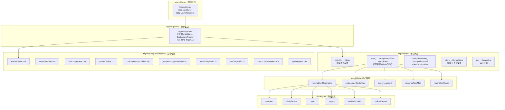


### 2.2 MgmtdState — 核心状态容器

MgmtdState 是 mgmtd 运行时的核心，所有 RPC 操作和后台任务都通过它读写状态。它的结构如下：

```cpp
struct MgmtdState {
  // ===== 不可变配置 =====
  const shared_ptr<ServerEnv> env_;              // 运行环境：KV 引擎、线程池、时间源等
  const MgmtdConfig &config_;                    // 配置项（大部分支持热更新）
  flat::NodeInfo selfNodeInfo_;                   // 自身节点信息（版本号、状态等会随心跳更新）
  flat::PersistentNodeInfo selfPersistentNodeInfo_; // 自身持久化信息（地址、标签，几乎不变）

  // ===== 持久化层 =====
  MgmtdStore store_;                             // FDB 操作封装：所有状态的持久化读写
  UserStoreEx userStore_;                        // 用户认证存储

  // ===== 核心状态（受 data_ 读写锁保护） =====
  CoroSynchronized<MgmtdData> data_;             // 路由信息、配置、lease 等

  // ===== 客户端会话（受 clientSessionMap_ 读写锁保护） =====
  CoroSynchronized<ClientSessionMap> clientSessionMap_;

  // ===== 写操作互斥锁 =====
  folly::coro::Mutex writerMu_;                  // 序列化写操作的 read-modify-write 过程
};
```


#### 状态怎么来、怎么变

MgmtdState 中的状态按来源和变化方式可以分为三类：

**1. 启动时初始化、运行时只读**：`env_`、`config_`、`selfPersistentNodeInfo_`。`config_` 虽然大部分字段支持热更新，但引用本身不变——热更新是修改 `config_` 指向的对象内容，而非替换引用。

**2. Lease 生命周期驱动**：`data_` 中的 `MgmtdData` 是最大的状态块，其生命周期与 lease 绑定（lease 的概念见下一节）：

```
获取新 lease (onNewLease)
  → 从 FDB 全量加载 routingInfo、configMap、chains 等
  → 调用 data_->reset(...) 一次性替换整个内存状态
  → 清空 clientSessionMap_（新 lease 周期，旧 session 作废）

运行中 (lease 续租期间)
  → RPC 写操作通过 FDB 事务修改 FDB 中的数据，然后更新 data_ 中的内存
  → RPC 读操作只读 data_ 的内存快照
  → 后台任务周期性地检查、持久化、加载

Lease 丢失
  → data_ 中的内存状态不再更新，成为过期快照
  → 非 primary 拒绝所有写操作 (doAsPrimary)
  → 下次获取新 lease 时重新全量加载
```

**3. 实时更新**：`selfNodeInfo_`（自身心跳更新配置版本号）、`clientSessionMap_`（客户端续期）。这些不依赖 lease 周期，每次 RPC 调用都可能更新。

#### 三把锁各保护什么

先把 MgmtdState 中的可变数据全部列出来，再看每把锁保护哪些：

```
MgmtdState 中的可变数据
├── data_ (CoroSynchronized<MgmtdData>) ← 第二把锁保护
│   └── MgmtdData
│       ├── leaseStartTs                    // 当前 lease 开始时间
│       ├── routingInfo                     // 最大的状态块
│       │   ├── routingInfoChanged          //   脏标记
│       │   ├── routingInfoVersion          //   路由版本号
│       │   ├── nodeMap                     //   所有节点信息
│       │   ├── chainTables                 //   所有 ChainTable
│       │   ├── chains                      //   所有 Chain
│       │   ├── targets                     //   所有 Target
│       │   ├── newBornChains               //   新建 Chain bootstrap 跟踪
│       │   ├── orphanTargetsByTargetId     //   孤立 Target (按 TargetId 索引)
│       │   └── orphanTargetsByNodeId       //   孤立 Target (按 NodeId 索引)
│       ├── configMap                       // 配置映射 (NodeType → Versioned 配置)
│       ├── lease                           // 当前 lease 信息
│       ├── universalTagsMap                // 通用标签映射
│       └── routingInfoCache                // 序列化缓存 (folly::Synchronized 自带锁)
│
├── clientSessionMap_ (CoroSynchronized<ClientSessionMap>) ← 第三把锁保护
│   └── RHStringHashMap<clientId → ClientSession>
│
└── writerMu_ (folly::coro::Mutex) ← 第一把锁
    不保护特定数据，保护的是写操作的 read-modify-write 过程
    确保同一时间只有一个写操作在操作 data_
```

三把锁的关系可以这样理解：

- **writerMu_**：不保护数据本身，保护的是**写操作对 data_ 的使用过程**。防止两个写操作同时进入"读 data_ → 改 data_"的阶段，导致一个写操作基于另一个写操作尚未完成的中间状态做决策
- **data_**：保护 `MgmtdData` 中的所有字段。读操作用 shared lock 并发读，写操作用 exclusive lock 独占写
- **clientSessionMap_**：保护客户端会话映射。与 data_ 完全独立，会话续期不会阻塞路由读写

以 Heartbeat 操作为例，看三把锁如何配合：

```
HeartbeatOperation::handle()

  ① co_await state.coScopedLock<"Heartbeat">()    // 获取 writerMu_
     // 此时其他写操作被阻塞

  ② co_await state.data_.coSharedLock()            // 获取 data_ 的 shared lock
     // 读取当前节点信息、配置版本等
     // 释放 data_ shared lock

  ③ co_await updateStoredRoutingInfo(...)           // FDB 事务：持久化变更
     // 内部再次获取 data_ shared lock 读取 routingInfoVersion
     // 然后执行 FDB 读写事务

  ④ co_await state.data_.coLock()                  // 获取 data_ 的 exclusive lock
     // 更新 nodeMap、Target 状态、routingInfoChanged
     // 释放 data_ exclusive lock

  ⑤ writerMu_ 的 WriterMutexGuard 析构             // 释放 writerMu_
     // 记录操作耗时到监控
```

步骤 ①⑤ 之间，其他写操作被 writerMu_ 阻塞，但读操作（如 GetRoutingInfo）不受影响——它们只获取 data_ 的 shared lock（步骤 ②④ 中写操作短暂持锁期间除外）。

#### 为什么必须用协程锁而不是线程锁

mgmtd 是基于协程的异步服务——一个线程可以交替执行多个协程。协程在 `co_await` 时挂起，让出线程给其他协程执行。传统线程锁（`std::mutex`、`std::shared_mutex`）会导致死锁：

```
线程 1 执行协程 A: 获取 data_ exclusive lock → co_await FDB 事务 (挂起)
线程 1 切换到协程 B: 尝试获取 data_ shared lock → 锁被 A 持有 → ???
```

协程 A 持有线程锁但已挂起，协程 B 在同一线程上运行但拿不到锁——如果是线程锁会阻塞整个线程，而线程上还有 A 等着恢复，造成死锁。

协程锁的解决方案：`co_await lock` 时如果锁不可用，协程挂起并让出线程，锁可用时恢复执行。不会阻塞线程，其他协程可以继续运行。

#### CoroSynchronized 的实现原理

```cpp
template <typename T>
class CoroSynchronized {
  folly::coro::SharedMutex sharedMu_;  // 协程读写锁
  T obj_;                              // 被保护的数据

  CoTask<SharedLockGuard<T>> coSharedLock() {
    auto lock = co_await sharedMu_.co_scoped_lock_shared();
    co_return SharedLockGuard(std::move(lock), obj_);  // 返回 RAII 守卫，持有 const T&
  }

  CoTask<ExclusiveLockGuard<T>> coLock() {
    auto lock = co_await sharedMu_.co_scoped_lock();
    co_return ExclusiveLockGuard(std::move(lock), obj_);  // 返回 RAII 守卫，持有 T&
  }
};
```

核心设计：把锁的生命周期和数据访问绑定在 RAII 守卫中。守卫析构时自动释放锁。编译期保证安全性——`coSharedLock()` 返回 `const T&`（只读），`coLock()` 返回 `T&`（可读写），不是运行时检查。

#### 锁的获取顺序

所有操作按 `writerMu_` → `data_` → `clientSessionMap_` 的固定顺序获取锁，避免死锁。


| 操作                  | writerMu_ | data_ shared | data_ exclusive | clientSessionMap_ |
| ------------------- | --------- | ------------ | --------------- | ----------------- |
| GetRoutingInfo      |           | ✓            |                 |                   |
| GetConfig           |           | ✓            |                 |                   |
| Heartbeat           | ✓         | ✓            | ✓               |                   |
| SetChainTable       | ✓         | ✓            | ✓               |                   |
| UpdateChain         | ✓         | ✓            | ✓               |                   |
| ExtendClientSession |           | ✓            |                 | ✓(exclusive)      |
| ListClientSessions  |           |              |                 | ✓(shared)         |


### 2.3 Lease — 分布式选主令牌

3FS 部署多个 mgmtd 实例做高可用，但同一时间只能有一个 mgmtd 执行写操作（修改节点状态、Chain、配置等），否则多个 mgmtd 同时写 FDB 会产生冲突。Lease 就是解决"谁有资格写"的机制——可以理解为一把**带有效期的分布式令牌**，存储在 FDB 中。

#### Lease 存储结构

```
FDB 中存储的 lease 记录:
  key:   Single:MgmtdLease
  value: MgmtdLeaseInfo {
           primary:    PersistentNodeInfo   ← 持有 lease 的 mgmtd 节点信息（含地址）
           leaseStart: UtcTime              ← lease 开始时间
           leaseEnd:   UtcTime              ← lease 过期时间（默认 leaseStart + 60s）
           releaseVersion: ReleaseVersion   ← 集群版本号（防回滚）
         }
```

#### 核心规则

- 只有 FDB 中 `leaseEnd > 当前时间` 且 `primary.nodeId == 自己` 的 mgmtd 才是 primary，才能执行写操作
- Primary 每 10s 向 FDB 续租一次（延长 `leaseEnd`），保持自己的 primary 身份
- 如果 primary 宕机或网络隔离，无法续租，60s 后 lease 过期，其他 mgmtd 可以抢到 lease 成为新 primary
- 非 primary 的 mgmtd 收到写请求时返回 `kNotPrimary` 错误，客户端据此切换到真正的 primary

#### Lease 在系统上下游中的作用

```
                    FDB (lease 存储)
                        │
            ┌───────────┼───────────┐
            ▼           ▼           ▼
      mgmtd-A      mgmtd-B      mgmtd-C
      (primary)    (standby)    (standby)
      持有 lease   无 lease     无 lease
      可写         只读         只读
            │           │           │
            │     心跳感知primary   │
            │◄──────────┘           │
            │                       │
    ┌───────┼───────────────────────┤
    │       │                       │
    ▼       ▼                       ▼
 Meta    Storage                 Client
 Service Service                 (FUSE)
    │       │                       │
    │       │    GetRoutingInfo      │
    │       │◄──────────────────────┤
    │       │                       │
    │       │    Heartbeat           │
    │       ├──────────────────────►│
    │       │                       │
    │  收到 kNotPrimary             │
    │  → 切换到新 primary           │
```

- **对 Meta/Storage/Client**：它们通过心跳和 `GetRoutingInfo` 与 mgmtd 交互。如果连接到的是 standby mgmtd，写操作（心跳）会收到 `kNotPrimary`，客户端自动切换到 primary
- **对 mgmtd 自身**：standby mgmtd 通过 `MgmtdHeartbeater` 向 primary 发心跳，感知 primary 存活并获取最新配置。如果 primary 长时间无响应，standby 会尝试抢 lease
- **对 FDB**：lease 存储在 FDB 中，利用 FDB 的事务原子性保证"同一时间只有一个 mgmtd 能成功续租或抢租"

#### Lease 切换与 bootstrapping

当 mgmtd 抢到新 lease 时（`leaseStart` 变了），内存状态可能已经过期（上一个 primary 的修改可能还没同步到本机）。因此需要 bootstrapping——在一个 FDB 事务中全量加载所有数据到内存。

bootstrapping 期间，客户端拿到的路由信息可能不完整（比如节点还在 CONNECTING 状态）。为了防止下游使用不完整数据，mgmtd 通过一个**时间窗口**标记 bootstrapping 状态：

```cpp
// MgmtdData::bootstrapping() — 每次构建路由信息时动态计算
bool bootstrapping(const MgmtdConfig &config) const {
  return leaseStartTs + config.bootstrapping_length().asUs() > SteadyClock::now();
}
```

`leaseStartTs` 在 `onNewLease` 完成、`reset()` 替换内存状态时设置为当前时间。之后 `bootstrapping_length`（默认 2min）内，`bootstrapping()` 返回 true；超过 2min 后自动返回 false，无需任何后台任务来清除。

这个设计意味着：即使 `onNewLease` 的 FDB 数据加载只花了 5 秒就完成了，bootstrapping 标志仍然会持续 2 分钟。这个额外的缓冲期是为了等待所有节点上报心跳——新 primary 上位后，节点可能还处于 `HEARTBEAT_CONNECTING` 状态，需要等一轮心跳周期后才能标记为 `HEARTBEAT_CONNECTED`。

对下游的影响：

- `GetRoutingInfo` 返回的 `flat::RoutingInfo` 中 `bootstrapping` 字段为 true
- 客户端收到后，如果配置了 `accept_incomplete_routing_info_during_mgmtd_bootstrapping = false`，会丢弃该路由信息（因为可能不完整），等待 bootstrapping 结束后再更新

---

### 2.4 RPC 操作列表

所有 RPC 操作定义在 `src/mgmtd/ops/` 目录下，通过 `MgmtdOperator` 统一分发：


| 操作                                 | 说明                    | 读写类型 |
| ---------------------------------- | --------------------- | ---- |
| `RegisterNode`                     | 注册新节点                 | 写    |
| `UnregisterNode`                   | 注销节点                  | 写    |
| `Heartbeat`                        | 心跳上报                  | 写    |
| `GetRoutingInfo`                   | 获取路由信息                | 读    |
| `SetChainTable`                    | 创建/更新 Chain Table     | 写    |
| `SetChains`                        | 批量设置 Chain            | 写    |
| `UpdateChain`                      | 添加/移除 Chain 中的 Target | 写    |
| `SetConfig`                        | 设置配置                  | 写    |
| `GetConfig`                        | 获取配置                  | 读    |
| `ExtendClientSession`              | 延期客户端会话               | 写    |
| `ListOrphanTargets`                | 列出孤立 Target           | 读    |
| `EnableDisableNode`                | 启用/禁用节点               | 写    |
| `SetNodeTags` / `GetUniversalTags` | 节点标签管理                | 读/写  |
| `RotateAsPreferredOrder`           | 按偏好顺序轮转 Target        | 写    |
| `RotateLastSrv`                    | 轮转 LASTSRV Target     | 写    |


---


## 3. 核心数据结构

mgmtd 的数据结构分两层：**内存运行时结构**（`src/mgmtd/service/`）和 **FlatBuffers 传输/持久化结构**（`src/fbs/mgmtd/`）。前者持有运行时附加信息（时间戳、缓存、锁），后者负责序列化、RPC 传输和 FDB 持久化。

### 3.1 WithTimestamp — 通用时间戳包装器

**设计背景**：心跳检测需要判断"上次更新是什么时候"。几乎每个运行时数据结构都需要带时间戳，但 FDB 中的持久化结构不需要（时间戳只在内存中有意义）。

```cpp
// src/mgmtd/service/WithTimestamp.h
template <typename T>
class WithTimestamp {
  T base_;           // 实际数据
  SteadyTime ts_;    // SteadyClock 时间戳（单调递增，不受系统时钟调整影响）
};
```

**为什么用 SteadyClock 而非 UtcClock？** `UtcClock` 可能因 NTP 同步而跳变，导致心跳超时判断出现误判（例如时钟回退会让"超时"变为"未超时"）。`SteadyClock` 单调递增，适合做时间差计算。

被以下结构继承使用：

- `NodeInfoWrapper : WithTimestamp<flat::NodeInfo>` — 节点信息 + 最后心跳时间
- `TargetInfo : WithTimestamp<flat::TargetInfo>` — Target 信息 + 最后更新时间
- `ClientSession : WithTimestamp<flat::ClientSession>` — 客户端会话 + 最后续期时间


### 3.2 NodeInfoWrapper — 节点信息包装器

**设计背景**：心跳 RPC 带有版本号（`hbVersion`），服务端需要拒绝旧版本的心跳请求，防止网络乱序导致状态回退。另外，节点的状态变更历史对运维诊断很有价值，但存储全量历史代价太大。

```cpp
// src/mgmtd/service/NodeInfoWrapper.h
class NodeInfoWrapper : public WithTimestamp<flat::NodeInfo> {
  HeartbeatVersion version_{0};                                         // 心跳版本号，防乱序
  SimpleRingBuffer<NodeStatusChange> statusChanges_{kStatusChangeCount}; // 最近 100 次状态变更
};
```

**两个优化设计**：


| 优化点                                | 设计原理                                                                                                  |
| ---------------------------------- | ----------------------------------------------------------------------------------------------------- |
| `version_` 心跳版本号                   | 每次心跳递增，服务端记录最新版本号。收到旧版本号的心跳直接拒绝（返回 `kHeartbeatVersionStale`），客户端需用返回的最新版本号 +1 重发。比"比较时间戳"更可靠，不受时钟偏差影响 |
| `SimpleRingBuffer<statusChanges_>` | 固定容量（100 条）的环形缓冲区记录状态变更历史。满时自动淘汰最旧记录。O(1) 插入，O(n) 遍历，比 `vector` 避免了内存重分配，比 `deque` 缓存更友好              |


### 3.3 TargetInfo — Target 运行时信息

**设计背景**：Target 的位置信息（nodeId + diskIndex）通过两种途径获取：1) Storage 心跳上报，2) FDB 持久化加载。两者可能不一致，需要跟踪"持久化到 FDB 的值"和"心跳上报的实际值"之间的差异，后台任务据此决定是否需要更新 FDB。

```cpp
// src/mgmtd/service/TargetInfo.h
class TargetInfo : public WithTimestamp<flat::TargetInfo> {
  bool locationInitLoaded = false;                // 是否已从 FDB 加载过持久化位置
  optional<NodeId> persistedNodeId;               // FDB 中持久化的 nodeId
  optional<uint32_t> persistedDiskIndex;          // FDB 中持久化的 diskIndex
  SteadyTime importantInfoChangedTime = now();    // 上次重要信息变更时间
};
```

**三个优化字段的作用**：


| 字段                                       | 设计原理                                                                                                                                                          |
| ---------------------------------------- | ------------------------------------------------------------------------------------------------------------------------------------------------------------- |
| `locationInitLoaded`                     | 防止 mgmtd 重启后立即覆盖 FDB 中已有的 Target 位置。只有确认"已成功加载持久化数据"后，才参与持久化比较逻辑。否则可能用空的内存值覆盖 FDB 中有效的位置信息                                                                    |
| `persistedNodeId` / `persistedDiskIndex` | 记录"已持久化到 FDB 的值"，与心跳上报的实际值比较。`MgmtdTargetInfoPersister` 据此筛选需要持久化的 Target，避免每轮全量写入 FDB。典型场景：Target 迁移到新节点后，`base().nodeId` 变了但 `persistedNodeId` 还是旧值，差异驱动持久化 |
| `importantInfoChangedTime`               | `localState` 或 `nodeId` 变化时更新。`MgmtdChainsUpdater` 用此时间判断 Target 是否有重要变更需要触发 Chain 更新。区分"重要变更"和"普通更新"（如 usedSize 变化），避免无关变更频繁触发 Chain 持久化                     |


### 3.4 LeaseInfo — Lease 选主状态

```cpp
// src/mgmtd/service/LeaseInfo.h
struct LeaseInfo {
  optional<MgmtdLeaseInfo> lease;   // 当前 lease 信息（可能为空，表示未持有 lease）
  bool bootstrapping = false;       // 是否正在执行 bootstrapping
};
```

**bootstrapping 标志的意义**：获取新 lease 后需要从 FDB 加载全部数据到内存，期间集群状态不完整。`bootstrapping = true` 时：

- 对外返回的 `flat::RoutingInfo` 中 `bootstrapping = true`，客户端据此判断路由信息可能不稳定
- `bootstrapping_length`（默认 2min）后自动变为 false，即使 `onNewLease` 已经完成


### 3.5 MgmtdData — 核心数据聚合

```cpp
// src/mgmtd/service/MgmtdData.h
struct MgmtdData {
  SteadyTime leaseStartTs;                          // 当前 lease 开始时间（用于判断 lease 周期）
  RoutingInfo routingInfo;                          // 路由信息（节点/链/Target）
  ConfigMap configMap;                              // 配置映射（NodeType → Versioned 配置）
  LeaseInfo lease;                                  // Lease 选主状态
  UniversalTagsMap universalTagsMap;                // 通用标签映射
  Synchronized<optional<flat::RoutingInfo>> routingInfoCache;  // 序列化缓存
};
```

**routingInfoCache 的设计原理**：

`GetRoutingInfo` 是最高频的 RPC 之一。每次请求都需要将内存中的 `RoutingInfo` 序列化为 `flat::RoutingInfo`（包含所有节点、链、Target 的映射表），序列化成本随集群规模线性增长。优化方案：

1. 首次请求时序列化并缓存结果
2. 后续相同版本的请求直接返回缓存（`folly::Synchronized` 保护读写）
3. 版本递增时清空缓存，下次请求重新生成
4. `version == 0` 的强制刷新请求不读缓存，但仍更新缓存

**ConfigMap 的二级映射**：

```cpp
using VersionedConfigMap = map<ConfigVersion, ConfigInfo>;  // 有序，rbegin() 即最新版本
using ConfigMap = map<NodeType, VersionedConfigMap>;
```

外层按 `NodeType`（MGMTD/META/STORAGE/CLIENT/FUSE）分组，内层按 `ConfigVersion` 有序排列。`rbegin()` 直接获取最新配置，O(1) 操作。每个 NodeType 的版本独立递增，互不影响。

### 3.6 RoutingInfo — 内存路由信息

**设计背景**：这是 mgmtd 最核心的数据结构。需要区分"持久化数据"和"临时数据"——前者与 FDB 一致，后者仅存在于内存中用于运行时逻辑。

```cpp
// src/mgmtd/service/RoutingInfo.h
struct RoutingInfo {
  bool routingInfoChanged = false;                  // 脏标记，触发版本递增
  RoutingInfoVersion routingInfoVersion{1};         // 当前版本号
  NodeMap nodeMap;                                  // [持久化] NodeId → NodeInfoWrapper
  ChainTableMap chainTables;                        // [持久化] ChainTableId → VersionMap → ChainTable
  ChainMap chains;                                  // [持久化] ChainId → ChainInfo
  TargetMap targets;                                // [派生]   TargetId → TargetInfo
  NewBornChains newBornChains;                      // [临时]   ChainId → 出生时间
  OrphanTargetsByTargetId orphanTargetsByTargetId;  // [临时]   TargetId → flat::TargetInfo
  OrphanTargetsByNodeId orphanTargetsByNodeId;      // [临时]   NodeId → TargetId 集合
};
```

**数据分类的设计原理**：


| 分类  | 字段                           | 说明                                                                                 |
| --- | ---------------------------- | ---------------------------------------------------------------------------------- |
| 持久化 | nodeMap, chainTables, chains | 来自 FDB，重启后通过 `onNewLease` 重新加载                                                     |
| 派生  | targets                      | 不直接持久化，由 chains 中的 ChainTargetInfo 派生而来。`insertNewChain` / `insertNewTarget` 时自动构建 |
| 临时  | newBornChains, orphanTargets | 仅存在于内存中，用于运行时逻辑（bootstrap 期控制、运维诊断），不持久化到 FDB                                      |


**targets 为何是"派生"而非"持久化"？**

Storage Service 心跳上报的是 `LocalTargetInfo`，只包含 Storage **本地视角**的状态：

```
LocalTargetInfo（Storage 上报）     TargetInfo（mgmtd 的完整视图）
  targetId                           targetId
  localState  ← 本地看到的状态        localState   ← 来自心跳
  diskIndex                          publicState  ← 来自 Chain（mgmtd 推导）
  usedSize                           chainId      ← 来自 Chain
  chainVersion                       nodeId       ← 来自心跳
  lowSpace                           diskIndex    ← 来自心跳
                                     usedSize     ← 来自心跳
```

心跳不报 `publicState`，因为 Storage 不知道——它不知道自己在 CRAQ 链中是 SERVING 还是 LASTSRV，这是 mgmtd 根据整条链上所有 Target 的 localState 全局推导出来的。

一个具体场景：一条 Chain 有 T1、T2、T3 三个 Target。

```
T1 本地状态: UPTODATE    ← T1 心跳上报 localState=UPTODATE
T2 本地状态: UPTODATE    ← T2 心跳上报 localState=UPTODATE
T3 本地状态: OFFLINE     ← T3 心跳上报 localState=OFFLINE（宕机了）

mgmtd 全局推导 publicState:
  T3: OFFLINE      ← 本地就是 OFFLINE
  T2: LASTSRV      ← T2 是最后一个正常工作的，它之后有不可用的 T3
  T1: SERVING      ← T1 之前所有 Target 都正常
```

T2 自己只知道"我本地数据是完整的 (UPTODATE)"，它不知道 T3 宕机了，也不知道自己应该被标记为 LASTSRV。只有 mgmtd 看到整条链的全貌后，才能做出正确的 publicState 推导。

因此 `targets` 是合并视图——`publicState` 和 `chainId` 来自 Chain（mgmtd 推导），`localState`、`nodeId`、`diskIndex`、`usedSize` 来自心跳。FDB 中只持久化 `ChainInfo`（含 ChainTargetInfo），不持久化合并后的完整 TargetInfo。

**orphanTargets — 心跳先于 Chain 注册的 Target**

Storage 心跳上报的 `LocalTargetInfo` 可能包含尚未被任何 Chain 引用的 TargetId。此时 mgmtd 的 `targets` 中找不到这个 targetId，无法更新，就记录为 orphanTarget。

典型场景：管理员通过 CLI 执行扩容操作，顺序如下：

```
1. 在 Storage Service 上 createTarget → Storage 本地创建了 Target，开始上报心跳
2. Storage 心跳到达 mgmtd → mgmtd 的 targets 中没有这个 targetId → 记入 orphanTargets
3. 管理员通过 UpdateChain ADD 将 Target 加入 Chain → mgmtd 的 targets 中插入该 Target
   → 同时从 orphanTargets 中移除
```

步骤 1 和 3 之间有一个时间窗口，在此期间 Target 只存在于 Storage 本地和 mgmtd 的 orphanTargets 中。orphanTargets 的意义就是：mgmtd 知道"这个 Target 存在，但还没分配给任何 Chain"，避免信息丢失。

orphanTargets 的生命周期：
- **产生**：心跳上报的 targetId 在 `targets` 中找不到时，自动加入 `orphanTargetsByTargetId` 和 `orphanTargetsByNodeId`
- **消除**：`insertNewChain` 或 `insertNewTarget` 将 Target 加入 Chain 时，自动调用 `eraseOrphanTarget` 从两个索引中移除
- **刷新**：每次心跳先清除该节点的所有旧 orphan 记录（`orphanTargetsByNodeId[nodeId]`），再重新收集。如果 Storage 不再上报某个 targetId，该 orphan 自然消失

**orphanTargets 的双索引设计**：

```cpp
OrphanTargetsByTargetId orphanTargetsByTargetId;  // TargetId → flat::TargetInfo
OrphanTargetsByNodeId orphanTargetsByNodeId;       // NodeId → set<TargetId>
```

- `orphanTargetsByTargetId`：按 TargetId 查询孤儿 Target 的详细信息
- `orphanTargetsByNodeId`：心跳时按 NodeId 清除该节点所有旧孤儿记录——先从 `orphanTargetsByNodeId[nodeId]` 获取 TargetId 列表，逐个从 `orphanTargetsByTargetId` 中删除，最后清除 `orphanTargetsByNodeId[nodeId]`

### 3.7 flat::MgmtdLeaseInfo — FDB 中的 Lease 记录

```cpp
// src/fbs/mgmtd/MgmtdLeaseInfo.h
struct MgmtdLeaseInfo {
  PersistentNodeInfo primary;     // 主节点的持久化信息（含地址）
  UtcTime leaseStart;             // lease 开始时间
  UtcTime leaseEnd;               // lease 结束时间
  ReleaseVersion releaseVersion;  // 集群版本号（防回滚）
};
```

**releaseVersion 防回滚**：升级集群时，新版本 mgmtd 的 `releaseVersion` 更大。`extendLease` 中检查：若新请求的 `releaseVersion` 小于 FDB 中已有的，直接返回当前 lease 不做更新。这防止了"升级后回滚"场景下旧版本 mgmtd 抢占 lease，确保集群不会降级运行。

**leaseStart 的保持语义**：当 lease 持有者不变（同一节点续租）时，`extendLease` 保持 `leaseStart` 不变只延长 `leaseEnd`。其他 mgmtd 通过 `leaseStart` 变化判断"lease 发生了切换"，触发重新向新 primary 注册心跳。

### 3.8 flat::NodeInfo vs flat::PersistentNodeInfo — 节点信息的两个版本

**设计背景**：心跳频繁上报节点信息，但大部分字段（地址、标签）很少变化。如果每次心跳都写 FDB，会带来大量不必要的写放大。因此将节点信息拆分为"运行时完整版"和"持久化精简版"。

```cpp
// src/fbs/mgmtd/NodeInfo.h — 运行时完整版（心跳中传递）
struct NodeInfo {
  FbsAppInfo app;               // 进程信息（nodeId, hostname, pid, port 等）
  NodeType type;                // 节点类型
  NodeStatus status;            // 当前状态（HEARTBEAT_CONNECTED 等）
  UtcTime lastHeartbeatTs;      // 最后心跳时间
  vector<TagPair> tags;         // 标签
  ConfigVersion configVersion;  // 当前配置版本
  ConfigStatus configStatus;    // 配置状态
};

// src/fbs/mgmtd/PersistentNodeInfo.h — 持久化精简版（存入 FDB）
struct PersistentNodeInfo {
  NodeId nodeId;
  NodeType type;
  vector<ServiceGroupInfo> serviceGroups;  // 服务地址
  vector<TagPair> tags;
  String hostname;
};
```

**HeartbeatOperation 中的优化**：

```cpp
auto persistentNewNode = flat::toPersistentNode(newNode);
auto needPersist = oldNode == nullptr || flat::toPersistentNode(oldNode->base()) != persistentNewNode;
```

只有 `PersistentNodeInfo` 发生变化时才写 FDB。`status`、`lastHeartbeatTs`、`configVersion` 等运行时字段的变化不会触发持久化，减少 FDB 写入压力。

### 3.9 flat::ChainInfo & flat::ChainTable — 链与链表

```cpp
// src/fbs/mgmtd/ChainInfo.h
struct ChainInfo {
  ChainId chainId;
  ChainVersion chainVersion;                    // Chain 级别版本号
  vector<ChainTargetInfo> targets;              // Target 列表（有序）
  vector<TargetId> preferredTargetOrder;        // 偏好顺序
};

// src/fbs/mgmtd/ChainTable.h
struct ChainTable {
  ChainTableId chainTableId;
  ChainTableVersion chainTableVersion;          // Table 级别版本号
  vector<ChainId> chains;                       // Chain ID 有序列表
  String desc;                                  // 描述信息
};
```

**版本号的设计**：Chain 和 ChainTable 各自独立维护版本号，均单调递增。Chain 的任何变更（添加/移除 Target、publicState 变化）都递增 `chainVersion`。ChainTable 的 chains 列表或 desc 变更才递增 `chainTableVersion`。两层版本号实现独立演进，修改单条 Chain 不需要更新 ChainTable。

**preferredTargetOrder**：管理员指定的 Target 偏好顺序。`MgmtdChainsUpdater` 在 `generateNewChain` 后，如果所有 Target 都 SERVING，会按 `preferredTargetOrder` 重排 Target 顺序。典型场景：把低延迟节点排在前面做 Head，提高写性能。

### 3.10 flat::ChainTargetInfo & flat::TargetInfo — Target 的两种视角

**设计背景**：Target 的状态信息分散在 Chain 视角和全局视角中。Chain 只关心 publicState（CRAQ 协议需要），全局视角还需要 localState 和位置信息。

```cpp
// src/fbs/mgmtd/ChainTargetInfo.h — Chain 内的 Target 视角
struct ChainTargetInfo {
  TargetId targetId;
  PublicTargetState publicState;   // SERVING / LASTSRV / OFFLINE
};

// src/fbs/mgmtd/TargetInfo.h — 全局 Target 视图
struct TargetInfo {
  TargetId targetId;
  PublicTargetState publicState;   // 与 ChainTargetInfo 同步
  LocalTargetState localState;     // Storage 上报的本地状态
  ChainId chainId;                 // 所属 Chain
  optional<NodeId> nodeId;         // 所在节点
  optional<uint32_t> diskIndex;    // 所在磁盘
  uint64_t usedSize;               // 已用空间
};
```

**publicState 与 localState 的分离**：这是 CRAQ 协议的核心设计。`localState` 是 Storage 本地报告的真实状态（ONLINE/UPTODATE/OFFLINE），`publicState` 是 mgmtd 根据 CRAQ 规则推导出的对外可见状态（SERVING/LASTSRV/OFFLINE）。两者分离使得 mgmtd 可以在 Chain 维度做全局协调——例如某个 Target 本地 ONLINE，但其后续 Target 不在线，它应该被标记为 LASTSRV 而非 SERVING。

### 3.11 flat::HeartbeatInfo — 心跳信息的变体设计

```cpp
// src/fbs/mgmtd/HeartbeatInfo.h
struct HeartbeatInfo {
  FbsAppInfo app;
  Payload info;  // variant<MetaHeartbeatInfo, StorageHeartbeatInfo, MgmtdHeartbeatInfo>
  HeartbeatVersion hbVersion;
  ConfigVersion configVersion;
  ConfigStatus configStatus;
};

// 不同类型携带不同负载
struct StorageHeartbeatInfo { vector<LocalTargetInfo> targets; };
struct MetaHeartbeatInfo    { Void dummy; };
struct MgmtdHeartbeatInfo   { Void dummy; };
```

**用** `variant` **实现类型安全的多态**：不同 NodeType 的心跳携带不同信息。Storage 携带 Target 列表，Meta 和 Mgmtd 目前没有额外信息。用 `std::variant` 而非继承/虚函数，因为：

1. 心跳结构需要序列化到 FDB，`variant` 天然支持值语义
2. 类型在编译期确定，没有虚函数开销
3. `type()` 通过 `visit` 自动推导，不需要手动维护类型标签


### 3.12 flat::LocalTargetInfo — Storage 心跳上报的 Target 状态

```cpp
// src/fbs/mgmtd/LocalTargetInfo.h
struct LocalTargetInfo {
  TargetId targetId;
  LocalTargetState localState;     // ONLINE / UPTODATE / OFFLINE
  optional<uint32_t> diskIndex;
  uint64_t usedSize;
  ChainVersion chainVersion;       // Storage 看到的 Chain 版本号
  bool lowSpace;                   // 磁盘空间不足标志
};
```

**chainVersion 的防乱序设计**：Storage 上报自己知道的 `chainVersion`，mgmtd 据此判断心跳是否基于过时的 Chain 信息。如果 `chain.chainVersion > lti.chainVersion` 且 `heartbeat_ignore_stale_targets=true`，则忽略该 Target 的状态更新。这防止了以下场景：mgmtd 已将 Target 从 Chain 中移除，但 Storage 的心跳仍基于旧的 Chain 版本报告该 Target 为 ONLINE。

### 3.13 CoroSynchronized — 协程安全的读写锁包装器

**设计背景**：mgmtd 是一个高并发的协程服务，读操作远多于写操作。`std::shared_mutex` 不支持协程（持有锁时不能 `co_await`），需要基于 `folly::coro::SharedMutex` 的协程友好版本。

```cpp
// src/common/utils/CoroSynchronized.h
template <typename T>
class CoroSynchronized {
  folly::coro::SharedMutex sharedMu_;  // 协程友好的读写锁
  T obj_;                              // 被保护的数据

  CoTask<SharedLockGuard<T>> coSharedLock();  // 共享锁（读）
  CoTask<ExclusiveLockGuard<T>> coLock();     // 排他锁（写）
};
```

**RAII 锁守卫的设计**：`coSharedLock()` 返回 `CoSharedLockGuard<T>`，`coLock()` 返回 `CoExclusiveLockGuard<T>`。守卫对象持有锁和数据的引用，通过 `operator->` 和 `operator`* 访问数据。守卫析构时自动释放锁。使用方式：

```cpp
// 读操作
auto dataPtr = co_await state.data_.coSharedLock();  // 获取共享锁
auto version = dataPtr->routingInfo.routingInfoVersion;  // 通过 operator-> 访问

// 写操作
auto dataPtr = co_await state.data_.coLock();  // 获取排他锁
dataPtr->routingInfo.routingInfoChanged = true;
```

**为什么不用** `folly::Synchronized`**？** `folly::Synchronized` 的锁不是协程友好的——在持有锁期间不能 `co_await`，否则会阻塞线程。mgmtd 的操作经常在持锁期间做 FDB 事务（需要 `co_await`），必须用协程锁。但 `routingInfoCache` 使用了 `folly::Synchronized`，因为它不需要协程锁——只是在序列化结果时短暂加锁，不涉及异步操作。

### 3.14 强类型 ID — 防止混淆的编译期保障

**设计背景**：mgmtd 中有大量 ID 类型（NodeId, ChainId, TargetId, ChainTableId...），底层都是 uint32/uint64。如果用裸整数，编译器无法检查类型混淆——把 ChainId 传给期望 TargetId 的函数不会报错。

```cpp
// src/fbs/mgmtd/MgmtdTypes.h — 全部用 STRONG_TYPEDEF 定义
STRONG_TYPEDEF(uint64_t, TargetId);
STRONG_TYPEDEF(uint64_t, ChainId);
STRONG_TYPEDEF(uint32_t, ChainTableId);
STRONG_TYPEDEF(uint32_t, ChainTableVersion);
STRONG_TYPEDEF(uint32_t, ChainVersion);  // 注意：uint32 而非 uint64
STRONG_TYPEDEF(uint64_t, RoutingInfoVersion);
STRONG_TYPEDEF(uint64_t, ConfigVersion);
STRONG_TYPEDEF(uint64_t, HeartbeatVersion);
```

**ChainVersion 用 uint32 的优化**（注释原文："ChainVersion is space sensitive and uint32 is enough for changes of one chain"）：ChainVersion 是单条 Chain 的变更计数，远达不到 uint32 上限（~43 亿次），用 uint32 节省空间——在 FDB 持久化和网络传输中，每条 Chain 的每个 Target 节省 4 字节，大规模集群下可观的存储节省。

---


## 4. Lease 选主机制


### 4.1 流程图解

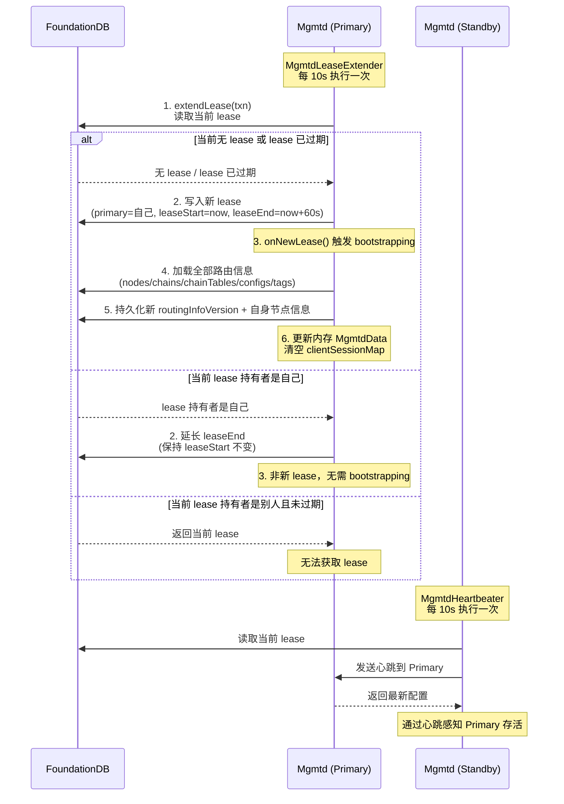


### 4.2 核心机制详解

**Lease 存储结构**：Lease 信息存储在 FDB 中，key 为 `Single:MgmtdLease`，value 为 `MgmtdLeaseInfo`：

```
MgmtdLeaseInfo {
  primary: PersistentNodeInfo   // 主节点信息
  leaseStart: UtcTime           // lease 开始时间
  leaseEnd: UtcTime             // lease 结束时间
  releaseVersion: ReleaseVersion // 版本号（防回滚）
}
```

**extendLease 的四条路径**（`MgmtdStore::extendLease`）：

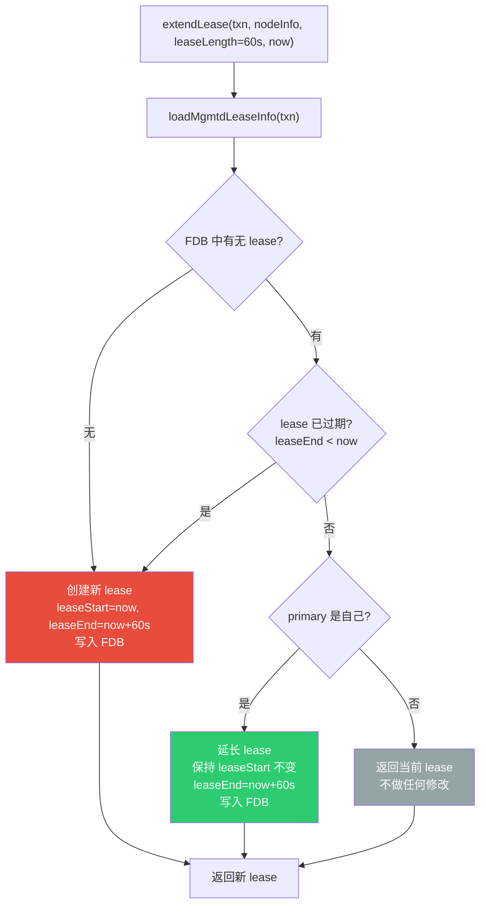


**Bootstrapping 过程**：当 mgmtd 获取新 lease（`onNewLease`）时，需要从 FDB 加载全部集群状态到内存：

1. 在一个 FDB 读写事务中并行加载：routingInfoVersion、所有节点、所有配置、所有 ChainTable、所有 Chain、所有 UniversalTags
2. 持久化新的 routingInfoVersion 和自身节点信息
3. 将加载的数据 reset 到内存 `MgmtdData` 中
4. 清空 `clientSessionMap`（新 lease 周期，旧 session 无效）
5. 所有 Chain 标记为 `newBornChains`（避免重启后立即更新不稳定状态）
6. 加载最新 MGMTD 配置，可能更新自身配置

**Primary 判定**：非 primary 的 mgmtd 通过 `doAsPrimary()` 辅助函数拒绝写操作。`ensureSelfIsPrimary()` 检查内存中 `lease.lease->primary.nodeId == selfId()`。

### 4.3 配置项


| 配置项                                  | 默认值  | 说明                                                          |
| ------------------------------------ | ---- | ----------------------------------------------------------- |
| `lease_length`                       | 60s  | lease 有效期                                                   |
| `extend_lease_interval`              | 10s  | 续租周期                                                        |
| `suspicious_lease_interval`          | 20s  | lease 可疑时间（当前代码中定义但未使用核心逻辑）                                 |
| `bootstrapping_length`               | 2min | bootstrapping 状态持续时间，期间返回的 RoutingInfo 中 bootstrapping=true |
| `extend_lease_check_release_version` | true | 续租时是否检查版本号防回滚                                               |


---


## 5. 心跳机制


### 5.1 流程图解

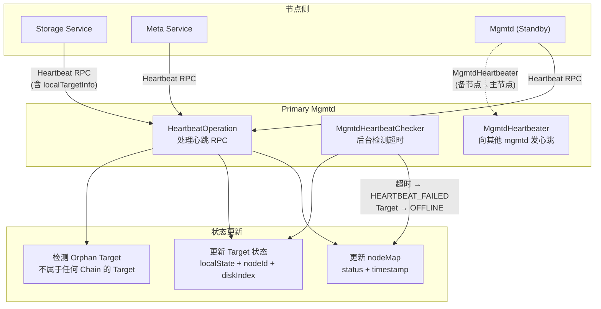


### 5.2 心跳上报流程（HeartbeatOperation）

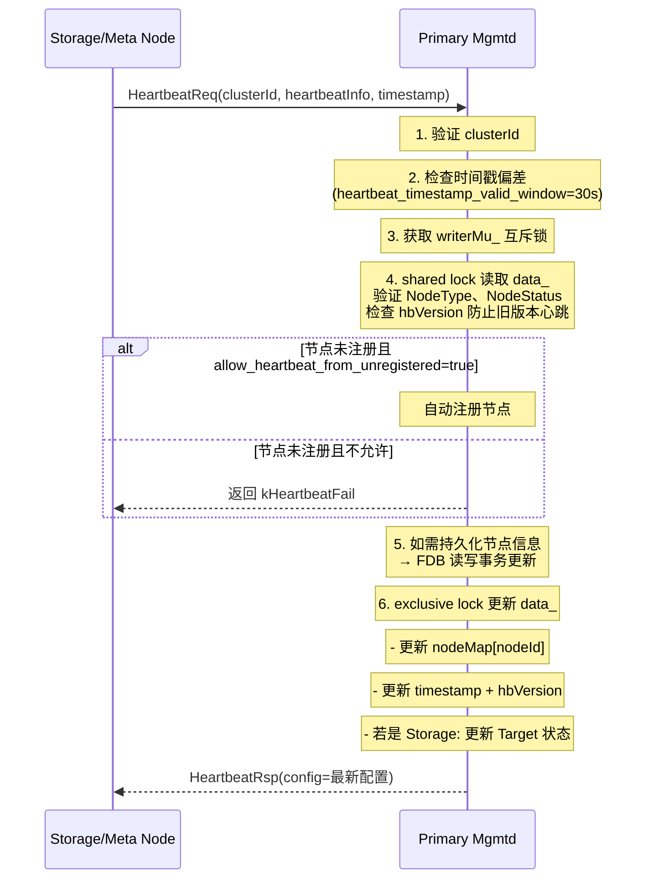


**心跳上报中 Target 状态更新**（Storage Service 心跳特有）：

`RoutingInfo::localUpdateTargets()` 处理 Storage 心跳中的 `localTargetInfo`：

1. 清除该节点之前的 orphanTargets
2. 遍历上报的 targets：
  - 若 targetId 已在 targets 中：更新 `localState`、`nodeId`、`diskIndex`、`usedSize`
  - 若 targetId 不在 targets 中：记录为 orphanTarget（可能是新 Target 还未被 Chain 引用）
3. 重要信息变更（localState 变化或 nodeId 变化）时标记 `importantInfoChangedTime`


### 5.3 心跳超时检测（MgmtdHeartbeatChecker）

后台每 10s 执行一次：

1. shared lock 读取所有节点和 Target
2. 检查节点：`nodeInfo.ts() + heartbeat_fail_interval < steadyNow` → 标记为 `HEARTBEAT_FAILED`
3. 检查 Target：`ti.ts() + heartbeat_fail_interval < steadyNow` 且 `localState != OFFLINE` → 设为 `OFFLINE`
4. exclusive lock 更新内存状态，设置 `routingInfoChanged = true`


### 5.4 mgmtd 自身心跳（MgmtdHeartbeater）

备节点 mgmtd 周期性向主节点发送心跳：

1. 读取当前 lease 信息，确定 primary 节点
2. 若自己是 primary → 跳过（不需要给自己发心跳）
3. 若无 primary → 跳过
4. 否则向 primary 的 Mgmtd 服务发送 Heartbeat RPC
5. 收到响应后检查是否有新配置，有则更新自身配置

这个机制的意义：备节点通过心跳感知主节点存活，同时获取最新配置。

### 5.5 配置项


| 配置项                                 | 默认值   | 说明                      |
| ----------------------------------- | ----- | ----------------------- |
| `heartbeat_timestamp_valid_window`  | 30s   | 心跳时间戳有效窗口，偏差超出则拒绝       |
| `heartbeat_fail_interval`           | 60s   | 心跳超时判定时间                |
| `allow_heartbeat_from_unregistered` | false | 是否允许未注册节点自动注册           |
| `send_heartbeat`                    | true  | 备 mgmtd 是否向主 mgmtd 发送心跳 |
| `send_heartbeat_interval`           | 10s   | 备 mgmtd 发送心跳的间隔         |


---


## 6. Chain Table 管理


### 6.1 核心概念

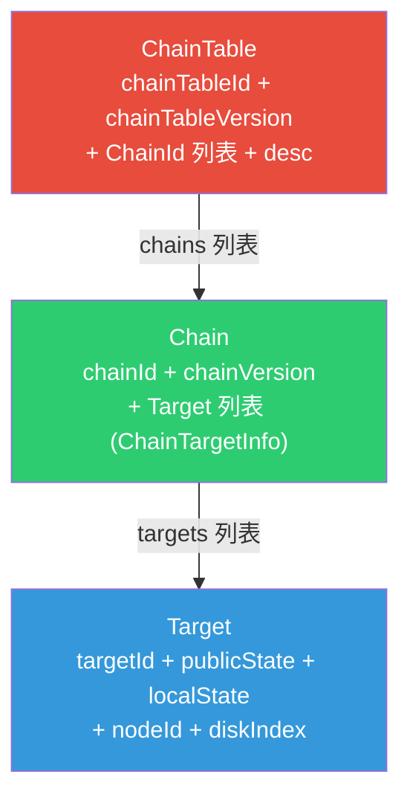


**ChainTable**：一个 ChainId 的有序列表，代表一组可用的复制链。

为什么需要 ChainTable，而不是直接用一堆 Chain？因为 3FS 的文件是条带化（striping）存储的——一个文件的数据分片分布在多条 Chain 上。Meta Service 创建文件时，需要从 ChainTable 中选取一组 Chain 来放置文件的数据分片。

```
文件 → Layout {
         tableId: 1          ← 引用哪个 ChainTable
         tableVersion: 3     ← 引用 ChainTable 的哪个版本
         stripeSize: 4       ← 条带大小：每个条带跨 4 条 Chain
         chains: ChainRange(baseIndex=0, seed=xxx)
       }

ChainTable 1 v3 {
  chains: [C1, C2, C3, C4, C5, C6, C7, C8]  ← 8 条 Chain
}

文件的 4 个数据分片 → 从 baseIndex=0 开始，选 C1, C2, C3, C4
另一个文件的 4 个数据分片 → 从 baseIndex=4 开始，选 C5, C6, C7, C8
```

ChainTable 的关键设计：

- **版本化**：同一个 `chainTableId` 可以有多个版本（`ChainTableVersionMap`），文件通过 `tableVersion` 绑定到特定版本。更新 ChainTable（扩容/缩容）产生新版本，旧文件继续使用旧版本的 Chain，新文件使用新版本
- **有序列表**：Chain 的顺序决定了条带分配的顺序。Meta Service 用 round-robin + shuffle 策略从 ChainTable 中选取 Chain，实现数据均匀分布
- **多个 ChainTable**：不同 `chainTableId` 的 ChainTable 可以服务不同场景，例如不同副本数、不同磁盘类型的 Chain 分开管理

**Chain**：一条 CRAQ 复制链，包含多个 Target，按 Head→Middle→Tail 顺序排列。

**Target**：一个逻辑存储单元，运行在某个节点的某块 SSD 上。

### 6.2 Chain Table 创建/更新

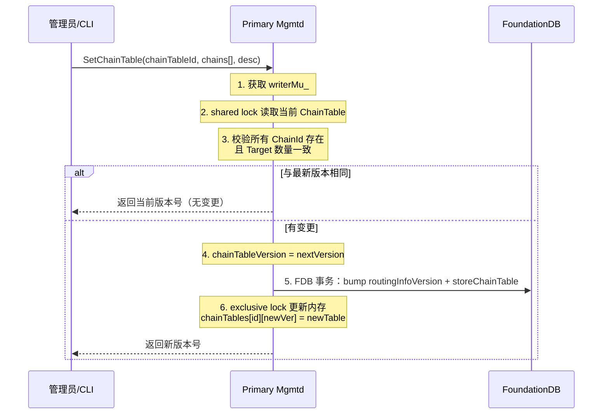


### 6.3 Chain 更新（UpdateChain）

UpdateChain 支持两种模式：

**ADD 模式**：向 Chain 末尾添加一个新 Target（初始状态为 OFFLINE）


**REMOVE 模式**：从 Chain 中移除一个 OFFLINE 状态的 Target


操作流程：

1. 获取 `writerMu_` + exclusive lock 读取当前 Chain
2. 更新 `chainVersion`，修改 targets 列表
3. FDB 事务：bump routingInfoVersion + storeChainInfo（REMOVE 时还清除 TargetInfo）
4. 更新内存：更新 chain + targets + orphanTargets


### 6.4 MgmtdChainsUpdater — 自动 Chain 状态更新

后台每 1s 执行一次，自动检测 Target 状态变化并更新对应的 Chain：

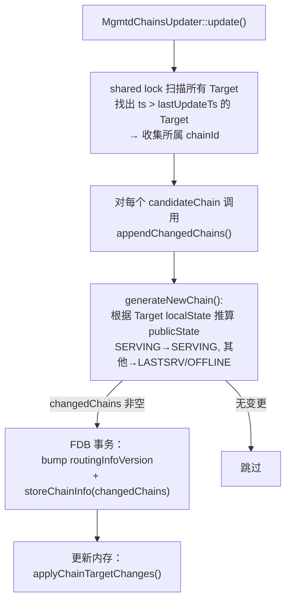


**generateNewChain 的状态推导规则**（`updateChain.h`）：

```
遍历 Chain 中的 Target（从后往前）：
- 若 localState == OFFLINE → publicState = OFFLINE
- 若 localState == ONLINE/UPTODATE 且后面没有 LASTSRV → publicState = SERVING
- 若 localState == ONLINE/UPTODATE 且后面有 LASTSRV → publicState = LASTSRV
```

这确保了 CRAQ 协议的正确性：LASTSRV 是最后一个提供完整服务的 Target，其后的 Target 正在同步。

### 6.5 NewBornChains — 新建 Chain 的 Bootstrap

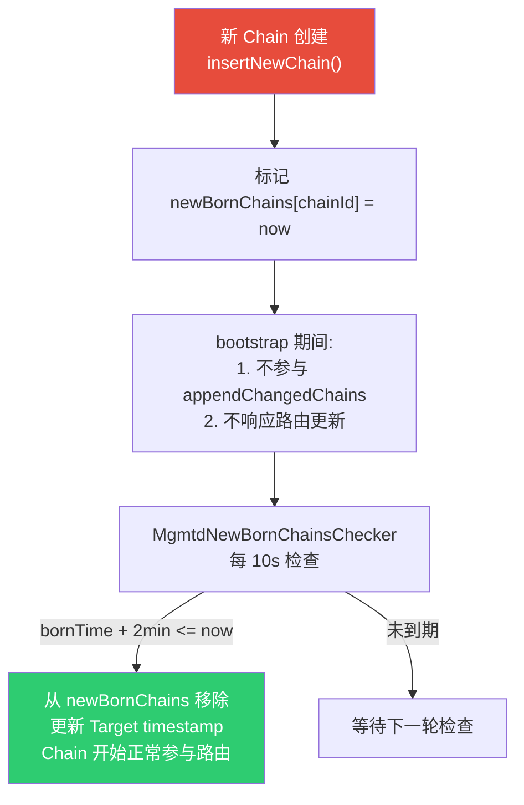


**为什么需要 Bootstrap 期？** 新创建的 Chain 上的 Target 可能还在同步数据，状态不稳定。bootstrap 期间（默认 2 分钟）：

- `appendChangedChains()` 跳过 newBornChains 中的 Chain
- 避免将不稳定状态推送到路由信息中

**重启场景**：`onNewLease` 时所有 Chain 都标记为 newBornChains（`RoutingInfo::reset`），确保重启后状态稳定再参与路由。

### 6.6 配置项


| 配置项                                    | 默认值   | 说明                       |
| -------------------------------------- | ----- | ------------------------ |
| `new_chain_bootstrap_interval`         | 2min  | 新 Chain 的 bootstrap 等待时间 |
| `update_chains_interval`               | 1s    | Chain 更新检查间隔             |
| `try_adjust_target_order_as_preferred` | false | 是否按偏好顺序调整 Target 排列      |


---


## 7. RoutingInfo 分发

### 7.0 RoutingInfo 是什么——集群的"活地图"

RoutingInfo 是 mgmtd 维护并分发给所有客户端和服务端的**全局路由信息**，它回答了一个核心问题：**数据在哪里**。3FS 中任何需要读写数据或定位节点的组件，都必须持有 RoutingInfo 才能工作。

**维护的内容**（`src/mgmtd/service/RoutingInfo.h:31-78`）：

| 字段 | 类型 | 维护什么 | 持久化 |
| ---- | ---- | ---- | ---- |
| `nodeMap` | `NodeMap` | 集群中所有节点（Meta/Storage/Client）的信息，键为 `NodeId` | 是 |
| `chainTables` | `ChainTableMap` | ChainTable（链表），描述多条 Chain 如何条带化，键为 `ChainTableId` | 是 |
| `chains` | `ChainMap` | 所有 Chain 的详细信息（有序 Target 列表、版本等），键为 `ChainId` | 是 |
| `targets` | `TargetMap` | 所有 Target 的运行时信息（状态、所属 Node、所属 Chain），键为 `TargetId` | 是 |
| `newBornChains` | `NewBornChains` | 新建 Chain 的临时状态，等待 Bootstrap 完成 | 否 |
| `orphanTargets*` | `OrphanTargets*` | 未关联到任何 Chain 的孤立 Target，用于清理 | 否 |

**在全局中的作用——数据定位的起点**：

```
用户文件
  └── Layout（Meta 分配，引用 ChainTable）
        └── ChainTable（从 RoutingInfo 获取）→ 选一条 Chain
              └── Chain（从 RoutingInfo 获取）→ 有序 Target 列表
                    └── Target（从 RoutingInfo 获取）→ 映射到 NodeId
                          └── Node（从 RoutingInfo.nodeMap 获取）→ RDMA 地址
```

不同组件依赖 RoutingInfo 完成各自的工作：

| 消费者 | 用途 |
| ---- | ---- |
| **FUSE / Native Client** | 通过 ChainTable 和 Chain 计算 chunk 落在哪条 Chain，再通过 Target→Node 映射找到 Storage 节点发 RDMA 读写 |
| **Storage Service** | 知道自己拥有的 Target 在哪些 Chain 中、前驱和后继是谁（CRAQ 链式转发的依据） |
| **Meta Service** | ChainAllocator 从 ChainTable 中选取可用 Chain 为新文件分配 Layout |

**分发机制**：mgmtd 通过 `GetRoutingInfo` RPC（`src/fbs/mgmtd/Rpc.h:42-48`）将 `flat::RoutingInfo` 分发出去。请求携带客户端当前持有的 `routingInfoVersion`，mgmtd 仅在版本有更新时返回全量数据（`src/mgmtd/ops/GetRoutingInfoOperation.cc:5-22`）。客户端（`src/client/mgmtd/MgmtdClient.cc` 的 `refreshRoutingInfo`）周期性拉取并缓存到本地，通过 `addRoutingInfoListener` 通知上层组件响应变更。

> 简言之，RoutingInfo = **节点表 + ChainTable + Chain + Target** 四张表的版本化快照，是整个集群数据路由的单一事实来源。本章后续小节详述其数据结构、版本递增机制和客户端获取流程。

### 7.1 数据结构

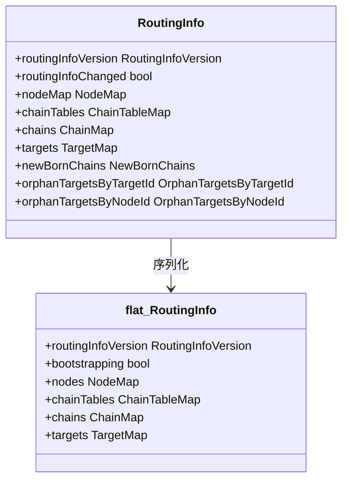


内存中的 `RoutingInfo` 是内部表示，包含临时数据（newBornChains、orphanTargets）。分发时序列化为 `flat::RoutingInfo`，只包含客户端需要的路由信息。

### 7.2 版本递增机制

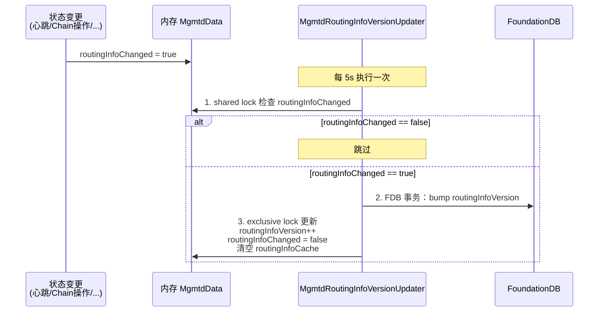


**设计要点**：routingInfoVersion 的递增是延迟的（非实时）。状态变更时先设置 `routingInfoChanged` 标志，由后台任务统一递增版本号并持久化。好处是批量变更可以合并为一次版本递增。

### 7.3 客户端获取路由信息（GetRoutingInfo）

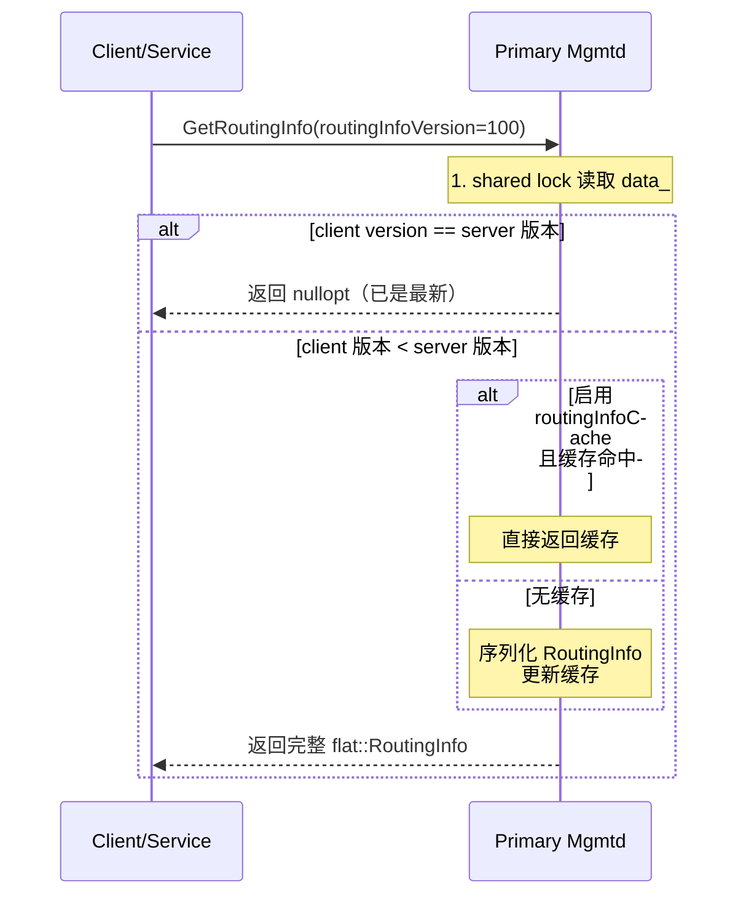


**增量更新设计**：客户端携带当前已知的 `routingInfoVersion`，服务端只在版本不同时返回完整数据。版本相同时返回空，减少网络传输。

**routingInfoCache**：缓存最近一次序列化的 `flat::RoutingInfo`，避免每次请求都重新序列化。缓存通过 `folly::Synchronized` 保护，版本不匹配时重新生成。

---


## 8. Target 状态管理


### 8.1 Target 状态模型

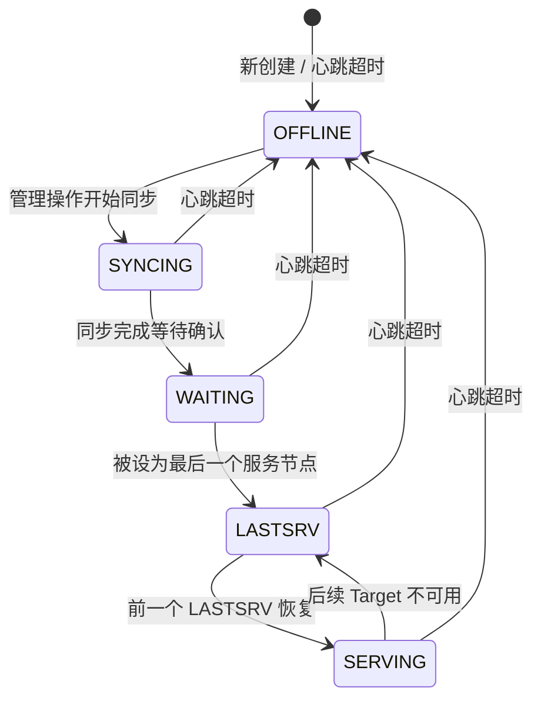


**两层状态**：


| 层级            | 字段              | 说明                          |
| ------------- | --------------- | --------------------------- |
| `publicState` | Chain 中的可见状态    | SERVING / LASTSRV / OFFLINE |
| `localState`  | Storage 本地报告的状态 | ONLINE / UPTODATE / OFFLINE |


publicState 由 mgmtd 根据 localState 和 CRAQ 协议规则推导得出（`generateNewChain`）。

### 8.1.1 SYNCING — 新 Target 加入 Chain 的数据同步

CRAQ 协议中，Chain 的每个 Target 应该持有完整数据副本。当新 Target 加入 Chain 时，它没有任何数据，需要从前驱（Chain 中排在自己前面的 Target）复制全部 chunk 数据。这个过程就是 SYNCING。

完整流程如下：

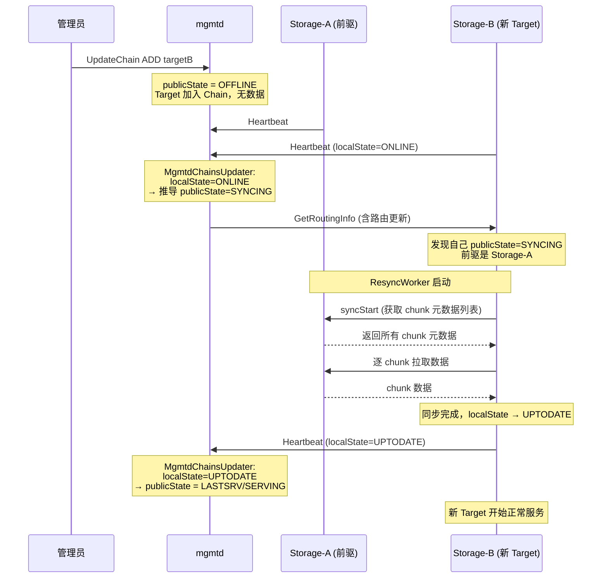

关键步骤说明：

1. **UpdateChain ADD**：管理员将新 Target 加入 Chain，初始 `publicState=OFFLINE`。此时新 Target 没有任何数据
2. **心跳上报 ONLINE**：新 Target 所在的 Storage Service 创建 Target 后上报心跳，`localState=ONLINE`（本地进程就绪，但数据尚未就绪）
3. **mgmtd 推导 SYNCING**：`MgmtdChainsUpdater` 检测到 `localState=ONLINE`，但该 Target 后面没有 LASTSRV/OFFLINE 的 Target，根据 CRAQ 规则推导 `publicState=SYNCING`
4. **Storage 发现 SYNCING**：新 Target 通过 `GetRoutingInfo` 拿到更新后的路由信息，发现自己 `publicState=SYNCING`，同时知道前驱 Target 的地址
5. **ResyncWorker 同步数据**：新 Target 向前驱发起 `syncStart` 获取所有 chunk 元数据，然后逐个 chunk 拉取数据。`syncStart` 返回的是前驱 Target 上所有 chunk 的元数据列表（`getAllMetadata`），新 Target 据此逐个拉取 chunk 数据
6. **同步完成 UPTODATE**：同步完成后调用 `syncReceiveDone`，将 `localState` 从 ONLINE 改为 UPTODATE（数据完整且最新）。下次心跳上报后，mgmtd 将 `publicState` 更新为 SERVING 或 LASTSRV

SYNCING 期间的行为约束：
- SYNCING 的 Target 不对外提供读服务——它可能还没有某些 chunk 的数据
- 前驱 Target 如果是 LASTSRV，仍然继续提供服务；如果是 SERVING，则其 `successor` 字段指向 SYNCING Target，用于 CRAQ 写传播
- `newBornChains` 的 bootstrap 期（2min）就是为了覆盖 SYNCING 阶段——新 Chain 的 Target 需要等同步完成后才参与路由

### 8.2 Target 状态变更来源

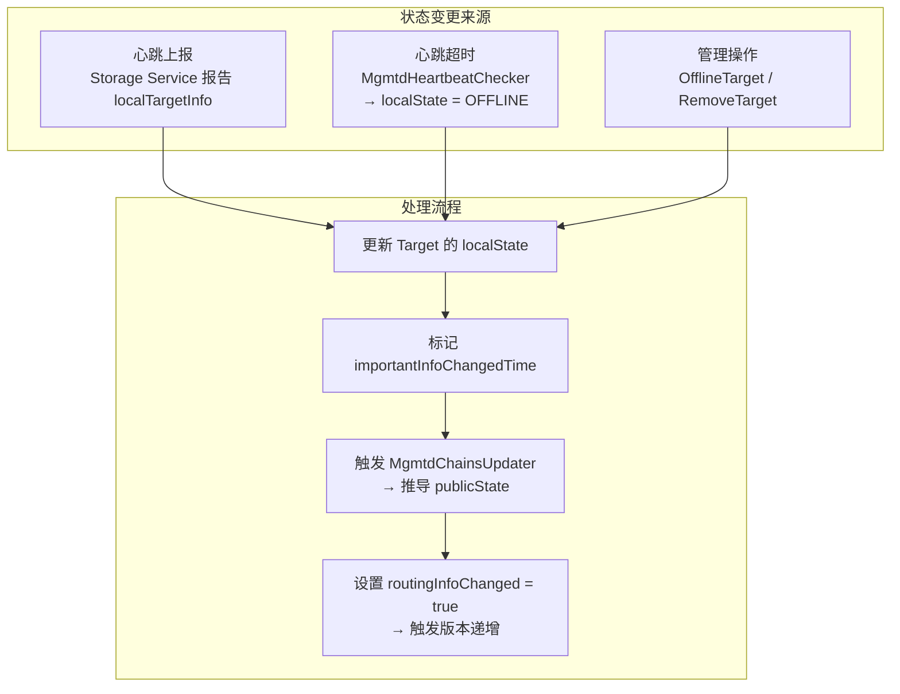


### 8.3 Target 信息的持久化

**MgmtdTargetInfoPersister**（每 1s 执行）：

持久化 Target 的位置信息（nodeId + diskIndex）到 FDB。只持久化发生变更的 Target：

```
筛选条件：locationInitLoaded && base.nodeId
         && (persistedNodeId != base.nodeId || persistedDiskIndex != base.diskIndex)
```

这确保了 mgmtd 重启后能恢复 Target 的位置信息，即使 Chain 信息来自 FDB 但 Target 的实际运行位置需要额外持久化。

**MgmtdTargetInfoLoader**（每 1s 执行）：

从 FDB 加载 Target 持久化信息到内存。关键逻辑：

1. 只在新 lease 周期才加载（`loadedLeaseStart < leaseStartTs`）
2. 分页加载（从 targetId=0 开始，每次加载一批）
3. 对每个 Target 更新 `persistedNodeId`、`persistedDiskIndex`、`locationInitLoaded`
4. 若内存中 Target 的 nodeId 为空（尚未通过心跳获取），则用持久化的 nodeId 填充


### 8.4 OrphanTargets — 孤立 Target

Storage Service 心跳可能上报尚未被任何 Chain 引用的 Target（例如刚创建但还未分配到 Chain），这些 Target 记录在 `orphanTargetsByTargetId` 和 `orphanTargetsByNodeId` 中。

- 当 Target 被加入 Chain 时（`insertNewChain` / `insertNewTarget`），自动从 orphanTargets 中移除
- 可通过 `ListOrphanTargets` RPC 查询，用于运维诊断
- 每次心跳时先清除该节点的旧 orphanTargets，再重新收集

---


## 9. 配置分发


### 9.1 配置存储结构

配置按 NodeType 分组，每个类型独立维护版本历史。用代码类型表达就是：

```cpp
ConfigMap = map<NodeType, VersionedConfigMap>
VersionedConfigMap = map<ConfigVersion, ConfigInfo>  // 有序，rbegin() 即最新版本
```

一个具体例子：

```
ConfigMap
├── META
│   ├── v1 → ConfigInfo{content="...", desc="初始配置"}
│   ├── v2 → ConfigInfo{content="...", desc="增加副本数"}
│   └── v3 → ConfigInfo{content="...", desc="调整心跳间隔"}   ← rbegin() 最新
│
├── STORAGE
│   ├── v1 → ConfigInfo{content="...", desc="初始配置"}
│   └── v2 → ConfigInfo{content="...", desc="增加磁盘"}      ← rbegin() 最新
│
├── MGMTD
│   └── v1 → ConfigInfo{content="...", desc="初始配置"}      ← rbegin() 最新
│
├── CLIENT
│   └── v1 → ConfigInfo{content="...", desc="初始配置"}
│
└── FUSE
    └── v1 → ConfigInfo{content="...", desc="初始配置"}
```

**设计要点**：

- 每个 NodeType 的版本号独立递增，互不影响。修改 STORAGE 配置不会 bump META 的版本号
- `rbegin()` 直接获取最新配置，O(1) 操作。心跳/GetConfig 只需返回最新版本
- FDB 中 key 采用反转版本号编码（`UINT64_MAX - version`），使最新版本排在最前面，加速查询
- **版本历史无上限**：当前实现不会清理旧版本——`SetConfig` 只追加新版本，不删除旧版本。FDB 中所有历史版本会永久保留。实际影响很小，因为配置变更是低频的人工操作，即使运行多年也不会积累太多版本

### 9.2 配置分发流程

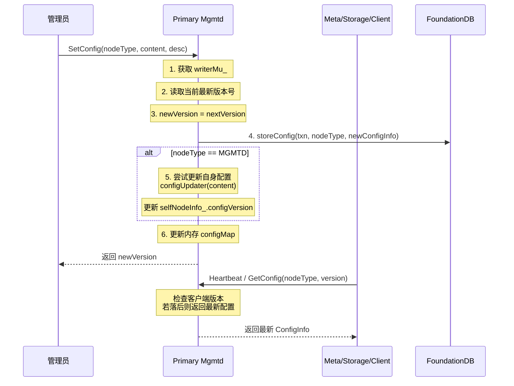


**配置热更新**：`MgmtdConfig` 中大部分配置项标记为 `CONFIG_HOT_UPDATED_ITEM`，支持运行时更新。更新方式有两种：

1. 通过 `SetConfig` RPC 设置 MGMTD 类型配置 → `configUpdater` 回调更新
2. 备节点通过心跳获取最新配置 → `updateSelfConfig()` 更新

---


## 10. ClientSession 管理


### 10.1 生命周期

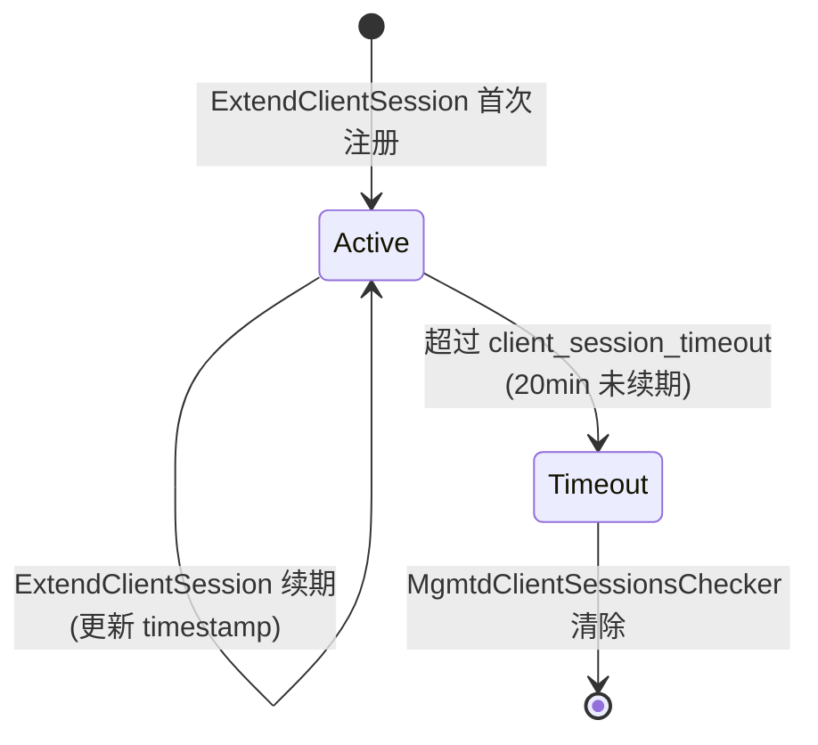


### 10.2 ClientSession 结构

```cpp
ClientSession : WithTimestamp<flat::ClientSession> {
  clientSessionVersion: ClientSessionVersion  // 版本号，防旧请求
  // flat::ClientSession 包含：
  //   universalId, description, serviceGroups
  //   configVersion, configStatus, lastExtend, type
}
```


### 10.3 ExtendClientSession 流程

1. 验证 clientId 非空
2. 若 `only_accept_client_uuid=true`，验证 clientId 是合法 UUID
3. 只允许 CLIENT 和 FUSE 类型
4. shared lock 读取 `data_`，获取最新配置和 universalTags
5. exclusive lock 更新 `clientSessionMap_`：
  - 首次注册：创建新 session
  - 续期：检查 `clientSessionVersion` 防旧请求，验证 universalId/description 等不变
6. 返回最新配置 + universalTags


### 10.4 MgmtdClientSessionsChecker

后台每 10s 检查一次：

1. shared lock 扫描所有 session，找出 `ts() + timeout < now` 的
2. exclusive lock 删除超时的 session


### 10.5 配置项


| 配置项                       | 默认值   | 说明                      |
| ------------------------- | ----- | ----------------------- |
| `client_session_timeout`  | 20min | 客户端会话超时时间               |
| `only_accept_client_uuid` | false | 是否只接受 UUID 格式的 clientId |


---


## 11. 并发控制与一致性


### 11.1 三层锁机制

```mermaid
flowchart TD
    subgraph WriteOp["写操作流程"]
        W1["1. doAsPrimary()<br/>验证自己是 Primary"]
        W2["2. writerMu_.co_scoped_lock()<br/>序列化写操作"]
        W3["3. data_.coSharedLock()<br/>读取当前状态<br/>(read phase)"]
        W4["4. FDB 读写事务<br/>持久化变更<br/>(persist phase)"]
        W5["5. data_.coLock()<br/>更新内存状态<br/>(write phase)"]
        W6["6. routingInfoChanged = true<br/>触发版本递增"]

        W1 --> W2 --> W3 --> W4 --> W5 --> W6
    end

    subgraph ReadOp["读操作流程"]
        R1["1. doAsPrimary()<br/>验证自己是 Primary"]
        R2["2. data_.coSharedLock()<br/>读取当前状态"]
        R3["3. 返回结果"]

        R1 --> R2 --> R3
    end

    style W2 fill:#e74c3c,color:#fff
    style W5 fill:#e74c3c,color:#fff
    style R2 fill:#2ecc71,color:#fff
```


**writerMu_ 的作用**：虽然 `data`_ 本身有读写锁，但写操作需要 read-modify-write 过程（先读再改再写）。如果两个写操作并发执行，可能在 read phase 读到相同状态，导致 lost update。`writerMu_` 保证同一时间只有一个写操作在执行。

**WriterMutexGuard**：析构时自动记录操作耗时，用于监控。

### 11.2 FDB 事务保证

```mermaid
flowchart LR
    subgraph MgmtdWrite["mgmtd 写操作"]
        Txn["FDB ReadWrite 事务"]
        LeaseCheck["ensureLeaseValid(txn)<br/>验证自己仍是 Primary"]
        StoreOp["store 操作<br/>(storeNodeInfo/storeChainInfo/etc.)"]
    end

    subgraph FDBGuarantee["FDB 事务保证"]
        Atomic["原子性：全部成功或全部失败"]
        SSI["SSI 隔离：可序列化快照隔离"]
        Retry["冲突自动重试：<br/>retry_times_on_txn_errors=-1<br/>(无限重试)"]
    end

    Txn --> Atomic
```


**withReadWriteTxn** 模板函数封装了 FDB 事务操作：

1. 创建 ReadWriteTransaction
2. 若 `validate_lease_on_write=true`，先验证 lease
3. 执行用户提供的 handler
4. 事务冲突时自动重试（默认无限重试，间隔 1s）

**ensureLeaseValid**：在 FDB 事务中读取当前 lease，验证 `primary.nodeId == selfId` 且 `leaseEnd >= now`。这确保了即使内存状态认为自己是 primary，FDB 层面也能检测到 lease 变化。

### 11.3 内存与 FDB 的一致性

写操作遵循 **先持久化再更新内存** 的原则：

```mermaid
flowchart LR
    Persist["1. FDB 事务提交成功"] --> Memory["2. 更新内存状态"]
    Memory --> Version["3. routingInfoChanged = true"]
    Version --> Bump["4. 后台 bump routingInfoVersion"]

    style Persist fill:#e74c3c,color:#fff
    style Memory fill:#2ecc71,color:#fff
```


若 FDB 事务失败，内存不会被更新，保证一致性。极端情况下（FDB 提交成功但更新内存前崩溃），下次 `onNewLease` bootstrapping 会从 FDB 重新加载，自动修复。

---


## 12. 关键配置项汇总


| 配置项                                    | 默认值   | 所属模块          | 说明                   |
| -------------------------------------- | ----- | ------------- | -------------------- |
| `lease_length`                         | 60s   | Lease 选主      | Lease 有效期            |
| `extend_lease_interval`                | 10s   | Lease 选主      | 续租间隔                 |
| `suspicious_lease_interval`            | 20s   | Lease 选主      | 可疑 lease 时间          |
| `bootstrapping_length`                 | 2min  | Lease 选主      | Bootstrapping 持续时间   |
| `extend_lease_check_release_version`   | true  | Lease 选主      | 续租时检查版本防回滚           |
| `heartbeat_timestamp_valid_window`     | 30s   | 心跳            | 心跳时间戳有效窗口            |
| `heartbeat_fail_interval`              | 60s   | 心跳            | 心跳超时判定时间             |
| `allow_heartbeat_from_unregistered`    | false | 心跳            | 是否允许自动注册             |
| `send_heartbeat`                       | true  | 心跳            | 备 mgmtd 是否发心跳        |
| `send_heartbeat_interval`              | 10s   | 心跳            | 备 mgmtd 心跳间隔         |
| `new_chain_bootstrap_interval`         | 2min  | Chain 管理      | 新 Chain bootstrap 时间 |
| `update_chains_interval`               | 1s    | Chain 管理      | Chain 更新检查间隔         |
| `try_adjust_target_order_as_preferred` | false | Chain 管理      | 按偏好顺序调整 Target       |
| `bump_routing_info_version_interval`   | 5s    | 路由分发          | 版本递增检查间隔             |
| `enable_routinginfo_cache`             | true  | 路由分发          | 是否启用路由信息缓存           |
| `client_session_timeout`               | 20min | ClientSession | 会话超时时间               |
| `only_accept_client_uuid`              | false | ClientSession | 只接受 UUID 格式 clientId |
| `check_status_interval`                | 10s   | 后台任务          | 通用状态检查间隔             |
| `update_metrics_interval`              | 1s    | 监控            | 指标更新间隔               |
| `target_info_persist_interval`         | 1s    | Target 持久化    | Target 信息持久化间隔       |
| `target_info_persist_batch`            | 1000  | Target 持久化    | 每批持久化 Target 数量      |
| `target_info_load_interval`            | 1s    | Target 加载     | Target 信息加载间隔        |
| `validate_lease_on_write`              | true  | 一致性           | 写操作是否验证 lease        |
| `retry_times_on_txn_errors`            | -1    | 一致性           | FDB 事务重试次数（-1=无限）    |
| `authenticate`                         | false | 安全            | 是否启用认证               |


---


## 13. 关键源码文件索引


| 文件                                                       | 说明                                                                  |
| -------------------------------------------------------- | ------------------------------------------------------------------- |
| **服务入口**                                                 |                                                                     |
| `src/mgmtd/mgmtd.cpp`                                    | 进程入口 main()                                                         |
| `src/mgmtd/MgmtdServer.h`                                | 服务定义，继承 net::Server                                                 |
| **核心状态**                                                 |                                                                     |
| `src/mgmtd/service/MgmtdOperator.h`                      | 操作入口，持有 MgmtdState + BackgroundRunner                               |
| `src/mgmtd/service/MgmtdState.h`                         | 核心状态，含 writerMu_、data_、clientSessionMap_、store_                     |
| `src/mgmtd/service/MgmtdData.h`                          | 核心数据结构：routingInfo、configMap、lease、routingInfoCache                 |
| `src/mgmtd/service/MgmtdData.cc`                         | MgmtdData 实现：配置/路由信息查询、缓存、bootstrapping                             |
| `src/mgmtd/service/RoutingInfo.h`                        | 路由信息：nodeMap、chainTables、chains、targets、newBornChains、orphanTargets |
| `src/mgmtd/service/RoutingInfo.cc`                       | RoutingInfo 实现：Target 更新、Chain 插入/删除、orphan 管理                      |
| `src/mgmtd/service/LeaseInfo.h`                          | Lease 信息：lease + bootstrapping 标志                                   |
| `src/mgmtd/service/TargetInfo.h`                         | Target 信息：继承 WithTimestamp，含持久化位置标记                                 |
| `src/mgmtd/service/ClientSession.h`                      | 客户端会话：继承 WithTimestamp，含版本号                                         |
| `src/mgmtd/service/MgmtdConfig.h`                        | 所有配置项定义                                                             |
| `src/mgmtd/service/helpers.h`                            | 辅助函数：doAsPrimary、withReadWriteTxn、updateStoredRoutingInfo 等         |
| `src/mgmtd/service/updateChain.h`                        | Chain 更新逻辑：generateNewChain、rotateAsPreferredOrder、rotateLastSrv    |
| **后台任务**                                                 |                                                                     |
| `src/mgmtd/background/MgmtdBackgroundRunner.cc`          | 11 个后台任务的启动和调度配置                                                    |
| `src/mgmtd/background/MgmtdLeaseExtender.cc`             | Lease 续租：extend() + onNewLease() bootstrapping                      |
| `src/mgmtd/background/MgmtdHeartbeatChecker.cc`          | 心跳超时检测                                                              |
| `src/mgmtd/background/MgmtdHeartbeater.cc`               | 备 mgmtd 向主 mgmtd 发送心跳                                               |
| `src/mgmtd/background/MgmtdChainsUpdater.cc`             | 自动 Chain 状态更新                                                       |
| `src/mgmtd/background/MgmtdNewBornChainsChecker.cc`      | 新建 Chain bootstrap 期检查                                              |
| `src/mgmtd/background/MgmtdRoutingInfoVersionUpdater.cc` | 路由信息版本递增                                                            |
| `src/mgmtd/background/MgmtdTargetInfoPersister.cc`       | Target 信息持久化到 FDB                                                   |
| `src/mgmtd/background/MgmtdTargetInfoLoader.cc`          | 从 FDB 加载 Target 持久化信息                                               |
| `src/mgmtd/background/MgmtdClientSessionsChecker.cc`     | 客户端会话超时检查                                                           |
| **RPC 操作**                                               |                                                                     |
| `src/mgmtd/ops/HeartbeatOperation.h/.cc`                 | 心跳 RPC 处理                                                           |
| `src/mgmtd/ops/RegisterNodeOperation.h/.cc`              | 节点注册                                                                |
| `src/mgmtd/ops/GetRoutingInfoOperation.h/.cc`            | 获取路由信息                                                              |
| `src/mgmtd/ops/SetChainTableOperation.h/.cc`             | 创建/更新 Chain Table                                                   |
| `src/mgmtd/ops/UpdateChainOperation.h/.cc`               | 添加/移除 Chain 中的 Target                                               |
| `src/mgmtd/ops/SetConfigOperation.h/.cc`                 | 设置配置                                                                |
| `src/mgmtd/ops/GetConfigOperation.h/.cc`                 | 获取配置                                                                |
| `src/mgmtd/ops/ExtendClientSessionOperation.h/.cc`       | 客户端会话续期                                                             |
| `src/mgmtd/ops/ListOrphanTargetsOperation.h`             | 列出孤立 Target                                                         |
| `src/mgmtd/ops/EnableDisableNodeOperation.h`             | 启用/禁用节点                                                             |
| `src/mgmtd/ops/RotateAsPreferredOrderOperation.h`        | 按偏好顺序轮转                                                             |
| `src/mgmtd/ops/RotateLastSrvOperation.h`                 | 轮转 LASTSRV Target                                                   |
| `src/mgmtd/ops/SetChainsOperation.h`                     | 批量设置 Chain                                                          |
| **持久化**                                                  |                                                                     |
| `src/mgmtd/store/MgmtdStore.h`                           | FDB 操作接口定义                                                          |
| `src/mgmtd/store/MgmtdStore.cc`                          | FDB 操作实现：key 编码、CRUD 操作                                             |


