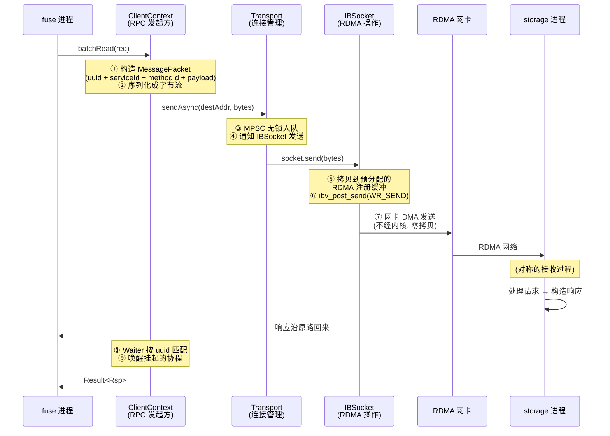
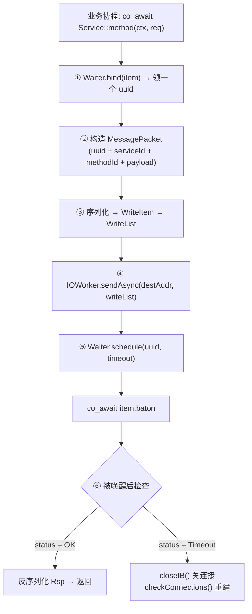
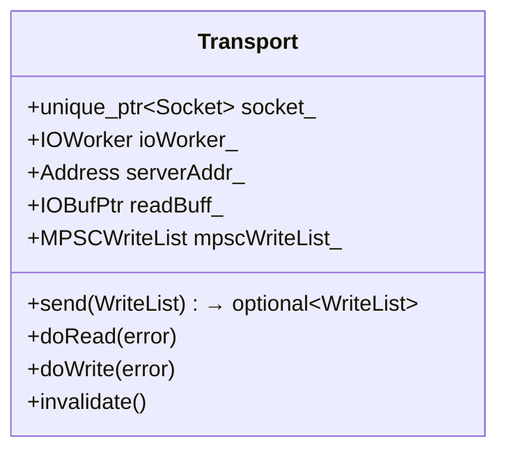
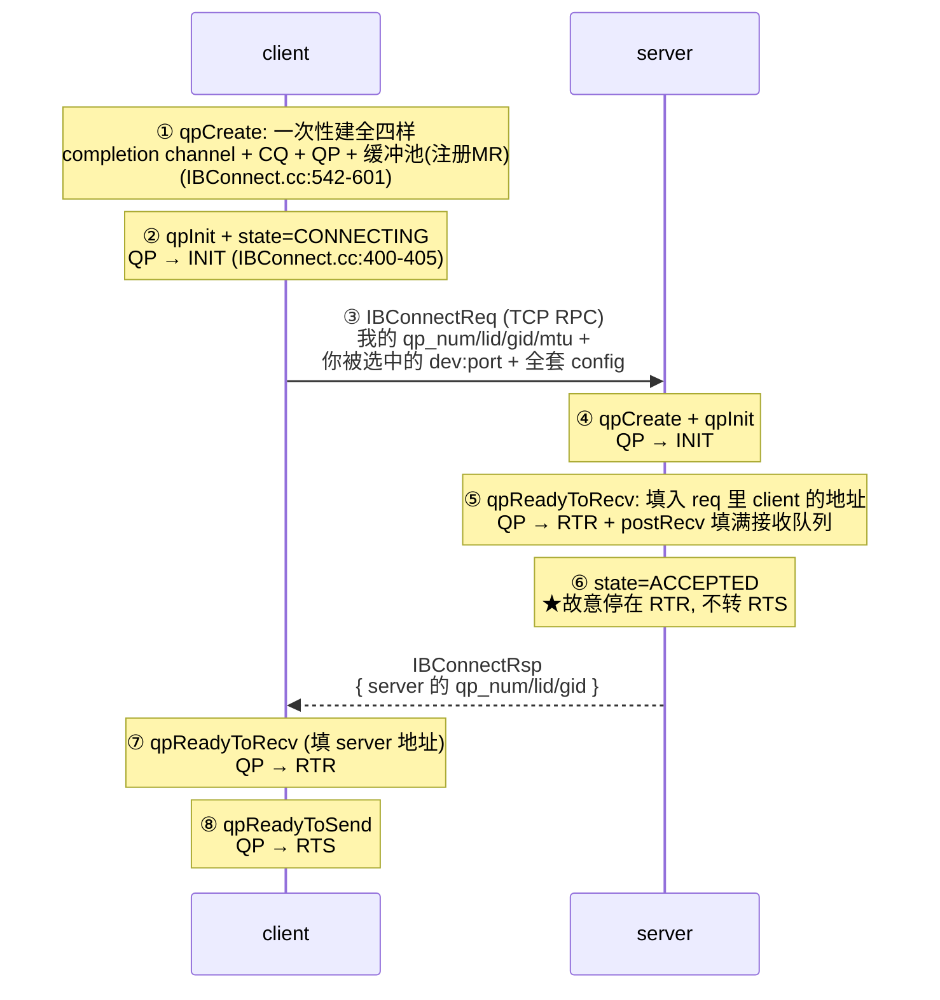
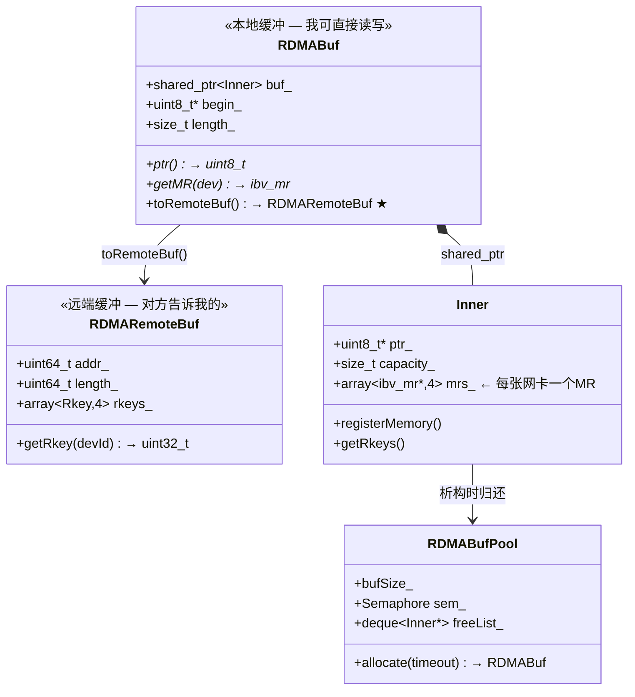
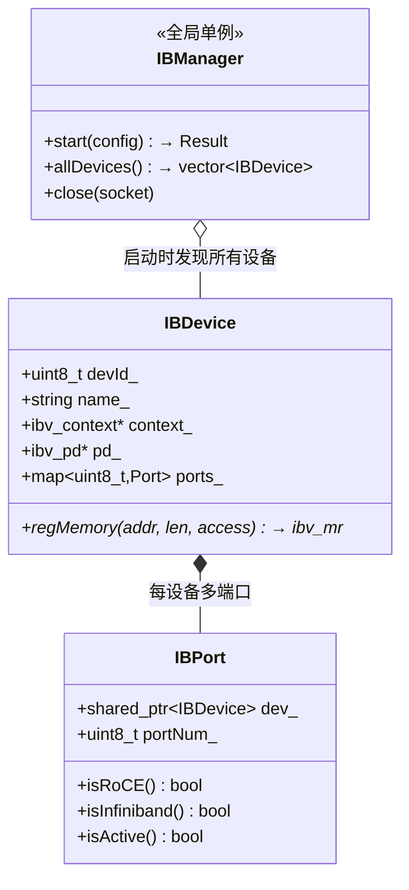

# 网络/RPC 模块详细分析

> 位置：`src/common/net/`（~8800 行）+ `src/common/serde/`（~2500 行）。
> **读法**：第 1 章用一个具体场景建立全景 → 第 0 章补充 RDMA 前置知识 → 第 2~7 章按数据流经的顺序从上往下逐层拆解 → 第 8 章回看机制总结。

## 目录

- [1. 全景：一次 RPC 到底发生了什么](#1-全景一次-rpc-到底发生了什么)
- [0. 前置：RDMA 是什么（不懂 RDMA 的先看这里）](#0-前置rdma-是什么不懂-rdma-的先看这里)
- [2. RPC 层：ClientContext / Service / MessagePacket](#2-rpc-层clientcontext--service--messagepacket)
- [3. 传输层：Transport / Waiter / EventLoop](#3-传输层transport--waiter--eventloop)
- [4. 连接层：RDMA 建连握手（TCP 带外换地址 + 数据面探针确认）](#4-连接层rdma-建连握手tcp-带外换地址--数据面探针确认)
- [5. 数据层：IBSocket 的缓冲与操作](#5-数据层ibsocket-的缓冲与操作)
  - [5.1 SendBuffers / RecvBuffers：预分配缓冲环](#51-sendbuffers--recvbuffers预分配缓冲环)
  - [5.2 WRId：CQE 回来时"这是谁"](#52-wridcqe-回来时这是谁)
  - [5.3 ImmData：搭便车的 4 字节控制信令（字节级格式）](#53-immdata搭便车的-4-字节控制信令字节级格式)
  - [5.4 CQ 轮询：事件分发循环](#54-cq-轮询事件分发循环)
  - [5.5 RDMA 读写：RDMAPostCtx 与批量](#55-rdma-读写rdmapostctx-与批量)
  - [5.6 优雅关闭与 Drainer](#56-优雅关闭与-drainer)
- [6. 内存层：RDMABuf / RDMARemoteBuf / RDMABufPool](#6-内存层rdmabuf--rdmaremotebuf--rdmabufpool)
- [7. 硬件层：IBDevice（网卡抽象）](#7-硬件层ibdevicerdma-网卡抽象)
- [8. 参考](#8-参考)

---

## 1. 全景：一次 RPC 到底发生了什么

**从一个你熟悉的场景开始**：fuse 进程要读一个 chunk，它调 `batchRead` 发给 storage 进程。这中间到底发生了什么？



**看完这张图，你应该带走三个概念**：

1. **发送方视角**：业务代码只调 `ClientContext`——序列化、网络传输、等待响应全部被封装
2. **数据流经五层**：RPC 层（构造消息）→ Transport 层（连接管理）→ IBSocket（RDMA 操作）→ 网卡（DMA）→ 对端
3. **UUID 匹配**：每条请求带一个 uuid，响应回来时凭 uuid 找到等待中的协程并唤醒

**后续章节按数据流经的顺序从上往下讲**，每层回答"这层解决什么问题"。

---

## 0. 前置：RDMA 是什么（不懂 RDMA 的先看这里）

### 与普通网络（TCP）的核心区别

```
TCP 发送数据 (传统):
  应用 buf → write() → 内核拷贝 → 协议栈 → 网卡 → 网络
              ↑ 系统调用    ↑ 一次拷贝     ↑ 又一次拷贝
              (~50μs 延迟)

RDMA 发送数据:
  应用 buf (已注册) → 网卡 DMA 直读 → 网络
                        ↑ 不经内核, 零拷贝
                        (~1μs 延迟)
```

### RDMA 的三个前提

**前提一：内存必须注册（MR）**

网卡要 DMA 直接到你的内存，前提是它知道**物理页在哪**。注册时内核会 pin 住这些页（防止被 swap 出去），并发放两把密钥：

```
ibv_reg_mr(pd, addr, length, access)
  → 返回 ibv_mr { addr, length, lkey, rkey }
    lkey: ★本地密钥 — 自己网卡操作这段内存时用
    rkey: ★远端密钥 — 告诉对方"你可以用这个 key 操作我的这段内存"
```

**前提二：必须先建连接（QP）**

QP（Queue Pair）是 RDMA 的"连接"——一对发送队列+接收队列，有状态迁移（INIT→RTR→RTS）才能收发。类似 TCP 的三次握手，但由应用层自己驱动。

**前提三：操作完成通过 CQ 通知**

每个 RDMA 操作（SEND/RECV/RDMA READ/WRITE）提交后不会同步等待完成——完成事件放进 CQ（Completion Queue），应用轮询或等待通知。

### RDMA 的四种操作

```
SEND / RECV:  对方要提前 post_recv 才能收到 (类似 UDP 但可靠)
RDMA WRITE:   我直接写对方的内存 (对方 CPU 不参与!)
RDMA READ:    我直接读对方的内存 (对方 CPU 不参与!)

★ RDMA WRITE/READ 是零拷贝的关键:
  fuse 的共享内存缓冲注册后, 把 rkey 告诉 storage
  → storage 读文件后 RDMA WRITE 直写 fuse 的共享内存
  → 数据路径: 磁盘 DMA → 应用共享内存, 无中间拷贝
```

---

## 2. RPC 层：ClientContext / Service / MessagePacket

**这层解决的问题**：把"调远端的函数"封装得跟调本地函数一样——你只管 `co_await Service::method(ctx, req)`，序列化、网络、等待、反序列化全部被封装。

### 2.1 怎么定义一个 RPC 服务

用宏声明（`serde/Service.h:80-101`）：

```
SERDE_SERVICE(FuseService, 10) {                        ← 服务名=FuseService, ID=10
  SERDE_SERVICE_METHOD(update, 3, UpdateReq, UpdateRsp) ← 方法名=update, ID=3
  SERDE_SERVICE_METHOD(batchRead, 5, BatchReadReq, BatchReadRsp)
};

宏展开后自动生成两样东西:
  客户端代理:  FuseService::update(ctx, req) → CoTryTask<UpdateRsp>
  服务端路由:  MethodExtractor 编译期(consteval)构建 methodId→handler 查找表
              ★零运行时分发开销 — 编译时就把跳表算好了
```

### 2.2 线上消息格式

每条 RPC 消息（请求和响应共用一个格式）的线上布局（`MessagePacket.h:53-70`）：

```
MessagePacket:
┌──────────────────────────────────────────────────┐
│ uuid: uint64_t      ← 全局唯一, 匹配请求和响应       │
│ serviceId: uint16_t ← 哪个服务 (如 FuseService=10)   │
│ methodId: uint16_t  ← 哪个方法 (如 update=3)         │
│ flags: uint16_t     ← IsReq / UseCompress / RDMA控制 │
│ version: Version    ← 版本协商 (major/minor/patch)   │
│ payload: 序列化的请求/响应体                          │
│ timestamp: optional ← 8个时间点 (性能分析, 可选)      │
└──────────────────────────────────────────────────┘
```

**Timestamp 的 8 个时间点**——嵌在消息里，响应方原样带回：

```
clientCalled → clientSerialized → [网络] → serverReceived → serverWaked
→ serverProcessed → serverSerialized → [网络] → clientReceived → clientWaked

serverLatency()   = serverSerialized - serverReceived   (服务端处理耗时)
networkLatency()  = inflight - serverLatency             (纯网络耗时)
queueLatency()    = serverWaked - serverReceived         (服务端排队耗时)
```

### 2.3 ClientContext：一次调用的完整流程



**关键细节**（`ClientContext.h:34-98`）：
- **uuid 的作用**：请求和响应可能乱序到达（多条在途），uuid 是唯一凭据
- **超时路径**：不只报错——还会**关闭超时的 RDMA 连接**并触发重连，防止后续请求继续走坏连接

---

## 3. 传输层：Transport / Waiter / EventLoop

**这层解决的问题**：管理"到某个服务端"的连接——多个协程共用一条连接发消息（不各开各的），事件驱动地收发数据。

### 3.1 Transport：连接的状态管理



**MPSC WriteList（多生产者单消费者）**——多个协程同时往同一个 Transport 发消息，不需要锁：

```
协程A: send(msg1) → CAS 入队 ──┐
协程B: send(msg2) → CAS 入队 ──┼──► 同一个队列
协程C: send(msg3) → CAS 入队 ──┘          │
                                          ▼
                              doWrite(): 单消费者逐条发
                              socket.send(buf) → flush()
```

**读路径**：epoll 收到 EPOLLIN → `doRead()` → 循环 `socket.recv()` 直到 EAGAIN → 解析 MessagePacket → 是请求就分发到 Handler，是响应就 `Waiter.post()` 唤醒等待者。

### 3.2 Waiter：UUID 匹配的分片锁设计

`Waiter` 是全局单例，管理所有在途 RPC 的 uuid → 等待者映射。

**分片锁怎么做到无全局争用**（`Waiter.h:39-49`）：

```
bind(item):                          ← 客户端发请求前调用
  thread_local start, end            ← 每个线程预分配一段z uuid 范围
  IF start >= end:
      start = uuid_idx_.fetch_add(1024)  ← 原子领一段
      end = start + 1024
  uuid = start++
  shards_[uuid % N].map.emplace(uuid, item)  ← 按 uuid 哈希到分片

post(packet):                        ← 响应到达时调用
  item = shards_[uuid % N].map.find(uuid)
  item.buf = 响应数据
  item.baton.post()                  ← 唤醒协程

★ 每线程独立 uuid 段 → bind 不竞争
★ N 个分片各自有锁 → post 不竞争 (不同 uuid 落不同分片)
```

### 3.3 EventLoop：epoll 事件循环

**这层解决的问题**：多个连接（Transport）共享一个线程做 IO——用 epoll 统一监听所有连接的 fd，有事时才唤醒处理，空闲时不耗 CPU。

#### 先搞清楚：RDMA 连接的三个对象和它们的 fd

一条 RDMA 连接（IBSocket）内部有**三个硬件/内核对象**，各自的角色：

```
IBSocket 内部:
┌─────────────────────────────────────────────────────────────┐
│  QP (Queue Pair)          ← "连接本体"                        │
│    ├── Send Queue           我发出的操作排队在这里               │
│    └── Recv Queue           预告网卡"下一条收到的消息放这"       │
│                                                             │
│  CQ (Completion Queue)    ← "完成事件的存放处"                 │
│    └── CQE (Completion Queue Entry)                        │
│        每个操作完成后, 网卡写一条 CQE 到这里                    │
│        (SEND完成了/RECV收到数据了/RDMA WRITE写完了)             │
│                                                             │
│  Completion Channel        ← ★有一个 fd! 这就是 epoll 监听的   │
│    └── 本质: 内核提供的一个文件描述符                           │
│        当 CQ 有新 CQE 且应用注册了通知 → 内核往这个 fd 写信号    │
│        → epoll_wait() 因此返回                                │
└─────────────────────────────────────────────────────────────┘

三者关系:
  QP 完成操作 → 结果写入 CQ → CQ 触发通知 → 内核写 channel 的 fd
  ↑ "干活"        ↑ "记录结果"    ↑ "通知 CPU"
```

**为什么 completion channel 是一个 fd**：RDMA 的设计者希望应用能用 epoll/select 统一管理 RDMA 事件和其他 IO 事件（TCP、文件、信号量），所以把"完成通知"封装成了文件描述符——内核往里写数据时 epoll 就能感知到。

#### fd 的委托链：Transport → IBSocket → channel

当 EventLoop 调 `epoll_ctl(ADD, handler->fd())` 时，这个 fd 是怎么来的：

```
EventLoop:  epoll_ctl(ADD, ????, ...)
                              ↑
Transport::fd()               ← Transport 实现了 EventHandler
  { return socket_->fd(); }    ← 委托给内部的 Socket (IBSocket)

IBSocket::fd()                 ← IBSocket 继承自 Socket
  { return channel_->fd; }     ← ★最终返回 completion channel 的 fd

所以: EventLoop epoll 监听的就是 RDMA 网卡的 completion channel fd
```

#### RDMA 连接注册到 EventLoop 的完整过程

`IOWorker.cc:46-58`：

```
RDMA 握手完成 (第 4 章讲的 IBConnect)
  → 得到一个 IBSocket (QP/CQ/channel 全就绪)
  → IOWorker.addIBSocket(sock)

addIBSocket 内部:
  ① Transport::create(sock, *this, Address::RDMA)
     把 IBSocket 包装成 Transport (加上读写状态管理)

  ② eventLoopPool_.add(transport, EPOLLIN|EPOLLOUT|EPOLLET)
     从 EventLoop 池里选一个 EventLoop
     内部调: epoll_ctl(ADD, transport->fd(), events)
             ↑ 就是 completion channel 的 fd (经过两层委托)

  效果: RDMA 网卡每次完成操作 → 内核写 channel fd → epoll 唤醒 → 处理
```

#### 从网卡完成到协程唤醒的完整 9 步

```
① RDMA 网卡完成一个操作 (SEND / RECV / RDMA WRITE / RDMA READ)
② 网卡把 CQE 写入 CQ (完成描述: 是什么操作、成功/失败、附带数据)
③ 网卡触发硬件中断
④ 内核往 completion channel 的 fd 写一个字节
⑤ EventLoop 的 epoll_wait() 返回 (这个 fd 变为可读)
⑥ EventLoop 调用 transport.handleEvents(EPOLLIN)      ← EventLoop.cc:142-145
⑦ Transport 设置读标志并触发读任务:
   flags_ |= kReadAvailableFlag                       ← Transport.cc:354-356
   ioWorker_.startReadTask(this)                      ← Transport.cc:367-368
⑧ Transport.doRead() 执行:
   循环调 socket.recv(readBuff_)                       ← Transport.cc:200
     → IBSocket.recv() 内部:
        cqGetEvent()        ← 消费 channel 的事件
        cqRequestNotify()   ← 重新注册通知 (下次再触发)
        cqPoll() → ibv_poll_cq() 批量取出所有 CQE
        按 WRId 分发:
          RECV → onRecved() (数据已在预分配的 RecvBuffer 里)
          RDMA_LAST → onRDMAFinished() (唤醒等待的协程)
          ImmData::ACK → sendBufs_.push() (缓冲回收)
   直到 EAGAIN (没有更多数据)
⑨ 解析收到的字节流为 MessagePacket:
   IF 是请求 → ioWorker.processMsg() → Processor 分发到 Handler
   IF 是响应 → Waiter.post(uuid) → 匹配 uuid → baton.post() → 唤醒客户端协程
```

```
epoll_wait 返回 → handleEvents → doRead → cqPoll → 分发
     (EventLoop)     (Transport)           (IBSocket)
         │               │                     │
         ▼               ▼                     ▼
   completion channel  socket.recv()     ibv_poll_cq 取 CQE
   fd 可读              循环直到 EAGAIN    按 WRId 分发:
                                           RECV → 请求 → Handler
                                           响应 → Waiter.post(uuid)
                                                  → 唤醒协程
```

---

## 4. 连接层：RDMA 建连握手（TCP 带外换地址 + 数据面探针确认）

**这层解决的问题**：把两个互不相识的 QP 变成一条可收可发的 RDMA 通道。整个过程三步走：挑网卡 → 换地址 → 发探针验证。

### 4.1 问题起源：建连信息没法走 RDMA 自己（鸡生蛋）

第 3.3 节说过，一条 RDMA 连接的本体是 QP。但 QP 刚创建时是个**半成品**——它只知道自己的编号（QPN），完全不知道对方的存在：

```
本端 QP 要能通信, 必须先填入三样"对方的信息":
  ① 对方的 QPN      dest_qp_num  — "发给谁"
  ② 对方的网卡地址   IB 网络: LID / 以太网(RoCE): GID — "路由到哪"
  ③ 协商好的规格     MTU、起始包序号 PSN、重试参数 — "用什么规格通话"

鸡生蛋: 这些信息必须传给对方,
        但唯一的高效通道 (RDMA) 恰恰还不存在
        → 必须先有一条"带外信道"把它们送过去
```

**3FS 的选择**：不用内核的 rdma_cm，而是**复用自己的 TCP RPC 框架**当带外信道——整个握手就是两个普通 RPC 方法（服务名 `IBConnect`，serviceId=11，方法 query=1 / connect=2，IBConnectService.h:18-21）。好处：设备选择、zone 匹配、参数协商全走自家代码，逻辑可控、可测试（Debug 版还能注入握手延迟和断连，IBConnect.cc:47-65）。

### 4.2 载体：握手复用自家 TCP RPC（同端口双协议）

握手开始前，两端的准备都发生在第 3 章的框架里：

```
服务端 (Listener::start, Listener.cc:118-127):
  监听 RDMA 地址时, 自动在【同一个 ip:port】上挂 IBConnectService (TCP)
  → 客户端的握手 RPC 由这个 TCP 服务收下

客户端 (Transport::connect, Transport.cc:84-91):
  要连 RDMA://ip:port 时, 把地址转成 TCP://ip:port 建一个 TCP ClientContext
  → 用它发起握手 RPC
```

也就是说：**一个 RDMA 端口背后永远站着一个同端口的 TCP 建连服务**，这是整个握手的地基。

### 4.3 第一阶段·设备发现：客户端挑一对最优网卡

**词义澄清**：本节的"端口"指网卡的物理口，**不是** TCP 端口号——两种"端口"对照：

| | 网卡物理口号（本节所指） | TCP 监听端口号 |
|---|---|---|
| 字段 | `IBConnectInfo.port`（IBConnect.h:127） | `Address.port` |
| 类型 | uint8_t，取值 1、2… | uint16_t |
| 归属 | 网卡硬件上的物理口子 | 进程监听的端口 |

层级与枚举：机器 → 多块网卡 dev（最多 4 块，`kMaxDeviceCnt`，IBDevice.h:119）→ 每块网卡多个物理口（`std::map<uint8_t, Port> ports_`，IBDevice.h:169）；query 响应就按"所有设备 × 每设备的所有口"双层循环构造（IBConnect.cc:106-121）。

**为什么要挑**：生产机器可能插多块 IB/RoCE 网卡，且分属不同 zone（交换机域）。走同一 zone 内的网卡对性能最好，不能随便连。

第一阶段就一次 RPC（IBQueryReq → IBQueryRsp），server 把自己所有设备×端口×zone 枚举出来（跳过非 ACTIVE 端口，IBConnect.cc:106-127）。真正的决策在 client 本地执行：

```
selectDevice(): 对端每个端口 × 本端每个端口, 逐对检查 (findMatchDevices, IBConnect.cc:224-260)

  逐对过滤三条件:
  ① 链路类型必须相同: IB 只配 IB, RoCE 只配 RoCE   (IBConnect.cc:212-221)
  ② 本端端口必须 ACTIVE, 没插线/未启用的跳过       (IBConnect.cc:207-211)
  ③ 两端 zone 列表求交集, 优先有交集的组合         (IBConnect.cc:201-205)

  选择顺序:
  ④ 第 1 轮只在"同 zone"组合里挑 → 找不到才放宽 (需 allow_unknown_zone)
     (IBConnect.cc:268-275)
  ⑤ IB 优先于 RoCE (prefer_ibdevice)              (IBConnect.cc:286-288)
  ⑥ 同一地址维护递增计数器, counter % 组合数 → 多网卡间轮询均摊
     (计数器: IBConnect.cc:374-384, 取模: IBConnect.cc:285)
```

输出一个四元组 Match：本端用哪块网卡（localDev:localPort）连对方的哪块网卡（remoteDev:remotePort）。

### 4.4 第二阶段·地址交换：两个 QP 互相认亲（状态机逐级解锁）

先建立 QP 状态机的直觉——**每一步转换解锁一种能力**，而不是一堆待填的参数：

```
ibv_create_qp()          此刻 QP 只是"领了个号"
   │
   │ qpInit()            填: 绑定哪个端口 + 声明允许远端读/写
   ▼                     解锁: 无 (只是报了户口)
  INIT
   │ qpReadyToRecv()     填: 对方的 QPN + 地址 + MTU + 起始序号
   ▼                     解锁: ★能收包
   RTR                   附带动作: 把全部接收缓冲 post 进 RecvQueue
   │                        (IBConnect.cc:684-689 — 网卡收包要写进缓冲,
   │                         队列空着 = 包无处安放)
   │ qpReadyToSend()     填: 超时/重试参数
   ▼                     解锁: ★能发包
   RTS  ───────────────▶ 软件层记为 READY
```

顺序**不能颠倒**：必须先到 RTR（能收）再到 RTS（能发）——否则自己发出的第一个包，对方的回包无处安放。

上面这张梯子是**硬件层**的状态机；旁边还叠着一张 3FS 自己维护的**软件层**状态机，握手代码要同时推进两层：

| 层 | 状态机 | 维护者 | 状态 |
|---|---|---|---|
| 硬件 | QP state machine | 网卡驱动（`ibv_modify_qp`） | RESET→INIT→RTR→RTS |
| 软件 | `IBSocket::State` | 3FS 代码（IBSocket.h:238-240） | CONNECTING / ACCEPTED / READY |

两侧的推进节奏不一样：

```
client: ⑦⑧ 一口气走完 INIT→RTR→RTS, 软件却仍停在 CONNECTING
        → 要等探针的"发送完成"事件 onSended 才转 READY (IBSocket.cc:505-515)
server: 收到首包 onRecved 时, qpReadyToSend(RTS) 和 state=READY 一步完成
        (IBSocket.cc:519-527)
```

读代码时注意两个坑：

- **源码注释自己也混用两层**：IBSocket.cc:508 写 "turn QP to READY"、522 写 "turn QP from ACCEPTED to RTS"——READY/ACCEPTED 是软件状态，QP 硬件没有这两个状态
- **RTS 兼任软件记账的启动点**：qpReadyToSend 成功后紧接着初始化三份配额（IBConnect.cc:717-719）——32 个发送缓冲、128 个 RDMA WR、8 个 ACK 便签。RTS 之前即使有代码想发，软件层配额也是空的

然后看两台机器怎么把这三步编排起来（client → server 的箭头走 TCP RPC，各侧竖直方向的 Note 是本地动作）：



**关键编排问题：server 为什么停在 RTR，不顺手转 RTS？**

先排除一个误解：握手期间 server 在 RDMA 侧**没有数据要发**——IBConnectRsp 走的是 TCP。真正的理由是下面两层：

```
理由① "转 RTS"是一个能力开关, 而握手约束不了之后谁来用它

  server 转 RTS + 连接入池 (acceptRDMA → addIBSocket, Listener.cc:198-199)
    → 此后进程里任何拿到这条连接的代码, 任何时刻都能 post send
    → 而 TCP 握手成功 ≠ client 的 ⑦⑧ 一定成功
       (client 可能 qpReadyToRecv/Send 失败, IBSocket.cc:425-436 就是这些错误分支)
    → 若在"client 未就绪"窗口里有任何一次发送
       → 撞上未 RTR 的 QP → RNR 重试 (rnr_retry, IBConnect.cc:702)
       → 耗尽则 QP 报废, 且这类错极难排查

  停在 RTR = 结构性防御: 硬件层面"能发"的能力,
  直到"证明对方能收" (收到首包) 之后才开启, 不依赖调用方自觉

理由② ACCEPTED 是半开连接的回收判据 (更实在的收益)

  若 server 提前转 READY 入池:
    client 半途死掉 → 这条连接零流量躺在池子里
    → server 只回响应、无主动流量 → 没有任何机制能发现它 → 僵尸连接永占资源

  实际设计: 停在 ACCEPTED 这个可观察的中间态
    → checkRDMA 睡 rdma_accept_timeout 后仍 ACCEPTED → invalidate 清理
       (Listener.cc:210-223)
    → check() 里 ACCEPTED 超时同样报错 (IBSocket.cc:756-761)
```

反方向没这个问题：**client 敢在 ⑧ 直接转 RTS**——它收到了 TCP 响应，这个事实本身就证明 server 已在 ⑤ 转完 RTR（能收了）。

### 4.5 第三阶段·0 字节探针：数据面自己完成就绪确认

还剩最后一个空档：server 被动等待，怎么知道 client 就绪了？再加一次 TCP 往返太浪费——3FS 让 **client 在握手尾声发一个 0 字节的 RDMA 探针**，把确认放进数据面完成。

**背景知识："带便签的发送"**：

- `ibv_post_send` 的类型选成 `SEND_WITH_IMM` = 发消息 + 捎带一个 **4 字节立即数**
- 这 4 字节**不走消息体**，而是出现在**对方的完成事件**里
- 效果：对方网卡不写任何数据，只投递一个"收到包 + 这 4 字节"事件——像信封上贴便签，信可以是空的
- 3FS 给便签定了编码格式（类型 + 数值，5.3 节详拆）

**探针就是一次"只有便签、没有信"的发送**：

```
client                                            server (停在 ACCEPTED)
 ① postConnectProbe():
    底层就是一次 ibv_post_send, 三个参数:
      类型 = SEND_WITH_IMM   (发送 + 捎便签)
      数据 = 无              (sg_list=nullptr → 0 字节)
      便签 = ack(0)          (便签编码: "ACK 类型, 数值 0")
    (IBSocket.cc:909-929)
    ────────── RDMA 首包 ──────────────▶ ② 对方网卡不写任何数据,
                                           只投递"收到带便签的包"事件
                                           onRecved 发现 state==ACCEPTED:
                                           qpReadyToSend → READY
 ③ 自己这边收到"发送完成"事件 onSended:
    CONNECTING → READY
    (IBSocket.cc:505-515)
═════════════════ 双方 READY, RDMA 通道正式可用 ═════════════════
```

两个细节设计的用意：

```
① 便签为什么写 ack(0) —— 向后兼容
   "确认 0 个缓冲"是个语义上的空操作:
     老版本 server: 把它当普通缓冲确认消化掉, 数值 0 = 什么都不用做
     新版本 server: 在 ACCEPTED 状态收到任何首包都转 READY
                   (IBSocket.cc:519-529)
   → 新 client 连老 server, 这一个包也能被正确处理
     (IBSocket.cc:912-913 注释)
② 数据为什么是 0 字节
   探针的唯一目的是让对方产生一个事件, 数据本身毫无意义:
   0 字节 = 不占发送缓冲环 (IBSocket.cc:919), 不耗带宽
```

至此对称性闭环：**client 的就绪由 TCP 响应证明，server 的就绪由 RDMA 首包证明**——零额外 TCP 往返。

### 4.6 握手的失败路径

```
场景              时机                     处理                          代码
──────────────────────────────────────────────────────────────────────────────────
参数超网卡能力     握手前双方各查一次         checkConfig 报错, 拒绝建连      IBConnect.cc:531-537
                  (max_qp_wr/max_cqe 等)
握手期间连接被关闭  qpReadyToRecv/Send 失败   先查 closed_: 是→报 SocketClosed  IBConnect.cc:425-436
                                           (与"真失败"区分, 便于上层决策重试)
探针一直不来      server 停在 ACCEPTED 超时   check() 报错, 连接被清理        IBSocket.cc:756-761
                                           (对方在建连中途死亡)
正常关闭          主动 close                先等在途操作完成(至多200ms),      IBSocket.cc:722-736
                                           再把 QP 转 ERROR
```

握手成功后：server 侧 accepted 的 IBSocket 经回调交给连接池，client 侧 IBSocket 被包装成 Transport 注册进 EventLoop（回看 3.3 节）——一条 RDMA 连接就绪。

---

## 5. 数据层：IBSocket 的缓冲与操作

**这层解决的问题**：QP 就绪后，具体怎么发消息、怎么收消息、怎么做 RDMA 直写。

### 5.1 SendBuffers / RecvBuffers：预分配缓冲环

IBSocket 预分配一组固定大小的缓冲块（`buf_size=16KB × send_buf_cnt=32`），一次性做 RDMA 注册：

```
预分配的缓冲区 (一整块内存, 一次性 ibv_reg_mr):
┌────────┬────────┬────────┬─...─┬────────┐
│ buf 0  │ buf 1  │ buf 2  │     │ buf 31 │
│ 16KB   │ 16KB   │ 16KB   │     │ 16KB   │
└────────┴────────┴────────┴─...─┴────────┘
  ↑tailIdx_ 原子递增 (分配端)  ↑frontIdx_ 原子递增 (释放端)

发送流程:
  ① 从 tailIdx_ 拿一个空闲 buf
  ② memcpy 消息数据到这个 buf
  ③ ibv_post_send(WR_SEND, buf的addr+lkey, len, wr_id)

接收流程:
  ① 提前 ibv_post_recv(buf的addr+lkey) ← 预告网卡"下一条消息放这"
  ② CQ 收到 WRType::RECV → 数据已经在 buf 里了 → 交给上层
  ③ 累积到 buf_ack_batch 个 → 用 ImmData::ACK 告诉对方"可以复用了"
```

### 5.2 WRId：CQE 回来时"这是谁"

每个 RDMA 操作提交时都带一个 64bit 的 `wr_id`，CQE（完成事件）回来时原样带回——**应用靠这个字段区分"完成的是什么类型的操作"**：

```
WRId = 48bit 值/指针 + 16bit 类型标记

7 种类型 (IBSocket.h:279):
  SEND       → 正在发送消息      (值 = 已发出的未信号计数)
  RECV       → 收到一条消息      (值 = 收到数据在哪个buf)
  ACK        → 发出了一个 ACK
  RDMA       → RDMA 操作的中间段
  RDMA_LAST  → RDMA 操作的最后段  (指针 = RDMAPostCtx*, 完成时唤醒等待者)
  CLOSE      → 发出了关闭消息
  CHECK      → 发出了存活探测
```

### 5.3 ImmData：搭便车的 4 字节控制信令（字节级格式）

RDMA 的发送操作可以捎带一个 32bit 的 Immediate Data——数据写到对方内存的同时，对方网卡会收到这个 32bit 信令（4.5 的"便签"就是它）。3FS 把这 4 字节拆成"类型 + 数值"两段（`ImmData` 类，IBSocket.h:339-378）：

```
        4 字节 (大端序/网络字节序)
┌───────────────┬───────────────────────────────┐
│  高 8 bit      │  低 24 bit                     │
│  类型 Type     │  数值 Value (0 ~ 2^24-1)       │
│  0=ACK 1=CLOSE │                                │
└───────────────┴───────────────────────────────┘
编码: (type << 24) | value       (IBSocket.h:356-360)
解码: type  = val >> 24          (IBSocket.h:362)
      value = val & 0x00FFFFFF   (IBSocket.h:363)
```

三个真实例子的字节值：

| 调用 | 含义 | 4 字节实际内容 |
|---|---|---|
| `ack(0)`（4.5 的探针） | 类型=ACK，数值=0 → 语义空操作 | `00 00 00 00` |
| `ack(8)`（真实 ACK） | "归还 8 块缓冲信用" | `00 00 00 08` |
| `close()`（关闭信令） | "我要关连接了" | `01 00 00 00` |

两种类型的完整因果链：

```
Type = ACK(value):  缓冲回收通知
  接收方: 每消费 buf_ack_batch(8) 块接收缓冲, 回一条 ack(8)
          (IBSocket.cc:687-695)
  发送方: 收到后只记数 sendAcked_ += value            (IBSocket.cc:568-570)
          下一轮 poll 时: 释放量 = min(sendAcked_, sendSignaled_)
          → sendBufs_.push(释放量), 环的 frontIdx_ 前进  (IBSocket.cc:346-353)
          ★ 取 min 的原因: 一块缓冲要同时满足
            "对方确认收到" (sendAcked_) + "本方发送完成事件已回" (sendSignaled_)
            才能真正复用

Type = CLOSE:  关闭通知
  对方收到后置 State::CLOSE, 连接优雅结束    (IBSocket.cc:571-578)

★好处: 控制信令搭数据流的便车, 不占用 SEND/RECV 队列, 不耗带宽
```

### 5.4 CQ 轮询：RDMA 为什么还需要 epoll

**常见困惑**：RDMA 不是绕过内核吗？为什么还要用 epoll？

**答案**：RDMA 绕过的是**数据面**（数据搬运不经内核协议栈），但**通知面**（怎么知道操作完成了）仍然需要内核帮助——epoll 监听的不是"数据到了"，而是 RDMA 网卡的 **completion channel fd**（有 CQE 需要处理）。

```
数据面 (确实绕过内核):
  对方网卡 → RDMA 网络 → 我的网卡 → DMA 直写我的用户态内存
  ★全程不经内核, 零拷贝

通知面 (仍然经过内核):
  我的网卡完成 DMA 后 → 硬件中断 → 内核往 completion channel fd 写信号
  → epoll 发现这个 fd 可读 → 唤醒线程 → ibv_poll_cq() 批量取 CQE
```

**代码证据**——IBSocket 注册到 EventLoop 的 fd 就是 completion channel：

```cpp
// IBSocket.h:519 — IBSocket 持有的三个 RDMA 资源:
std::unique_ptr<ibv_comp_channel> channel_;  // ← 完成事件通道 (一个 fd)
std::unique_ptr<ibv_cq> cq_;                  // ← 完成队列 (CQE 存放处)
std::unique_ptr<ibv_qp> qp_;                  // ← 连接

// IBSocket.h:134 — 注册到 epoll 的就是 channel 的 fd:
int fd() const override { return channel_->fd; }

// 3FS 选了事件通知模式 (非忙轮询):
// 空闲时 CPU 占用 0% (线程睡在 epoll_wait)
// 代价: 多一次中断+内核唤醒 (~几μs)
// 对比 SPDK 的忙轮询: 空闲也 100% CPU, 延迟最低
// 3FS 是通用文件系统, CPU 要留给业务 → 选事件通知
```

**完整的通知链**——从硬件中断到协程恢复：

```
① 网卡完成一个操作 (SEND / RECV / RDMA WRITE / RDMA READ)
② 网卡把 CQE (完成描述) 写入 CQ
③ 网卡触发硬件中断
④ 内核往 completion channel 的 fd 写一个字节
⑤ EventLoop 的 epoll_wait() 返回 (这个 fd 可读)
⑥ 线程醒来调 cqPoll():
   cqGetEvent()        ← 消费 channel 的事件
   cqRequestNotify()   ← 重新注册通知 (ibv_req_notify_cq, 一次性的)
   循环 ibv_poll_cq()  ← 非阻塞批量取出所有 CQE
⑦ 每个 CQE 按 WRId::type() 分发:
     SEND → onSended()          (信号计数, 缓冲管理)
     RECV → onRecved()          (数据已在预分配缓冲, 交给 Transport)
     ACK → onAckSended()
     RDMA_LAST → onRDMAFinished() (RDMA 完成, 唤醒等待协程)
⑧ ImmData 处理 (带外信令):
     ACK(count) → sendBufs_.push(count) (对方告知缓冲可复用)
     CLOSE → 触发关闭流程
```

**cqRequestNotify 为什么每次都要调**：RDMA 的通知注册是一次性的（armed/disarmed 模型）——每次 `ibv_req_notify_cq` 只保证下一次完成事件触发通知，之后需要重新注册。cqPoll 先重新注册再轮询，保证不漏事件。

### 5.5 RDMA 读写：RDMAPostCtx 与批量

**单个 RDMA 操作**（读对方的远端缓冲到本地）：

```
rdmaRead(remoteBuf, localBuf):
  构造 RDMAPostCtx (含 Baton)
  ibv_post_send(WR_RDMA_READ, remote_addr, rkey, local_addr, lkey, len)
  co_await ctx.baton        ← 挂起等待 CQE
  CQE 到达 → onRDMAFinished → ctx.finish() → baton.post() → 协程恢复
```

**批量 RDMA**（一次 post 多个操作，减少 doorbell）：

```
RDMAReqBatch batch = socket.rdmaWriteBatch()
batch.add(remoteBuf1, localBuf1)     ← 加第 1 个
batch.add(remoteBuf2, localBuf2)     ← 加第 2 个
co_await batch.post()                ← 分批 ibv_post_send (每批≤32)

batch.post() 内部:
  创建 RDMAPostCtx
  分批 ibv_post_send:
    每个 WR 的 wr_id = WRId::rdma(ctx, 是否最后一段)
  co_await ctx.baton ← 只等最后一段的 CQE (中间段不等待)

RDMAPostCtx 包含:
  sem: BatchSemaphore    ← 并发限流 (最多 max_rd_atomic=16 个在途)
  baton: coro::Baton     ← 完成通知
  status: 错误码
  postBegin/postEnd: 延迟追踪
```

### 5.6 优雅关闭与 Drainer

关闭不是立即销毁——进入 Drainer 状态（`IBSocket.h:479-497`）：

```
close():
  ① state = CLOSE
  ② 发送 ImmData::CLOSE (搭最后一个 RDMA WRITE)
  ③ IBSocketManager 创建 Drainer (持有 socket 引用)
  ④ Drainer 持续 poll CQ
     → 等对方的 CLOSE ACK + 排空在途 CQE
  ⑤ drain_timeout (5s) 后 → 销毁 QP/CQ/缓冲
```

---

## 6. 内存层：RDMABuf / RDMARemoteBuf / RDMABufPool

**这层解决的问题**：管理 RDMA 可访问的内存——谁注册、怎么描述对方的内存、怎么池化复用。

### RDMABuf 与 RDMARemoteBuf——"我的内存"和"你的内存"



**两类缓冲的关系**：

```
fuse 进程的共享内存 (已 RDMA 注册):
  RDMABuf { begin_=&共享内存, Inner 持有 MR }

  ↓ toRemoteBuf() — 从 Inner 的 MR 提取 rkey

  RDMARemoteBuf { addr=&共享内存, rkeys }
      │
      │  序列化后通过 RPC 发给 storage
      │  (SerdeMethod 特化, RDMABuf.h:354-434)
      ▼
storage 进程收到:
  RDMARemoteBuf { addr=fuse的内存地址, rkey }
      │
      │  rdmaWrite(this_remoteBuf, local_data)
      │  网卡 DMA: storage 的数据 → fuse 的共享内存
      ▼
fuse 的共享内存里就有了数据 (零拷贝)
```

**Inner 为什么要多网卡 MR**：不同网卡的 PD 不同，rkey 不通用。同一块内存要在每张在用的网卡上各注册一个 MR，连接走哪张网卡就用哪个 MR 的 lkey/rkey（`RDMABuf.h:289`）。

**RDMABufPool**：Semaphore + freeList 的缓冲池。fuse 的 `bufPool`（fuse.md 4.1）就是这个类的实例——allocate 时 `co_await sem_.wait()` 等空闲，RDMABuf 析构时 Inner 自动回池。

---

## 7. 硬件层：IBDevice（RDMA 网卡抽象）

**这层解决的问题**：初始化和管理物理 RDMA 网卡——设备发现、端口管理、PD 分配、内存注册的底层入口。



**每个 3FS 进程启动时都会调 `IBManager::start(config)`**——枚举机器上的 RDMA 网卡，为每张卡建一个 `IBDevice`，分配 PD，打开端口。

**regMemory 是所有 RDMA 内存注册的最终入口**（`IBDevice.h:136`）——无论上层怎么包装（ShmBuf 的 registerForIO、RDMABufPool 的批量注册、IBSocket 的 SendBuffers 注册），最终都调到这里。

---

## 8. 参考

### 核心机制速查

| 机制 | 一句话 | 代码位置 |
|---|---|---|
| **MR 注册** | RDMA 可访问的内存必须 pin + 注册；每张网卡一个 MR（rkey 不同） | `IBDevice.h:136` / `RDMABuf.h:276` |
| **RDMARemoteBuf** | 远端内存的"地址+rkey"描述，通过 RPC 序列化传给对方 | `RDMABuf.h:40-134` |
| **WRId** | 64bit WR 标识，CQE 回来时区分 7 种操作类型 | `IBSocket.h:282-337` |
| **ImmData** | 32bit 带外数据，搭 RDMA WRITE 传 ACK/CLOSE 控制信令 | `IBSocket.h:339-378` |
| **信号批处理** | 每 buf_signal_batch=8 次 SEND 才产生一次 CQE，减少中断 | `IBSocket.h:111` |
| **缓冲 ACK** | 对方用 ImmData::ACK(count) 告知缓冲可复用 | `IBSocket.h:418-430` |
| **RDMAPostCtx** | 批量 RDMA 的上下文（Baton 挂起 + Semaphore 限流 + 延迟追踪） | `IBSocket.h:245-277` |
| **IBConnect** | 自研 RDMA 握手：TCP 上跑设备查询 + QP 参数交换 | `IBConnect.h/.cc` |
| **Drainer** | 优雅关闭：发 CLOSE → 排空 CQ → 5s 后销毁 | `IBSocket.h:479-497` |
| **RDMABufPool** | Semaphore + freeList，fuse 的 bufPool 就是它 | `RDMABuf.h:318-349` |
| **Waiter 分片锁** | thread_local UUID 段 + Map 分片，bind/post 无全局锁 | `Waiter.h:39-49` |
| **MPSC WriteList** | 多协程无锁往 Transport 写消息（CAS 入队） | `Transport.h:130` |
| **MethodExtractor** | consteval 编译期构建 methodId→handler 路由表 | `Service.h:49-78` |
| **Timestamp 8 点** | 消息内嵌 8 个时间点，可拆出网络/排队/处理耗时 | `MessagePacket.h:36-51` |

### 源码索引

| 文件 | 行数 | 职责 | 对应章节 |
|---|---|---|---|
| `serde/ClientContext.h` | 204 | 客户端 RPC 入口 | 第 2 章 |
| `serde/Service.h` | 153 | 服务/方法声明宏 + 编译期路由 | 第 2 章 |
| `serde/MessagePacket.h` | 89 | 线上消息格式 | 第 2 章 |
| `serde/Serde.h/.cc` | 1000+409 | 序列化框架 | 第 2 章 |
| `net/Transport.h/.cc` | 137+383 | 连接状态机/MPSC 读写 | 第 3 章 |
| `net/Waiter.h/.cc` | 181+135 | UUID 匹配/超时管理 | 第 3 章 |
| `net/EventLoop.h/.cc` | 100+188 | epoll 事件循环 | 第 3 章 |
| `net/IOWorker.h/.cc` | 132+138 | IO 工作线程 | 第 3 章 |
| `net/ib/IBConnect.h/.cc` | 186+743 | RDMA 握手协议 | 第 4 章 |
| `net/ib/IBSocket.h/.cc` | 582+1262 | RDMA 连接核心 | 第 5 章 |
| `net/ib/RDMABuf.h/.cc` | 434+176 | RDMA 缓冲管理 | 第 6 章 |
| `net/ib/IBDevice.h/.cc` | 321+843 | RDMA 网卡抽象 | 第 7 章 |
| `net/Listener.h/.cc` | ~234 | 服务端监听 | 第 3 章 |
| `net/TransportPool.h/.cc` | 108+212 | 连接池 | 第 3 章 |
| `net/WriteItem.h/.cc` | 207+157 | 写请求封装 | 第 3 章 |
