# 3FS (Fire-Flyer File System) 项目综述

## 目录

- [0. 核心概念图解](#0-核心概念图解)
  - [0.1 四大组件与协作关系](#01-四大组件与协作关系)
  - [0.2 数据的组织方式](#02-数据的组织方式)
  - [0.3 客户端两种访问方式](#03-客户端两种访问方式)
  - [0.4 元数据的组织](#04-元数据的组织)
- [1. 项目概述](#1-项目概述)
- [2. 系统架构](#2-系统架构)
- [3. 核心模块划分](#3-核心模块划分)
- [4. 数据流与交互关系](#4-数据流与交互关系)
  - [4.1 读操作数据流](#41-读操作数据流)
  - [4.2 写操作数据流](#42-写操作数据流)
  - [4.3 元数据操作流](#43-元数据操作流)
- [5. 关键设计原理](#5-关键设计原理)
  - [5.1 数据组织与访问](#51-数据组织与访问)
  - [5.2 故障恢复的流量均衡](#52-故障恢复的流量均衡)
  - [5.3 元数据存储](#53-元数据存储)
  - [5.4 文件长度一致性](#54-文件长度一致性)
  - [5.5 零拷贝 I/O (IoRing)](#55-零拷贝-io-ioring)
  - [5.6 Chunk Engine](#56-chunk-engine)
- [6. 模块详细分析计划](#6-模块详细分析计划)
- [7. 技术栈总览](#7-技术栈总览)
- [8. 进程与部署](#8-进程与部署)
- [9. 关键源码文件索引](#9-关键源码文件索引)

---

## 0. 核心概念图解

### 0.1 四大组件与协作关系

3FS 由四个核心组件构成，所有组件通过 RDMA 网络互连：

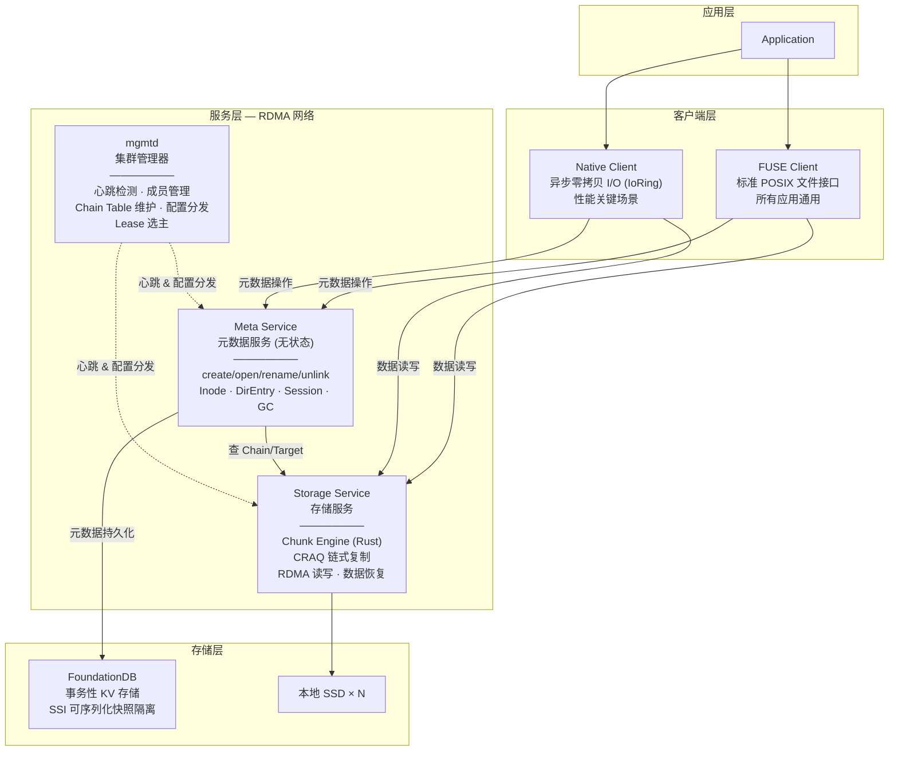

- **mgmtd**（集群管理器）：集群的"大脑"，通过心跳和租约管理成员，维护 Chain Table 并分发路由信息。多实例部署，一主多备
- **Meta Service**（元数据服务）：无状态设计，所有元数据存于 FoundationDB，客户端可连接任意实例。提供文件/目录的增删改查
- **Storage Service**（存储服务）：管理本地 SSD，实现 CRAQ 链式复制协议，提供数据的读写和恢复能力
- **FoundationDB**：Apple 开源的事务性 KV 存储，SSI 隔离级别保证元数据的可序列化一致性

### 0.2 数据的组织方式

文件数据从逻辑到物理经过五层映射，最终落到 SSD 上：

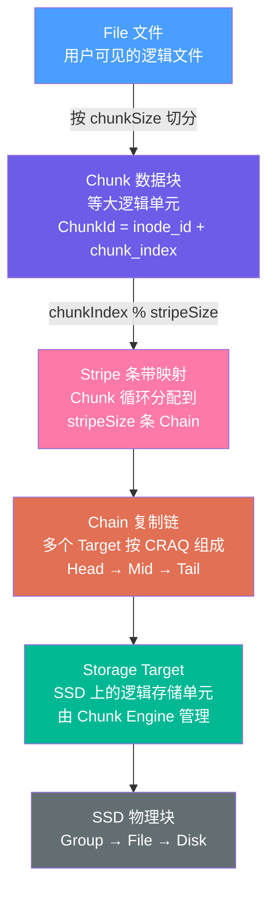

#### Chunk — 文件切分

文件按固定大小（chunkSize，如 1MB）切分为等大的逻辑 Chunk，每个 Chunk 由全局唯一的 ChunkId 标识：

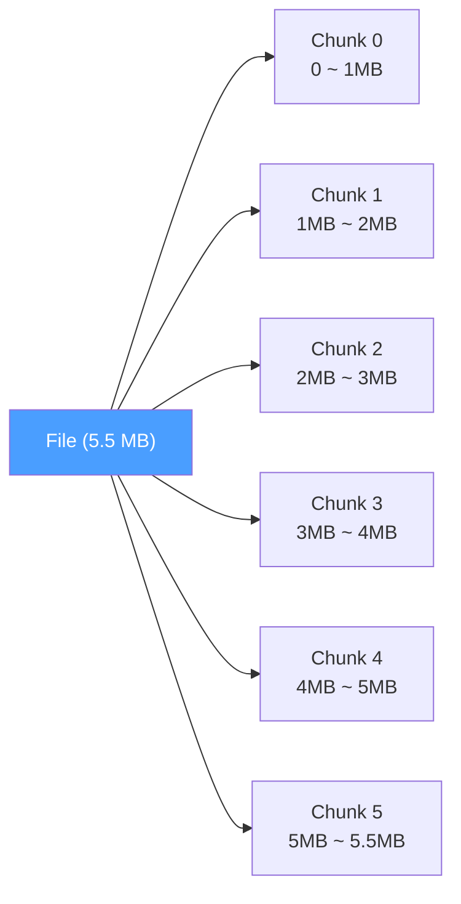

#### Stripe — Chunk 到 Chain 的映射

文件按 chunkSize 切成 Chunk 后，需要决定每个 Chunk 存到哪条 Chain 上。Stripe 就是这个分配规则：

1. 创建文件时，从 Chain Table 中选取 **stripeSize** 条连续 Chain，shuffle 打乱后得到一个 Chain 列表
2. Chunk 按索引对 stripeSize 取模，映射到列表中对应位置的 Chain
3. 每 stripeSize 个 Chunk 为一个周期，循环使用同一组 Chain

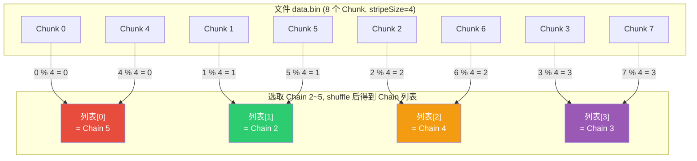

结果：**Chunk 0, 4, 8, 12... 都存到 Chain 5；Chunk 1, 5, 9, 13... 都存到 Chain 2**，以此类推。stripeSize=4 意味着文件数据同时分散在 4 条 Chain 上，可以并行读写。3FS 默认 stripeSize=200，即一个文件的数据同时分散在 200 条 Chain 上，充分聚合集群带宽。不同文件选取不同的起始 Chain + 不同的 shuffle 种子，所以不会都挤到同样的 Chain 上。

#### Chain — CRAQ 链式复制

每条 Chain 由多个 Storage Target 按 Head → Middle → Tail 链式排列。写从 Head 沿链传播到 Tail 提交，读可从任意 Target 读取：

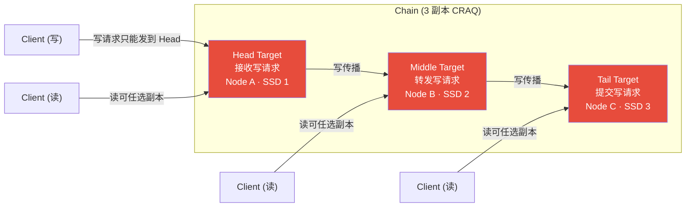

- **写**：Client → Head 获取锁 → 读已提交版本 → 应用更新存为 pending → 逐节点转发 → Tail 提交(pending→committed) → 确认回传 → Head 释放锁
- **读**：可从任意 serving 状态的 Target 读取 committed 版本，读带宽线性扩展
- 每个 SSD 上创建多个 Target，每个 Target 加入不同 Chain，实现负载均衡
- **BIBD 排列**：Chain Table 按均衡不完全区组设计排列，节点故障时读流量均匀分散，避免少数节点成为瓶颈

#### Target — SSD 上的物理存储

每个 Target 由 Chunk Engine（Rust 实现）管理，数据按 Node → Disk → File → Group → Chunk 层级组织：

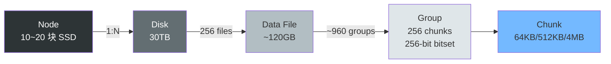

- **写采用 COW（写时复制）**：分配新物理块 → 读旧数据 → 应用更新 → 写新位置 → 原子更新元数据，旧数据在引用释放前可安全并发读
- **元数据由 RocksDB 持久化**：chunk_id→chunk_meta、group_id→group_state、chunk_pos→chunk_id
- **内存缓存 MetaCache**：chunk_id→chunk_info，加速查询

### 0.3 客户端两种访问方式

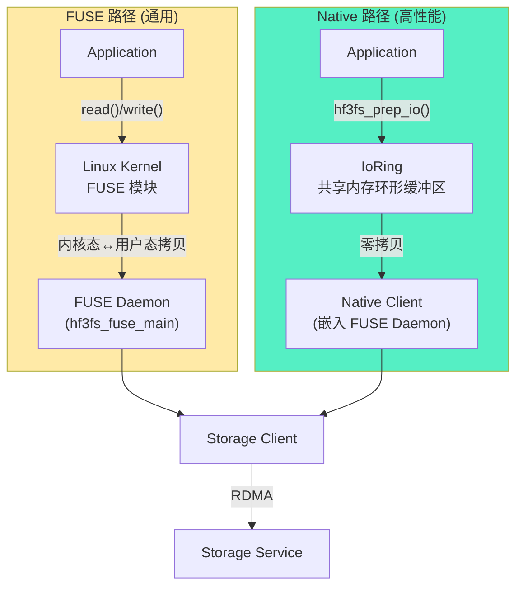

- **FUSE Client**：通过 Linux FUSE 内核模块重定向 I/O，标准 POSIX 接口，所有应用通用。缺点：内核态-用户态内存拷贝开销，FUSE 共享队列锁竞争限制并发（约 400K 4KiB reads/s）
- **Native Client**：嵌入 FUSE Daemon，提供异步零拷贝 I/O API。应用通过共享内存的 IoRing 提交 I/O 请求，FUSE Daemon 批量处理，全程零拷贝
  - **Iov**：大块共享内存区域，存放读写数据，InfiniBand 内存注册由客户端管理
  - **Ior**：小型共享环形缓冲区，用户进程通过 SQE 提交请求，daemon 通过 CQE 返回结果
  - 受 Linux io_uring 启发，但运行在用户态（用户进程 ↔ FUSE Daemon），而非用户态 ↔ 内核态

### 0.4 元数据的组织

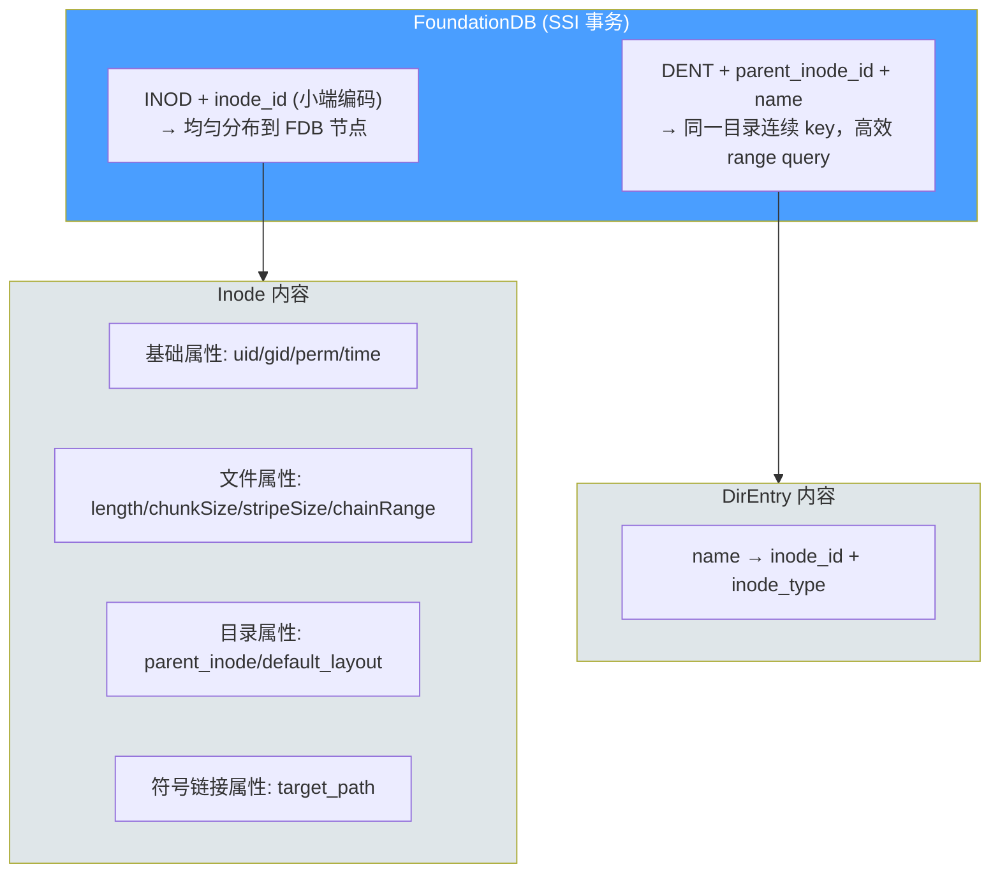

- Meta Service 无状态，所有元数据存于 FoundationDB，客户端可连接任意 Meta 实例
- FDB 的 SSI 事务提供可序列化一致性，并发冲突自动重试，无需应用层加锁
- **FileSession** 跟踪以写模式打开的 fd，删除写打开的文件会延迟到所有 fd 关闭
- **GcManager** 后台异步回收已删除文件的 Chunk 数据

---

## 1. 项目概述

3FS 是 DeepSeek 开源的高性能分布式文件系统，专为 AI 训练和推理工作负载设计。它利用现代 SSD 和 RDMA 网络（InfiniBand/RoCE）提供一个共享存储层，使分布式应用无需关心数据局部性即可高效访问存储资源。

**核心特性：**

- **分解式架构**：聚合数千块 SSD 的吞吐和数百个存储节点的网络带宽
- **强一致性**：基于 CRAQ（Chain Replication with Apportioned Queries）实现
- **文件接口**：基于 FoundationDB 的无状态元数据服务，提供标准文件系统语义
- **高性能**：180 节点集群聚合读吞吐达 6.6 TiB/s

**典型工作负载：**

- 数据准备（层次化目录结构管理）
- Dataloader（随机访问训练样本，无需预取/打乱）
- Checkpointing（大规模训练的高吞吐并行检查点）
- KVCache（LLM 推理优化，替代 DRAM 缓存的高吞吐低成本方案）

---

## 2. 系统架构

系统架构和核心概念已在第 0 章图解，这里补充各组件间的网络通信协议：

- **客户端 ↔ Meta/Storage**：通过 RDMA（InfiniBand 或 RoCE），自研 IBSocket + Transport + Serde 框架
- **mgmtd ↔ Meta/Storage**：心跳 RPC（TCP 或 RDMA），分发 RoutingInfo 和配置
- **Meta ↔ FoundationDB**：FDB 客户端库，SSI 事务
- **Storage ↔ Storage**：CRAQ 链式转发（RDMA），数据同步恢复（RDMA）

---

## 3. 核心模块划分

根据代码结构和功能职责，3FS 可划分为以下核心模块：

| 序号  | 模块                                       | 代码路径                                                         | 职责                                 |
| --- | ---------------------------------------- | ------------------------------------------------------------ | ---------------------------------- |
| 1   | **集群管理 (mgmtd)**                         | `src/mgmtd/`                                                 | 集群成员管理、心跳检测、Chain Table 维护、配置分发    |
| 2   | **元数据服务 (meta)**                         | `src/meta/`                                                  | 文件系统语义实现、Inode/目录项管理、Session/GC 管理 |
| 3   | **存储服务 (storage)**                       | `src/storage/`                                               | Chunk 存储、CRAQ 复制、RDMA 读写、数据恢复      |
| 4   | **客户端 (client)**                         | `src/client/`                                                | 元数据客户端、存储客户端、集群管理客户端               |
| 5   | **FUSE 层 (fuse)**                        | `src/fuse/`                                                  | FUSE 接口实现、IoRing 零拷贝 I/O、用户空间文件系统  |
| 6   | **网络/RPC (common/net + common/serde)**   | `src/common/net/`, `src/common/serde/`                       | RDMA 通信、RPC 框架、序列化/反序列化            |
| 7   | **基础库 (common/utils + common/kv + fdb)** | `src/common/`, `src/fdb/`, `src/kv/`                         | 通用工具、KV 引擎抽象、FoundationDB 集成       |
| 8   | **FlatBuffers Schema (fbs)**             | `src/fbs/`                                                   | 各服务的数据结构定义和 RPC 接口定义               |
| 9   | **Chunk Engine (chunk_engine)**          | `src/storage/chunk_engine/` (Rust)                           | SSD 上的 Chunk 存储引擎（独立 Rust 实现）      |
| 10  | **核心服务基础 (core)**                        | `src/core/`                                                  | 服务基础设施、用户管理（各服务共用）                 |
| 11  | **客户端 API (lib)**                        | `src/lib/`                                                   | 对外暴露的 C/C++/Python/Rust 客户端 API    |
| 12  | **辅助服务**                                 | `src/analytics/`, `src/migration/`, `src/monitor_collector/` | 追踪分析、数据迁移、监控采集                     |

---

## 4. 数据流与交互关系

### 4.1 读操作数据流

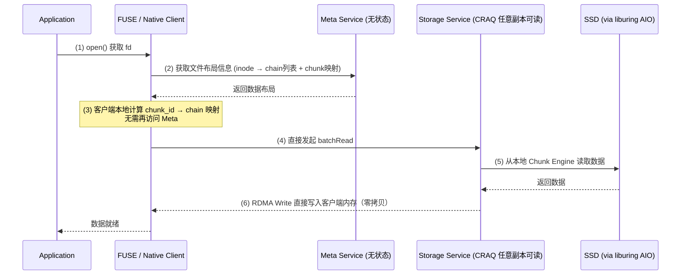

### 4.2 写操作数据流

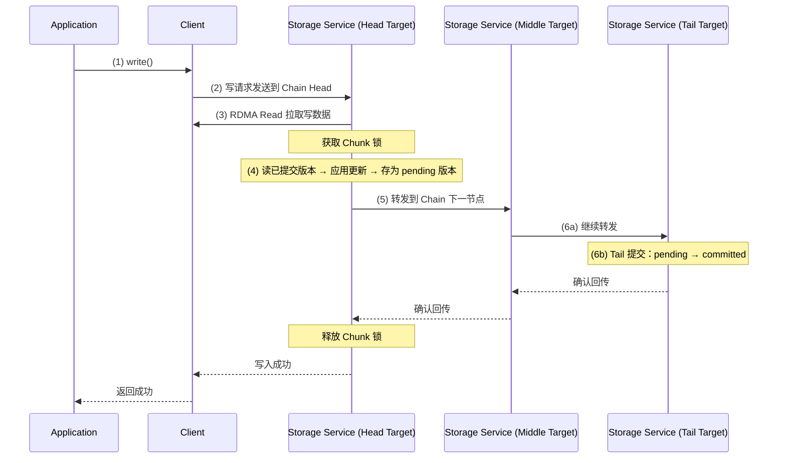

### 4.3 元数据操作流

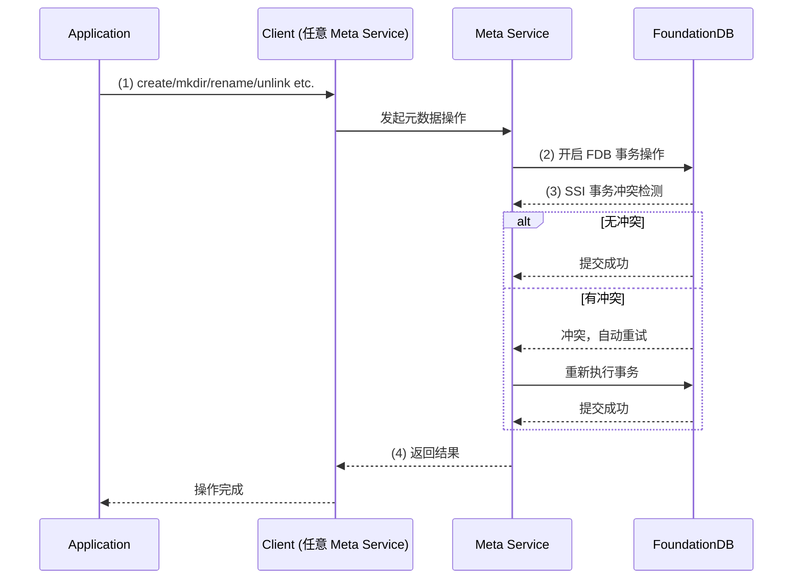

---

## 5. 关键设计原理

### 5.1 数据组织与访问

数据组织的五层映射（File → Chunk → Stripe → Chain → Target → SSD）已在第 0 章图解。这里补充端到端的访问路径：

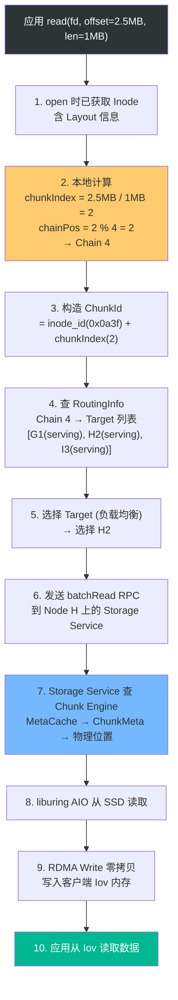

核心要点：open 时获取 Layout 后，后续读写可纯本地计算目标位置，无需再访问 Meta。

### 5.2 故障恢复的流量均衡

- 使用"均衡不完全区组设计"（BIBD）使节点故障时重定向流量均匀分散
- 通过整数规划求解器获得最优 Chain Table 排列
- 避免单节点故障导致少数节点成为瓶颈

### 5.3 元数据存储

- 基于 FoundationDB 事务性 KV 存储，元数据服务无状态
- Inode key = "INOD" + inode_id（小端编码，均匀分布到 FDB 节点）
- DirEntry key = "DENT" + parent_inode_id + name（同一目录连续 key 范围，高效 range query）
- 利用 FDB SSI 事务实现并发控制，冲突时自动重试

### 5.4 文件长度一致性

- 客户端定期（默认 5s）上报最大写位置
- close/fsync 时从 Storage 精确查询最后一个 chunk 的长度
- 使用 rendezvous hash 按 inode ID 分配长度更新任务到不同 Meta 服务，减少冲突
- 小文件优化：记录可能使用的 chain 数量，避免查询所有 stripe chain

### 5.5 零拷贝 I/O (IoRing)

- **Iov**：大块共享内存区域，用于零拷贝读写，InfiniBand 内存注册由客户端管理
- **Ior**：小型共享环形缓冲区，类似 Linux io_uring 的通信机制
  - 用户进程入队 I/O 请求
  - 客户端出队批量处理
  - 支持多 ring 并行，避免单 ring 的同步开销
- IoRing 内部结构：SQE (Submission Queue Entry) → 处理 → CQE (Completion Queue Entry)
  - 共享内存 + 信号量实现用户态与 FUSE daemon 间通信

### 5.6 Chunk Engine

- **Rust 实现**（`src/storage/chunk_engine/`），独立编译
- 存储层次：Chunk(64KB/512KB/4MB) → Group(256 chunks) → File(960 groups) → Disk(256 files) → Node
- **Allocator**：内存中管理 chunk 分配/回收，使用 bitset 快速查找空闲位
- **MetaStore**：基于 RocksDB 持久化三种映射：
  - `chunk_id → chunk_meta`
  - `group_id → group_state`
  - `chunk_pos → chunk_id`
- **写操作采用 COW**：分配新位置 → 读旧数据 → 应用更新 → 写新位置 → 原子更新元数据
- 后台线程：allocate_thread 维持活跃 group 池，compact_thread 回收稀疏 group

---

## 6. 模块详细分析计划

后续将逐模块深入分析，每个模块产出一份详细文档：

| 序号  | 模块                           | 分析重点                                                              |
| --- | ---------------------------- | ----------------------------------------------------------------- |
| 1   | **集群管理 (mgmtd)**             | 心跳机制、Chain Table 管理、状态机转换、Lease 选主、RoutingInfo 分发                 |
| 2   | **元数据服务 (meta)**             | Inode/DirEntry 数据模型、事务操作实现、Session 管理、GC 流程、路径解析                  |
| 3   | **存储服务 (storage)**           | StorageOperator、CRAQ 写入/读取流程、ReliableForwarding、数据同步恢复、BufferPool |
| 4   | **Chunk Engine**             | Allocator 实现、MetaStore 实现、COW 流程、Compact 策略、Rust FFI 接口           |
| 5   | **客户端 (client)**             | StorageClient 实现、MetaClient 实现、Target 选择策略、重试机制                   |
| 6   | **FUSE 层 (fuse)**            | IoRing 实现、零拷贝数据流、FUSE Ops 映射、IovTable 管理                          |
| 7   | **网络/RPC**                   | IBSocket 实现、RDMA 通信、Transport 层、Serde 序列化框架、Service 定义            |
| 8   | **基础库**                      | ConfigBase、Coroutine 封装、KVEngine 抽象、FDB 集成、监控框架                   |
| 9   | **FlatBuffers Schema (fbs)** | 数据结构定义、RPC 接口规范、跨模块通信协议                                           |
| 10  | **客户端 API (lib)**            | C API (UsrbIo)、C++ API (IClient)、Python/Rust 绑定、共享内存机制            |

---

## 7. 技术栈总览

| 类别        | 技术                                              |
| --------- | ----------------------------------------------- |
| 核心语言      | C++20 (Coroutines), Rust (Chunk Engine)         |
| 构建系统      | CMake + Cargo (Rust 部分)                         |
| RPC/序列化   | 自研 Serde 框架 + FlatBuffers Schema                |
| 网络        | RDMA (InfiniBand/RoCE), 自研 IBSocket + Transport |
| 元数据存储     | FoundationDB 7.1+ (SSI 事务)                      |
| Chunk 元数据 | RocksDB                                         |
| 内存分配      | jemalloc / mimalloc                             |
| 异步 I/O    | liburing (io_uring)                             |
| 文件系统接口    | FUSE 3.16.1+                                    |
| 协程        | folly coroutines + C++20 协程                     |
| 配置        | TOML (toml11)                                   |
| 监控        | ClickHouse (analytics), Prometheus metrics      |
| 第三方库      | fmt, zstd, folly, gtest, leveldb, pybind11      |

---

## 8. 进程与部署

3FS 包含以下独立可执行进程：

| 进程                       | 入口                                            | 配置文件                          | 职责           |
| ------------------------ | --------------------------------------------- | ----------------------------- | ------------ |
| `mgmtd_main`             | `src/mgmtd/mgmtd.cpp`                         | `mgmtd_main.toml`             | 集群管理器        |
| `meta_main`              | `src/meta/meta.cpp`                           | `meta_main.toml`              | 元数据服务        |
| `storage_main`           | `src/storage/storage.cpp`                     | `storage_main.toml`           | 存储服务         |
| `hf3fs_fuse_main`        | `src/fuse/hf3fs_fuse.cpp`                     | `hf3fs_fuse_main.toml`        | FUSE 客户端守护进程 |
| `monitor_collector_main` | `src/monitor_collector/monitor_collector.cpp` | `monitor_collector_main.toml` | 监控采集器        |

所有服务进程基于 `TwoPhaseApplication<T>` 模板类实现两阶段启动（初始化 → 运行）。

---

## 9. 关键源码文件索引

| 文件                                              | 说明                   |
| ----------------------------------------------- | -------------------- |
| `src/mgmtd/mgmtd.cpp`                           | 集群管理器入口              |
| `src/mgmtd/MgmtdServer.h`                       | 集群管理器服务定义            |
| `src/mgmtd/background/MgmtdChainsUpdater.cc`    | Chain Table 更新逻辑     |
| `src/mgmtd/background/MgmtdHeartbeatChecker.cc` | 心跳检测                 |
| `src/mgmtd/background/MgmtdLeaseExtender.cc`    | Lease 选主             |
| `src/meta/meta.cpp`                             | 元数据服务入口              |
| `src/meta/service/MetaOperator.h`               | 元数据操作核心类             |
| `src/meta/store/Inode.h`                        | Inode 数据结构           |
| `src/meta/store/DirEntry.h`                     | 目录项数据结构              |
| `src/meta/store/Operation.h`                    | 元数据操作基类              |
| `src/meta/components/ChainAllocator.h`          | Chain 分配器            |
| `src/meta/components/GcManager.h`               | GC 管理                |
| `src/meta/components/SessionManager.h`          | Session 管理           |
| `src/storage/storage.cpp`                       | 存储服务入口               |
| `src/storage/service/StorageService.h`          | 存储服务 RPC 接口          |
| `src/storage/service/StorageOperator.h`         | 存储操作核心类              |
| `src/storage/service/ReliableForwarding.cc`     | 可靠转发（CRAQ 链式传播）      |
| `src/storage/service/TargetMap.cc`              | Target 状态管理          |
| `src/storage/sync/ResyncWorker.cc`              | 数据同步恢复               |
| `src/storage/chunk_engine/`                     | Chunk Engine (Rust)  |
| `src/fuse/hf3fs_fuse.cpp`                       | FUSE 客户端入口           |
| `src/fuse/IoRing.h`                             | 零拷贝 I/O 环形缓冲区        |
| `src/fuse/FuseOps.cc`                           | FUSE 操作实现            |
| `src/client/storage/StorageClient.h`            | 存储客户端接口              |
| `src/client/meta/MetaClient.h`                  | 元数据客户端接口             |
| `src/client/mgmtd/MgmtdClient.h`                | 集群管理客户端接口            |
| `src/lib/api/hf3fs.h`                           | C++ 客户端 API          |
| `src/lib/api/hf3fs_usrbio.h`                    | C 客户端 API (USRBIO)   |
| `src/common/net/ib/IBSocket.h`                  | RDMA Socket 实现       |
| `src/common/serde/Serde.h`                      | 序列化框架                |
| `src/fdb/FDBKVEngine.h`                         | FoundationDB KV 引擎封装 |

