# 数据存储 (Storage) 模块详细分析

## 目录

- [1. 模块定位与职责](#1-模块定位与职责)
- [2. 核心概念](#2-核心概念)
  - [2.1 数据模型层级](#21-数据模型层级)
  - [2.2 Chain - 复制链](#22-chain---复制链)
  - [2.3 Target - 复制副本](#23-target---复制副本)
  - [2.4 Chunk - 数据单元](#24-chunk---数据单元)
  - [2.5 ChunkId - 数据寻址键](#25-chunkid---数据寻址键)
  - [2.6 Target 状态与角色](#26-target-状态与角色)
- [3. 整体架构](#3-整体架构)
  - [3.1 分层结构](#31-分层结构)
  - [3.2 Components - 核心组件容器](#32-components---核心组件容器)
  - [3.3 RPC 操作列表](#33-rpc-操作列表)
- [4. 读路径](#4-读路径)
  - [4.1 流程图解](#41-流程图解)
  - [4.2 关键设计](#42-关键设计)
- [5. 写路径与 CRAQ 链式复制](#5-写路径与-craq-链式复制)
  - [5.1 写操作流程](#51-写操作流程)
  - [5.2 handleUpdate - 写操作的核心](#52-handleupdate---写操作的核心)
  - [5.3 Chunk 版本号机制](#53-chunk-版本号机制)
  - [5.4 Checksum 校验](#54-checksum-校验)
  - [5.5 写入路径的 4K 对齐](#55-写入路径的-4k-对齐)
- [6. 可靠更新机制](#6-可靠更新机制)
  - [6.1 为什么需要三层 ID](#61-为什么需要三层-id)
  - [6.2 ReliableUpdate 流程图](#62-reliableupdate-流程图)
  - [6.3 ReliableForwarding - 可靠链式转发](#63-reliableforwarding---可靠链式转发)
- [7. 存储层](#7-存储层)
  - [7.1 StorageTarget - 双引擎抽象层](#71-storagetarget---双引擎抽象层)
  - [7.2 ChunkStore - 传统存储引擎](#72-chunkstore---传统存储引擎)
  - [7.3 ChunkEngine - Rust 新引擎](#73-chunkengine---rust-新引擎)
  - [7.4 ChunkMetadata - Chunk 元数据](#74-chunkmetadata---chunk-元数据)
- [8. 数据同步 (Resync)](#8-数据同步-resync)
  - [8.1 同步场景](#81-同步场景)
  - [8.2 ResyncWorker - 后台同步引擎](#82-resyncworker---后台同步引擎)
  - [8.3 FullSync - 全量同步模式](#83-fullsync---全量同步模式)
- [9. TargetMap - 本地路由信息](#9-targetmap---本地路由信息)
  - [9.1 AtomicallyTargetMap - 原子更新](#91-atomicallytargetmap---原子更新)
  - [9.2 路由信息更新流程](#92-路由信息更新流程)
  - [9.3 Target 状态转换](#93-target-状态转换)
- [10. 后台任务](#10-后台任务)
  - [10.1 任务总览](#101-任务总览)
  - [10.2 CheckWorker - 磁盘与空间管理](#102-checkworker---磁盘与空间管理)
  - [10.3 AllocateWorker - Chunk 预分配与空间整理](#103-allocateworker---chunk-预分配与空间整理)
  - [10.4 PunchHoleWorker - 空间回收](#104-punchholeworker---空间回收)
- [11. UpdateWorker - 写入执行引擎](#11-updateworker---写入执行引擎)
  - [11.1 架构](#111-架构)
  - [11.2 UpdateJob - 写入任务](#112-updatejob---写入任务)
- [12. ChunkId 与数据布局](#12-chunkid-与数据布局)
  - [12.1 ChunkId 代码定义](#121-chunkid-代码定义)
  - [12.2 Chunk 大小](#122-chunk-大小)
- [13. 并发控制](#13-并发控制)
  - [13.1 锁层次](#131-锁层次)
  - [13.2 Chunk 锁与 Channel 锁的协作](#132-chunk-锁与-channel-锁的协作)
- [14. 关键配置项汇总](#14-关键配置项汇总)
- [15. 关键源码文件索引](#15-关键源码文件索引)

---

## 1. 模块定位与职责

Storage Service 是 3FS 的"手"——负责实际的数据读写。它不管理文件系统元数据（那是 Meta 的职责），也不管理集群拓扑（那是 mgmtd 的职责），而是将 chunk 数据存储在本地 SSD 上，并通过 CRAQ 协议在 Chain 内的多个 Target 之间复制数据。

**核心职责：**

| 职责 | 说明 |
| ---- | ---- |
| Chunk 读写 | 接收 Client/Meta 的 batchRead/write/update 请求，执行本地 IO |
| CRAQ 链式复制 | 写操作沿 Chain 从 Head 向 Tail 传播，保证所有副本一致 |
| 数据同步 (Resync) | 新 Target 加入 Chain 时，从前驱拉取全部 chunk 数据 |
| Target 生命周期 | 创建/下线/移除 Target，管理本地存储路径 |
| 路由信息维护 | 从 mgmtd 获取 RoutingInfo，维护本地 TargetMap |
| 磁盘空间管理 | 监控磁盘使用率，触发紧急回收，拒绝新建 chunk |

**部署模式：** 每个 Storage Service 实例管理一台机器上的多个 SSD 磁盘，每个磁盘上可创建多个 Target。一个 Target 对应 CRAQ 链中的一个副本。

**核心概念层级：** Storage 模块围绕几个核心概念组织，它们从上到下形成包含关系：**文件** → **Layout** → **ChainTable** → **Chain** → **Target** → **Chunk**。文件的数据通过 Layout 分布在多条 Chain 上（条带化），每条 Chain 由多个 Target 组成（CRAQ 复制链），每个 Target 管理一组 Chunk（实际数据单元）。理解这些概念的上下层映射关系是阅读后续章节的基础，详见[第 2 章 核心概念](#2-核心概念)。

---

## 2. 核心概念

### 2.1 数据模型层级

Storage 模块的核心概念从上到下形成包含关系：

```
文件 (Inode, Meta 服务管理)
  └── Layout (描述文件数据如何分布在 Chain 上)
        └── ChainTable → Chain[0..N] (条带化)
              └── Chain (一条 CRAQ 复制链)
                    ├── Target (Head)    ← 节点 A，磁盘 0
                    ├── Target (Middle)  ← 节点 B，磁盘 1
                    └── Target (Tail)    ← 节点 C，磁盘 0
                          └── Chunk[]   ← 实际存储的数据单元
```

- **文件**由 Meta Service 管理，通过 Inode 标识
- **Layout**描述文件数据如何条带化分布到多条 Chain 上
- **ChainTable**包含多条 Chain，实现条带化（类似 RAID 0）
- **Chain**是一条 CRAQ 复制链，由有序的 Target 列表组成
- **Target**是 Chain 中的一个副本，是连接上层逻辑和底层物理存储的桥梁
- **Chunk**是数据存储的最小单元，存储在 Target 中

### 2.2 Chain — 复制链

**定义：** 一条 CRAQ（Chain Replication with Apportioned Queries）链，由有序的 Target 列表组成。Chain 保证数据在多个 Target 之间一致复制。

**上层映射：** 文件的 Layout 通过 ChainTable 引用 Chain，文件的每个 chunk 映射到一条 Chain。Meta Service 通过 ChainId 定位 Chain，Storage Service 通过 TargetMap 查找 Chain 中各 Target 的位置。

**下层映射：** Chain 本身不存储数据，数据存储在 Chain 上的每个 Target 中。写操作从 Head 沿链传播到 Tail，读操作可从任意 SERVING 的 Target 读取。

**关键属性：**

| 属性 | 说明 |
| ---- | ---- |
| `ChainId` | Chain 的全局唯一标识，由 mgmtd 分配 |
| `ChainVersion` | Chain 的拓扑版本号，每次 Chain 拓扑变更（添加/移除 Target）时递增 |
| `targets[]` | 有序的 Target 列表，顺序决定 CRAQ 链的传播方向 |
| `isHead` / `isTail` | 链中第一个 SERVING/SYNCING 的 Target 为 Head，没有 successor 的 Target 为 Tail |

**ChainVersion 递增时机：** 当 Chain 的拓扑发生变更时（如添加新 Target、移除故障 Target），mgmtd 会递增 ChainVersion。Storage 节点通过比较本地 chainVer 与请求中的 chainVer 来检测 Chain 变更，避免向过时的链拓扑写入。

### 2.3 Target — 复制副本

**定义：** Chain 中的一个副本，是连接上层逻辑和底层物理存储的桥梁。Target 是 Storage 模块最核心的概念——它既是 CRAQ 协议的参与者（上层），也是物理存储的管理者（下层）。

**上层映射：**

- **mgmtd 的 TargetInfo**：mgmtd 维护每个 Target 的全局状态（PublicTargetState），通过心跳与 Storage 同步
- **Chain 中的成员**：Target 作为 ChainTargetInfo 出现在 Chain 的 targets 列表中，其位置决定角色（Head/Middle/Tail）
- **StorageOperator 的操作对象**：所有读写操作都通过 TargetId 定位到具体的 Target

**下层映射：** Target 对应磁盘上的一个独立目录，包含：

```
Target 物理目录结构：
  ├── target.toml (PhysicalConfig)  — 配置文件（targetId, chunkSizeList 等）
  ├── ChunkStore 或 ChunkEngine     — 数据引擎（二选一）
  │     ├── 数据文件 (*.dat)        — chunk 数据
  │     └── 元数据库 (LevelDB/RocksDB) — chunk 元数据
  └── ...
```

具体包含：
- **PhysicalConfig** (`target.toml`)：Target 的物理配置文件
- **ChunkStore 或 ChunkEngine**：数据引擎，管理 chunk 的读写
- **ChunkMetaStore** (LevelDB/RocksDB)：元数据库，存储每个 chunk 的版本号、checksum、状态等
- **多个物理数据文件**：chunk 数据存储在固定大小的物理文件中

**关键属性：**

| 属性 | 说明 |
| ---- | ---- |
| `TargetId` | Target 的全局唯一标识 |
| `publicState` | 公共状态（SERVING/SYNCING/LASTSRV/WAITING/OFFLINE），由 mgmtd 管理 |
| `localState` | 本地状态（UPTODATE/ONLINE/OFFLINE），由 Storage 自行管理 |
| `chainId` | 所属 Chain 的 ID |
| `nodeId` | 所在节点 ID |
| `diskIndex` | 所在磁盘索引 |
| `path` | 物理存储路径 |
| `isHead` | 是否是 Chain 的 Head |
| `isTail` | 是否是 Chain 的 Tail |
| `successor` | 后继 Target 信息（Chain 中下一个 SERVING/SYNCING 的 Target） |

**状态机：** Target 的状态由 `PublicTargetState` 和 `LocalTargetState` 两个维度组合决定：

- `PublicTargetState`：全局可见状态，由 mgmtd 管理，影响请求路由
- `LocalTargetState`：本地状态，由 Storage 自行管理，影响本地 IO 能力

只有 `localState == UPTODATE` 且 `publicState == SERVING` 的 Target 才能正常处理读写请求。

**角色判定：**

- **isHead**：链中第一个 `publicState` 为 SERVING 或 SYNCING 的 Target。Head 接收客户端的写请求，是 CRAQ 链的入口
- **isTail**：链中没有 successor 的 Target。Tail 写入成功即表示全链确认，产生 commitVer
- **successor**：链中下一个 `publicState` 为 SERVING 或 SYNCING 的 Target。写操作从当前 Target 转发到 successor

### 2.4 Chunk — 数据单元

**定义：** 数据存储的最小单元，固定大小（512KB~64MB）。每个 Chunk 存储文件的一段连续数据。

**上层映射：** Meta Service 生成 ChunkId，编码 `(inode_id, chunk_index)`。同一文件的 chunk 在 key 空间连续排列，利于范围查询。文件的每个 chunk_index 映射到一条 Chain 上的一个 Chunk。

**下层映射：** 在 Target 的物理文件中占据一段连续空间，通过 `(chunkSize, fileIdx, offset)` 定位。ChunkStore 将 chunk 映射到固定大小的物理文件中，ChunkEngine 直接管理 chunk 的布局和索引。

**元数据：** 每个 Chunk 维护 `ChunkMetadata`，包含：

| 字段 | 说明 |
| ---- | ---- |
| `commitVer` | 提交版本号，全链确认后递增 |
| `updateVer` | 写入版本号，每次写入递增 |
| `chainVer` | Chain 版本号，检测 Chain 变更 |
| `size` | chunk 数据大小 |
| `chunkState` | COMMIT / DIRTY / CLEAN |
| `checksum` | CRC32C 校验和 |
| `recycleState` | NORMAL / REMOVAL_IN_PROGRESS / REMOVAL_IN_RETRYING |

**状态：**

| 状态 | 说明 |
| ---- | ---- |
| COMMIT | 已提交，数据已全链确认 |
| DIRTY | 写入中，数据已本地写入但未全链确认 |
| CLEAN | 写入完成待提交，等待 successor 返回 commitVer |

### 2.5 ChunkId — 数据寻址键

**定义：** 固定 128-bit（16 bytes）结构，是 chunk 的全局唯一标识。代码定义在 `src/fbs/meta/Schema.h:177-226`，有 `static_assert(sizeof(ChunkId) == 16)` 强制约束。文档其他章节所说的"变长字节串"是 `storage::ChunkId`（`src/fbs/storage/Common.h:82-110`）--它只是 Meta 层 ChunkId `pack()` 出来的 16 字节 `std::string` 包装，用于 RPC 传输，并非真正的变长。

**格式：** 16 字节按大端序划分为 5 个字段：

```
[tenant 1B] + [reserved 1B] + [inode 8B] + [track 2B] + [chunk 4B] = 16B
```

注释原文（`Schema.h:180`）：`format: [tenent id (0x00)] + [ unused 0x_00] + [ 64bits inode id ] + [ 16bits track id ] + [ 32bits chunk num ]`。

| 字段 | 大小 | 含义 |
| ---- | ---- | ---- |
| `tenent_` | 1B | 租户位，当前固定为 `0x00` |
| `reserved_` | 1B | 保留位，当前固定为 `0x00` |
| `inode_` | 8B | 文件 InodeId（Meta 分配），同一文件的 chunk 共享此字段 |
| `track_` | 2B | 多轨文件保留位，当前固定为 0（`Schema.h:185` 注释：reserve for multitrack files） |
| `chunk_` | 4B | 文件内的 chunk 序号，由 `offset / chunkSize` 推导 |

所有字段使用大端序存储（`folly::Endian::big64/big16/big32`）。`Schema.h:179` 注释说明原因：`Use big endian form to keep order`--使 ChunkId 的字节序比较等同于 `(inode, track, chunk)` 的数值比较，从而同一文件的 chunk 在 key 空间中按 chunk 序号连续排列，支持 LevelDB/RocksDB 的高效范围查询。

**构造方式：** Meta 层 ChunkId 的真实构造函数（`Schema.h:193-198`）：

```cpp
ChunkId(InodeId inode, uint16_t track, uint32_t chunk);
```

生成入口是 `File::getChunkId(InodeId id, uint64_t offset)`（`src/fbs/meta/Schema.cc:62-73`）：

```cpp
auto chunk = offset / layout.chunkSize;   // 文件 offset -> chunk 序号
return ChunkId(id, 0, chunk);             // track 固定为 0
```

即 `chunk 序号 = 文件 offset / chunkSize`，ChunkId 完全由 `(inode_id, chunk_index)` 数学推导得出，没有独立的 ID 分配服务，是确定性生成。

Storage 层的 `storage::ChunkId` 另外提供两个构造函数（`src/fbs/storage/Common.cc:10-34`）：

```cpp
ChunkId(uint64_t high, uint64_t low);                          // 从两个 64-bit 整数构造
ChunkId(const ChunkId &baseChunkId, uint64_t chunkIndex);      // 在 base 上叠加 chunkIndex（末 8 字节加法）
```

后者用于 `GlobalKey::fromFileOffset`（`Common.cc:98-107`）：`ChunkId chunkId(baseChunkId, chunkIndex)`。

**范围生成：** `ChunkId::range(InodeId, chunkBegin=0)`（`Schema.h:208-215`）生成 `[begin, end)` 区间：

```cpp
auto begin = ChunkId(inodeId, 0, chunkBegin);  // track=0
auto end = ChunkId(inodeId, 1, 0);             // track=1
```

巧妙之处：字段顺序为 `inode -> track -> chunk`，`track=1` 的任何 ChunkId 在字节序上都大于 `track=0` 的所有 ChunkId，所以 `[begin, end)` 自然覆盖该 inode 的全部 chunk，无需考虑 chunk 字段的 `UINT32_MAX` 边界问题。

**全局唯一性：** ChunkId 不需要"分配"--InodeId 由 Meta 全局唯一分配，chunk_index 由文件 offset 确定，二者组合即保证全局唯一。同一文件的 chunk 在 key 空间连续排列，便于批量操作（如 truncateChunks、removeChunks）。

### 2.6 Target 状态与角色

#### PublicTargetState — 公共状态

PublicTargetState 是 mgmtd 管理的全局状态，所有节点可见，影响请求路由和 Chain 拓扑：

| 状态 | 说明 |
| ---- | ---- |
| SERVING | 正常服务，可处理读写请求 |
| SYNCING | 正在追赶数据，可接收写入但需要特殊处理（见下文） |
| LASTSRV | 链中最后一个 SERVING 的 Target，等待被替换后下线 |
| WAITING | 等待分配到 Chain，尚未加入任何链 |
| OFFLINE | 已下线，不参与任何操作 |

**状态转换图：**

```
WAITING ──(加入 Chain)──→ SYNCING ──(同步完成)──→ SERVING
                              ↑                       │
                              │                       │
                              └──(数据不一致)──────────┘
                                                          │
                                                   (链变更/下线)
                                                          ↓
                                                       LASTSRV ──(替换完成)──→ OFFLINE
                                                          ↑
                                                   (链变更/下线)
                                                          │
                                                       SERVING ──(直接下线)──→ OFFLINE
```

#### LocalTargetState — 本地状态

LocalTargetState 是 Storage 自行管理的本地状态，影响本地 IO 能力：

| 状态 | 说明 |
| ---- | ---- |
| UPTODATE | 数据已同步完成，可正常处理读写请求 |
| ONLINE | Target 已加载但数据尚未同步完成，只可写不可读 |
| OFFLINE | Target 已下线，不处理任何请求 |

**推导关系：** Storage 根据 mgmtd 下发的 TargetInfo 和本地状态推导 publicState。例如，当 mgmtd 标记 Target 为 OFFLINE 但本地 Target 已加载（localState=ONLINE）时，Storage 推导 publicState=SYNCING，表示需要同步数据。

#### isHead / isTail / successor 的判定逻辑

这些角色不是 Target 的固有属性，而是根据 Chain 中各 Target 的 publicState 动态推导的：

- **isHead**：链中第一个 `publicState` 为 SERVING 或 SYNCING 的 Target。Head 之前的 WAITING/OFFLINE Target 不参与数据传播
- **isTail**：链中没有 successor 的 Target。Tail 写入成功即表示全链确认
- **successor**：链中下一个 `publicState` 为 SERVING 或 SYNCING 的 Target。写操作从当前 Target 转发到 successor

判定逻辑在 `TargetMap::updateRouting()` 中执行，每次路由信息更新时重新计算。

#### SYNCING 状态的含义

SYNCING 状态表示 Target 正在从前驱同步数据。SYNCING 的 Target 有以下特殊行为：

1. **可接收写入**：SYNCING 的 Target 可以接收前驱转发的写请求，但需要特殊处理——部分写入必须先读出完整 chunk 再以全量方式转发（详见[第 6 章 可靠更新机制](#6-可靠更新机制)）
2. **触发 ResyncWorker**：当 TargetMap 发现 Chain 中有 SYNCING 的 Target 时，将其加入 `syncingChains`，ResyncWorker 会启动数据同步
3. **不可读**：SYNCING 的 Target 的 `localState` 为 ONLINE（非 UPTODATE），读请求会被拒绝

---

## 3. 整体架构

### 3.1 分层结构

一个 Storage Service 实例管理一台机器上的多个 SSD 磁盘。其内部按职责分为五层：

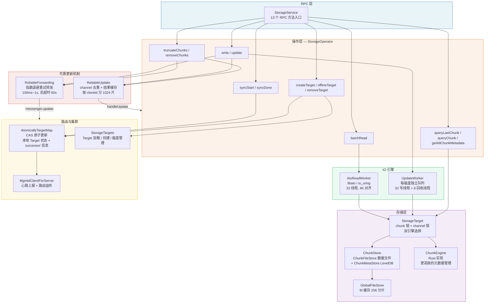

**请求在层间的流转**：

- **读请求**：`StorageService → StorageOperator.batchRead → TargetMap(验证状态) → AioReadWorker(提交AIO) → RDMA写回客户端`
- **写请求**：`StorageService → StorageOperator.write → ReliableUpdate(去重) → StorageOperator.handleUpdate → lockChunk → UpdateWorker(本地写) → ReliableForwarding(转发) → UpdateWorker(本地提交)`
- **同步请求**：`ResyncWorker.loop → syncStart(获取远端元数据) → 逐chunk forward → syncDone`

**后台任务**（独立运行，不参与请求路径）：

| 任务 | 触发方式 | 作用 |
| ---- | ---- | ---- |
| ResyncWorker | 500ms loop | 发现 syncingChains，启动数据同步 |
| CheckWorker | 10s loop | 磁盘空间检查，触发紧急回收 |
| AllocateWorker | loop | 预分配空闲 chunk，减少写延迟 |
| PunchHoleWorker | loop | 回收已删除 chunk 的空间 |
| SyncMetaKvWorker | 1min loop | fsync 元数据 KV，确保持久性 |
| DumpWorker | 1d loop | 诊断 dump |

### 3.2 Components — 核心组件容器

```cpp
struct Components {
  // ===== 网络与集群 =====
  const Config &config;
  flat::AppInfo appInfo;
  unique_ptr<net::Client> netClient;              // 网络客户端
  atomic_shared_ptr<IMgmtdClientForServer> mgmtdClient;  // mgmtd 客户端
  BufferPool rdmabufPool;                         // RDMA 缓冲池

  // ===== 路由与存储 =====
  AtomicallyTargetMap targetMap;                  // 原子更新的 TargetMap
  StorageTargets storageTargets;                  // 所有 Target 的加载/创建管理

  // ===== IO 引擎 =====
  AioReadWorker aioReadWorker;                    // 异步读 (libaio/io_uring)
  client::StorageMessenger messenger;             // 向其他 Storage 节点发 RPC

  // ===== 后台任务 =====
  ResyncWorker resyncWorker;                      // 数据同步
  CheckWorker checkWorker;                        // 磁盘/空间检查
  DumpWorker dumpWorker;                          // 诊断 dump
  AllocateWorker allocateWorker;                  // chunk 预分配
  PunchHoleWorker punchHoleWorker;                // 空间回收 (punch hole)
  SyncMetaKvWorker syncMetaKvWorker;              // 元数据 fsync

  // ===== 可靠更新 =====
  ReliableForwarding reliableForwarding;          // 可靠转发 (重试)
  ReliableUpdate reliableUpdate;                  // 可靠更新 (去重+缓存)

  // ===== 协程池 =====
  DynamicCoroutinesPool readPool;                 // 读请求协程池
  DynamicCoroutinesPool updatePool;               // 写请求协程池
  DynamicCoroutinesPool syncPool;                 // 同步请求协程池
  DynamicCoroutinesPool defaultPool;              // 默认协程池

  // ===== 操作核心 =====
  StorageOperator storageOperator;                // 所有 RPC 操作的入口
};
```

**启动顺序**（`Components::start`）：

```
rdmabufPool → 协程池 → messenger → reliableForwarding → storageTargets
→ aioReadWorker → dumpWorker → allocateWorker → punchHoleWorker
→ syncMetaKvWorker → waitRoutingInfo → resyncWorker → checkWorker → storageOperator
```

关键点：`waitRoutingInfo` 在 `resyncWorker` 之前完成——必须先拿到路由信息，知道哪些 Chain 需要同步，才能启动 ResyncWorker。

### 3.3 RPC 操作列表

所有 RPC 定义在 `StorageSerde` 中，通过 `StorageService` 分发到 `StorageOperator`：

| 操作 | 说明 | IO 类型 |
| ---- | ---- | ---- |
| `batchRead` | 批量读 chunk 数据 | 异步 AIO 读 |
| `write` | 客户端写（Head 节点接收） | 同步写 + 链式转发 |
| `update` | 前驱节点的更新传播 | 同步写 + 链式转发 |
| `queryLastChunk` | 查询 chunk 范围内最后一个 chunk | 元数据查询 |
| `truncateChunks` | 截断/扩展 chunk | 同步写 + 链式转发 |
| `removeChunks` | 删除 chunk 范围 | 同步写 + 链式转发 |
| `syncStart` | 同步开始：返回所有 chunk 元数据 | 元数据查询 |
| `syncDone` | 同步完成：标记 Target 为 UPTODATE | 状态更新 |
| `spaceInfo` | 查询磁盘空间信息 | 查询 |
| `createTarget` | 创建新 Target | 管理操作 |
| `offlineTarget` | 下线 Target | 管理操作 |
| `removeTarget` | 移除 Target | 管理操作 |
| `queryChunk` | 查询单个 chunk 元数据 | 元数据查询 |
| `getAllChunkMetadata` | 获取 Target 所有 chunk 元数据 | 元数据查询 |

---

## 4. 读路径

### 4.1 流程图解

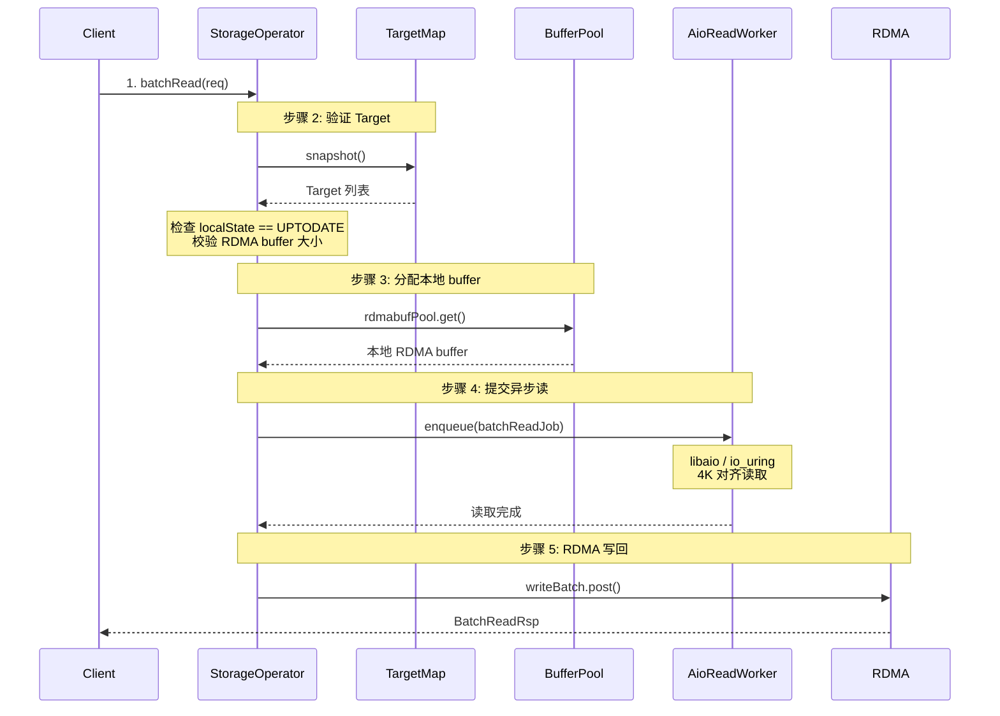

### 4.2 关键设计

**AIO 读引擎**：`AioReadWorker` 支持 libaio 和 io_uring 两种引擎，可通过配置切换（甚至随机选择用于 A/B 测试）。读请求被封装为 `BatchReadJob`，包含多个 `AioReadJob`，每个 job 对应一个 chunk 的读取。

**4K 对齐**：SSD 的 IO 要求 4K 对齐。如果读取的 offset/length 不对齐，AioReadWorker 会自动补齐 head/tail 部分，读出对齐区域后再截取实际需要的数据。

**RDMA 零拷贝**：读操作使用 RDMA write 直接将数据从本地 buffer 写入客户端的远程 buffer，避免额外的内存拷贝。每个 RDMA 设备有并发信号量（`max_concurrent_rdma_writes`，默认 256），防止 RDMA 过载。

**Target 状态检查**：读操作要求 Target 的 `localState == UPTODATE`，否则返回 `kTargetStateInvalid`。这确保不会从正在同步数据的 Target 读取不完整的数据。

---

## 5. 写路径与 CRAQ 链式复制

### 5.1 写操作流程

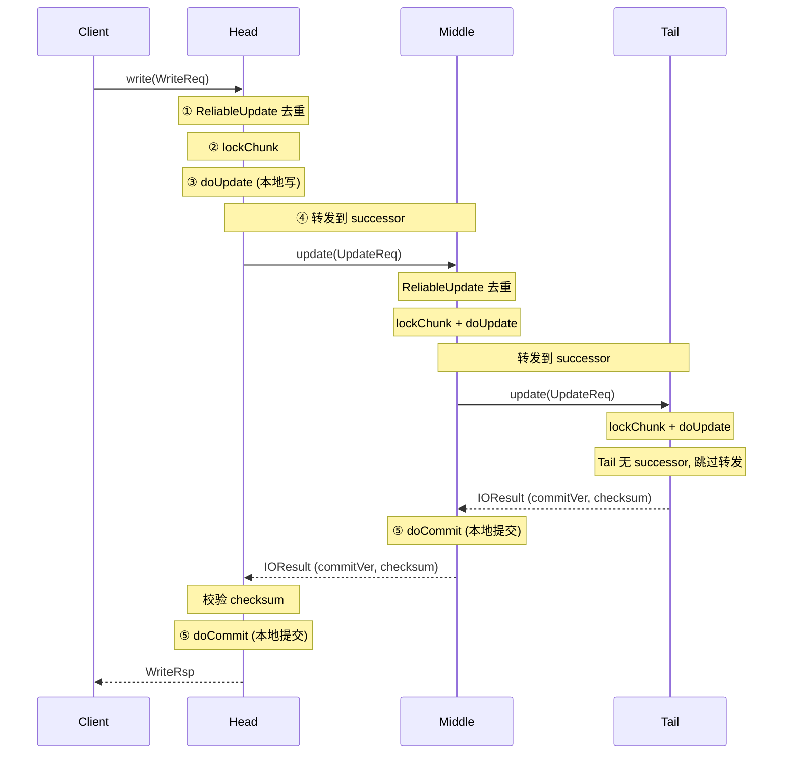

### 5.2 handleUpdate — 写操作的核心

`StorageOperator::handleUpdate()` 是所有写操作（write/update/truncate/extend/remove/commit）的核心流程：

```
handleUpdate()
  1. 验证请求合法性
     - fromClient 的请求只能发到 Head 节点
     - 拒绝 readonly 模式下的写请求
     - 拒绝 syncing 状态的 truncate/extend

  2. lockChunk — 获取 chunk 级别互斥锁
     - CoLockManager 保证同一 chunk 同时只有一个写操作
     - 锁粒度：单个 chunk，不同 chunk 可并发

  3. doUpdate — 本地写入
     - RDMA read：从客户端远程 buffer 拉取数据到本地 buffer
     - UpdateWorker 入队：按 diskIndex 分队列，每个磁盘独立
     - 等待写入完成

  4. ReliableForwarding — 转发到 successor
     - 如果有 successor：发送 UpdateReq 到 successor 节点
     - 如果是 Tail（无 successor）：跳过转发
     - 转发失败时指数退避重试

  5. doCommit — 本地提交
     - 更新 chunk 的 commitVer
     - 将 chunk 状态从 DIRTY/CLEAN 变为 COMMIT
```

### 5.3 Chunk 版本号机制

#### 5.3.1 三个版本号

每个 chunk 维护三个版本号：

| 版本号 | 说明 |
| ---- | ---- |
| `updateVer` | 写入版本号，每次写入递增。用于检测乱序/重复写入 |
| `commitVer` | 提交版本号，链式传播到 Tail 后递增。表示数据已被所有副本确认 |
| `chainVer` | Chain 版本号，Chain 拓扑变更时递增。用于检测 Chain 变化 |

#### 5.3.2 updateVer 的产生：客户端不指定，Head 自增

客户端发送写请求时，`updateVer` 固定为 **0**（`StorageClientImpl.cc:1894`）：

```cpp
hf3fs::storage::UpdateIO payload{writeIO->offset,
                                 writeIO->length,
                                 writeIO->chunkSize,
                                 key,
                                 iobuf.toRemoteBuf(),
                                 hf3fs::storage::ChunkVer(0) /*updateVer*/,  // 客户端不指定
                                 UpdateType::WRITE,
                                 writeIO->checksum};
```

truncate 和 remove 操作同样带 `ChunkVer(0)`（`StorageOperator.cc:768, 818`）。客户端不知道也不关心版本号，updateVer 完全由服务端管理。

**Head 节点本地写入时自增**（`ChunkReplica.cc:232-238`）：

```cpp
} else {  // writeIO.updateVer == 0
    meta.updateVer += 1;  // 服务端自增
    if (meta.updateVer > meta.commitVer + 1) {
        return makeError(StorageCode::kChunkAdvanceUpdate);
    }
}
```

**Head 写入成功后回填到请求对象**（`StorageOperator.cc:409-410`）：

```cpp
if (req.payload.updateVer == 0) {
    req.payload.updateVer = updateResult.updateVer;  // 回填，req 是引用传递
}
```

**转发给 successor 时携带已回填的 updateVer**（`ReliableForwarding.cc:145-149`）：

```cpp
UpdateReq updateReq = req;  // 复制 req，updateVer 已被 Head 回填
updateReq.options.fromClient = false;
```

因此 successor 收到的 `updateVer > 0`，走版本号检查分支（而非自增分支）。

**SYNCING 状态的特殊处理**：当 successor 处于 SYNCING 状态且需要读取完整 chunk 转发时，`doForward` 从本地读出或查询 chunk 元数据获取 updateVer（`ReliableForwarding.cc:200, 222`），确保转发请求携带正确的版本号。

#### 5.3.3 updateVer 的传播与 commitVer 的产生

完整的版本号流转过程：

```
Client → Head:updateVer=0
         ↓ Head 本地写入，meta.updateVer += 1 (例如 3→4)
         ↓ 回填 req.payload.updateVer = 4
         ↓
    Middle:updateVer=4 (来自 Head 回填)
         ↓ 版本号检查通过，meta.updateVer = 4
         ↓ 本地写入
         ↓
    Tail:updateVer=4
         ↓ 版本号检查通过，meta.updateVer = 4
         ↓ 本地写入，Tail 无 successor，跳过转发
         ↓
    Tail → Middle: IOResult{commitVer=4}
         ↓ Middle doCommit: meta.commitVer = 4
    Middle → Head: IOResult{commitVer=4}
         ↓ Head doCommit: meta.commitVer = 4
Head → Client: WriteRsp{updateVer=4, commitVer=4}
```

**commitVer 的产生**：Tail 节点写入成功后，其 `updateVer` 即为本次写入的 `commitVer`（因为 Tail 是最后一个副本，写入成功即意味着所有副本都已确认）。`commitVer` 随着链式响应从 Tail 传回 Head，每个节点在 `doCommit` 中更新自己的 `meta.commitVer`。

**syncing 写入的版本号**：当 `options.isSyncing == true` 时（`ChunkReplica.cc:211-215`）：

```cpp
if (options.isSyncing) {
    meta.updateVer = writeIO.updateVer;           // 直接赋值，不自增
    meta.commitVer = ChunkVer{writeIO.updateVer - 1};  // commitVer = updateVer - 1
}
```

syncing 写入将 chunk 置为"已写入但未提交"状态（`commitVer` 比 `updateVer` 小 1，`chunkState = DIRTY`），写入完成后变为 CLEAN。之后仍然在同一个 `handleUpdate` 中继续转发到 successor，收到 successor 返回的 commitVer 后执行 doCommit 推进 `commitVer`。这与正常写入的流程完全一致，`commitVer = updateVer - 1` 只是初始值，表示 syncing 的 Target 尚未完成全链确认。

**isSyncing 标记的作用与设置场景**：`isSyncing` 的核心作用是让接收方跳过正常的版本号连续性检查（`kChunkCommittedUpdate` / `kChunkStaleUpdate` / `kChunkMissingUpdate`），改走直接赋值分支。原因是 SYNCING 的 Target 之前是空的（`updateVer=0`），如果前驱的 chunk 已经是 `updateVer=5`，直接同步过来会触发 `kChunkMissingUpdate`（5 > 0 + 1）。`isSyncing` 标记主要出现在两种场景：

| 场景 | 设置位置 | 设置者 | 数据来源 | 触发时机 |
| ---- | ---- | ---- | ---- | ---- |
| 1. 向 SYNCING successor 转发 | `ReliableForwarding.cc:152-155` | 前驱节点 | 前驱本地已有的 chunk 数据 | 客户端写请求沿链传播，发现 successor 是 SYNCING |
| 2. ResyncWorker 同步写入 | `ResyncWorker.cc:445` | SYNCING Target 自己的 ResyncWorker | 从前驱 RPC 拉取的 chunk 数据 | 后台 ResyncWorker 500ms 扫描到 syncingChains |

**场景 1 - 向 SYNCING successor 转发**：正常的客户端写请求沿 CRAQ 链传播，前驱节点写完本地后转发给 successor 时，检查 `target.successor->targetInfo.publicState == SYNCING`（`ReliableForwarding.cc:152`）。如果是 SYNCING，前驱设置 `updateReq.options.isSyncing = true`，并且对于部分写入（`length != chunkSize`）先从本地读出完整 chunk 再以全量 WRITE 转发（`readForSyncing` 逻辑，`ReliableForwarding.cc:158-216`），确保 SYNCING 的 Target 收到完整数据。

**场景 2 - ResyncWorker 同步写入**：新 Target 加入 Chain 后 `publicState = SYNCING`，本机的 ResyncWorker 从前驱拉取数据（`syncStart` 获取元数据，逐 chunk `update`），构造的 `UpdateReq` 设置 `req.options.isSyncing = true`（`ResyncWorker.cc:445`）。注意 ResyncWorker 构造请求时 `updateVer` 固定为 1，但实际生效的版本号会在 `doForward` 中被前驱的真实版本号覆盖（`ReliableForwarding.cc:200, 222`）。

两种场景的共同点是：接收方都是 SYNCING 状态的 Target，都需要跳过版本号连续性检查。区别在于数据来源--场景 1 是"被动接收"（前驱推过来），场景 2 是"主动拉取"（自己从前驱拉）。

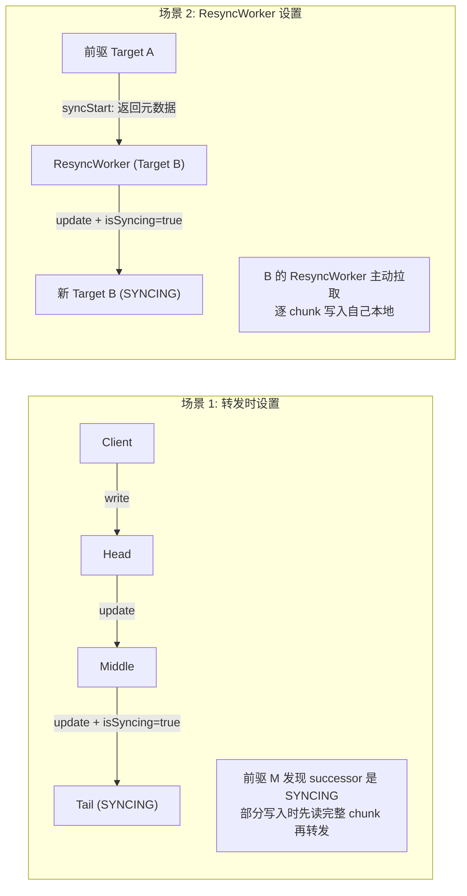

#### 5.3.4 多客户端并发写同一 chunk

CRAQ 链式复制要求**同一 chunk 同时只能有一个未提交写入**。这通过两层锁保证：

| 锁 | 粒度 | 获取方式 | 作用 |
| -- | ---- | -------- | ---- |
| chunk 锁 (`CoLockManager`) | 单 chunk | 阻塞等待 | 串行化同一 chunk 的写入，不同 chunk 可并发 |
| channel 锁 (`CoLockManager`) | 单 channel | 非阻塞 tryLock | 防止同一 channel 的并发更新，冲突时快速失败让客户端重试 |

获取顺序固定：先 channel 锁（`ReliableUpdate.cc:56`），后 chunk 锁（`StorageOperator.cc:371`）。

**多客户端并发写时序**：

```
T1: ClientA → Head, channelA 分配, tryLockChannel(channelA) ✓
T2: ClientB → Head, channelB 分配, tryLockChannel(channelB) ✓
    (不同 channel，channel 锁不冲突)
T3: ClientA → lockChunk(chunkId) ✓ (先到先得)
T4: ClientB → lockChunk(chunkId) ✗ (阻塞等待)
T5: ClientA → doUpdate, meta.updateVer: 3→4, 回填 updateVer=4
T6: ClientA → forward → Middle → Tail → commit
T7: ClientA → doCommit, meta.commitVer: 3→4, 释放 chunk 锁
T8: ClientB → 获得 chunk 锁, doUpdate, meta.updateVer: 4→5, 回填 updateVer=5
T9: ClientB → forward → Middle → Tail → commit
```

chunk 锁保证 updateVer 严格递增。A 的写入未 commit 之前，B 一直阻塞在 chunk 锁上。这也解释了为什么 `kChunkAdvanceUpdate`（自增后 `updateVer > commitVer + 1`）是 DFATAL 级别——它意味着两个未提交写入同时存在于同一 chunk，违反了 CRAQ 的基本约束。

**为什么不让客户端指定 updateVer？**

1. **客户端不知道服务端的版本号**：客户端发请求时不知道 chunk 当前的 updateVer，强行指定会导致版本号冲突
2. **简化重试逻辑**：客户端重试时仍携带 `updateVer=0`，服务端通过 ReliableUpdate 的 channel+seqnum 去重，不依赖版本号判断是否重复
3. **CRAQ 的约束**：链式复制要求写入顺序一致，Head 节点是唯一确定版本号的地方，避免多节点分配版本号导致不一致

#### 5.3.5 版本号检查场景

版本号检查发生在 `ChunkReplica::update()` 中（`src/storage/store/ChunkReplica.cc:216-238`），当写入请求携带 `updateVer > 0` 时（即 Head 回填后转发给 successor 的请求）。正常情况下 `commitVer ≤ updateVer ≤ commitVer + 1`，写入请求携带的 `writeIO.updateVer` 与本地版本号的关系决定属于哪种场景：

| 错误码 | 条件 | 含义 | 处理 | 严重性 |
| ---- | ---- | ---- | ---- | ---- |
| `kChunkCommittedUpdate` | `writeIO.updateVer ≤ commitVer` | 重复请求，数据已全链提交 | 视为成功 | 正常（重试场景） |
| `kChunkStaleUpdate` | `commitVer < writeIO.updateVer ≤ updateVer` | 重复请求，数据已本地写入但未全链提交 | 视为成功 | 正常（重试场景） |
| `kChunkMissingUpdate` | `writeIO.updateVer > updateVer + 1` | 版本号跳变，中间有丢失 | 阻塞/重试 | 需等待修复 |
| `kChunkAdvanceUpdate` | 自增后 `updateVer > commitVer + 1` | 多个未提交写入堆积 | 返回错误 | 异常（DFATAL） |

**kChunkCommittedUpdate — 重复请求（已提交）**：客户端发送写请求，Head 写入成功并链式传播到 Tail 完成提交（`commitVer` 已推进），但响应在返回途中丢失。客户端超时重试，携带相同的 `updateVer`。此时 `commitVer` 已 ≥ 该 `updateVer`，说明写入早已完成。视为成功，返回 `lengthInfo = req.payload.length`，`commitVer = req.payload.updateVer`。这是 CRAQ + ReliableUpdate 的核心场景——重试请求不会导致重复写入。

**kChunkStaleUpdate — 重复请求（未提交）**：链式转发中，写请求 A（updateVer=5）已到达本节点并写入（`meta.updateVer=5`），但 A 还没转发到 successor 并返回 commitVer。此时另一个写请求 B（updateVer=5，相同 seqnum）到达，`updateVer(5) ≤ meta.updateVer(5)` 但 `> meta.commitVer`，说明该版本已写入但未提交。

**关键**：kChunkStaleUpdate 在 `StorageOperator::handleUpdate()` 中**没有 `co_return`**，代码会继续执行后续的转发和提交流程。对比 kChunkCommittedUpdate 直接返回（数据已全链提交，无需再做任何事），kChunkStaleUpdate 的数据只完成了本地写入，还需要继续转发到 successor 并执行 doCommit。这保证了即使请求是"重复"的，全链提交流程仍然会完整执行，客户端收到成功响应时数据一定可以被读到。

**读请求能读到数据吗？** 可以。3FS 的读请求默认使用 LoadBalance 策略，可从 Chain 中任意 SERVING 节点读。Storage 端要求 Target 必须 `upToDate()`（`localState == UPTODATE`）才允许读，而 UPTODATE 的 Target 上的数据一定是已提交的。kChunkStaleUpdate 的重试请求会完成全链提交后才返回成功，因此客户端收到成功响应后，数据已可读。

**kChunkMissingUpdate — 版本号不连续**：本节点 `updateVer=3`，突然收到 `updateVer=5` 的写入，跳过了 `updateVer=4`。可能原因：链式转发中前驱节点的 updateVer=4 请求网络丢包，或并发请求乱序到达。阻塞等待，ReliableForwarding 会重试，等待缺失的 updateVer=4 先到达。不能跳过的原因：如果跳过 4 直接写 5，后续 updateVer=4 到达时会变成 stale update 被丢弃，导致数据丢失。

**kChunkAdvanceUpdate — 超前提交**：发生在 `updateVer == 0`（客户端未指定版本号，服务端自增）时。本节点 `commitVer=3, updateVer=4`（有一个写入还没提交），又来了一个 `updateVer=0` 的写入，自增后 `updateVer=5`，`5 > 3 + 1`，触发此错误。意味着多个未提交写入同时存在，违反 CRAQ "同一 chunk 同时只有一个未提交写入" 的约束，属于异常情况。

### 5.4 Checksum 校验

写操作携带 CRC32C checksum，在两个层面校验：

1. **本地写入**：`doUpdate` 写入数据后计算 checksum，与请求中的 checksum 比较
2. **链式传播**：`handleUpdate` 收到 successor 的响应后，比较本地 checksum 与 successor 返回的 checksum。不一致说明数据在传播过程中损坏，返回 `kChecksumMismatch`

如果 `ReliableForwarding::doForward` 发现 RDMA buffer 损坏（本地 buffer 的 checksum 与请求不一致），会调用 `ApplicationBase::handleSignal(SIGUSR2)` 自杀，防止脏数据传播。

### 5.5 写入路径的 4K 对齐

读路径使用 O_DIRECT，必须由应用层处理 4K 对齐（AioReadWorker 补齐 head/tail）。写路径的对齐策略与读路径不同——两个引擎采用了不同的方案。

#### 上层写入的 offset/length 不保证对齐

写入请求的 `offset` 和 `length` 由文件偏移决定，**没有任何 4K 对齐保证**。完整链路：

1. **Fuse 层写缓冲合并**：`hf3fs_write()` (`FuseOps.cc:1575-1689`) 将小写入攒在 `InodeWriteBuf`（默认 1MB）中，连续写入合并，不连续或 buffer 满时 flush。但合并后仍可能不对齐（如文件偏移 100 处写 1MB，chunk 内偏移就是 100）。

2. **PioV 按 chunk 边界拆分**：`PioV::chunkIo()` (`PioV.cc:98-130`) 将写入按 chunk 边界拆分，`chunkOff = off % chunkSize` 可以是任意值，`chunkLen` 也可以是任意值。

3. **写缓冲的 flush 时机**：Fuse 不会无限攒小写，5 个触发点保证数据最终刷出：

| 触发条件 | 时机 | 代码位置 |
| ---- | ---- | ---- |
| Buffer 满（1MB） | 写入时 | `FuseOps.cc:1669` |
| 写入不连续 | 写入时 | `FuseOps.cc:1649` |
| fsync / flush | 用户主动调用 | `FuseOps.cc:1691` |
| 读同一文件前 | 读操作时 | `FuseOps.cc:1487` |
| 定期后台扫描 | ~30s 间隔 | `FuseOps.cc:2671`, `FuseClients.cc:161` |

用户写完后什么都不做时，最多等 ~30s 由 `periodicSyncScan` 兜底 flush。数据以原始大小（可能远小于 4K）发到 Storage。

#### 传统引擎 (ChunkStore) — 降级为 Buffered IO

`ChunkFileView::write()` (`ChunkFileView.cc:45-90`) 的策略是"能对齐就用 Direct IO，不能对齐就走 Buffered IO"：

```cpp
// ChunkFileView.cc:56-58
if (size % kAIOAlignSize == 0 && offset % kAIOAlignSize == 0 &&
    reinterpret_cast<uint64_t>(buf) % kAIOAlignSize == 0) {
  fd = direct_;   // O_DIRECT — 对齐 → Direct IO
}
// 否则 → normal fd (O_RDWR | O_SYNC) — Buffered IO
```

不对齐时走 normal fd（带页缓存 + O_SYNC），内核处理对齐，**不需要先读后写**。代价是绕过了 Direct IO 的低延迟优势，且引入了页缓存污染和潜在的 torn write 风险。

#### Rust 引擎 (ChunkEngine) — Direct IO + 显式 Read-Modify-Write

Rust 引擎坚持所有写入最终走 Direct IO，不对齐时由应用层显式 read-modify-write。写入有三条路径（`engine.rs:386-433`）：

| 路径 | 触发条件 | IO 行为 | 代码位置 |
| ---- | ---- | ---- | ---- |
| `safe_write` 对齐路径 | append 写且 4K 对齐 | 直接 `pwrite`，零额外 IO | `chunk.rs:200-234` |
| `safe_write` 先读后写 | `meta.len` 不对齐且需扩展 | 先 `pread` 读 tail 4K 块，合并后整块 `pwrite` | `chunk.rs:235-276` |
| `copy_on_write` | 覆盖写（offset < meta.len）或 syncing | 先读整个旧 chunk，合并后写入新 chunk，原子替换 | `chunk.rs:89-174` |

**safe_write 先读后写**（`chunk.rs:235-276`）：

```rust
let start = self.meta.len & !(ALIGN_SIZE.0 as u32 - 1);  // 对齐到 4K 边界
if start != self.meta.len {
    // 先读出 tail 不对齐的 4K 块
    self.pread(&mut vec[start as usize..][..ALIGN_SIZE.into()], start)?;
}
// 合并新数据后整块 pwrite（4K 对齐）
self.pwrite(&vec[start as usize..new_len.next_multiple_of(ALIGN_SIZE.into())], start)?;
```

**copy_on_write**（`chunk.rs:89-174`）：分配新 chunk → 读旧 chunk 合并新数据 → 写入新 chunk → 原子替换。旧 chunk 在整个过程中不被修改，任何步骤失败旧数据完好。

#### 为什么 Rust 引擎不用 Buffered IO？

传统引擎的 normal fd 和 Rust 引擎的 normal fd 都带 `O_SYNC`（`GlobalFileStore.cc:23`, `cluster.rs:22`），但 Rust 引擎选择不依赖它处理不对齐写入，原因有三：

**1. 崩溃安全 — O_SYNC 不对齐写入可能 torn write**

内核处理 O_SYNC 不对齐写入时隐式做 read-modify-write：先读 4K 页 → 修改 → 写回。但写回过程中崩溃可能导致 4K 页只写了一半（torn write），**超出写入范围的相邻数据也被损坏**。Direct IO 保证要么完整写入要么不写入，不会损坏相邻数据。

**2. copy_on_write 提供原子性**

Rust 引擎的 CoW 流程（`engine.rs:388-401`）分配新 chunk 写入，旧 chunk 不被修改。失败后旧数据完好，比 Buffered IO 的原地修改安全得多。

**3. 页缓存污染**

3FS 是专用存储服务，内存应尽量用于 RDMA buffer 和元数据缓存。Buffered IO 会让内核缓存 TB 级的 chunk 数据，挤占有用内存。Direct IO 完全绕过页缓存，内存使用可控。

#### IO 放大在实际场景中的影响

| 路径 | 额外 IO | 实际影响 |
| ---- | ---- | ---- |
| `safe_write` 对齐路径 | 0 | **主路径，无放大** |
| `safe_write` 先读后写 | 多读 1 个 4K 块 | 仅 chunk 尾部最后一个 4K 块，相比 chunk 大小（512KB~64MB）可忽略 |
| `copy_on_write` | 读 + 写整个 chunk | 放大最大，但覆盖写在 3FS 的 append-only 模式下很少发生 |

3FS 的典型 IO 模式是 append only（训练数据写入、checkpoint 保存），append 写的 `offset == meta.size`，只要前一次写入是 4K 倍数，后续 append 写走对齐路径，零额外 IO。只有文件末尾的最后一次写入不是 4K 倍数时，下一个 chunk 的第一次写入才会触发先读后写。

---

## 6. 可靠更新机制

### 6.1 为什么需要三层 ID

ReliableUpdate 的去重依赖 `clientId + chainId + channelId` 三层 ID 的组合。要理解为什么需要这么多 ID，需要从完整链路看每个 ID 的作用：

**请求从客户端到服务端的完整路径**：

```
客户端 (StorageClientImpl)
  ↓ 分配 channel: UpdateChannelAllocator.allocate()
  ↓ 构建 MessageTag: {clientId, requestId, channel{id, seqnum}}
  ↓ 发送 WriteReq
Head 节点 (StorageOperator::write)
  ↓ 转换为 UpdateReq (tag 原样传递)
  ↓ 调用 ReliableUpdate::update()
  ↓ 按 clientId 分片 → 查找 channelMap[chainId + channelId]
  ↓ 执行 handleUpdate → ReliableForwarding → successor
Middle 节点 (StorageOperator::update)
  ↓ 收到 UpdateReq (tag 原样传递)
  ↓ 调用 ReliableUpdate::update()
  ↓ 同样按 clientId 分片 → 查找 channelMap[chainId + channelId]
  ↓ 执行 handleUpdate → ReliableForwarding → successor
Tail 节点 ... (同理)
```

**每个 ID 的作用**：

| ID | 谁分配 | 作用 | 为什么需要 |
| -- | ------ | ---- | ---------- |
| `ClientId` | mgmtd | 标识一个客户端实例 | 不同客户端可能写同一个 chunk，需要区分"谁的请求"。按 clientId 分片（1024 片）减少锁竞争 |
| `ChainId` | mgmtd | 标识一条 CRAQ 链 | 同一客户端可能同时写多条链上的 chunk，每条链的写入独立去重 |
| `ChannelId` | 客户端 `UpdateChannelAllocator` | 标识客户端内的一个写入通道 | 同一客户端对同一条链可能有多个并发写入，每个写入分配不同的 channel，互不阻塞 |
| `ChannelSeqNum` | 客户端 `UpdateChannelAllocator` | 标识同一 channel 上的请求序号 | 重试请求携带相同的 seqnum，服务端据此识别"这是重试还是新请求" |
| `RequestId` | 客户端 | 标识单次 RPC 请求 | 用于调试和日志追踪，不参与去重逻辑 |

**为什么不能只用 clientId + requestId 去重？**

关键在于**并发写入**。一个客户端可能同时发起多个写请求（写不同 chunk），如果只用一个全局递增的序号：

- 请求 A（chunk1）和请求 B（chunk2）并发发出，A 的 seqnum=1，B 的 seqnum=2
- A 超时重试，携带 seqnum=1
- 但服务端可能已经处理过 seqnum=2 的请求，如果用全局序号去重，会误判 A 的重试为"过期请求"

引入 channelId 后，每个 channel 有独立的 seqnum 空间，不同 channel 的写入互不干扰。同一 channel 内的 seqnum 严格递增，重试请求使用相同 seqnum，去重判断才不会出错。

**channel 的生命周期**：

1. 客户端发送写请求前，`UpdateChannelAllocator::allocate()` 从 channel 池中分配一个空闲 channelId，并递增 seqnum
2. 请求完成后，`UpdateChannelAllocator::release()` 将 channelId 归还池中，可复用
3. channel 池大小有限（`ChannelId` 为 uint16_t，最多 65535 个），分配失败返回 `kResourceBusy`

**去重的完整判断逻辑**（`ReliableUpdate::update()`）：

服务端为每个 `(clientId, chainId, channelId)` 维护一个 `ReqResult`，其中 `channelSeqnum` 记录该 channel **已处理过的最高 seqnum**。收到请求时，将请求中的 `req.tag.channel.seqnum` 与缓存的 `reqResult->channelSeqnum` 比较：

```
1. channelId == 0 → 跳过去重，直接执行 handleUpdate()
   （sync 场景的 REMOVE 操作不带 channel）

2. req.seqnum < reqResult.channelSeqnum → kDuplicateUpdate
   （请求的序号低于已处理的最高序号，说明是过期请求，直接拒绝）

3. req.seqnum == reqResult.channelSeqnum 且有缓存结果 → 返回缓存结果
   （请求序号等于已处理的最高序号，说明是重试请求，且之前已执行完毕，直接返回之前的结果）

4. req.seqnum == reqResult.channelSeqnum 但无缓存结果 → 执行 handleUpdate()
   （重试请求，但之前的结果已被清理，需要重新执行）

5. req.seqnum > reqResult.channelSeqnum → 执行 handleUpdate()
   （请求序号高于已处理的最高序号，是新请求，正常执行）
   执行完毕后更新 reqResult.channelSeqnum = req.seqnum
```

**tag 在链式转发中的传递**：`ReliableForwarding::doForward()` 将 UpdateReq 原样转发给 successor（只修改 `fromClient=false` 和 `chainVer`），tag 中的 clientId/channelId/seqnum 不变。因此链上每个节点都能用相同的 key 查找去重缓存，保证整条链的去重一致性。

### 6.2 ReliableUpdate 流程图

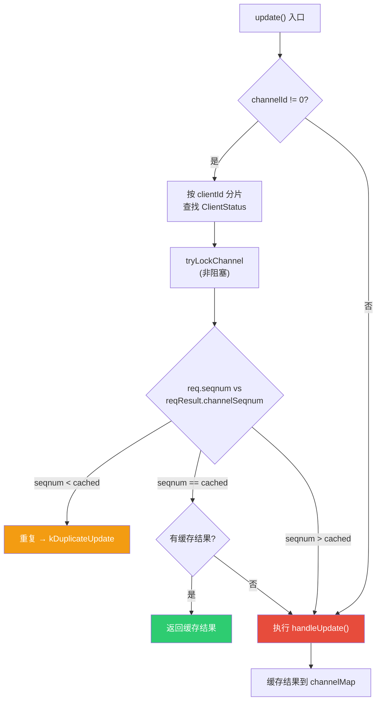

**数据结构**：

```cpp
struct ReqResult {
  ChannelSeqNum channelSeqnum;   // 该 channel 已处理的最高 seqnum（用于去重判断）
  RequestId requestId;           // 对应的请求 ID
  IOResult updateResult;         // 执行结果（缓存，重试时可直接返回）
  ChunkVer succUpdateVer;        // successor 的 updateVer（用于 updateVer=0 时恢复版本号）
  uint32_t generationId;         // StorageTarget 的 generation（检测 Target 重建后缓存失效）
};

struct ClientStatus {
  unordered_map<pair<ChainId, ChannelId>, ReqResult> channelMap;  // 每个 chain+channel 的最新结果
  UtcTime lastUsedTime;                                           // 最后使用时间（用于清理过期客户端）
};
Shards<ClientMap, 1024> shards_;  // 按 clientId 分片，减少锁竞争
```

**过期客户端清理**：`cleanUpExpiredClients()` 定期检查，不在 mgmtd 活跃客户端列表中且超过 `expired_clients_timeout`（默认 1h）未使用的客户端状态被清除。

### 6.3 ReliableForwarding — 可靠链式转发

**设计背景**：CRAQ 链式复制中，每个非 Tail 节点写完本地后，必须将更新转发给 successor。但 successor 可能暂时不可用（正在重启、网络抖动），而写操作不能因此失败——数据必须传播到所有副本。ReliableForwarding 的核心就是**在 successor 暂时不可用时，通过重试等待其恢复**。

#### 三层调用结构

ReliableForwarding 由三个函数组成，各司其职：

```
forwardWithRetry()    ← 外层：重试循环 + 指数退避
  └─ forward()        ← 中层：检查 successor + chainVer 校验
       └─ doForward() ← 内层：构造请求 + 处理 SYNCING + 发送 RPC
```

**外层 `forwardWithRetry()`** — 重试循环：

- 使用 `ExponentialBackoffRetry`，初始等待 100ms，最大等待 1s，总超时 60s
- 每次循环先从 TargetMap 获取最新的 Target 信息（successor 可能已恢复）
- 调用 `forward()`，根据结果决定是否重试
- 重试期间的等待不是空等：每 100ms 检查一次 successor 是否恢复，如果 TargetMap 中已无 successor（Chain 拓扑变更，本节点变成 Tail），立即退出等待

**中层 `forward()`** — successor 检查 + 版本校验：

- 如果没有 successor → 返回 `kNoSuccessorTarget`（Tail 节点的正常情况，不是错误）
- 调用 `doForward()` 发送请求
- 成功后校验 chainVer：如果 successor 返回的 `commitChainVer > 本地 chainVer`，说明远端拿到了更高版本的 chain，本地需要通过重试获取最新路由

**内层 `doForward()`** — 构造请求 + 发送 RPC：

- 修改请求：`fromClient = false`，设置 `chainVer`
- 判断 successor 是否处于 SYNCING 状态，如果是则做特殊处理（见下文）
- 通过 `messenger.update()` 发送 RPC 到 successor
- 如果返回 `kChecksumMismatch`，验证本地 RDMA buffer 是否损坏，损坏则自杀（`SIGUSR2`）

#### 流程图

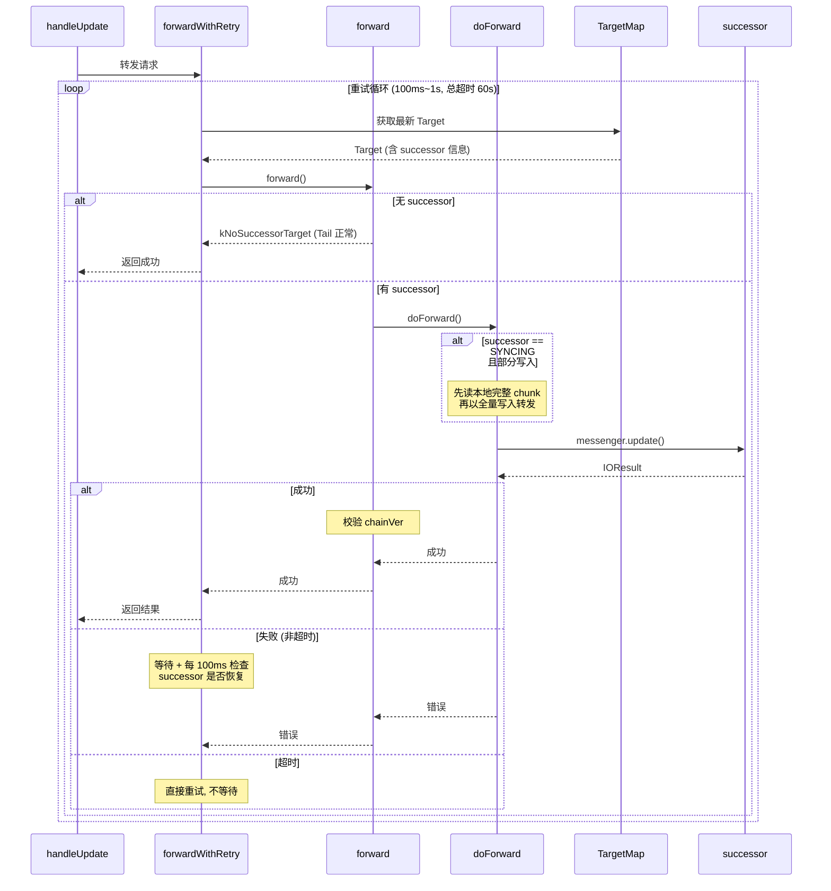

#### 失败时的重试策略

失败后的行为取决于错误类型：

| 错误类型 | 处理方式 | 原因 |
| ---- | ---- | ---- |
| 成功 / `kNoSuccessorTarget` | 立即返回 | 正常情况 |
| 超时 (`kTimeout`) | 直接重试，不额外等待 | 网络延迟，立即重试可能成功 |
| 其他错误 | 指数退避等待 (100ms~1s) + 重试 | successor 可能暂时不可用 |
| 总超时 (60s) | 返回错误 | successor 可能长时间不可用 |
| `kRoutingVersionMismatch` | 直接返回错误（不允许使用过时 chainVer 时） | 路由版本不一致，需要调用方刷新路由 |

等待期间每 100ms 检查 TargetMap：如果 Chain 拓扑变更导致本节点变成 Tail（不再有 successor），立即退出等待并返回 `kNoSuccessorTarget`，避免无谓等待。

#### SYNCING 状态的特殊处理

当 successor 处于 SYNCING 状态时，它正在从前驱同步数据，此时不能只转发部分写入，必须转发**完整 chunk**：

| 写入类型 | 处理方式 | 原因 |
| ---- | ---- | ---- |
| 部分写入（offset != 0 或 length != chunkSize） | 先从本地读出完整 chunk，再以全量 WRITE 转发 | SYNCING 的 Target 需要完整数据 |
| 全量写入 / truncate / extend | 直接转发，但设置 `isSyncing = true` | 已经是完整操作 |
| remove | 直接转发 | 不涉及数据 |

为什么 SYNCING 的 Target 需要完整 chunk？因为 SYNCING 的 Target 之前没有任何数据，部分写入会导致它上面只有部分数据，后续读操作会读到不一致的内容。

---

## 7. 存储层

Target 的核心概念和属性已在[第 2 章 核心概念](#2-核心概念)中说明，本章聚焦于存储引擎的实现细节。

### 7.1 StorageTarget - 双引擎抽象层

`StorageTarget`（`src/storage/store/StorageTarget.h`）是连接上层操作（StorageOperator）和底层存储引擎的抽象层。它对外暴露统一的读写接口，内部通过 `useChunkEngine()` 选择具体引擎（`StorageTarget.h:162`）：

```cpp
inline bool useChunkEngine() const { return targetConfig_.only_chunk_engine; }
```

所有操作都根据 `useChunkEngine()` 分派到 `ChunkStore`（传统引擎）或 `ChunkEngine`（Rust 引擎）。例如 `punchHole()`（`StorageTarget.h:84-90`）：

```cpp
Result<bool> punchHole() {
    if (useChunkEngine()) { return true; }           // Rust 引擎自行管理空间
    else { return chunkStore_.punchHole(); }          // 传统引擎走 PunchHoleWorker
}
```

**核心职责**：

| 职责 | 实现 | 代码位置 |
| ---- | ---- | ---- |
| 双引擎分派 | `useChunkEngine()` 选择引擎，所有操作二选一 | `StorageTarget.h:162` |
| chunk 锁 | `CoLockManager` 串行化同一 chunk 的并发写 | `StorageTarget.h:182`，`lockChunk()` |
| channel 锁 | `CoLockManager` 防止同一 channel 并发更新 | `StorageTarget.h:183`，`tryLockChannel()` |
| 异步读接口 | `aioPrepareRead()` / `aioFinishRead()` | `StorageTarget.h:69-72` |
| 写入接口 | `updateChunk()` 入队 UpdateWorker | `StorageTarget.h:75` |
| 元数据查询 | `queryChunk()` / `queryChunks()` / `getAllMetadata()` | `StorageTarget.h:57-58, 78-81` |
| 空间回收 | `punchHole()` 回收已删除 chunk | `StorageTarget.h:84-90` |
| 空间统计 | `usedSize()` / `unusedSize()` | `StorageTarget.h:105-114` |
| 紧急回收 | `setEmergencyRecycling()` | `StorageTarget.h:135-141` |
| 生命周期 | `generationId()` 每次 Target 重建递增，用于 ReliableUpdate 缓存失效 | `StorageTarget.h:153` |

**物理目录结构**（每个 Target 独立目录）：

```
Target 物理目录：
  ├── target.toml (PhysicalConfig)       - 配置文件
  ├── ChunkStore 或 ChunkEngine          - 数据引擎（二选一）
  │     ├── 512KB/  1MB/  2MB/  4MB/  16MB/  64MB/   - 按 chunkSize 分目录
  │     │     ├── 00  01  02 ... FF                   - 256 个数据文件（十六进制命名）
  │     │     └── ...
  │     └── meta/                         - 元数据库 (LevelDB/RocksDB)
  └── ...
```

### 7.2 ChunkStore - 传统存储引擎

ChunkStore 由三个组件组成（`src/storage/store/ChunkStore.h:40-43`）：

```cpp
ChunkStore(const Config &config, GlobalFileStore &globalFileStore)
    : fileStore_(config_.file_store(), globalFileStore),   // 数据文件管理
      metaStore_(config_.meta_store(), fileStore_) {}       // 元数据管理
```

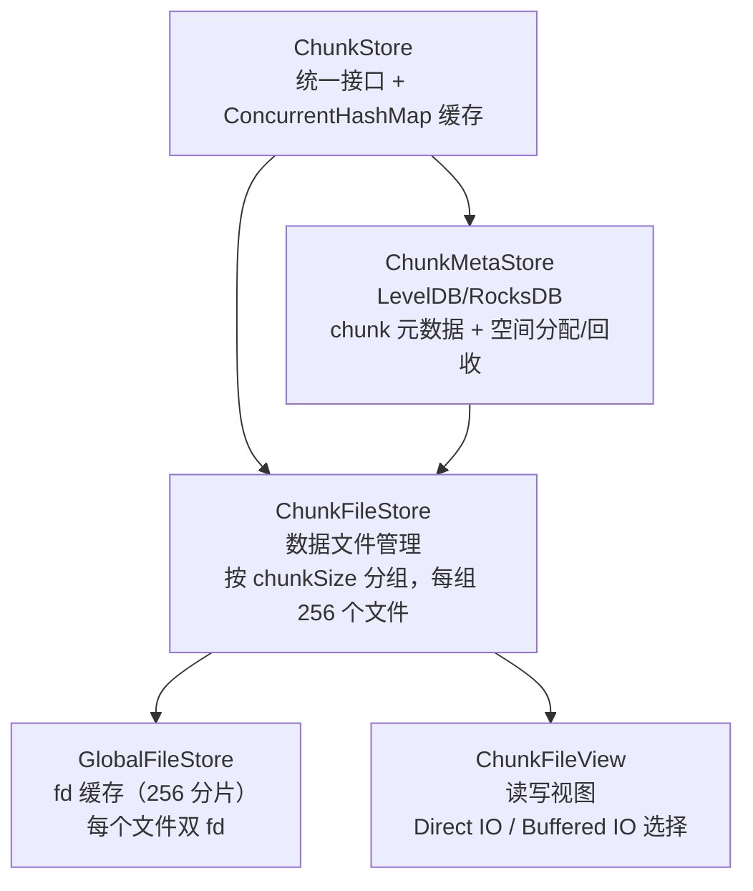

#### 7.2.1 ChunkFileStore - 数据文件布局

**文件分组**：每个 chunkSize 对应一组独立目录，每组包含 `physical_file_count`（默认 256）个物理文件（`PhysicalConfig.h:20`）。默认 6 种 chunkSize，共 6 × 256 = 1536 个文件。

文件路径（`ChunkFileStore.cc:111`）：

```
path_ / Size::toString(chunkSize) / fmt::format("{:02X}", chunkIdx)
# 例如: /data/target0/512KB/00, ..., /data/target0/512KB/FF
#       /data/target0/64MB/00,  ..., /data/target0/64MB/FF
```

**文件增长**：文件不是固定大小，而是按 `allocate_size`（默认 256MB）增量动态增长（`ChunkMetaStore.h:20`，`ChunkMetaStore.cc:872-874`）：

```cpp
auto allocateSize = config_.allocate_size();                          // 256MB
auto newFileSize = (fileSize / allocateSize + 1) * allocateSize;      // 向上取整到 256MB 倍数
fileStore_.allocate(fileId, fileSize, newFileSize - fileSize);         // fallocate 预分配
```

- 文件初始大小为 0，每次扩展 256MB，文件大小 = 256MB × n
- **文件大小没有上限**，实际受磁盘空间约束
- 256 个文件**轮转使用**（`ChunkMetaStore.cc:842`）：`nextAllocateIndex = (allocateIndex + 1) % 256`

**chunk 在文件内的 offset**：每次扩展的 256MB 空间被切分为 `allocate_size / chunkSize` 个 chunk 位置（`ChunkMetaStore.cc:884-890`）：

| chunkSize | 每次扩展产生 chunk 数 | 256MB 内可容纳 |
| ---- | ---- | ---- |
| 512KB | 512 个 | 512 个 |
| 1MB | 256 个 | 256 个 |
| 4MB | 64 个 | 64 个 |
| 16MB | 16 个 | 16 个 |
| 64MB | 4 个 | 4 个 |

**chunk 定位**：通过 `ChunkFileId{chunkSize, fileIdx}` + `innerOffset` 唯一定位（`ChunkMetaStore.cc:503-504`）：

```cpp
meta.innerFileId = {chunkSize, pos.fileIdx};   // 哪个 chunkSize、哪个文件
meta.innerOffset = size_t{pos.offset};          // 文件内偏移（chunkSize 的整数倍）
```

#### 7.2.2 ChunkMetaStore - 元数据与空间管理

chunk 的元数据（版本号、checksum、状态、位置等）存储在 KV 存储（LevelDB/RocksDB）中。ChunkMetaStore 不仅管理元数据，还负责 chunk 的**空间分配与回收**。

**空间分配**（`createChunk`，`ChunkMetaStore.cc:427-535`）：

```
createChunk 优先级：
  1. recycledChunks  ← 复用已删除 chunk 的位置（最高优先级，不分配新空间）
  2. createdChunks   ← 预分配池中的空闲位置
  3. allocateChunks  ← 扩展文件，分配新空间（256MB 增量）
```

**空间回收 - 删除时的两条路径**（`ChunkMetaStore.cc:389-403`）：

删除 chunk 时由 `startingPoint`（文件历史分配高水位线）决定走哪条路径：

```cpp
const bool doPunchHole = meta.innerOffset < state.startingPoint.load();
if (doPunchHole) {
    fileStore_.punchHole(meta.innerFileId, meta.innerOffset);  // 直接释放空间
} else {
    // 插入 RemovedKey，延迟回收
    RemovedKey removedKey{chunkSize, now, {fileIdx, offset}};
    batchOp->put(serializeKey(removedKey), {});
}
```

| 路径 | 条件 | 行为 | 空间释放时机 |
| ---- | ---- | ---- | ---- |
| 直接 punch hole | `offset < startingPoint` | `fallocate(FALLOC_FL_PUNCH_HOLE)` | 立即归还文件系统 |
| RemovedKey 延迟回收 | `offset >= startingPoint` | 标记 RemovedKey，等待后续处理 | 3 天后过期或被复用 |

**RemovedKey 的后续回收**有两条路径：

1. **复用**（优先）：`createChunk` 时 `recycleRemovedChunks()` 把 RemovedKey 转为 RecycledKey，新 chunk 直接复用该位置（`ChunkMetaStore.cc:935-1007`）
2. **punch hole**（兜底）：PunchHoleWorker 每 10s 扫描，对超过 `removed_chunk_expiration_time`（默认 3 天）的 RemovedKey 执行 punch hole（`ChunkMetaStore.cc:1009-1053`）。紧急回收模式下（磁盘使用率 > 95%），过期时间变为 0，立即处理

**关键配置项**（`ChunkMetaStore.h:20-24`）：

| 配置项 | 默认值 | 说明 |
| ---- | ---- | ---- |
| `allocate_size` | 256MB | 文件增长步长，必须是 kMaxChunkSize(64MB) 的倍数 |
| `recycle_batch_size` | 256 | 每轮回收 RemovedKey 的最大数量 |
| `punch_hole_batch_size` | 16 | 每轮 punch hole 的最大数量 |
| `removed_chunk_expiration_time` | 3 天 | RemovedKey 过期时间，过期后才允许 punch hole |
| `removed_chunk_force_recycled_time` | 1 小时 | 超过此时间强制转为 recycled |

#### 7.2.3 GlobalFileStore - 全局 fd 缓存

`GlobalFileStore`（`src/storage/store/GlobalFileStore.h`）缓存所有物理文件的 fd，避免重复 open/close。使用 256 分片的 `Shards<FdMap, 256>` 减少锁竞争（`GlobalFileStore.h:31-33`）。

每个文件维护**两个 fd**（`GlobalFileStore.cc:22-43`）：

| fd | 打开方式 | 用途 |
| ---- | ---- | ---- |
| `normal_` | `O_RDWR \| O_SYNC` | 带页缓存 + 同步写入，处理不对齐 IO |
| `direct_` | `O_RDWR \| O_DIRECT` | 绕过页缓存，处理 4K 对齐 IO |

#### 7.2.4 ChunkFileView - IO 路径选择

`ChunkFileView`（`src/storage/store/ChunkFileView.cc`）是读写操作的最终执行者。写入时根据 4K 对齐情况选择 fd（`ChunkFileView.cc:56-61`）：

```cpp
if (size % kAIOAlignSize == 0 && offset % kAIOAlignSize == 0 &&
    reinterpret_cast<uint64_t>(buf) % kAIOAlignSize == 0) {
    fd = direct_;   // O_DIRECT - 对齐 -> Direct IO
}
// 否则 -> normal_ (O_RDWR | O_SYNC) - Buffered IO + 同步
```

- **对齐写入**：走 `direct_`（O_DIRECT），绕过页缓存，低延迟
- **不对齐写入**：走 `normal_`（O_SYNC），内核处理对齐（隐式 read-modify-write），**不需要应用层先读后写**
- 写入失败时指数退避重试（100ms~5s，总超时 30s，`ChunkFileView.cc:63`）

读取操作也支持 `direct` 参数选择 fd（`ChunkFileView.cc:23`）。

#### 7.2.5 稀疏文件与碎片化

ChunkFileStore 通过 `fallocate(FALLOC_FL_PUNCH_HOLE | FALLOC_FL_KEEP_SIZE, ...)` 回收已删除 chunk 的物理空间（`ChunkFileStore.cc:74`），Rust 引擎在 `cluster.rs:9` 使用同样的 flag。这种 punch hole 操作会让大文件变成**稀疏文件**（sparse file）——文件逻辑大小不变，但物理空间出现空洞。

##### 稀疏文件的潜在影响

| 影响维度 | 具体表现 |
|---------|---------|
| **XFS extent 树膨胀** | 每个空洞与有效区间的边界都会产生一个新的 extent。extent 数量增加会导致 inode 的 B+树元数据膨胀，内存占用上升，元数据操作变慢 |
| **写放大** | 空洞区域被读取时返回零页，但若后续有不对齐写入落在空洞边界附近，内核需要 read-modify-write 将零页与新增数据合并 |
| **物理碎片化** | 长期回收后文件内部有效数据离散分布，顺序读时磁头/SSD 内部需要跨空洞寻址，吞吐下降 |
| **TRIM 缺失** | punch hole 只释放文件系统块映射，并不会向底层块设备下发 TRIM/DISCARD 命令，SSD 的 GC 无法及时回收物理块 |

##### 3FS 的缓解策略

3FS 从多个层面缓解稀疏文件带来的问题：

1. **优先复用已回收空间（ChunkStore 引擎）**  
   `ChunkMetaStore::createChunk()`（`ChunkMetaStore.cc:427-535`）按优先级选择分配源：`recycledChunks > createdChunks > allocateChunks`。已 punch hole 的空洞会被优先复用，而不是继续扩展文件尾部。RemovedKey 在 3 天后才被 punch hole（`removed_chunk_expiration_time`，`ChunkMetaStore.h:24`），给复用留出时间窗口。

2. **大粒度分配与回收**  
   chunkSize 默认为 `{512KB, 1MB, 2MB, 4MB, 16MB, 64MB}`（`PhysicalConfig.h:21`），Rust 引擎每个 Group 包含 256 个 chunk（`chunk_engine/README.md`）。所有读写回收都以 chunkSize 为单位，避免小块随机打孔造成的细碎空洞。

3. **Rust 引擎：compact_groups 整组回收**
   ChunkEngine 不逐个 punch hole，而是由 AllocateWorker 周期性调用 `compact_groups()`，当 `reserved_chunks` 超过阈值时，将碎片化 Group 中的有效 chunk **整体搬迁到其他 Group**，旧 Group 对应的物理空间一次性释放。这避免了细碎空洞累积，代价是搬迁期间临时双倍空间占用。完整机制详见 [第 7.3.6 节](#736-空间回收与-compact-机制)。

4. **256 文件轮转避免单文件过度稀疏**  
   每个 chunkSize 对应 256 个物理文件（`PhysicalConfig.h:20`），chunk 通过 `(chunkSize, fileIdx, offset)` 轮转分布。空洞被分散到 256 个文件中，单个文件的 extent 数量不会过度膨胀。

5. **XFS 部署配置：不开 discard**  
   `deploy/README.md` 推荐使用 XFS（`mkfs.xfs -s size=4096`），挂载选项为 `noatime,nodiratime`，**不包含 `discard`**。3FS 选择由应用层显式管理空间回收，而非依赖文件系统异步 TRIM，避免 TRIM 影响前台 IO 延迟。

##### 典型工作负载特征

3FS 主要承载训练数据的顺序写入与批量删除（checkpoint 轮转、数据过期清理）。这类负载下：
- 写入以 chunkSize 为单位顺序追加，文件尾部增长
- 删除以文件/目录为粒度批量触发，空洞集中产生
- 空洞会被后续写入快速复用，长期存在的稀疏区域有限
- Rust 引擎的 compact 机制在后台平滑整理碎片

因此在 3FS 的实际部署中，稀疏文件的影响被控制在可接受范围内，不需要额外的碎片整理工具。

### 7.3 ChunkEngine - Rust 新引擎

ChunkEngine 是用 Rust 实现的新存储引擎，通过 FFI (cxx) 被 C++ 调用。相比 ChunkStore 的 LevelDB 元数据管理，ChunkEngine 使用**内存分配器 + RocksDB 持久化**的架构，元数据操作全部在内存中完成，性能更高。

#### 7.3.1 整体架构

ChunkEngine 分为两个组件（`src/storage/chunk_engine/README.md`）：

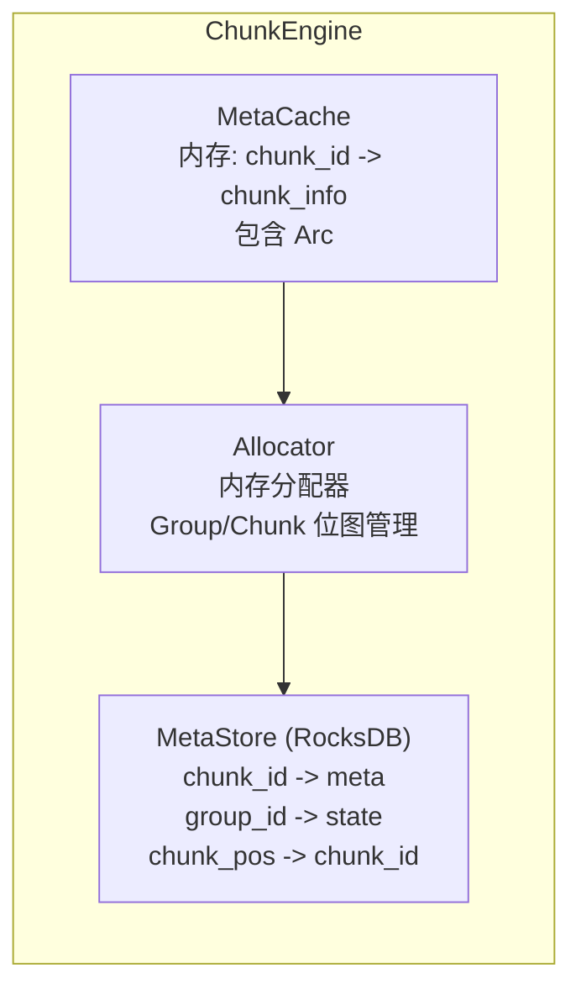

| 组件 | 职责 | 状态 |
| ---- | ---- | ---- |
| **Allocator** | 分配/回收 chunk 位置，纯内存操作 | 内存态，启动时从 RocksDB 加载 |
| **MetaStore** | 持久化分配/回收事件 | RocksDB，WriteBatch 保证原子性 |
| **MetaCache** | 内存缓存 chunk_id -> chunk_info | 内存态，含 `Arc<ChunkPos>` 引用计数 |

#### 7.3.2 存储层级

ChunkEngine 的存储层级与传统引擎不同（`src/storage/chunk_engine/README.md`）：

| 层级 | 说明 | 容量 |
| ---- | ---- | ---- |
| **Chunk** | 基本数据单元（64KB, 512KB, 4MB） | - |
| **Group** | 256 个 chunk 组成一个 group | 16MB / 128MB / 1GB（取决于 chunkSize） |
| **File** | 一个文件包含多个 group | ~120GB（512KB chunkSize 时约 960 个 group） |
| **Disk** | 每个磁盘 256 个文件/chunkSize | ~30TB |
| **Node** | 10-20 个磁盘 | ~1.2B chunks, ~5M groups |

**分配算法**（`src/storage/chunk_engine/README.md`）：

- 每个 group 用 **256-bit bitset**（4 个 uint64_t）跟踪 256 个 chunk 的分配状态
- 分配时用 `__builtin_ctz` 快速找到空闲位
- 维护三个内存结构：
  - `active_groups`：当前活跃的 group，分配优先从此处取
  - `allocated_groups`：已分配空间但无 chunk 的 group
  - `unallocated_groups`：未分配空间的 group

**后台线程**：
- `allocate_thread`：维持 `active_groups` 在目标大小范围内
- `compact_thread`：定期扫描 `active_groups`，迁移所有 chunk 后释放整个 group 的空间

#### 7.3.3 写入流程 - Copy-on-Write

ChunkEngine 的写入采用 **Copy-on-Write** 策略（`src/storage/chunk_engine/README.md`）：

```
1. 查询 MetaCache，获取当前 chunk_info
2. Allocator::allocate() 分配新 chunk 位置（纯内存）
3. 读旧 chunk 数据 -> 合并新写入 -> 写入新 chunk 位置
4. WriteBatch 原子提交：new_chunk_info + 旧位置释放记录 -> RocksDB
5. 更新 MetaCache
```

**崩溃安全**：步骤 3 中旧 chunk 不被修改，任何步骤失败旧数据完好。步骤 4 的 WriteBatch 保证原子性--新元数据和旧位置释放要么同时成功，要么同时失败。

**引用计数安全**：使用 `Arc<ChunkPos>` 管理所有权（`src/storage/chunk_engine/README.md`）：
- 分配返回 `Arc<ChunkPos>`，持久化失败时自动释放
- 读操作也持有 `Arc<ChunkPos>`，保证读期间 chunk 不会被回收

#### 7.3.4 C++/Rust 互操作

`ChunkEngine`（`src/storage/store/ChunkEngine.h`）是 C++ 侧的封装，通过 cxx FFI 调用 Rust。关键接口：

| C++ 接口 | Rust 接口 | 说明 |
| ---- | ---- | ---- |
| `aioPrepareRead()` | `engine.get_raw_chunk()` | 获取 chunk 的 fd + offset，供 AIO 读取 |
| `update()` | `engine.get_writing_chunk()` | 获取 WritingChunk 句柄，写入数据 |
| `commit()` | `engine.release_writing_chunk()` | 提交并释放 WritingChunk |
| `queryChunk()` | `engine.get_raw_chunk()` | 查询单个 chunk 元数据 |
| `queryChunks()` | `engine.query_raw_chunks()` | 范围查询 chunk 元数据 |
| `getAllMetadata()` | `engine.query_all_raw_chunks()` | 获取所有 chunk 元数据 |
| `removeAllChunks()` | `engine.raw_batch_remove()` | 批量删除 chunk |

`ChunkEngineUpdateJob` 管理 Rust 侧 `WritingChunk` 的生命周期，RAII 保证 `release_writing_chunk()` 在析构时调用。

#### 7.3.5 两个引擎的对比

| 维度 | ChunkStore (C++) | ChunkEngine (Rust) |
| ---- | ---- | ---- |
| 元数据存储 | LevelDB/RocksDB | RocksDB + 内存 MetaCache |
| 空间分配 | ChunkMetaStore 管理，RemovedKey 回收 | Allocator 内存分配，Group 位图 |
| 空间回收 | PunchHoleWorker punch hole | compact_thread 整组回收 |
| 写入策略 | 原地写（Direct IO / Buffered IO 选择） | Copy-on-Write（分配新位置，原子替换） |
| 文件布局 | 256 文件/chunkSize，256MB 增量增长 | 256 文件/chunkSize，Group 为单位管理 |
| fd 管理 | GlobalFileStore 双 fd 缓存 | Rust 侧直接管理 |
| 崩溃安全 | O_SYNC / Direct IO | CoW + WriteBatch 原子提交 |
| IO 对齐 | 不对齐走 Buffered IO | 不对齐走 read-modify-write |

#### 7.3.6 空间回收与 compact 机制

ChunkEngine 不使用 PunchHoleWorker 逐个打孔，而是通过自身的 `compact_groups` 机制进行**整组回收**：将碎片化的 Group 中所有有效 chunk 搬迁到其他 Group，然后释放整个 Group 的物理空间。这避免了稀疏空洞累积，代价是搬迁期间临时双倍空间占用。

**触发入口**：`AllocateWorker`（C++ 侧，`src/storage/worker/AllocateWorker.cc:36-57`）每 100ms 循环一次，对每个引擎依次调用：

```cpp
engine->allocate_groups(minRemainGroups, maxRemainGroups, 128);   // 预分配
engine->allocate_ultra_groups(minRemainUltraGroups, maxRemainUltraGroups, 32);
engine->compact_groups(maxReserved);  // 空间整理
```

其中 `maxReserved` 由配置项 `max_reserved_chunks` 控制（默认 `1_GB`，`AllocateWorker.h:21`）。

##### 1. Group 位图与分级

每个 Group 是一段连续的物理空间，内部划分为 256 个等长 chunk 槽位。Group 的占用状态由 `GroupState`（`src/storage/chunk_engine/src/types/group_state.rs`）管理：

```
GroupState {
    bits: [u64; 4],   // 256 位位图，每位对应一个 chunk 槽位
    count: u32,       // 已用槽位数
}
// 常量: TOTAL_BITS = 256, LEVELS = 4
// level() = count / 64，取值 0..=3
```

- **Level 0**：0-63 个 chunk 已用（最空）
- **Level 1**：64-127 个 chunk 已用
- **Level 2**：128-191 个 chunk 已用
- **Level 3**：192-255 个 chunk 已用（最满）

`allocate()` 分配时从 Level 3 向 Level 0 遍历（优先填满已有 Group）；`get_compact_task()` 回收时从 Level 0 向 Level 3 遍历（优先搬迁最空的 Group）。

##### 2. Group 状态机

`ChunkAllocator`（`src/storage/chunk_engine/src/alloc/chunk_allocator.rs`）将所有 Group 划分为以下集合：

| 集合 | 含义 | 说明 |
| ---- | ---- | ---- |
| `full_groups` | 已满 Group | 256 个槽位全占用，不可再分配 |
| `active_groups` + `active_levels[4]` | 活跃 Group | 有空闲槽位，按 level 分桶管理 |
| `frozen_groups` | 冻结 Group | 正在被 compact，禁止新分配但允许 deallocate |
| `group_allocator.allocated_groups` | 已释放 Group | 空间已释放，可复用 |
| `group_allocator.unallocated_groups` | 未分配 Group | 分配失败的 Group |

Group 的生命周期：

```
unallocated ──allocate──> active(level N)
                             │
                         allocate 填满
                             │
                             v
                           full
                             │
                        deallocate
                             │
                             v
                    active(level N-1) ◄──┐
                             │            │
                        compact 选中      │
                             │            │
                             v            │
                          frozen ─────────┼── move_chunk 全部搬走 ──> deallocate(空组释放)
                             │            │
                    finish_compact_task   │
                             │            │
                             v            │
                    active(level M) ──────┘
                    (回到活跃集合)
```

##### 3. compact 触发条件

要理解何时触发 compact，先要理解 `reserved_chunks` 这个指标的含义。

**`reserved_chunks` = 空闲槽位数 = 已分配的全部槽位 − 正在使用的槽位**

ChunkEngine 以 Group（256 个 chunk 槽位）为粒度向操作系统申请物理空间。AllocateWorker 会提前分配好若干 Group 放在池子里等待写入请求使用。一个 Group 一旦分配，256 个槽位就全部计入 `reserved_chunks`；每被写入请求消耗一个，`reserved_chunks` 减 1；每有 chunk 被删除，`reserved_chunks` 加 1（槽位归还回池子）。

问题在于：**删除是随机的，归还的槽位散落在各个 Group 中**。假设 10 个 Group 各有 200 个 chunk 被删除，`reserved_chunks` 高达 2000，但这些空闲槽位分散在 10 个 Group 里，每个 Group 只剩 56 个有效 chunk。这就是碎片化——空间总量不少，但无法整组释放。

compact 的作用就是**消除碎片**：把稀疏 Group 里的有效 chunk 搬到其他 Group，腾空后整组释放，`reserved_chunks` 直接减少 256。

**触发判断**（`chunk_allocator.rs:207-223`）：AllocateWorker 每次循环传入 `max_reserved`（默认 1GB，即 `1GB / chunkSize` 个 chunk），Allocator 检查当前 `reserved_chunks` 是否超过此阈值：

```rust
pub fn get_compact_task(&mut self, max_reserved: u64) -> Option<GroupId> {
    let reserved = self.counter.reserved_chunks();
    if reserved <= max_reserved {
        return None;  // 碎片浪费未超阈值，不需要整理
    }
    // 超过阈值：从最空的 Group（Level 0）开始搬迁
    for set in &mut self.active_levels {
        if let Some(&group_id) = set.iter().next() {
            set.remove(&group_id);
            let state = self.active_groups.remove(&group_id).unwrap();
            self.frozen_groups.insert(group_id, state);  // 冻结，禁止新分配
            return Some(group_id);
        }
    }
    None
}
```

选 Group 时从 Level 0（最空，0-63 个有效 chunk）开始，优先搬迁最稀疏的 Group，这样能用最少的搬迁量释放整组空间。

`reserved_chunks` 的变化由 `AllocatorCounter`（`allocator_counter.rs`）原子维护：

| 操作 | allocated_chunks | reserved_chunks | 含义 |
| ---- | ---- | ---- | ---- |
| `allocate_group()` | +256 | +256 | AllocateWorker 预分配一个新 Group |
| `allocate_chunk()` | 不变 | -1 | 写入请求消耗一个空闲槽位 |
| `deallocate_chunk()` | 不变 | +1 | chunk 被删除，槽位归还 |
| `deallocate_group()` | -256 | -256 | 整组释放（compact 搬空后） |

一句话总结：**`reserved_chunks` 衡量的是「分配了但没存数据」的 chunk 数，超过 1GB 就触发 compact 把碎片整理掉**。

##### 4. chunk 搬迁流程

对每个待 compact 的 Group，`compact_groups` 遍历该 Group 中所有 chunk，逐一调用 `move_chunk(chunk_id)`（`engine.rs:226-248`）：

```
move_chunk(chunk_id):
  1. get(chunk_id) → 获取 old_chunk 的 Arc 引用（保持引用计数，防止并发释放）
  2. old_chunk.copy_chunk() → 分配新位置并复制数据
     ├─ allocator.allocate(true) → 在其他活跃 Group 中分配新槽位
     ├─ 复制元数据（保留版本号，更新 pos，重置 etag）
     └─ pread 旧数据 + pwrite 到新位置（线程局部 buffer，对齐 IO）
  3. CAS 替换 meta_cache 中的条目
     ├─ if Arc::ptr_eq(cached, old_chunk):  // 期间无其他线程修改
     │   ├─ meta_store.move_chunk() → RocksDB WriteBatch 原子提交
     │   ├─ meta_cache.insert(new_chunk)
     │   └─ return Some(new_chunk)
     └─ else: return None  // chunk 已被其他线程更新或删除，跳过
```

**并发安全**：通过 `Arc::ptr_eq` 实现 CAS 语义。如果在 `move_chunk` 执行期间，该 chunk 被其他写入请求更新（新分配了位置）或删除，`meta_cache` 中的 `Arc` 指针会发生变化，`ptr_eq` 检查失败，本次搬迁静默跳过，不会产生数据不一致。

##### 5. RocksDB 原子提交

`meta_store.move_chunk()`（`meta_store.rs:193-248`）使用 WriteBatch 将以下操作原子提交：

1. **更新 chunk 元数据**：`chunk_meta_key(chunk_id)` → 新元数据（含新 pos）
2. **删除旧 pos 映射**：`pos_to_chunk_key(old_pos)` → delete
3. **释放旧 Group 位**：`group_bits_key(old_group)` → merge `MergeState::release(old_index)`
4. **添加新 pos 映射**：`pos_to_chunk_key(new_pos)` → put chunk_id
5. **占用新 Group 位**：`group_bits_key(new_group)` → merge `MergeState::acquire(new_index)`

其中步骤 3 会导致旧 Group 的 `reserved_chunks` 通过 `deallocate` 间接归还。当旧 Group 的最后一个 chunk 被搬走时，`deallocate()`（`chunk_allocator.rs:173-205`）检测到 `state.is_empty()`，调用 `group_allocator.deallocate(group_id)` 释放整组物理空间。

##### 6. finish_compact_task

搬迁完成后（无论成功或失败），`compact_groups` 调用 `finish_compact_task(group_id)`（`chunk_allocator.rs:225-233`）：

- 如果 `frozen_groups` 中该 Group 仍存在（仍有 chunk 未搬走）：移回 `active_groups` 和对应 `active_levels`
- 如果已不存在（所有 chunk 都已搬走，Group 已被 `deallocate` 释放）：仅记录日志

这保证 compact 过程中即使部分 chunk 搬迁失败，Group 也不会永远卡在 frozen 状态。

##### 7. 与 set_allow_to_allocate 的关系

`set_allow_to_allocate`（`engine.rs:167-169`）由 `CheckWorker` 在磁盘空间紧张时调用（`CheckWorker.cc:181`）：

- 磁盘使用率 >= `disk_reject_create_chunk_threshold`（默认 0.98）：`set_allow_to_allocate(false)`，禁止分配新 Group
- 恢复后：`set_allow_to_allocate(true)`

`allow_to_allocate` 只影响 `group_allocator.allocate()`（是否创建新 Group），**不影响 compact**。compact 的搬迁目标 Group 来自 `active_groups`（已有 Group），不需要分配新 Group。因此在磁盘满时 compact 仍然可以工作，将碎片整理到已有 Group 中。

### 7.4 ChunkMetadata - Chunk 元数据

ChunkMetadata（`src/fbs/storage/Common.h:652-677`）是每个 chunk 的完整元数据定义：

```cpp
struct ChunkMetadata {
    // ===== 版本号 =====
    ChunkVer commitVer;       // 提交版本号（全链确认后递增）
    ChunkVer updateVer;       // 写入版本号（每次写入递增）
    ChunkVer chainVer;        // Chain 拓扑版本号

    // ===== 数据描述 =====
    uint32_t size;            // chunk 数据大小
    ChunkState chunkState;    // COMMIT / DIRTY / CLEAN
    RecycleState recycleState;// NORMAL / REMOVAL_IN_PROGRESS / REMOVAL_IN_RETRYING
    ChecksumType checksumType;// NONE / CRC32C
    uint32_t checksumValue;   // CRC32C 校验值

    // ===== 物理位置（仅传统引擎使用）=====
    size_t innerOffset;       // 文件内偏移
    ChunkFileId innerFileId;  // {chunkSize, fileIdx}

    // ===== 追踪信息 =====
    uint16_t lastNodeId;      // 最后写入的节点
    RequestId lastRequestId;  // 最后写入的请求 ID
    Uuid lastClientUuid;      // 最后写入的客户端 UUID
    UtcTime timestamp;        // 最后更新时间
};
```

版本号字段（commitVer、updateVer、chainVer）的机制已在[第 5.3 节](#53-chunk-版本号机制)中详细说明，chunkState 的状态转换已在[第 2.4 节](#24-chunk--数据单元)中说明。

**RecycleState - 空间回收状态**：

| 状态 | 说明 | 代码位置 |
| ---- | ---- | ---- |
| `NORMAL` | 正常状态，chunk 可读写 | - |
| `REMOVAL_IN_PROGRESS` | chunk 正在被删除，空间回收进行中 | `ChunkMetaStore.cc:386-403` |
| `REMOVAL_IN_RETRYING` | 删除失败正在重试，chunk 数据已不可用但元数据仍在 | `ChunkStore.cc:107-110` |

`readyToRemove()` 方法（`Common.h:675`）判断 `recycleState != NORMAL` 时才允许真正删除 chunk，防止误删正在使用的 chunk。

**ChunkEngine 的元数据映射**：ChunkEngine 的 Rust 侧使用 `RawMeta` 结构，C++ 侧通过 `ChunkEngine::copyMeta()`（`ChunkEngine.h:14-28`）转换为 `ChunkMetadata`。注意 ChunkEngine 中 `commitVer` 和 `updateVer` 都映射自同一个 `chunk_ver` 字段，通过 `chunk_uncommitted` 标志区分是否已提交（`ChunkEngine.h:221-224`）：
- 已提交：`commitVer = updateVer = chunk_ver`，`chunkState = COMMIT`
- 未提交：`commitVer = chunk_ver - 1`，`updateVer = chunk_ver`，`chunkState = CLEAN`

---

## 8. 数据同步 (Resync)

### 8.1 同步场景

当新 Target 加入 CRAQ 链时，它没有任何数据，需要从前驱 Target 复制全部 chunk。完整流程：

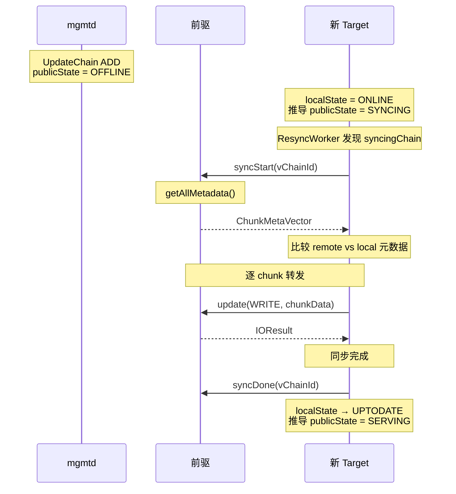

### 8.2 ResyncWorker — 后台同步引擎

```cpp
class ResyncWorker {
  CoroutinesPool<VersionedChainId> pool_;           // 同步任务协程池
  UpdateChannelAllocator updateChannelAllocator_;   // channel 分配器
  ConcurrencyLimiter batchConcurrencyLimiter_;      // 批量并发控制
  Shards<SyncingChainIds, 32> shards_;              // 同步状态分片（防重入）
};
```

**loop() 主循环**：

1. 每 500ms 从 `targetMap.snapshot()->syncingChains()` 获取需要同步的 Chain 列表
2. 随机打乱顺序，避免热点
3. 对每个 Chain 检查同步状态：`isSyncing == false` 且 `lastSyncingTime > 30s 前` 才启动同步（防重入 + 限流）
4. 提交到协程池执行 `handleSync()`

**handleSync() 核心逻辑**：

1. **syncStart**：向前驱 Target 发送 `syncStart` RPC，获取所有 chunk 元数据（`remoteMetas`）
2. **比较**：获取本地所有 chunk 元数据（`localMetas`），逐个比较
3. **生成写列表/删除列表**：
   - 远程有、本地无 → writeList（需要从前驱拉取）
   - 本地有、远程无 → removeList（本地多余的 chunk 需要删除）
   - 两边都有 → 比较版本号/checksum，决定是否需要更新
4. **批量执行**：先批量删除（removeList），再批量写入（writeList），每批 `batch_size`（默认 16）个
5. **syncDone**：向前驱发送 `syncDone` RPC，通知同步完成

**版本号比较规则**（`handleSync` 中的 remoteMeta vs localMeta）：

| 条件 | 动作 |
| ---- | ---- |
| `meta.chainVer > remoteMeta.chainVer` | 本地版本更高，跳过（remote chain version low） |
| `remoteMeta` 未提交 | 跳过（remote uncommitted） |
| `meta.chainVer < remoteMeta.chainVer` | 本地版本更低，**致命错误**，下线 successor |
| `meta.updateVer != remoteMeta.commitVer` 且 `meta.chainVer != vChainId.chainVer` | **致命错误**，commit version mismatch |
| `meta.checksum != remoteMeta.checksum` | checksum 不一致，**致命错误** |
| 以上均不满足 | 跳过（数据一致） |

**致命错误处理**：发现致命不一致时，主动向前驱发送 `offlineTarget(force=true)` 将 successor 下线，防止脏数据继续传播。

### 8.3 FullSync — 全量同步模式

配置 `full_sync_level` 控制全量同步策略：

| 级别 | 说明 |
| ---- | ---- |
| NONE | 不做全量同步，只比较版本号 |
| HEAVY | 所有 chunk 都重新写入，即使版本号/checksum 一致 |

`full_sync_chains` 配置可以指定哪些 Chain 做全量同步（为空则对所有 Chain 生效）。

---

## 9. TargetMap — 本地路由信息

Target 的核心属性（targetId、publicState、localState、isHead、isTail、successor 等）已在[第 2 章 Target](#23-target--复制副本)中说明，本章聚焦于 TargetMap 的更新机制。

### 9.1 AtomicallyTargetMap — 原子更新

`AtomicallyTargetMap` 使用 `compare_exchange_strong` 实现 CAS 更新，保证读操作永远不会看到半更新的状态：

```cpp
Result<Void> AtomicallyTargetMap::updateTargetMap(auto &&updateFunc) {
  auto lock = unique_lock(mutex_);
  auto map = snapshot();
  while (true) {
    auto newMap = map->clone();
    RETURN_AND_LOG_ON_ERROR(updateFunc(newMap));
    if (targetMap_.compare_exchange_strong(map, move(newMap))) {
      break;
    }
  }
  updateCallback_(*snapshot());
  return Void{};
};
```

**updateCallback**：每次 TargetMap 更新后触发回调，用于更新心跳 payload（向 mgmtd 报告 Target 状态变化）。

### 9.2 路由信息更新流程

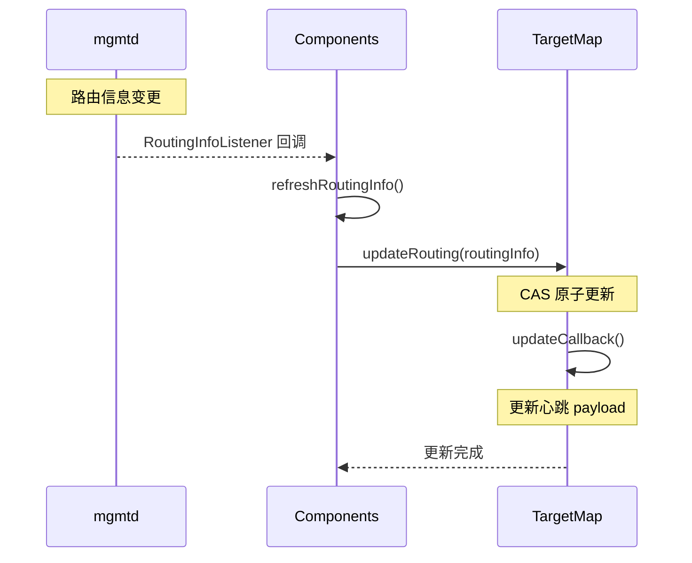

`updateRouting()` 的核心逻辑（`TargetMap::updateRouting`）：

1. 清除旧的 Chain 映射和同步链列表
2. 遍历新路由信息中的 Chain，找到本机拥有的 Target
3. 更新 Target 的 `vChainId`、`localState`、`publicState`
4. 查找 successor（Chain 中下一个 SERVING/SYNCING 的 Target）
5. 如果 successor 是 SYNCING 状态，加入 `syncingChains_`（触发 ResyncWorker）
6. 处理 LASTSRV → SERVING 状态转换：调用 `resetUncommitted()` 重置未提交的 chunk

### 9.3 Target 状态转换

#### 9.3.1 两套状态枚举

3FS 的 Target 同时维护**公共状态**（mgmtd 全局视角）和**本地状态**（storage 节点视角），两者协同决定 target 的实际行为。

**PublicTargetState**（`MgmtdTypes.h:10-19`，由 mgmtd 下发）：

| 状态 | 值 | 含义 |
| ---- | --- | --- |
| `INVALID` | 0 | 初始/无效 |
| `SERVING` | 1 | 正常提供服务，参与链复制 |
| `LASTSRV` | 2 | 链尾节点，即将退役，不再接收新写入 |
| `SYNCING` | 4 | 正在同步数据，还未达到一致状态 |
| `WAITING` | 8 | 等待中（尚未开始同步） |
| `OFFLINE` | 16 | 离线 |

**LocalTargetState**（`MgmtdTypes.h:21-28`，由本地根据 publicState 推导）：

| 状态 | 值 | 含义 |
| ---- | --- | --- |
| `INVALID` | 0 | 初始/无效 |
| `UPTODATE` | 1 | 数据最新，可正常读写 |
| `ONLINE` | 2 | 在线但数据未同步，不能正常服务 |
| `OFFLINE` | 4 | 离线，storageTarget 已释放 |

#### 9.3.2 状态转换规则

`updateLocalState()`（`TargetMap.cc:329-352`）在每次路由更新时，根据新的 publicState 推导 localState：

```cpp
// 规则 1: UPTODATE + (OFFLINE|LASTSRV|WAITING) -> OFFLINE
if (localState == UPTODATE &&
    (publicState == OFFLINE || publicState == LASTSRV || publicState == WAITING)) {
  return OFFLINE;  // 优雅关闭：数据已最新，但被通知下线
}
// 规则 2: ONLINE + SERVING -> UPTODATE
if (localState == ONLINE && publicState == SERVING) {
  return UPTODATE;  // 同步完成，正式上岗
}
return localState;  // 其他情况不变
```

完整的状态转换关系：

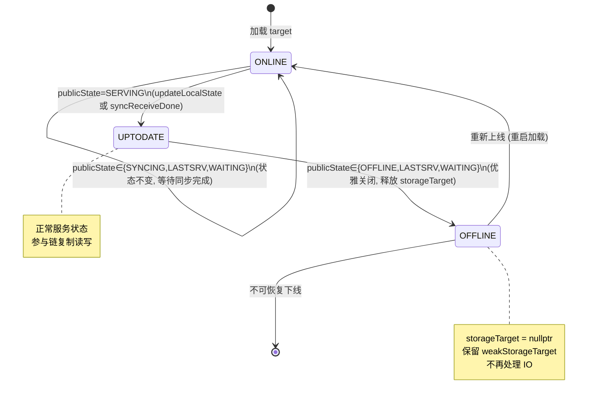

#### 9.3.3 状态转换的触发机制

状态转换不是单个操作直接完成的，而是由 mgmtd 的 **3 个独立后台任务** 协同驱动：

| 后台任务 | 运行间隔 | 配置项 | 职责 |
|---------|---------|--------|------|
| `MgmtdHeartbeatChecker` | 10s | `check_status_interval` | 检测心跳超时，强制改 localState |
| `MgmtdChainsUpdater` | 1s | `update_chains_interval` | 检测 target 状态变化，调用 `generateNewChain` |
| storage 心跳上报 | 由 storage 侧控制 | — | 上报 localState 给 mgmtd |

**关键前提**：mgmtd 侧的 localState **不是 mgmtd 自己计算的**，而是直接来自 storage 节点的心跳上报（`RoutingInfo.cc:70`：`base.localState = lti.localState`）。storage 节点通过自己的 `updateLocalState` 计算后上报，mgmtd 直接信任。唯一的例外是心跳超时时，mgmtd 会主动将 localState 改为 OFFLINE。

#### 9.3.4 关键转换场景与处理

**场景 1：新 target 上线（WAITING -> SYNCING -> SERVING）**

1. mgmtd 为链分配新 target，publicState = `WAITING`
2. 本地 localState 为 `ONLINE`（刚加载），`updateLocalState` 规则不匹配，保持 `ONLINE`
3. mgmtd 将 publicState 改为 `SYNCING`，predecessor 开始向该 target 同步数据
4. `updateRouting` 发现 successor 为 SYNCING，加入 `syncingChains_`（`TargetMap.cc:233`），触发 `ResyncWorker`
5. 同步完成后，predecessor 调用 `syncReceiveDone()`（`TargetMap.cc:111-122`），将 localState 设为 `UPTODATE`
6. mgmtd 将 publicState 改为 `SERVING`，target 正式参与服务

**场景 2：心跳断开触发退役（SERVING -> LASTSRV -> OFFLINE）**

不是心跳一断就变 LASTSRV，而是经过 3 个步骤：

**步骤 1：MgmtdHeartbeatChecker 检测超时，将 localState 改为 OFFLINE**

`MgmtdHeartbeatChecker`（`MgmtdHeartbeatChecker.cc`）每 10s 运行一次，检查所有非 OFFLINE 的 target 是否超过 `heartbeat_fail_interval`（默认 **60s**）未收到心跳：

```cpp
// MgmtdHeartbeatChecker.cc:49-50
if (ti.base().localState != OFFLINE && ti.ts() + heartbeatFailInterval < steadyNow) {
  candidateTargetIds.push_back(tid);
}
// line 67-70: 强制改为 OFFLINE
ri.updateTarget(tid, [steadyNow](auto &ti) {
  ti.base().localState = flat::LocalTargetState::OFFLINE;
  ti.updateTs(steadyNow);  // 更新时间戳，触发下一步
});
```

此时 mgmtd 侧：localState = OFFLINE，但 publicState 仍然是 SERVING（还没变）。

**步骤 2：MgmtdChainsUpdater 检测时间戳变化，调用 generateNewChain**

`MgmtdChainsUpdater`（`MgmtdChainsUpdater.cc`）每 1s 运行，检测 target 的 `ts()` 是否比上次检查时新：

```cpp
// MgmtdChainsUpdater.cc:25-27
for (const auto &[tid, ti] : ri.getTargets()) {
  if (ti.ts() > lastUpdateTs) {  // 时间戳有变化
    candidateChains.insert(ti.base().chainId);
  }
}
```

步骤 1 中 `ti.updateTs(steadyNow)` 更新了时间戳，所以 1s 内 `MgmtdChainsUpdater` 会检测到变化，对该 chain 调用 `generateNewChain`。

**步骤 3：generateNewChain 将 SERVING + OFFLINE 降级为 LASTSRV**

`generateNewChain`（`updateChain.cc:31-42`）发现 SERVING target 的 localState 是 OFFLINE：

```cpp
for (const auto &ti : oldTargetsByPs[PS::SERVING]) {
  if (ti.localState == LS::ONLINE || ti.localState == LS::UPTODATE) {
    dispatch(newTargetsByPs, ti, PS::SERVING, "");        // 存活，保持 SERVING
  } else if (newTargetsByPs[PS::LASTSRV].empty()) {
    dispatch(newTargetsByPs, ti, PS::LASTSRV, "first SERVING");  // 第一个离线 -> LASTSRV
  } else {
    dispatch(newTargetsByPs, ti, PS::OFFLINE, "following SERVINGs");  // 其余 -> OFFLINE
  }
}
```

此后：
- 如果链中仍有其他 SERVING target，LASTSRV 会被进一步转为 OFFLINE（`updateChain.cc:90-94`）
- 如果链中没有 SERVING 了，LASTSRV 保留，等待恢复
- 在 storage 侧，`updateLocalState` 规则 1 命中（`UPTODATE + LASTSRV -> OFFLINE`），释放 `storageTarget`

> 另有 `shutdownChain()`（`updateChain.cc:165-186`）用于集群级停机，将所有 SERVING 一次性转为 LASTSRV，由 `MgmtdStore::shutdownAllChains` 调用。

**场景 3：心跳恢复触发故障恢复（LASTSRV -> SERVING）-- resetUncommitted**

同样不是心跳一恢复就变 SERVING，而是经过 3 个步骤：

**步骤 1：storage 节点心跳恢复，上报 localState=ONLINE**

storage 节点恢复后重新连上 mgmtd，发心跳。此时 storage 侧的 localState 取决于 `updateLocalState` 的计算：

- storage 节点重启后重新加载 target，初始 localState = `ONLINE`
- 收到路由信息：publicState 是 LASTSRV
- `updateLocalState(ONLINE, LASTSRV)`：无规则匹配，保持 `ONLINE`（注意：如果是 `UPTODATE + LASTSRV` 会变成 OFFLINE，但重启后是 ONLINE 不是 UPTODATE）

storage 在心跳中上报 localState=ONLINE，mgmtd 在 `localUpdateTargets`（`RoutingInfo.cc:70`）中直接覆盖：

```cpp
// RoutingInfo.cc:63-70
ti.updateTs(steadyNow);                    // 更新时间戳，触发下一步
base.localState = lti.localState;          // 直接用上报值覆盖
```

**步骤 2：MgmtdChainsUpdater 检测时间戳变化，调用 generateNewChain**

与场景 2 步骤 2 相同，`ti.updateTs` 变化后 1s 内 `MgmtdChainsUpdater` 检测到，对该 chain 调用 `generateNewChain`。

**步骤 3：generateNewChain 将 LASTSRV + ONLINE 提升为 SERVING**

`generateNewChain`（`updateChain.cc:44-47`）发现 LASTSRV target 的 localState 是 ONLINE，且链中没有 SERVING：

```cpp
for (const auto &ti : oldTargetsByPs[PS::LASTSRV]) {
  if (newTargetsByPs[PS::SERVING].empty()) {  // 链中没有 SERVING 节点
    if (ti.localState == LS::ONLINE || ti.localState == LS::UPTODATE) {
      dispatch(newTargetsByPs, ti, PS::SERVING, "first LASTSRV");  // 自动提升
    } else {
      dispatch(newTargetsByPs, ti, PS::LASTSRV, "following LASTSRVs");  // 仍离线，保持
    }
  } else {
    dispatch(newTargetsByPs, ti, PS::OFFLINE, "Has SERVING");  // 有 SERVING 了，退役完成
  }
}
```

publicState 从 LASTSRV 变为 SERVING。storage 侧收到新路由信息后，`updateLocalState(ONLINE, SERVING)` -> 规则 2 命中 -> `UPTODATE`，target 恢复正常服务。

典型场景：链 `A -> B`（均 SERVING），A、B 所在节点同时故障（如机架断电）。60s 后 HeartbeatChecker 将两者的 localState 改为 OFFLINE，`generateNewChain` 将第一个 SERVING+OFFLINE 的 A 降级为 LASTSRV，B 变为 OFFLINE。之后 A 恢复上线，心跳上报 localState=ONLINE，`generateNewChain` 发现链中无 SERVING 且 A 的 LASTSRV 仍然存活，**自动将 A 从 LASTSRV 提升为 SERVING**，链恢复可用。

**步骤 4（storage 侧）：resetUncommitted 清理未提交 chunk**

在 storage 侧，`updateRouting` 末尾检测到该 target 之前是 LASTSRV、现在变为 SERVING/SYNCING/WAITING，且 `storageTarget` 仍然有效（`TargetMap.cc:272-279`），触发 `resetUncommitted()`：

```cpp
// updateRouting 末尾的兜底处理
for (auto &[targetId, target] : targets_) {
  if (lastSrvTargets.contains(targetId) && target.storageTarget &&
      (target.publicState == SERVING || target.publicState == SYNCING ||
       target.publicState == WAITING)) {
    target.storageTarget->resetUncommitted(target.vChainId.chainVer);
  }
}
```

**为什么需要 resetUncommitted？** 在 SYNCING 或 LASTSRV 期间，target 上可能残留**未提交的 chunk**：
- SYNCING 期间的写入使用 `isSyncing=true`，`commitVer = updateVer - 1`（见 5.3.3 节），chunk 停留在未提交状态
- LASTSRV 期间可能收到 predecessor 转发的写入，同样可能未提交

当 target 重新变为 SERVING 时，这些 chunk 必须被强制提交。`resetUncommitted()`（`ChunkStore.cc:179-214`）的逻辑：

```cpp
for (auto &chunkId : uncommitted) {
  CommitIO commitIO;
  commitIO.commitVer = chunkInfo.meta.updateVer;  // 提交到最新版本
  commitIO.isForce = true;                         // 强制提交，跳过版本检查
  commitIO.commitChainVer = chainVer;              // 使用新的 chain 版本
  ChunkReplica::commit(*this, updateJob);          // chunkState -> CLEAN
}
uncommitted.clear();
```

`isForce=true` 时（`ChunkReplica.cc:432-434`），直接将 `chunkState` 设为 `CLEAN`、`commitVer = updateVer`，跳过正常的版本连续性检查。

> **注意**：该处理仅在 `target.storageTarget != nullptr` 时生效。如果 target 之前已因 LASTSRV 触发 `UPTODATE -> OFFLINE`（storageTarget 已释放），则跳过。因此实际触发场景是：localState 仍为 `ONLINE`（如重启后重新加载的 target）从 LASTSRV 恢复。


**场景 4：磁盘错误下线**

`offlineTargets(path)`（`TargetMap.cc:305-314`）由 `CheckWorker` 在检测到磁盘不可写时调用，直接将对应磁盘上所有 target 的 localState 设为 `OFFLINE`，标记 `diskError = true`。这是不走 `updateLocalState` 的旁路下线路径。

**场景 5：手动下线**

`offlineTarget(targetId)`（`TargetMap.cc:294-303`）设置 `offlineUponUserRequest = true` 并将 localState 设为 OFFLINE，用于运维主动下线单个 target。

#### 9.3.5 状态转换的副作用汇总

| 转换 | 触发位置 | 副作用 |
| ---- | ---- | ---- |
| `-> OFFLINE` (localState) | `updateLocalState` / `offlineTargets` / `offlineTarget` | 释放 storageTarget，保留 weakStorageTarget |
| `SYNCING` 检测到 | `updateRouting:233` | 加入 syncingChains_，触发 ResyncWorker |
| 同步完成 | `syncReceiveDone:120` | localState -> UPTODATE |
| `LASTSRV -> SERVING/SYNCING/WAITING` | `updateRouting:272-279` | 调用 resetUncommitted() 强制提交未提交 chunk |
| isHead / isTail 变化 | `updateRouting:256-269` | 记录 WARNING 日志 |

---

## 10. 后台任务

### 10.1 任务总览

| 任务 | 间隔 | 说明 |
| ---- | ---- | ---- |
| ResyncWorker | 500ms (loop) | 发现 syncingChains，启动数据同步 |
| CheckWorker | 10s | 磁盘空间检查、紧急回收触发 |
| AllocateWorker | 后台循环 | chunk 预分配，保持空闲 chunk 池 |
| PunchHoleWorker | 后台循环 | 回收已删除 chunk 的空间 (fallocate FALLOC_FL_PUNCH_HOLE) |
| SyncMetaKvWorker | 1min | fsync 元数据 KV 存储，确保持久性 |
| DumpWorker | 1d | 诊断 dump：chunk 元数据、性能 profile |

### 10.2 CheckWorker - 磁盘与空间管理

CheckWorker 是一个**多职责后台任务**，主循环每 100ms 唤醒一次（`CheckWorker.cc:120`），但内部各子任务按不同间隔独立执行。它同时服务于 ChunkStore 和 ChunkEngine 两种引擎，部分操作引擎无关，部分有引擎专属逻辑。

#### 10.2.1 循环结构

```cpp
// CheckWorker.cc:118-276  主循环
while (!stopping_) {
  cond_.wait_for(lock, 100_ms, ...);  // 每 100ms 唤醒
  // 1. reload offline targets         -- 每次循环
  // 2. check disk status              -- 每 3s
  // 3. clean up expired clients       -- 每 60s
  // 4. update target used size        -- 每 update_target_size_interval (默认 10s)
  // 5. trigger heartbeat if need      -- 每 1s
  // 6. report chunk engine metrics    -- 每 1s
}
```

#### 10.2.2 各子任务详解

**任务 1：重新加载 OFFLINE target（每次循环）**

遍历所有 target，对于 `localState == OFFLINE` 且 `weakStorageTarget` 已过期（无引用）的 target，调用 `storageTargets.loadTarget()` 重新加载（`CheckWorker.cc:124-145`）。加载成功后触发 `refreshRoutingInfo()` 让 target 重新参与路由。

> **引擎归属**：引擎无关。通过 `StorageTarget` 抽象统一处理，`loadTarget` 内部根据 target 配置决定使用 ChunkStore 还是 ChunkEngine。

**任务 2：磁盘状态检查（每 3s，`CheckWorker.cc:147-185`）**

对每个磁盘执行：

1. `boost::filesystem::space()` 获取磁盘容量和可用空间，计算使用率
2. `checkWritable()` 写测试文件检测磁盘是否只读
3. 如果磁盘不可用（`space()` 失败或只读），调用 `offlineTargets(targetPath)` 将该磁盘上所有 target 设为 OFFLINE
4. 计算空间阈值标记：
   - `lowSpace`：使用率 >= `disk_low_space_threshold`（默认 0.96）
   - `rejectCreateChunk`：使用率 >= `disk_reject_create_chunk_threshold`（默认 0.98）
5. 通过 `targetMap.updateDiskState()` 将标记写入 target 信息

> **引擎归属**：**混合**。磁盘检查本身引擎无关，但空间不足时的处理方式不同：
> - **ChunkEngine**：调用 `engines()[i]->set_allow_to_allocate(!rejectCreateChunk)`（`CheckWorker.cc:181`），直接关闭 Rust 引擎的分配器开关，新 chunk 分配被拒绝
> - **ChunkStore**：仅设置 `rejectCreateChunk` 标记，由写入路径检查该标记决定是否拒绝

**任务 3：清理过期 client（每 60s，`CheckWorker.cc:187-197`）**

调用 `reliableUpdate.cleanUpExpiredClients()` 清理长时间无活动的 client 通道资源。

> **引擎归属**：引擎无关。操作的是 `ReliableUpdate` 的 client 通道管理器，不涉及存储引擎。

**任务 4：更新 target 使用量（每 `update_target_size_interval`，默认 10s，`CheckWorker.cc:199-233`）**

这是引擎差异最大的任务，分三步：

**步骤 a**：`targetMap.updateTargetUsedSize()` 触发心跳 payload 更新，将各 target 的 `usedSize()` 上报给 mgmtd。

**步骤 b**：遍历每个在线 target 执行：

| 操作 | ChunkStore | ChunkEngine |
|------|-----------|-------------|
| `reportUnrecycledSize()` | 上报未回收 chunk 大小到监控 | 上报未回收 chunk 大小到监控（通过 StorageTarget 分派） |
| `setEmergencyRecycling()` | **生效**：启用紧急回收模式，加速 PunchHoleWorker | **No-op**：`StorageTarget.h:135-141` 直接 return，ChunkEngine 无此机制 |
| `unusedSize()` | 返回 `unusedSize_`（未分配的预留空间） | 同左（引擎无关，返回 `unusedSize_`） |
| `useChunkEngine()` | false | true |

> 紧急回收的触发条件：磁盘使用率 >= `emergency_recycling_ratio`（默认 0.95）。**仅对 ChunkStore 生效**，ChunkEngine 依赖 `set_allow_to_allocate` 和自身的 `compact_groups` 机制管理空间。

**步骤 c**：收集每磁盘的 ChunkEngine 原始指标（`CheckWorker.cc:222-232`）：

```cpp
auto rawUsedSize = components_.storageTargets.engines()[i]->raw_used_size();
recorder.position_count.set(rawUsedSize.position_count);  // chunk 位置总数
recorder.position_rc.set(rawUsedSize.position_rc);        // Arc<ChunkPos> 引用计数
```

> **引擎归属**：**ChunkEngine 专属**。`raw_used_size()` 和 `position_count`/`position_rc` 是 Rust 引擎特有的指标，ChunkStore 不涉及。

**任务 5：触发心跳（每 1s，`CheckWorker.cc:235-239`）**

调用 `components_.triggerHeartbeatIfNeed()`，在 target 状态变化时主动触发心跳上报。

> **引擎归属**：引擎无关。

**任务 6：上报 ChunkEngine 指标（每 1s，`CheckWorker.cc:241-275`）**

从 `engines()[i]->get_metrics()` 获取 Rust 引擎的运行指标并上报到监控系统，包括：

| 指标类别 | 具体指标 |
|---------|---------|
| **Copy-on-Write** | `copy_on_write_times`（次数）、`copy_on_write_latency`（延迟）、`copy_on_write_read_times`（CoW 读次数）、`copy_on_write_read_bytes`（CoW 读字节）、`copy_on_write_read_latency`（CoW 读延迟） |
| **Checksum** | `checksum_reuse`（复用）、`checksum_combine`（合并）、`checksum_recalculate`（重算） |
| **Safe Write** | `direct_append`（直接追加）、`indirect_append`（间接追加）、`truncate_shorten`（截断缩短）、`truncate_extend`（截断扩展）、`read_tail_times`（读尾部次数）、`read_tail_bytes`（读尾字节） |
| **Allocate** | `allocate_times`（分配次数）、`allocate_latency`（分配延迟） |
| **Pwrite** | `pwrite_times`（写次数）、`pwrite_latency`（写延迟） |

> **引擎归属**：**ChunkEngine 专属**。整个任务 6 仅对 Rust 引擎生效，ChunkStore 不上报这些指标。

#### 10.2.3 引擎差异总结

| CheckWorker 操作 | ChunkStore | ChunkEngine |
|-----------------|-----------|-------------|
| 磁盘空间检查 | 引擎无关 | 引擎无关 |
| 磁盘不可用 -> offline | 引擎无关 | 引擎无关 |
| `set_allow_to_allocate()` | 不适用 | **生效**：控制 Rust 分配器开关 |
| `setEmergencyRecycling()` | **生效**：加速 PunchHoleWorker | **No-op** |
| `reportUnrecycledSize()` | 生效 | 生效（通过 StorageTarget 分派） |
| `raw_used_size()` / `position_count` | 不适用 | **ChunkEngine 专属** |
| CoW/Checksum/SafeWrite 指标 | 不适用 | **ChunkEngine 专属** |
| 重新加载 OFFLINE target | 引擎无关 | 引擎无关 |
| 清理过期 client | 引擎无关 | 引擎无关 |
| 触发心跳 | 引擎无关 | 引擎无关 |

**核心差异**：ChunkStore 的空间管理依赖 `setEmergencyRecycling` + PunchHoleWorker 的紧急回收模式；ChunkEngine 的空间管理依赖 `set_allow_to_allocate` 开关 + 自身的 `compact_groups` 整组回收机制，不经过 PunchHoleWorker。

#### 10.2.4 配置项

| 配置项 | 默认值 | 说明 |
|--------|--------|------|
| `update_target_size_interval` | 10s | target 使用量更新间隔（任务 4） |
| `emergency_recycling_ratio` | 0.95 | 紧急回收触发阈值（仅 ChunkStore） |
| `disk_low_space_threshold` | 0.96 | 低空间标记阈值 |
| `disk_reject_create_chunk_threshold` | 0.98 | 拒绝创建 chunk 阈值 |

> 磁盘状态检查间隔（3s）、client 清理间隔（60s）、指标上报间隔（1s）在代码中硬编码，不可配置。

### 10.3 AllocateWorker — Chunk 预分配与空间整理

**设计背景**：创建新 chunk 需要分配物理文件空间，如果等到写请求到来时才分配，会增加写延迟。AllocateWorker 提前分配好空闲 chunk，写请求到来时直接使用。

AllocateWorker 每 100ms 循环一次，对每个引擎执行三项操作（`AllocateWorker.cc:48-52`）：

```cpp
engine->allocate_groups(minRemainGroups, maxRemainGroups, 128);
engine->allocate_ultra_groups(minRemainUltraGroups, maxRemainUltraGroups, 32);
engine->compact_groups(maxReserved);
```

前两项是 ChunkEngine 专属的 Group 预分配（保持空闲 Group 池），第三项是空间整理（compact）。compact 的完整机制详见 [第 7.3.6 节](#736-空间回收与-compact-机制)。

配置项（`AllocateWorker.h:16-22`）：
- `min_remain_groups`（默认 4）/ `max_remain_groups`（默认 8）：保持的空闲 chunk 组数范围
- `min_remain_ultra_groups`（默认 0）/ `max_remain_ultra_groups`（默认 4）：大 chunk（>4MB）的空闲组数
- `max_reserved_chunks`（默认 1GB）：compact 触发阈值，当 `reserved_chunks` 超过此值时启动整组回收

### 10.4 PunchHoleWorker - 空间回收

PunchHoleWorker 负责**ChunkStore 引擎**的物理空间回收。对于 ChunkEngine，`StorageTarget::punchHole()` 直接返回 `true`（no-op），空间回收由 Rust 引擎自身的 `compact_groups` 机制处理。

#### 10.4.1 循环结构

```cpp
// PunchHoleWorker.cc:37-94
while (!stopping_) {
  if (allTargetsRecycled) {
    cond_.wait_for(lock, 1_s, ...);  // 全部回收完，等 1s
  }
  if (now - lastPunchHoleTime >= 10_s) {  // 每 10s 执行一轮
    // 遍历所有在线 target
    for (auto &weakTarget : targets) {
      for (auto i = 0u; i < 128u && !stopping_; ++i) {  // 每 target 最多 128 次迭代
        auto result = target->punchHole();
        if (*result) break;  // 全部打完，跳出
      }
    }
  }
}
```

- **外层间隔**：每 10s 执行一轮（`PunchHoleWorker.cc:50`）
- **内层循环**：每个 target 最多调用 128 次 `punchHole()`（`PunchHoleWorker.cc:75`），每次处理一个 batch（默认 16 个 chunk）
- **空闲休眠**：如果上一轮所有 target 都回收完毕（`allTargetsRecycled = true`），等待 1s 再检查

#### 10.4.2 物理空间回收管线

chunk 删除后的空间回收是一个**三阶段管线**，不是立即释放物理空间：

```
阶段 1: chunk 删除           阶段 2: 回收复用              阶段 3: 打洞释放
┌─────────────────┐      ┌───────────────────┐      ┌────────────────────┐
│ recycleState =  │      │ RemovedKey        │      │ RemovedKey         │
│ REMOVAL_INPROG  │ ──>  │ -> RecycledKey    │ ──>  │ 物理空间 fallocate │
│ + RemovedKey    │      │ (空间可复用)       │      │ (PUNCH_HOLE)       │
│ (带时间戳)       │      │                   │      │ + 删除 RemovedKey  │
└─────────────────┘      └───────────────────┘      └────────────────────┘
     立即                  1h 后或空间不足时           3d 后或紧急回收时
```

**阶段 1：chunk 删除（立即）**

chunk 被删除时，`ChunkReplica::removeChunk()` 将 `ChunkMetadata.recycleState` 设为 `REMOVAL_IN_PROGRESS`，同时在 LevelDB 中写入一条 `RemovedKey`（包含 chunkSize、文件位置、删除时间戳）。物理空间**不释放**。

**阶段 2：回收复用（`removed_chunk_force_recycled_time`，默认 1h 后，或新 chunk 分配时）**

`ChunkMetaStore::recycleRemovedChunks()`（`ChunkMetaStore.cc:935`）将 `RemovedKey` 转换为 `RecycledKey`，并将文件位置加入 `recycledChunks` 列表供新 chunk 复用。触发条件（`ChunkMetaStore.cc:928-932`）：

```cpp
const bool doRecycle =
    recycledAndHoleCount + config_.recycle_batch_size() <= removedCount ||  // 可复用空间不足
    (recycledAndHoleCount < removedCount &&
     state.oldestRemovedTimestamp + config_.removed_chunk_force_recycled_time() < now);  // 超过 1h
```

> 此阶段**不释放物理空间**，只是将位置标记为可复用。新 chunk 创建时优先使用 `recycledChunks`（见 7.2.2 节的分配优先级）。

**阶段 3：打洞释放（`removed_chunk_expiration_time`，默认 3d 后，或紧急回收时）**

这是 PunchHoleWorker 负责的阶段。`ChunkMetaStore::punchHole()`（`ChunkMetaStore.cc:537-561`）处理**未被复用的** `RemovedKey`：

```cpp
// ChunkMetaStore.cc:539-542
auto expirationUs = now - config_.removed_chunk_expiration_time().asUs();  // 默认 3 天前
if (emergencyRecycling_) {
  expirationUs = now;  // 紧急回收：立即过期，不等 3 天
}
```

对每个 chunkSize，检查最老的 `RemovedKey` 时间戳是否超过过期时间。如果超过，调用 `punchHoleRemovedChunks()` 执行实际打洞：

```cpp
// ChunkMetaStore.cc:1009-1053  punchHoleRemovedChunks
for (each RemovedKey with timestamp < expirationUs) {
  batchOp->remove(key);                    // 从 LevelDB 删除 RemovedKey
  fileStore_.punchHole(fileId, offset);    // 物理打洞
  ++punchHoleCount;
  if (punchHoleCount >= punch_hole_batch_size) break;  // 每 batch 最多 16 个
}
state.holeCount += punchHoleCount;  // 记录已打洞数量
```

最终的系统调用在 `ChunkFileStore::punchHole()`（`ChunkFileStore.cc:74`）：

```cpp
::fallocate(innerFile.direct_, FALLOC_FL_PUNCH_HOLE | FALLOC_FL_KEEP_SIZE, offset, fileId.chunkSize);
```

#### 10.4.3 引擎归属

| 操作 | ChunkStore | ChunkEngine |
|------|-----------|-------------|
| PunchHoleWorker 调用 `target->punchHole()` | 执行实际回收 | **返回 true（no-op）** |
| `fallocate(PUNCH_HOLE)` | 由 PunchHoleWorker 执行 | 不适用 |
| 空间回收机制 | RemovedKey 3 阶段管线 + 紧急回收 | Rust 引擎 `compact_groups` 整组回收 |
| 紧急回收触发 | `setEmergencyRecycling(true)` 跳过 3d 延迟 | `set_allow_to_allocate(false)` 关闭分配器 |

> ChunkEngine 不需要 PunchHoleWorker，因为它的空间回收由 Rust 侧的 `compact_thread` 通过 `compact_groups()` 整组复制回收，不产生稀疏空洞（见 7.3 节）。

#### 10.4.4 配置项

| 配置项 | 默认值 | 作用 |
|--------|--------|------|
| `removed_chunk_expiration_time` | 3 天 | RemovedKey 打洞前的等待时间（阶段 3） |
| `removed_chunk_force_recycled_time` | 1 小时 | RemovedKey 强制回收复用的等待时间（阶段 2） |
| `punch_hole_batch_size` | 16 | 每次 `punchHole()` 调用最多打洞的 chunk 数 |
| `recycle_batch_size` | 256 | 每次 `recycleRemovedChunks()` 回收的 chunk 数 |

> 紧急回收（`emergencyRecycling_`）由 CheckWorker 在磁盘使用率 >= `emergency_recycling_ratio`（默认 0.95）时通过 `setEmergencyRecycling(true)` 开启，跳过 3 天等待立即打洞。仅对 ChunkStore 生效。

---

## 11. UpdateWorker — 写入执行引擎

### 11.1 架构

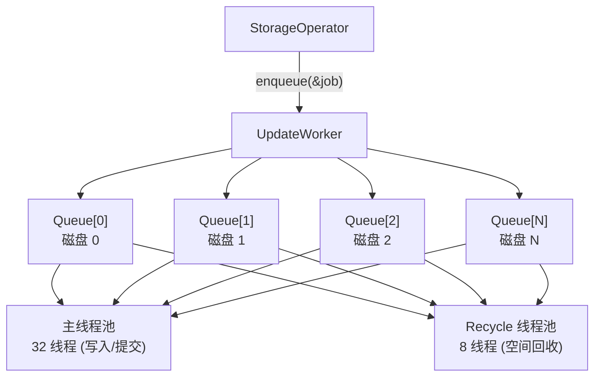

**按磁盘分队列**：每个磁盘一个 `BoundedQueue`（默认容量 4096），写请求按 `target->diskIndex()` 路由到对应队列。这保证了：

1. 同一磁盘上的写操作串行化，避免磁盘寻道抖动
2. 不同磁盘上的写操作完全并行
3. 一个磁盘慢不会阻塞其他磁盘

**两个线程池**：
- 主线程池（32 线程）：执行 chunk 写入/提交
- 后台线程池（8 线程）：执行空间回收等后台任务

### 11.2 UpdateJob — 写入任务

```cpp
class UpdateJob {
  ServiceRequestContext &requestCtx_;
  UpdateType type_;              // WRITE / REMOVE / TRUNCATE / EXTEND / COMMIT
  ChunkId chunkId_;
  shared_ptr<StorageTarget> target_;
  UpdateIO updateIO_;            // 写入 IO 描述
  CommitIO commitIO_;            // 提交 IO 描述
  ChunkEngineUpdateJob &chunkEngineJob_;  // Rust 引擎的写入句柄
  UpdateOptions options_;
  IOResult result_;              // 执行结果
  folly::coro::Baton baton_;     // 完成通知
};
```

`UpdateJob` 通过 `Baton` 实现异步等待：调用方 `co_await job.complete()` 挂起，UpdateWorker 执行完写入后 `job.setResult()` 唤醒调用方。

---

## 12. ChunkId 与数据布局

ChunkId 的核心概念和格式已在[第 2 章 ChunkId](#25-chunkid--数据寻址键)中说明，此处补充代码定义和 Chunk 大小的细节。

### 12.1 ChunkId 代码定义

```cpp
class ChunkId {
  string data_;  // 变长字节串，通常 128 bit (16 bytes)
  // 特殊构造：
  ChunkId(uint64_t high, uint64_t low);           // 从两个 64-bit 整数构造
  ChunkId(const ChunkId &baseChunkId, uint64_t chunkIndex);  // base + index
};
```

### 12.2 Chunk 大小

系统支持多种 chunk 大小：`512KB, 1MB, 2MB, 4MB, 16MB, 64MB`。同一文件的 chunk 大小固定（在创建时确定），不同文件可以使用不同 chunk 大小。

---

## 13. 并发控制

### 13.1 锁层次

| 锁 | 粒度 | 保护对象 | 类型 |
| -- | ---- | -------- | ---- |
| `AtomicallyTargetMap::mutex_` | 全局 | TargetMap 的 CAS 更新 | `std::mutex` |
| `StorageTarget::chunkLocks_` | 单 chunk | 同一 chunk 的并发写 | `CoLockManager` |
| `StorageTarget::channelLocks_` | 单 channel | 同一 channel 的并发更新 | `CoLockManager` |
| `ChunkStore::maps_[shard]` | 分片 | chunk 元数据并发访问 | `ConcurrentHashMap` |
| `ReliableUpdate::shards_` | 分片 | 客户端状态并发访问 | `Shards` (1024) |
| `UpdateWorker::queueVec_[disk]` | 单磁盘 | 磁盘写入串行化 | `BoundedQueue` |

### 13.2 Chunk 锁与 Channel 锁的协作

写操作需要同时获取 chunk 锁和 channel 锁，获取顺序固定：

1. **channel 锁**（`ReliableUpdate` 中 `tryLockChannel`）：非阻塞，失败立即返回 `kChannelIsLocked`，客户端重试
2. **chunk 锁**（`handleUpdate` 中 `lockChunk`）：阻塞等待，保证同一 chunk 不会并发写入

Channel 锁用 `tryLock` 而非阻塞等待，因为 channel 冲突意味着客户端的请求序号有问题，快速失败让客户端重试比阻塞等待更高效。

---

## 14. 关键配置项汇总

| 配置项 | 默认值 | 所属模块 | 说明 |
| ---- | ---- | ---- | ---- |
| `num_threads` (UpdateWorker) | 32 | 写入 | Update 线程池大小 |
| `bg_num_threads` (UpdateWorker) | 8 | 写入 | Recycle 线程池大小 |
| `queue_size` (UpdateWorker) | 4096 | 写入 | 每磁盘写入队列容量 |
| `num_threads` (AioReadWorker) | 32 | 读取 | AIO 线程池大小 |
| `ioengine` | libaio | 读取 | IO 引擎：libaio / io_uring / random |
| `max_concurrent_rdma_writes` | 256 | RDMA | 每设备并发 RDMA write 上限 |
| `max_concurrent_rdma_reads` | 256 | RDMA | 每设备并发 RDMA read 上限 |
| `read_only` | false | 写入 | 是否只读模式 |
| `retry_first_wait` (ReliableForwarding) | 100ms | 转发 | 重试初始等待时间 |
| `retry_max_wait` (ReliableForwarding) | 1s | 转发 | 重试最大等待时间 |
| `retry_total_time` (ReliableForwarding) | 60s | 转发 | 重试总超时 |
| `num_threads` (ResyncWorker) | 16 | 同步 | 同步线程池大小 |
| `batch_size` (ResyncWorker) | 16 | 同步 | 同步批量大小 |
| `full_sync_level` | NONE | 同步 | 全量同步级别 |
| `update_target_size_interval` (CheckWorker) | 10s | 检查 | 空间检查间隔 |
| `emergency_recycling_ratio` | 0.95 | 检查 | 触发紧急回收的使用率 |
| `disk_low_space_threshold` | 0.96 | 检查 | 标记 lowSpace 的使用率 |
| `disk_reject_create_chunk_threshold` | 0.98 | 检查 | 拒绝创建 chunk 的使用率 |
| `sync_meta_kv_interval` | 1min | 元数据 | fsync 间隔 |
| `clean_up_expired_clients` | false | ReliableUpdate | 是否清理过期客户端缓存 |
| `expired_clients_timeout` | 1h | ReliableUpdate | 客户端缓存过期时间 |
| `speed_up_quit` | true | 生命周期 | 加速退出（跳过某些清理） |

---

## 15. 关键源码文件索引

| 文件 | 说明 |
| ---- | ---- |
| **服务入口** | |
| `src/storage/storage.cpp` | 进程入口 main() |
| `src/storage/service/StorageServer.h/.cc` | 服务定义，继承 net::Server |
| **核心组件** | |
| `src/storage/service/Components.h/.cc` | 组件容器，启动/停止顺序，mgmtd 交互 |
| `src/storage/service/StorageService.h/.cc` | RPC 层，13 个方法委托 StorageOperator |
| `src/storage/service/StorageOperator.h/.cc` | 操作核心：读写/更新/同步/管理 |
| `src/storage/service/TargetMap.h/.cc` | 本地路由信息，Target 状态管理 |
| **可靠更新** | |
| `src/storage/service/ReliableUpdate.h/.cc` | 写请求去重 + 结果缓存 |
| `src/storage/service/ReliableForwarding.h/.cc` | 链式转发 + 指数退避重试 |
| **存储层** | |
| `src/storage/store/StorageTarget.h/.cc` | Target 存储抽象，双引擎支持 |
| `src/storage/store/StorageTargets.h/.cc` | 所有 Target 的加载/创建管理 |
| `src/storage/store/ChunkStore.h/.cc` | 传统存储引擎 |
| `src/storage/store/ChunkEngine.h/.cc` | Rust 新引擎的 C++ 封装 |
| `src/storage/store/ChunkFileStore.h/.cc` | 物理数据文件管理 |
| `src/storage/store/ChunkMetaStore.h/.cc` | 元数据 KV 存储 (LevelDB/RocksDB) |
| `src/storage/store/ChunkMetadata.h` | Chunk 元数据结构 |
| `src/storage/store/GlobalFileStore.h/.cc` | 全局文件描述符缓存 |
| `src/storage/store/PhysicalConfig.h` | Target 物理配置 |
| **IO 引擎** | |
| `src/storage/aio/AioReadWorker.h/.cc` | 异步读引擎 (libaio/io_uring) |
| `src/storage/aio/BatchReadJob.h/.cc` | 批量读任务 |
| `src/storage/update/UpdateWorker.h/.cc` | 写入执行引擎（每磁盘独立队列） |
| `src/storage/update/UpdateJob.h` | 写入任务定义 |
| **数据同步** | |
| `src/storage/sync/ResyncWorker.h/.cc` | 后台数据同步引擎 |
| **后台任务** | |
| `src/storage/worker/CheckWorker.h/.cc` | 磁盘空间检查 |
| `src/storage/worker/AllocateWorker.h/.cc` | chunk 预分配 |
| `src/storage/worker/PunchHoleWorker.h/.cc` | 空间回收 (punch hole) |
| `src/storage/worker/SyncMetaKvWorker.h/.cc` | 元数据 fsync |
| `src/storage/worker/DumpWorker.h/.cc` | 诊断 dump |
| **FlatBuffers 类型** | |
| `src/fbs/storage/Common.h` | 所有 RPC 请求/响应类型、ChunkId、UpdateIO、ChunkMetadata 等 |
| `src/fbs/storage/Service.h` | RPC 服务定义 (StorageSerde) |
